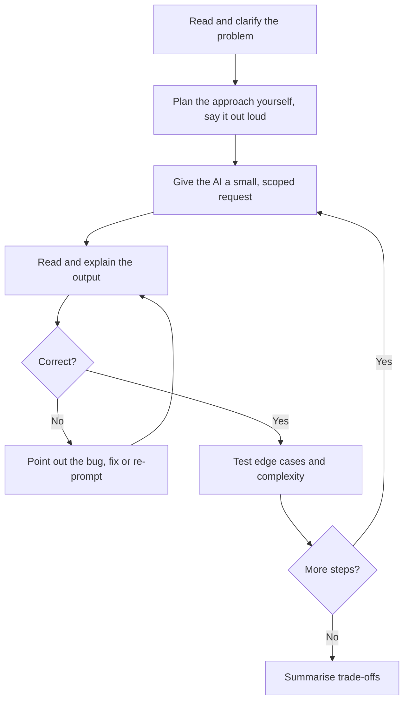
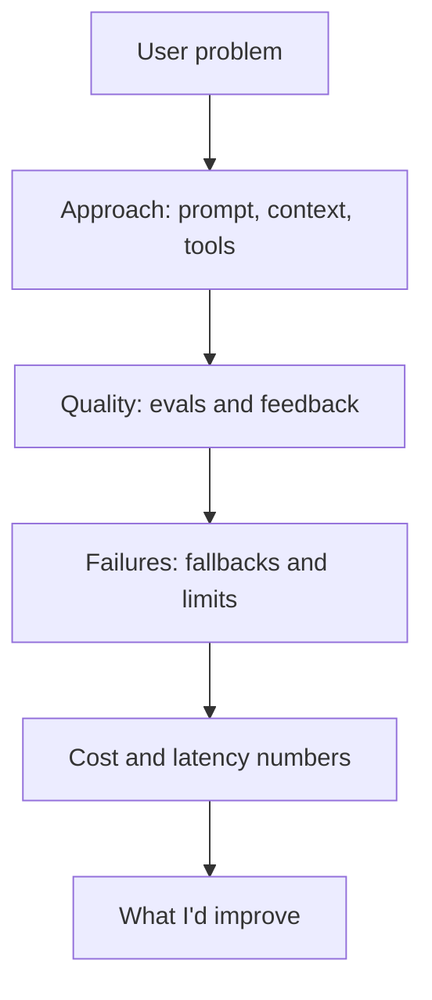
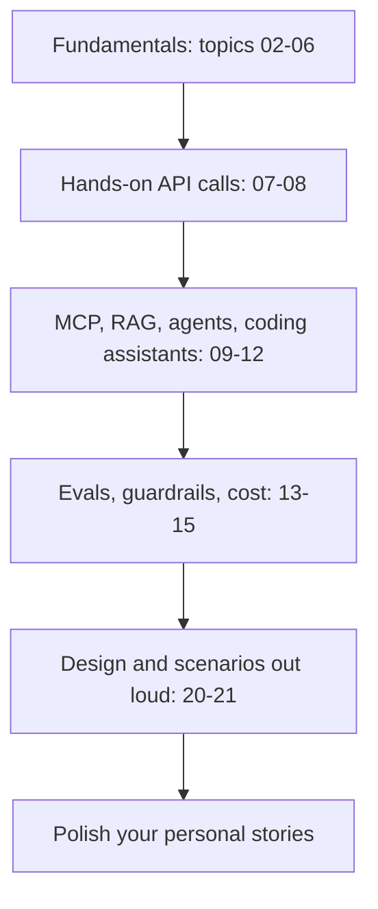

# AI in Software Engineering Interviews

[⬅ Back to index](../README.md)

Covers: why software engineering interviews now include AI questions, the kinds of questions asked, answering "how do you use AI?", AI-allowed coding rounds, what AI knowledge a software engineer is expected to have (and what isn't expected), talking about AI features you've built, opinion questions, common mistakes, and a preparation plan.

---

### 1. Why do software engineering interviews now ask about AI?

Answer

**In short:** AI has changed day-to-day engineering. Most teams use AI coding assistants and many products now ship AI features, so interviewers want to know whether you can use AI tools responsibly, build on top of LLM APIs, and reason about the risks: hallucinations, security, privacy and cost.

#### What changed

Two things happened at the same time:

1. **The way code gets written changed.** AI coding assistants (chat assistants, IDE autocomplete, coding agents that edit files and run commands) are now normal in most teams. A company hiring you wants to know you'll use them to move faster *without* lowering quality, and without leaking confidential code.
2. **The products changed.** Many apps now include AI features: chat assistants, smart search, summaries, recommendations, support bots, "write this for me" buttons. These features are usually built by ordinary product engineers calling an LLM API, not by an ML research team.

So the interviewer is asking AI questions for the same reason they ask about concurrency or networking: it's part of the job now.

#### What they are trying to find out

| Area | What a good candidate shows |
|---|---|
| Using AI tools | You delegate sensible tasks, give good context, and verify everything before it ships |
| Understanding LLMs | You know what models are good and bad at, and why outputs vary |
| Building AI features | You can call an LLM API safely from an app (backend proxy, streaming, errors, cost) |
| Risk | You think about hallucinations, prompt injection, user data and spend |

#### Who gets asked

This is expected of Android, iOS, backend, frontend and full-stack engineers, not just "AI engineers". The depth is practical: you need to know how to work with models and build on them, not machine-learning maths or how models are trained.

**Likely follow-ups:**
- *"Does your current team use AI tools?"*: describe what tools, for what, and what rules exist (e.g. approved tools only, no customer data in prompts).
- *"Have you built anything with an LLM API?"*: see question 6 for how to answer either way.

### 2. What kinds of AI questions do software engineers get asked?

Answer

**In short:** Questions fall into a handful of buckets: how you personally use AI, LLM fundamentals, prompting and context, building AI features, quality and risk (testing, security, privacy, cost), AI system design, and opinion questions about where engineering is going.

#### The buckets

| Bucket | Example questions | Where to study |
|---|---|---|
| **Your AI usage** | "How do you use AI in your work?", "How do you make sure AI-generated code is correct?" | [AI Fluency](03-ai-fluency.md), [AI Coding Assistants](12-ai-coding-assistants.md) |
| **Fundamentals** | Tokens, context windows, temperature, hallucinations, why outputs vary | [AI Capabilities & Limitations](02-how-llms-work.md) |
| **Prompting and context** | "How would you get reliable output from a model?" | [Prompt Engineering](04-prompt-engineering.md), [Context Engineering](05-context-engineering.md) |
| **Building AI features** | Calling an LLM API from your app, streaming, tool use, RAG, structured outputs | [Building With LLM APIs](07-building-with-llm-apis.md), [Tool Use](08-tool-use.md), [RAG](10-rag-search.md) |
| **Quality and risk** | "How would you test an AI feature?", "How do you prevent prompt injection?", "How do you control cost?" | [Evals](13-evals.md), [Guardrails](14-guardrails-safety.md), [Cost & Latency](15-efficiency-cost-latency.md) |
| **Design** | "Add an AI assistant to our app" as a system design or product question | [AI System Design](20-ai-system-design.md) |
| **Opinion** | "How is AI changing software engineering?" | Question 7 below |

#### How they show up in a loop

- **Behavioural / hiring-manager rounds** lean on "your AI usage" and opinion questions. They are checking judgement and ownership.
- **Technical screens** pick a few fundamentals ("why does the same prompt give different answers?") to check you aren't just using buzzwords.
- **System design rounds** may have an AI component: an assistant, a summariser, semantic search. The usual design skills apply, plus AI-specific concerns like evals, guardrails and token cost.
- **Coding rounds** may allow an AI assistant (see question 4).

**Tip:** for each bucket, have one concrete example from your own work ready. Real examples beat definitions in every bucket.

### 3. How should you answer "How do you use AI in your day-to-day work?"

Answer

**In short:** Be concrete and show judgement. Say what you delegate to AI, how you describe the task, how you check the results, where you deliberately don't use it, and one real outcome. Avoid both "I don't use AI" and "AI writes all my code".

#### Why this question is asked

It sounds casual, but it tests three things at once: whether you're keeping up with how engineering is done now, whether you have good judgement about when AI helps and when it doesn't, and whether you still *own* the code you ship.

#### A structure that works

A good structure follows the AI Fluency 4Ds (Delegation, Description, Discernment, Diligence; see [AI Fluency](03-ai-fluency.md)):

1. **What you delegate (Delegation).** E.g. "boilerplate, unit tests, exploring an unfamiliar codebase, first drafts of docs, debugging from stack traces, one-off scripts."
2. **How you describe tasks (Description).** Give context and constraints, point at existing code to copy patterns from, keep a project instruction file (conventions, build commands), and ask for a plan first on bigger changes.
3. **How you check results (Discernment).** Run the tests, read every diff, check unfamiliar APIs against the official docs, and watch for invented functions or outdated patterns.
4. **Where you don't use it, and why (Diligence).** Security-sensitive code without careful review, confidential or customer data in tools that aren't approved, decisions you must own (architecture choices, anything you can't explain).
5. **An outcome.** A number or before/after: "cut the time to add a new screen from two days to one, with test coverage going up."

#### Example answer (about 60 seconds spoken)

> "I use a coding agent daily, mostly for well-defined tasks: writing tests for existing code, migrations, and getting oriented in parts of the codebase I don't know. For anything bigger than a small change I ask it for a plan first and correct the plan before it writes code. We keep an instructions file in the repo with our architecture rules and test commands, so its output matches our conventions. I review every diff like a teammate's PR and I don't merge anything I couldn't explain. I don't paste production data or secrets into it, and I'm extra careful with auth and payment code. The biggest win has been tests: our coverage on the feature I own went from about 40% to 70% in a sprint without slowing feature work."

#### Pitfalls

- **"I don't use AI."** Sounds out of date, unless you explain a real reason (e.g. company policy) and show you understand the tools anyway.
- **"AI writes all my code."** Sounds like you don't own the result.
- **Only listing tools.** Naming three products says nothing about judgement; describe the workflow.
- **No verification.** Interviewers listen specifically for how you check output.

**Likely follow-ups:**
- *"Tell me about a time AI gave you wrong code."*: have a real story: what was wrong, how you caught it (test failed, docs didn't match), what you changed in your workflow.
- *"How do you stop it from leaking company code?"*: use company-approved tools and accounts, follow data policies, keep secrets out of prompts.

### 4. What happens in an AI-allowed coding interview, and how should you behave?

Answer

**In short:** Some companies now allow, or even provide, an AI assistant in coding rounds, while others ban it, so ask the recruiter beforehand and never use AI where it isn't allowed. When it is allowed, you're judged on how you *work with* the AI: you plan, you direct it with scoped requests, you read and explain every line, you test, and you stay in control.

#### Why companies run these rounds

If engineers use AI on the job, a coding round without it tests a slightly artificial skill. AI-allowed rounds try to measure the real one: can you break down a problem, direct a tool, and catch its mistakes? The problem is often bigger or more realistic than a classic algorithm puzzle (e.g. extend an existing small codebase), because the AI makes the typing cheap.

#### The rules first

- **Ask the recruiter** whether AI is allowed, which tools, and whether you use your own setup or theirs.
- **Never use AI where it isn't allowed.** Getting caught ends the process, and companies do look for it.

#### How to behave when it is allowed

- **Understand and plan the problem yourself first.** Explain your approach before touching the tool. This shows the thinking is yours.
- **Give clear, scoped requests**, not the whole problem pasted in. "Write a function that merges overlapping intervals; input is sorted by start" is better than the full prompt text.
- **Read and explain every line** it produces. Catch its mistakes out loud ("this misses the empty-list case"). Catching a bug the AI made is a *positive* signal.
- **Test the code** with edge cases and check complexity; fix issues yourself when that's quicker than re-prompting.
- **Stay in control.** You should be able to continue if the tool disappeared.

#### Pitfalls

- Accepting a large block of code silently and moving on.
- Re-prompting in a loop ("try again") instead of diagnosing the bug.
- Going quiet while the AI works; interviewers can only score what they hear.
- Practising only without AI, then fumbling the tool on the day. Rehearse with the kind of tool you'll be given.

**Likely follow-up:** *"Why did you write that part yourself instead of asking the AI?"*: a fine answer is "it was faster to write five lines than to explain them" or "this logic is the core of the problem and I wanted to be sure of it."

### 5. What AI knowledge is a software engineer expected to have – and not expected to have?

Answer

**In short:** You're expected to understand how LLMs behave, how to prompt and give context, how to build features on an LLM API safely, tool use, RAG, agents and MCP at a conceptual level, how to use and review AI coding assistants, and how to test and guard AI features. You're not expected to know how to train models, transformer maths or statistics, unless the role is ML-specific.

#### Expected

| Area | What "knowing it" means in practice | Topic |
|---|---|---|
| How LLMs behave | Tokens, context windows, sampling/temperature, hallucinations, knowledge cutoff, statelessness (the model only knows what's in the current request) | [02](02-how-llms-work.md) |
| Prompting and context | Writing clear instructions, giving examples, choosing what goes into the context window | [04](04-prompt-engineering.md), [05](05-context-engineering.md) |
| Structured outputs | Getting JSON that matches a schema, and validating it | [06](06-structured-outputs.md) |
| Calling an LLM API from an app | Keep the API key on a backend proxy, stream responses, handle errors, timeouts and rate limits, track cost | [07](07-building-with-llm-apis.md) |
| Tool use, RAG, agents, MCP | What each is, when you'd use it, and when it's overkill | [08](08-tool-use.md)–[11](11-agents-workflows.md) |
| AI coding assistants | Using them well and reviewing their output | [12](12-ai-coding-assistants.md) |
| Quality and safety | Evals (test sets for AI output), guardrails, prompt injection, privacy basics | [13](13-evals.md), [14](14-guardrails-safety.md) |

The common thread: you treat the model as a **powerful but unreliable dependency**. You know its behaviour well enough to design around it, the same way you'd design around a flaky network.

#### Not expected (unless the role is ML-specific)

- Training or fine-tuning models from scratch, backpropagation.
- Transformer and attention maths.
- Statistics and probability theory.
- GPU optimisation and model serving internals.

If you get one of these and it's not your area, it's fine to say so and bring it back to what you'd do as an engineer: "I haven't trained models, but as the consumer of one I'd measure whether it's good enough with an eval set."

#### Pitfall

Don't over-correct by dropping jargon you can't explain. "Embeddings" or "temperature" are fine to mention, but expect the follow-up "what is that?" and have a one-sentence plain-English answer.

### 6. How do you talk about an AI feature you built (or haven't built yet)?

Answer

**In short:** If you've built one, walk through the user problem, your approach (prompt, context/RAG, tools), how you tested quality, how you handled failures, cost and latency numbers, and what you'd improve. If you haven't, build a small one before interviews: describing real problems you hit is far more convincing than theory.

#### If you've built one: a story structure

1. **User problem.** What were users trying to do, and why AI? ("Support agents spent 5 minutes reading long ticket threads before replying.")
2. **Approach.** Which model, what goes in the prompt, where context comes from (RAG over docs, the user's data, tool calls), and whether output is free text or structured JSON.
3. **Quality.** How you knew it was good: an eval set of real examples, human review, thumbs up/down feedback, and what score you reached.
4. **Failure handling.** What happens on hallucinations, refusals, timeouts, rate limits, or bad JSON. E.g. "we validate the JSON and retry once, then fall back to the non-AI view."
5. **Cost and latency.** Rough numbers: tokens per request, cost per user per month, time to first token, and what you did about them (caching, a smaller model for simple cases, streaming).
6. **What you'd improve.** Shows you can be critical of your own work.

#### If you haven't built one

Build a small one before interviews, ideally in the stack you're interviewing for. For example: a feature in your app that summarises or answers questions over your own data via an LLM API, with:

- the API key kept on a small backend, not in the app,
- streaming responses into the UI,
- one or two tool calls (e.g. "look up an order"),
- a 20-case test set you run after each prompt change.

A weekend is enough. The value isn't the app, it's the problems you'll hit (the model ignoring an instruction, malformed JSON, a slow first response, a cost surprise) and how you fixed them. Those are exactly what interviewers probe.

#### Pitfalls

- Talking only about the model ("we used the latest model") and not the engineering around it.
- No numbers at all. Even rough ones show you measured.
- Claiming it "never hallucinates". Say how you reduced and detected it instead.

**Likely follow-ups:**
- *"How did you know it was good enough to ship?"*: an eval set with a pass-rate target, plus a small rollout with feedback.
- *"What would you do if costs doubled?"*: cache, trim context, route simple requests to a cheaper model, set per-user limits.

### 7. How should you answer "Will AI replace software engineers?" or "How is AI changing engineering?"

Answer

**In short:** Give a balanced answer based on your experience: AI is automating more of the *writing* of code, which shifts an engineer's value towards understanding problems, designing systems, specifying work clearly, reviewing and verifying, and owning quality, security and outcomes. Engineers who use AI well get more productive; those who accept its output uncritically create risk.

#### What the interviewer is checking

This isn't a prediction contest. They want to see that you've thought about it from real experience, aren't panicking or dismissive, and are adapting sensibly.

#### A balanced position

**What's being automated:** boilerplate, tests, migrations, simple bug fixes, first drafts of code and docs, getting oriented in unfamiliar code.

**What's becoming more valuable:**

| Skill | Why it matters more now |
|---|---|
| Understanding the problem | AI builds what you ask for; asking for the right thing is the hard part |
| System design | Architecture, data models and trade-offs still need human judgement |
| Specifying work clearly | Clear specs and context produce better AI output |
| Reviewing and verifying | More code is produced, so more needs careful review and testing |
| Owning outcomes | Someone still answers for quality, security and incidents |

**The risk side:** teams can ship more code faster, including more bugs and security issues if review doesn't keep up. Uncritical use creates hidden debt.

#### Make it personal

End with what you've actually seen and how you're adapting, e.g.: "On my team, the time spent typing code dropped, but the time spent on reviews went up. I've responded by writing clearer tickets and specs, investing in tests so I can trust changes faster, and reviewing AI-written code as carefully as a new teammate's."

#### Pitfalls

- Doom ("we'll all be replaced") or denial ("it's just autocomplete").
- Confident predictions with dates or percentages you can't back up.
- Only talking about the industry, never about yourself.

### 8. What are common mistakes when discussing AI in interviews?

Answer

**In short:** The main mistakes are over-claiming or dismissing AI, never mentioning verification, being casual with confidential data, using buzzwords you can't explain, over-engineering designs, and ignoring cost, latency, privacy and failure handling.

#### The mistakes and what to do instead

| Mistake | Why it hurts | Do this instead |
|---|---|---|
| Over-claiming ("AI does everything for me") | Sounds like you don't own your work | Describe what you delegate and what you keep |
| Dismissing AI entirely | Sounds out of date or inflexible | Show you've tried it and have a reasoned view |
| No mention of verification | The #1 thing interviewers listen for | Mention tests, diff review, checking docs |
| Casual about confidential code and customer data | A real security and compliance risk | Mention approved tools, data policies, no secrets in prompts |
| Buzzwords without substance ("we'd use RAG and agents") | Reveals shallow understanding when probed | Say *when and why*: "RAG, because answers must come from our docs, which change weekly" |
| Over-engineering designs (a multi-agent system for a simple summary) | Shows poor judgement about complexity and cost | Start with the simplest thing (one prompt, one call) and add pieces only when needed |
| Ignoring cost, latency, privacy and failures in AI designs | These are what make AI features hard in production | Cover token cost, streaming, data handling, timeouts and fallbacks |

#### A quick self-check

Before an interview, practise one answer and ask yourself:
- Did I say how I **check** the output?
- Did I mention at least one **risk** and how I handle it?
- Could I explain every **term** I used in one plain sentence?
- Did I start **simple** in my design?

If yes to all four, you've avoided most of these mistakes.

### 9. How should you prepare in 1–2 weeks?

Answer

**In short:** Learn how LLMs behave and how to prompt them, make a few real API calls yourself, understand MCP, RAG, agents and coding assistants, study evals, guardrails and cost, practise one AI feature design out loud, and prepare a concrete "how I use AI" story with numbers.

#### A plan

1. **Fundamentals (days 1–3).** Read topics 02–06: [how LLMs behave](02-how-llms-work.md), [AI fluency](03-ai-fluency.md), [prompting](04-prompt-engineering.md), [context](05-context-engineering.md), [structured outputs](06-structured-outputs.md).
2. **Get hands-on (days 3–5).** Make a few API calls yourself: a chat, a tool call, a streamed response (topics [07](07-building-with-llm-apis.md)–[08](08-tool-use.md)). Doing this once makes the theory stick.
3. **Building blocks (days 5–8).** Read topics 09–12 ([MCP](09-mcp.md), [RAG](10-rag-search.md), [agents](11-agents-workflows.md), [AI coding assistants](12-ai-coding-assistants.md)), and use a coding agent on a real task, noting what worked and what didn't. Those notes become interview stories.
4. **Quality and risk (days 8–10).** Read topics 13–15 ([evals](13-evals.md), [guardrails](14-guardrails-safety.md), [cost](15-efficiency-cost-latency.md)). These are the areas interviewers use to separate strong candidates.
5. **Practise out loud (days 10–12).** Do one AI feature design ([topic 20](20-ai-system-design.md)) and a few [scenarios](21-scenario-based.md), speaking as you would in the interview.
6. **Your story (ongoing).** Prepare your "how I use AI" answer (question 3) and one AI feature story (question 6) with concrete examples and numbers.

**Short on time?** Prioritise fundamentals, one hands-on API call, evals and guardrails, and your personal story. Those cover the majority of questions.

The free Anthropic Academy courses (AI Fluency, Claude Code in Action, Building with the Claude API, Introduction to MCP) are good hands-on companions.

---

[⬅ Back to index](../README.md) · [Next: AI Capabilities & Limitations ➡](02-how-llms-work.md)
