# AI Capabilities & Limitations

[⬅ Back to index](../README.md)

Covers: what we mean by "AI", how an assistant gets its character, and the four properties that explain most AI behaviour – next-token prediction (how output is generated, sampling, variability), knowledge (what the model knows, cutoffs, hallucinations), working memory (context window, statelessness, long-context limits) and steerability (instructions, system prompts, sycophancy) – plus extended thinking, multimodality, when properties collide, and diagnosing unexpected outputs.

---

## What We Mean by AI

### 1. What do people mean by "AI" today, and how is generative AI different from earlier AI?

<details>
<summary>Answer</summary>

**In short:** "AI" is a broad label, but in engineering conversations today it almost always means **generative AI** – assistants and APIs built on large language models (Claude, Gemini, GPT models) that read and write text and code from plain-language instructions. Earlier deployed AI was mostly **predictive**: one model trained for one narrow task, such as a spam score or a product recommendation.

#### Predictive AI: one model, one job

For most of the 2010s, "we use AI" meant a team had trained a model on labelled data to make a specific prediction:

- Is this email spam? (classification)
- Which products will this user click? (ranking / recommendation)
- How likely is this transaction to be fraud? (a score)
- What's in this photo? (image classification)

Each model needed its own dataset, its own training pipeline and usually an ML team to maintain it. It output a **label or a number**, and you couldn't ask it to do anything else.

#### Generative AI: one model, many jobs

Generative models **produce new content** – text, code, images, audio, video. The big shift for software engineers is that a single large language model can do many different tasks just from instructions:

| | Predictive (classic ML) | Generative (LLMs) |
|---|---|---|
| Output | A label, score or ranking | New text, code, images, structured data |
| How you get a new task | Collect data, train a new model | Write a new prompt |
| Interface | Feature vectors in, numbers out | Natural language (and images) in and out |
| Who builds it | Usually an ML team | Any engineer calling an API |
| Typical failure | Wrong label | Fluent but wrong or invented content |

Modern LLMs also increasingly **see images, use tools and take actions** (call APIs, run code, edit files), which is what "agents" refers to.

#### Why the distinction matters in an interview

Classic ML hasn't gone away – fraud scores, feed ranking and forecasting still run on it, and it's often cheaper and more predictable for a narrow task with lots of labelled data. A good answer shows you know when each fits: use an LLM for open-ended language tasks or when you have no training data; consider a classic model when the task is narrow, high-volume and well-labelled.

**Likely follow-ups:**
- *Is a recommendation system "AI"?* – Yes, predictive ML; it's just not generative.
- *Would you replace an existing classifier with an LLM?* – Only if it measurably improves quality or removes maintenance cost; LLMs are slower and pricier per call.

</details>

### 2. What's the difference between AI, machine learning, deep learning and generative AI?

<details>
<summary>Answer</summary>

**In short:** They're nested circles. **AI** is the whole field; **machine learning** is the part of AI that learns from data; **deep learning** is ML using many-layered neural networks; **generative AI** is deep learning used to create new content, such as large language models.

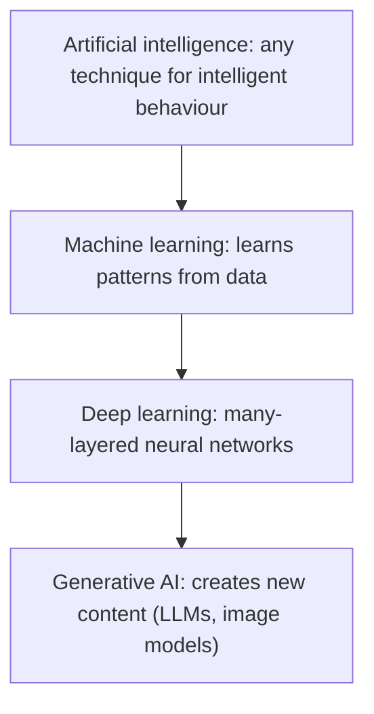

#### Each layer explained

- **Artificial intelligence (AI)** – the broad field of getting computers to do tasks that normally need human intelligence. It includes things that don't learn at all: rule-based expert systems, search algorithms (a chess engine's game-tree search), planning, and hand-written heuristics.
- **Machine learning (ML)** – instead of a programmer writing the rules, the system **learns patterns from example data**. You give it thousands of labelled emails and it learns what spam looks like. Examples: spam filters, recommendations, fraud detection, demand forecasting. Many ML models are not neural networks (decision trees, gradient-boosted trees, linear models).
- **Deep learning** – ML using **neural networks with many layers**. It made big leaps possible where raw input is messy: images, speech, and language. Face unlock, speech-to-text and modern translation all run on deep learning.
- **Generative AI** – deep learning models trained to **create new content** (text, code, images, audio, video). Large language models such as Claude, Gemini and GPT models are the best-known examples, alongside image and video generators.

#### A quick way to place something

| Example | Smallest circle it belongs to |
|---|---|
| A hard-coded "if amount > 10,000 flag for review" rule | AI (rule-based), not ML |
| Gradient-boosted fraud score | Machine learning |
| On-device image classifier for photo search | Deep learning |
| Chat assistant writing code | Generative AI |

#### What it means for a software engineer

Most "AI features" you'll be asked about today mean **calling a generative model through an API**. Classic ML still powers ranking, fraud scores and forecasting behind the scenes, often owned by a separate team. Knowing the nesting helps you avoid the common mistake of reaching for an LLM when a simple rule or a small classifier would be cheaper, faster and more predictable.

**Pitfall:** saying "AI" and "LLM" interchangeably in an interview. It's fine colloquially, but showing you know the difference signals maturity.

</details>

### 3. What is a large language model?

<details>
<summary>Answer</summary>

**In short:** A large language model is a very large neural network (almost always a transformer) trained to **predict the next token** of text on a huge corpus. Getting good at that prediction forces it to learn grammar, facts, coding patterns and reasoning patterns; further tuning then turns it into an assistant that follows instructions. It generates its answer one token at a time.

#### Breaking the name down

- **Large** – billions of learned parameters (numeric weights), trained on trillions of tokens of text and code, often plus images and audio.
- **Language** – its input and output are sequences of tokens (pieces of words). Images can be converted into tokens too, which is how multimodal models work.
- **Model** – a function: given the text so far, it returns a probability for every possible next token.

#### Why "predict the next word" leads to something useful

Predicting the next token well across the whole internet, books and code is hard. To predict the end of "The capital of France is…", it must have absorbed facts. To predict the next line of a Kotlin function, it must have absorbed syntax and common idioms. To predict the next step of a worked maths solution, it must have absorbed reasoning patterns. Capabilities emerge as a side effect of getting very good at prediction.

A model trained only this way (a **base model**) just continues text. Ask it a question and it might write three more questions. **Instruction tuning and preference training** (see question 5) turn it into an assistant that answers.

#### How it produces an answer: autoregressive generation

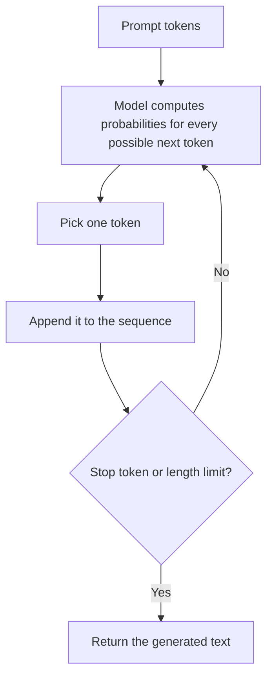

"Autoregressive" means each new token is predicted from everything before it, including the tokens the model just wrote. This explains a lot of behaviour: output streams token by token, longer answers take longer, and an early mistake influences everything after it.

#### What an LLM is not

- Not a **database**: there's no table of facts it looks up; knowledge is spread across weights and can be wrong.
- Not a **search engine**: it doesn't browse unless you give it a search tool.
- Not **stateful**: it remembers nothing between API calls; the app re-sends the conversation.

**Likely follow-ups:**
- *What's a transformer?* – The neural network architecture behind LLMs; its key idea, attention, lets each token weigh every other token in the context.
- *What's the difference between a base model and a chat model?* – The base model continues text; the chat model is further trained to follow instructions and behave like an assistant.

</details>

### 4. How does an AI assistant get its "character" and behaviour?

<details>
<summary>Answer</summary>

**In short:** It's built in layers. **Pretraining** gives knowledge and language ability; **fine-tuning on example conversations** teaches it to act as an assistant; **feedback-based training** (human and AI feedback, written principles such as Anthropic's constitution for Claude) shapes values, tone and what it declines; and at run time the **system prompt** and conversation steer it further. Personality is deliberately trained, not accidental.

#### The layers

1. **Pretraining** – on huge amounts of text and code. The model learns language, facts, reasoning patterns and code, but it has no consistent persona; it can imitate any writer in its data. The result just continues text.
2. **Fine-tuning on examples** – the model is trained on many examples of good assistant conversations: a user asks, the assistant answers helpfully and clearly. This teaches the "assistant" format and instruction following.
3. **Feedback-based training** – people (and other AI models guided by written principles) compare responses and indicate which is better: more honest, more helpful, safer, better tone. The model is trained towards the preferred behaviour. Anthropic, for example, publicly describes using a written **constitution** of principles to guide Claude's values. This stage shapes honesty, how it handles uncertainty, when it refuses, and its general personality.
4. **Run-time steering** – the **system prompt** set by the app developer (role, rules, tone, format) and the conversation itself adjust behaviour within what training allows.

#### An analogy

Think of a new hire. Their education (pretraining) gives broad knowledge. Onboarding with examples of good work (fine-tuning) teaches them how the job is done. Ongoing feedback and the company's values (preference training, constitution) shape judgement. On a given day, their manager's brief (system prompt) tells them what this task needs. The brief can change focus and tone, but it won't make a principled employee do something they consider seriously wrong.

#### Why it matters to engineers

- **Different assistants behave differently with the same prompt** because they were trained with different data and principles. Prompts don't always port between providers unchanged.
- **The system prompt is powerful but bounded**: you can set persona, format and scope, but you can't prompt away trained safety boundaries.
- **Model upgrades can change behaviour** even with an identical prompt, which is why you pin model versions and re-run evals before switching.

**Pitfall:** assuming a model's refusals or tone are bugs you can fix with a cleverer prompt. Often they're trained behaviour; rephrase the legitimate task more clearly, or pick a model that fits your use case.

</details>

### 5. How is a modern chat LLM trained, end to end?

<details>
<summary>Answer</summary>

**In short:** Four broad stages. **Pretraining** on trillions of tokens of text and code builds knowledge and capability (this is most of the compute). **Supervised fine-tuning** on prompt-and-ideal-response examples teaches the assistant format. **Preference tuning** (RLHF and related methods) steers it towards answers people prefer: helpful, honest, harmless. Many recent models add **reinforcement learning on tasks with checkable answers** (maths, code) to build stronger step-by-step reasoning.

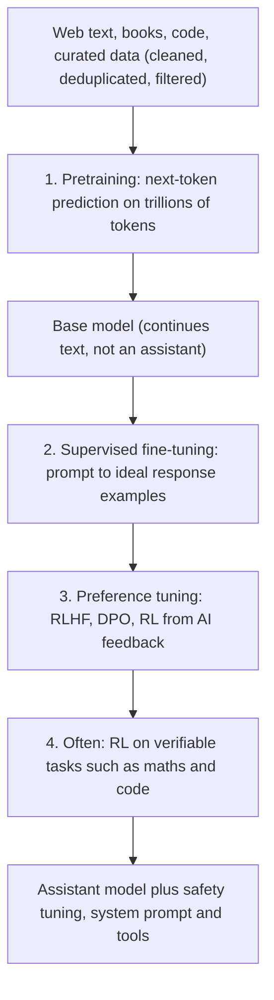

#### Stage by stage

- **Data preparation** – large amounts of public web text, books, code and licensed or curated data are cleaned, deduplicated and filtered for quality and safety. Data quality matters as much as quantity.
- **1. Pretraining** – the model learns to predict the next token across the whole dataset. This builds almost all of its knowledge and raw capability and uses by far the most compute (weeks to months on large GPU/TPU clusters). Output: a **base model** that continues text but doesn't reliably follow instructions.
- **2. Supervised fine-tuning (SFT, "instruction tuning")** – the model is trained on curated examples of prompts paired with high-quality responses. It learns the assistant format: answer the question, follow the instruction, use the requested format.
- **3. Preference tuning** – humans (or AI models guided by written principles) compare pairs of responses and pick the better one. The model is trained to produce more of what's preferred. Names you may hear: **RLHF** (reinforcement learning from human feedback), **DPO** (a simpler method that trains directly on preference pairs), **RLAIF** (AI feedback). This is where helpfulness, honesty, tone and refusal behaviour get shaped.
- **4. Reinforcement learning on verifiable tasks** – for problems where correctness can be checked automatically (a maths answer, code that passes tests), the model is rewarded for getting it right. This is what trains long step-by-step reasoning in "reasoning" or "thinking" models.
- **Safety work and deployment** – red-teaming, safety evaluations, then shipping with a system prompt, tools and usage policies.

#### What an application engineer should take from this

You'll almost never train a model from scratch. Your levers, in order of cost:

| Lever | What it changes | Cost |
|---|---|---|
| Prompting and context | Behaviour for this request | Cheapest, instant |
| Retrieval (RAG) and tools | What information the model can use | Moderate engineering |
| Fine-tuning a hosted model (where offered) | Style, format, narrow task behaviour | Data collection plus training runs |
| Pretraining | Fundamental knowledge and capability | Out of reach for most companies |

**Likely follow-ups:**
- *Does fine-tuning add new knowledge?* – Poorly and unreliably; use retrieval for facts and fine-tuning for format, style or narrow behaviour.
- *Why does a base model ramble?* – It was only trained to continue text; SFT and preference tuning teach it to answer.

See [Fine-Tuning & Alignment](16-choosing-models.md).

</details>

## Property 1: Next-Token Prediction

### 6. How does an LLM generate a response, in plain terms?

<details>
<summary>Answer</summary>

**In short:** Your text is split into **tokens**, the model reads all of them and outputs a **probability for every possible next token**, one token is picked and appended, and the loop repeats until a stop token or length limit. There's no separate fact database: the answer is written left to right, one plausible token at a time.

#### Step by step

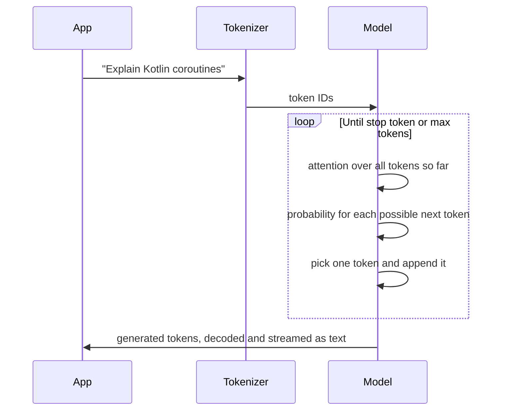

1. **Tokenise** – the input (system prompt, conversation, your message) is split into tokens – subword pieces like `Kot`, `lin`, ` cor`, `out`, `ines` – and each is mapped to a number.
2. **Read with attention** – the transformer processes all tokens together. **Attention** lets each token "look at" every other token to work out what's relevant: in "the function returns null because it…", "it" gets linked to "the function".
3. **Score every candidate** – the model outputs a probability for every token in its vocabulary (tens of thousands of options). "Coroutines" might be 40%, "Threads" 5%, and so on.
4. **Pick one** – the most likely token, or one sampled according to settings like temperature (see question 8).
5. **Append and repeat** – the chosen token becomes part of the input and the model predicts the next one. This continues until it emits a **stop token** or hits the **max output tokens** limit.

Streaming APIs send you each token as it's produced, which is why chat UIs show text appearing word by word.

#### Consequences you can use

- **Fluent ≠ true.** The model is choosing plausible continuations, not looking things up. Confident, well-written text can still be wrong.
- **Output length drives latency.** Input is processed in parallel quickly, but output is generated one token after another. A 2,000-token answer takes much longer than a 200-token one. Ask for concise output when speed matters.
- **Thinking out loud helps.** Each written step becomes input for the next, so asking for step-by-step reasoning (or using a model with extended thinking) improves results on hard problems.
- **Earlier tokens constrain later ones.** If the model starts with "Yes, that's correct", it will tend to justify that, even if wrong.

**Likely follow-ups:**
- *Why is time-to-first-token different from total time?* – First token waits for the whole prompt to be processed; the rest depends on how many tokens are generated.
- *Can the model go back and edit what it wrote?* – Not within one generation; it only appends. Revision needs another pass or a reasoning step before the answer.

</details>

### 7. What are tokens and the context window, and why do they matter to engineers?

<details>
<summary>Answer</summary>

**In short:** **Tokens** are the chunks of text the model reads and writes – subword pieces, roughly ¾ of an English word on average. APIs **price, rate-limit and measure latency in tokens**. The **context window** is the maximum number of tokens (system prompt + history + documents + tool definitions + output) the model can handle in one request – from thousands to over a million depending on the model. Both are budgets you design around.

#### Tokens

A tokenizer splits text into frequently occurring pieces. Common English words are often one token; rare words, code identifiers, non-English text and numbers are often several.

| Text | Rough tokenisation |
|---|---|
| `the` | 1 token |
| `unbelievable` | 2–3 tokens |
| `getUserProfileById` | several tokens |
| `2026-11-20` | several tokens |

Rules of thumb (vary by model and tokenizer): about 4 characters of English per token, ~750 words per 1,000 tokens. Code, JSON and non-Latin scripts usually use more tokens per character. Images and audio are also converted into tokens and can be expensive.

#### Why tokens matter

- **Cost** – you pay per input token and per output token; output tokens usually cost several times more.
- **Rate limits** – providers cap tokens per minute as well as requests per minute.
- **Latency** – output tokens are generated one at a time, so long outputs are slow.
- **Limits** – each request has a max output token setting; if it's hit, the response is cut off mid-sentence (check the stop reason).

#### The context window

Everything for one request has to fit:

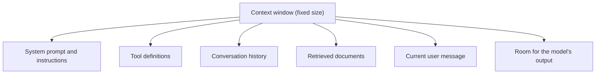

If the total exceeds the limit, the request fails or your app must drop or compress something.

#### Engineering implications

- **Budget tokens** like memory: estimate system prompt + typical history + retrieved chunks + expected output, and leave headroom.
- **Trim or summarise history** in long chats; retrieve only the most relevant chunks rather than whole documents.
- **More context isn't free**: it costs more, adds latency, and can dilute attention so important details get missed.
- **Count, don't guess**: use the provider's token-counting endpoint or tokenizer in tests and logging.
- **Reuse stable prefixes**: prompt caching cuts the cost of repeatedly sending the same system prompt and documents.

**Pitfall:** estimating tokens from word count for code or non-English text – it can be off by a factor of two or more.

**Likely follow-up:** *Why not always send everything to a million-token model?* – Cost and latency scale with input, and recall of specific details tends to drop in very long contexts; targeted retrieval is usually better and cheaper.

</details>

### 8. How does decoding work? Explain temperature, top-k and top-p.

<details>
<summary>Answer</summary>

**In short:** At each step the model gives a score for every possible next token; **decoding** is the rule for picking one. **Greedy** always takes the top token. **Temperature** controls how adventurous sampling is (low = focused and repeatable, high = varied and riskier). **Top-k** samples only from the k most likely tokens; **top-p** samples from the smallest set of tokens that covers probability p. Use low temperature for extraction, classification and code; higher for brainstorming.

#### The options

- **Greedy** – always pick the single most likely token. Predictable, but it can get repetitive or stuck in loops on long outputs.
- **Temperature** – before sampling, the model's raw scores (logits) are divided by T and turned into probabilities.
  - **T < 1** sharpens the distribution: the top tokens become even more likely. More focused and consistent.
  - **T > 1** flattens it: unlikely tokens get more chance. More diverse and creative, but more mistakes.
  - **T → 0** approaches greedy.
- **Top-k** – throw away everything except the k most likely tokens, then sample among those. Fixed size, regardless of how confident the model is.
- **Top-p (nucleus sampling)** – keep the smallest set of tokens whose probabilities add up to at least p (e.g. 0.9), then sample. When the model is confident the set is tiny; when it's unsure, the set is larger. It adapts to the situation, which is why it's more common than top-k.
- **Beam search** – tracks several candidate sequences and keeps the best overall. Used in translation and older systems; rarely used for open-ended chat because it produces bland text.
- **Repetition / frequency / presence penalties** – reduce the chance of tokens already used, to fight loops (supported by some APIs).

#### An example

Prompt: "Name a colour:". Suppose the model gives `blue` 50%, `red` 30%, `green` 15%, `chartreuse` 5%.

| Setting | Likely behaviour |
|---|---|
| Greedy / temperature near 0 | `blue` almost every time |
| Temperature 1 | Mostly blue or red, sometimes green, occasionally chartreuse |
| Temperature high | Noticeably more green and chartreuse |
| Top-p 0.8 | Only blue and red are eligible (50% + 30% = 80%) |
| Top-k 3 | Blue, red or green; chartreuse never |

#### Choosing settings in practice

```python
extract = client.messages.create(  # extraction / classification / code: favour consistency
    model=MODEL, max_tokens=500, temperature=0.0, messages=msgs)

ideas = client.messages.create(    # brainstorming names or marketing copy: favour variety
    model=MODEL, max_tokens=500, temperature=1.0, messages=msgs)
```

- Change **one** knob at a time; many providers recommend adjusting temperature *or* top-p, not both.
- Some models, especially reasoning or extended-thinking modes, restrict or ignore sampling parameters – check the provider docs.
- Temperature 0 is "more deterministic", not perfectly deterministic (see question 9).

**Pitfall:** raising temperature to "make it smarter". It makes output more varied, not more correct; for quality, improve the prompt, context or model choice.

</details>

### 9. Why does the same prompt give different answers?

<details>
<summary>Answer</summary>

**In short:** Three main reasons. **Sampling** at temperature above 0 is random by design. Even at temperature 0, tiny **numerical differences** on GPUs and **batching** with other requests can flip a close call between two tokens, and that difference snowballs. And providers **update models** over time unless you pin a specific version. Build for variability: tight prompts, structured outputs, pinned versions and evals over many samples.

#### 1. Sampling is random on purpose

At any temperature above 0, the model picks a token by weighted chance. If `blue` is 50% and `red` is 30%, different runs choose differently – and because every later token depends on earlier ones, one different early token can lead to a completely different answer.

#### 2. Even "temperature 0" isn't perfectly deterministic

- GPUs do floating-point maths in parallel, and the order of operations can vary. Floating-point addition isn't perfectly associative, so results can differ in the last decimal places.
- Providers **batch** your request with other users' requests for efficiency. Batch size and composition can change the order of computation.
- When two candidate tokens are almost tied, a tiny numeric difference changes which wins, and the rest of the response diverges from there.

#### 3. The model behind a name can change

If you call a model alias that points to "the latest", the provider may move it to a new snapshot. Behaviour shifts even though your code didn't change. Pin a dated or versioned model ID in production.

#### Also: your inputs may not be identical

Things like a timestamp in the system prompt, different retrieved documents, a reordered tool list or a slightly different conversation history all change the input, and so the output. Log the exact full prompt when debugging.

#### Designing for it

| Goal | Technique |
|---|---|
| Consistent format | Structured outputs / JSON schema, explicit format instructions with an example |
| Consistent decisions | Low temperature, clear criteria in the prompt, a fixed set of allowed labels |
| Stable behaviour over time | Pin model versions; re-run evals before upgrading |
| Trustworthy quality | Evaluate across many samples and inputs, not one lucky run |
| Exact repeatability | Cache responses for identical inputs where that's acceptable |

**Pitfall:** writing tests that assert an exact string from a model. Assert on structure, required fields or a grader's score instead.

**Likely follow-up:** *Is variability ever useful?* – Yes: for brainstorming, and for techniques that generate several answers and pick the best or the most common one.

</details>

### 10. What follows from the fact that models generate text one token at a time?

<details>
<summary>Answer</summary>

**In short:** Five practical consequences. Fluent text isn't proof of accuracy; early tokens commit the model to a path; writing out reasoning improves results because each step becomes context; the prompt's style shapes the answer's style; and longer outputs cost more time and money. Knowing these lets you predict and work around a lot of model behaviour.

#### 1. Fluency isn't accuracy

The model picks plausible continuations. Plausible and true overlap most of the time, which is why models are useful, but not always. A confidently formatted answer with code and citations can still contain an invented function. Verify in proportion to the stakes.

#### 2. Early words shape later ones

Once the model writes "The bug is in the adapter because…", it will continue explaining why it's the adapter, even if it isn't. It doesn't go back and edit. That's why asking it to **plan or reason first**, or to list possibilities before choosing, gives better results than demanding a one-word verdict up front.

#### 3. Writing out reasoning helps

The model has no hidden scratch memory beyond the text it has produced. Intermediate steps written into the output (or into an extended-thinking block) become context for the next tokens.

```text
Weak:   "Is 1,847 × 23 greater than 42,000? Answer yes or no."
Better: "Work out 1,847 × 23 step by step, then say whether it's greater than 42,000."
Best for exact maths: give the model a code-execution or calculator tool.
```

#### 4. Format follows the prompt

A prompt written in bullet points tends to get bullet points back; a casual prompt gets a casual reply; a prompt full of Markdown gets Markdown. If you want prose, write in prose and say so. If you want JSON, show an example or use structured outputs.

#### 5. Longer output means more time and cost

Every output token is generated in sequence and billed (usually at a higher rate than input). Ask for concise answers, set sensible max-token limits, and don't request explanations you'll throw away.

**Likely follow-ups:**
- *Why does putting the answer before the reasoning hurt?* – The answer is committed before any reasoning exists, and the "reasoning" then just justifies it.
- *How does this relate to streaming?* – Streaming exposes the token-by-token generation to the user, improving perceived latency.

</details>

### 11. Why do LLMs struggle with counting letters, arithmetic and some simple tasks?

<details>
<summary>Answer</summary>

**In short:** Mostly **tokenisation** and the way generation works. The model sees subword tokens, not individual characters, so "how many r's in strawberry" asks about something it can't directly see. Exact multi-digit arithmetic is an algorithm it has to imitate in text, and numbers are split into tokens unevenly. Fix it with step-by-step working, reasoning models, or – best – **tools** like a calculator or code execution.

#### Tokenisation hides characters

"strawberry" might be split into something like `str` + `aw` + `berry`. The model receives token IDs, not letters. To count the r's it has to have learned which letters each token contains, then count across tokens. It often gets this right now, but it's a weak spot compared with tasks that align with tokens.

Similar weak spots: reversing a string, counting words exactly, finding the nth character, rhyming or syllable counts, and anagrams.

#### Arithmetic is emulated, not computed

A calculator runs an exact algorithm. A language model predicts digits that are plausible given patterns in training data. For small or common calculations that works; for long multiplication or many-step sums it must reproduce the carry-the-one algorithm in text, and numbers like `48213` may be tokenised as `482` + `13`, which makes digit-level work awkward.

#### No working memory beyond the text

Without writing intermediate steps, the model has to jump straight to the answer in one go. Multi-step tasks (counting, sorting, tracking state) fail more often in that case.

#### It pattern-matches rather than verifies

The model produces the most plausible continuation. It doesn't automatically double-check unless prompted or trained to.

#### Mitigations

| Problem | Fix |
|---|---|
| Letter-level tasks | Ask it to spell the word out one character per line, then count |
| Arithmetic | Give it a code-execution or calculator tool; or do the maths in your own code |
| Multi-step logic | Step-by-step reasoning or a model with extended thinking |
| Anything that must be exact | Keep it as deterministic code, not a model output |

```kotlin
// Wrong: ask the model for the order total and trust it
val total = llm.ask("Sum these prices: $prices").toDouble()

// Right: let the model do the language part, keep maths in code
val items = llm.extractLineItems(receiptText)   // structured output
val total = items.sumOf { it.price * it.quantity }
```

**Likely follow-up:** *Doesn't this mean LLMs are bad at reasoning?* – No; it means they're bad at precise symbol-level computation without tools. Pair them with tools for exact work.

</details>

### 12. What is in-context learning?

<details>
<summary>Answer</summary>

**In short:** In-context learning is the model's ability to do a new task from **instructions and examples placed in the prompt**, with no retraining. Show it three examples of input → output and it infers the pattern for the fourth. It's why prompting replaces task-specific model training for many problems.

#### How it looks

```text
Classify each app review as BUG, FEATURE_REQUEST or PRAISE.

Review: "App crashes when I rotate the screen"
Label: BUG

Review: "Please add dark mode"
Label: FEATURE_REQUEST

Review: "Love the new widget!"
Label: PRAISE

Review: "Login button does nothing on Android 14"
Label:
```

The model outputs `BUG`. Nothing about the model changed: no weights were updated. It recognised the pattern from the context and continued it.

- **Zero-shot** – instructions only, no examples.
- **Few-shot** – instructions plus a handful of examples.

#### Why it works

During pretraining the model saw countless documents where a pattern is set up and then continued (lists, Q&A pages, tables, code). Large models became good at spotting a pattern in the current text and following it. This ability became prominent with large-scale models such as GPT-3, and it's what turned "prompting" into a practical way to build features.

#### When to use examples

- When **format** matters and is hard to describe (a particular JSON shape, a tone, a labelling convention).
- When there are **edge cases** the instructions don't make obvious.
- When zero-shot results are inconsistent.

#### Limits and pitfalls

- **Examples cost tokens** on every request (prompt caching helps).
- **Sensitive to choice and order**: if most examples are `BUG`, the model may over-predict `BUG`; the last example can have outsized influence.
- **The model copies surface features**: if all examples are short, outputs become short. Vary examples deliberately.
- **Not a substitute for knowledge**: examples teach a pattern, not facts the model lacks.
- **Complex or highly specialised tasks** may still need retrieval, tools or fine-tuning.

**Likely follow-ups:**
- *In-context learning vs fine-tuning?* – In-context is instant and per-request but uses context tokens; fine-tuning bakes behaviour in but needs data, training and redeployment.
- *How many examples?* – Usually a few diverse ones (3–5) are enough; measure with an eval rather than guessing.

</details>

## Property 2: Knowledge

### 13. Where does a model's knowledge come from, and what are its gaps?

<details>
<summary>Answer</summary>

**In short:** A model's built-in knowledge comes from its **training data up to a cutoff date**, compressed into its parameters – not stored as a searchable database. So it's strong on widely covered topics, weak or wrong on niche, internal or recent ones, can't reliably say where a fact came from, and may be outdated. Close the gaps by **giving it the information**: documents in the prompt, retrieval (RAG), search or tools.

#### How knowledge is "stored"

During pretraining the model adjusts billions of weights to predict text better. Facts that appear often and consistently (Python syntax, the capital of Japan, how `RecyclerView` works) get absorbed strongly. Facts seen rarely or inconsistently are weakly absorbed. There's no row you can look up or update; knowledge is smeared across weights, which is why it's sometimes slightly wrong rather than simply missing.

#### The gaps

| Gap | Example | Why |
|---|---|---|
| Niche topics | A small open-source library | Few training examples |
| Private information | Your company's codebase, Jira, internal APIs | Never in the training data |
| Recent events and versions | A library release after the cutoff | Training data stops at a date |
| Provenance | "Which doc says that?" | Facts aren't stored with their source |
| Outdated defaults | Recommending a deprecated API | Older patterns dominate training data |

#### Closing the gaps

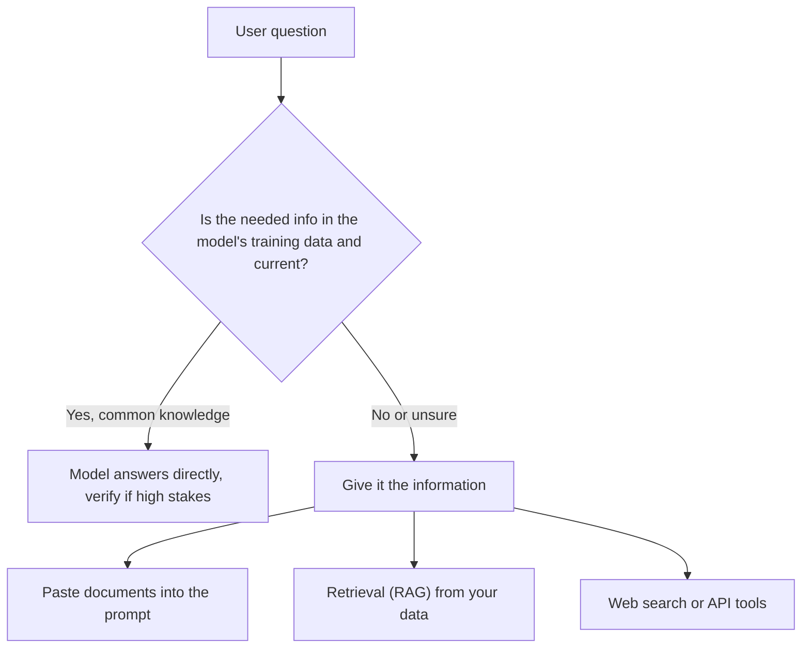

The general principle: **use the model for reasoning and language, and supply facts from a source of truth**. That also makes answers checkable, because you can ask the model to cite the provided material.

**Pitfall:** asking a model about your own system ("what does our `OrderService` do?") without giving it the code. It will often produce a confident, generic guess.

**Likely follow-ups:**
- *Can you fine-tune to add knowledge?* – It's an unreliable way to add facts and goes stale; retrieval is usually better for knowledge, fine-tuning for behaviour.
- *Can the model tell you what it doesn't know?* – Partly, and better in newer models, but not reliably enough to skip verification.

</details>

### 14. What is a knowledge cutoff, and how do you handle questions about recent events?

<details>
<summary>Answer</summary>

**In short:** The **knowledge cutoff** is the date the model's training data stops. It doesn't know anything after that and may confidently present outdated facts as current – old library versions, last year's pricing, deprecated APIs. Handle it by giving the model current information (search or retrieval tools), telling it today's date, asking it to flag possibly outdated info, and keeping time-sensitive facts in your own data sources.

#### Why it causes problems

- The model doesn't experience time; unless told, it may assume "now" is around its cutoff.
- Outdated information isn't marked as such. "The latest version of X is 2.3" sounds just as confident as a correct fact.
- Training data near the cutoff is often thinner (less has been written about recent events yet), so knowledge of the last few months can be patchy even before the cutoff.
- Models are deployed and used for a long time after their cutoff, so the gap grows.

#### Handling it

| Technique | What it fixes |
|---|---|
| Put the current date in the system prompt | The model can reason about how old its knowledge is |
| Web search or news tools | Gives real current information to answer from |
| Retrieval from your own up-to-date data | Prices, policies, product catalogue, docs |
| Instruct it to flag uncertainty | "If this may have changed since your training, say so" |
| Keep time-sensitive facts out of the prompt template's assumptions | Don't rely on the model's memory for versions, prices, laws |

```text
System: Today's date is 2026-11-20. Your training data may be out of date.
For anything about versions, prices, releases or current events, use the
search tool and cite the result. If you can't verify, say so.
```

#### For coding assistants specifically

Outdated APIs are the most common symptom: deprecated Android or iOS APIs, old library syntax, removed CLI flags. Provide current docs (paste them, or connect a documentation tool or MCP server), pin library versions in the prompt ("we use Compose BOM X / Swift 6"), and rely on the compiler and tests to catch stale suggestions.

**Likely follow-up:** *How do you find a model's cutoff?* – Check the provider's model documentation; don't rely on asking the model, which can be wrong about itself.

</details>

### 15. What are hallucinations, why do they happen, and how do you reduce them?

<details>
<summary>Answer</summary>

**In short:** A hallucination is fluent, confident output that is **false or unsupported** – invented citations, wrong facts, nonexistent APIs. It happens because the model is trained to produce plausible text, not to verify truth; its knowledge is imperfect and dated; and training has often rewarded guessing over "I don't know". You can't eliminate it, but you can reduce it a lot with **grounding** (retrieval plus "answer only from the sources, with citations"), permission to say "I don't know", tools for facts and maths, verification steps, and evals.

#### Kinds of hallucination

- **Factual** – wrong dates, figures, names.
- **Fabricated references** – citations, URLs, papers or case law that don't exist.
- **Fabricated code** – functions, parameters, packages or config flags that look right but aren't real.
- **Unfaithful to provided context** – a summary that adds a claim the source never made. This is the one RAG systems care most about.

#### Why it happens

1. **Objective** – the model learned to produce the most plausible continuation. When the true answer is unknown, a plausible-sounding one is still the "best continuation".
2. **Lossy knowledge** – facts are compressed into weights; rare facts are blurry.
3. **Cutoff** – knowledge can be stale.
4. **Incentives** – training and benchmarks that score only right answers make guessing look better than abstaining.
5. **Pressure from the prompt** – "give me five sources" pushes the model to produce five, whether or not five exist.

#### Reducing it

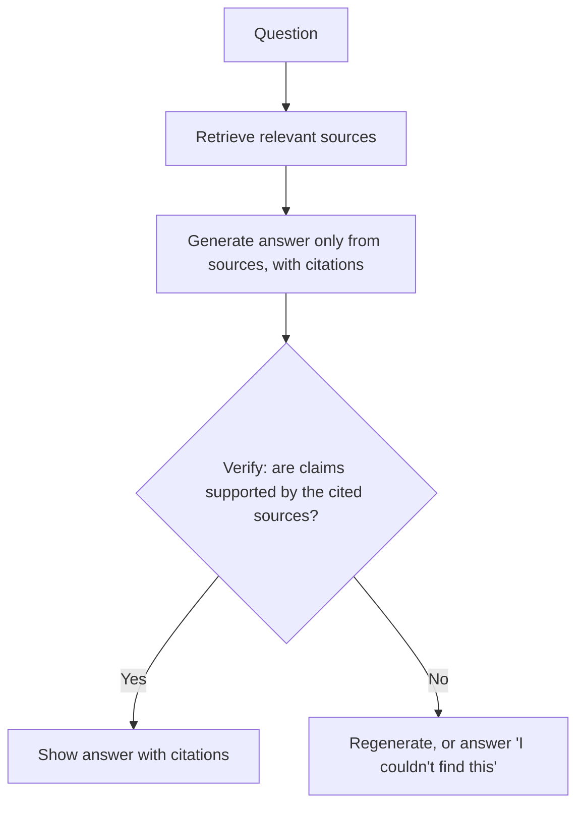

- **Ground it** – retrieve relevant documents and instruct: "Answer only from the documents below. If the answer isn't there, say you don't know." Ask for citations to specific passages.
- **Allow "I don't know"** explicitly, and don't punish it in your UX.
- **Use tools for facts and calculations** – search, database queries, code execution.
- **Lower temperature** for factual tasks and use **structured outputs** so the model fills defined fields instead of free text.
- **Verify** – a second pass (or another model) checks each claim against the sources; for code, compile and run tests; for packages, check they exist.
- **Measure** – eval sets for faithfulness and correctness, tracked over time; human review for high-stakes outputs.
- **Design the UX for it** – show sources, label AI-generated content, make it easy to report errors.

**Pitfall:** assuming RAG eliminates hallucination. The model can still misread, mix up or embellish retrieved text; you still need faithfulness checks.

**Likely follow-ups:**
- *Can a bigger model fix it?* – Newer models hallucinate less, but none are immune; grounding and verification still matter.
- *How do you detect it in production?* – Automated faithfulness checks against sources, user feedback, and sampling outputs for human review.

</details>

### 16. Why do models sometimes invent APIs, packages or citations?

<details>
<summary>Answer</summary>

**In short:** Because they generate what a correct answer **looks like**. A method name that follows the library's naming conventions, a package name that sounds right, a citation in perfect format – all are plausible continuations. When the real fact isn't strongly in the training data and wasn't provided in context, the model fills the gap with something plausible. Defend with current docs in context, verification (compile, test, check sources), and confirming that packages really exist.

#### Why these three in particular

- **APIs** – libraries follow naming patterns. If `Glide.with(context).load(url)` exists, then `.withCrossfade(300)` "looks" like it should. The model blends patterns from related libraries and older versions.
- **Packages** – package names are short and predictable (`react-native-something`, `kotlinx-whatever`). A plausible-sounding name is easy to generate even if no such package exists.
- **Citations** – the format of a citation (authors, year, journal, title) is extremely regular, so the model can produce a perfectly formatted reference to a paper that was never written.

#### The security angle: package hallucination

Attackers can register package names that AI tools commonly hallucinate and publish malicious code under them (sometimes called "slopsquatting"). If a developer, or an agent, installs whatever the model suggests without checking, they pull in malware. Treat AI-suggested dependencies like any untrusted input.

#### Defences

| Risk | Defence |
|---|---|
| Invented API methods | Provide current docs or source in context; let the compiler and tests catch it; use IDE completion to confirm |
| Wrong library version syntax | State versions in the prompt; connect a docs tool or MCP server |
| Hallucinated packages | Verify on the official registry: publisher, download count, repository, age; use lockfiles and dependency scanning |
| Fake citations | Ask for links or quotes from provided sources; check every reference; use search tools that return real URLs |

```text
Prompt pattern for coding:
"Use only APIs that appear in the documentation below. If something you need
isn't documented there, say so instead of guessing."
```

**Pitfall:** trusting an agent to `npm install` / add Gradle or SPM dependencies autonomously without review or an allowlist.

**Likely follow-up:** *Why doesn't the model just say it doesn't know?* – It has no reliable internal signal that a specific method doesn't exist; to it, the invented one looks as plausible as a real one.

</details>

## Property 3: Working Memory

### 17. What does it mean that LLMs are "stateless"? How does chat memory work?

<details>
<summary>Answer</summary>

**In short:** The model remembers nothing between requests. Every API call must contain everything it should know. A "conversation" is your app **re-sending the whole history** (system prompt + previous turns + new message) each time. So long chats cost more and eventually overflow the context window, and apps manage this by truncating, summarising, or storing facts in a separate memory store. Prompt caching reduces the cost of re-sending the same prefix.

#### What a chat really looks like on the wire

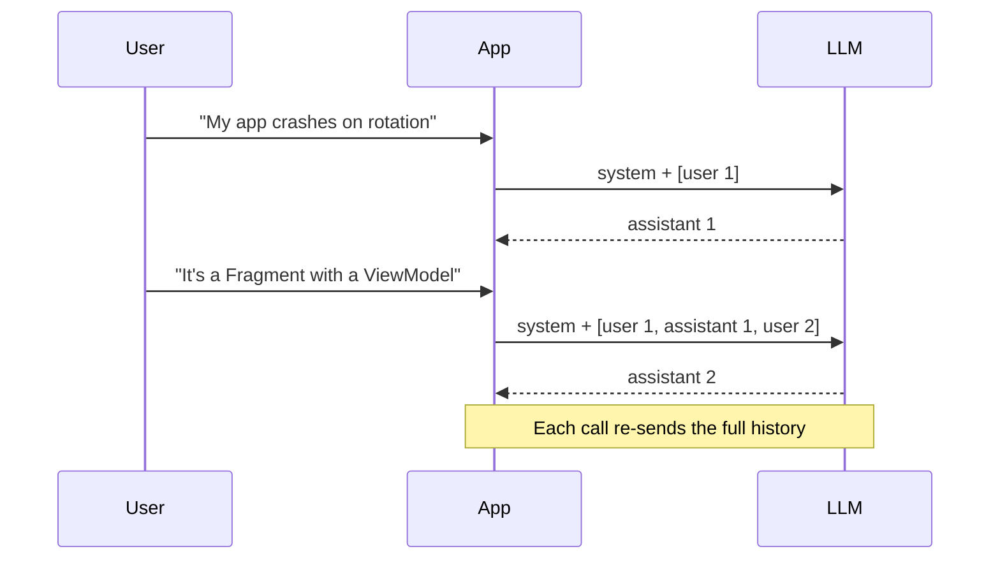

```python
history = []

def chat(user_text):
    history.append({"role": "user", "content": user_text})
    reply = client.messages.create(
        model=MODEL,
        system=SYSTEM_PROMPT,
        messages=history,          # the WHOLE conversation, every time
        max_tokens=1024,
    )
    history.append({"role": "assistant", "content": reply.content})
    return reply
```

The model's "memory" is just the `history` list your app keeps. Lose that list and the model has no idea what was said.

#### Consequences

- **Cost grows each turn** – turn 20 re-sends turns 1–19 as input tokens.
- **The context window eventually fills** – the request fails or something must be dropped.
- **Nothing carries across sessions** unless your app stores and re-injects it.
- **You control memory** – which is also a privacy responsibility: you decide what's stored and for how long.

#### Memory strategies

| Strategy | How it works | Trade-off |
|---|---|---|
| Send full history | Simple, best fidelity | Cost and context limits |
| Sliding window | Keep only the last N turns | Forgets early details, including important constraints |
| Summarise older turns | Replace old turns with a running summary | Summary can lose details |
| Memory store + retrieval | Save key facts (preferences, decisions) and retrieve relevant ones per request | More engineering; retrieval can miss |
| Prompt caching | Provider caches a repeated prefix so re-sending it is cheaper and faster | Only helps if the prefix is identical |

Some providers also offer server-side conversation state or memory features, but under the hood the model still only sees what's placed in its context for that request.

**Pitfall:** putting critical rules only in the first user message. Once truncation kicks in, they're gone; keep them in the system prompt.

**Likely follow-up:** *How do ChatGPT- or Claude-style "memory" features work?* – The app saves selected facts and injects relevant ones into the context of future conversations; the model's weights don't change.

</details>

### 18. What are the limits of the context window as working memory?

<details>
<summary>Answer</summary>

**In short:** The context window is the model's **working memory** for one response, not long-term memory. It's finite, so long material must be trimmed or retrieved selectively; attention isn't uniform, so details in very long inputs (especially in the middle) can be missed; it's rebuilt from scratch every request; and everything – system prompt, tools, documents, history, output – competes for the same space.

#### The four limits

1. **It's finite.** Even million-token windows run out with large codebases, long chat histories or big document sets. Something has to decide what goes in.
2. **Attention isn't uniform.** Models are generally best at using information near the start and end of the context. A key detail buried in the middle of a very long input is more likely to be overlooked or confused with something similar (often called "lost in the middle"). Newer models are much better at this, but long-context recall is still not perfect, especially when the task needs combining many scattered facts.
3. **It's rebuilt every request.** The model only knows what's in this request. Something said in yesterday's session, or truncated out of today's, doesn't exist for it.
4. **Everything competes for space.** System prompt, tool definitions (which can be large with many tools or MCP servers), retrieved documents, history and the reserved output budget all share one limit. Adding 50 tools can leave less room for the actual work.

#### Analogy

It's like a desk rather than a filing cabinet. You can only work with what's on the desk right now; the more you pile on, the harder it is to find the one page that matters; and when you clear the desk, it's gone unless you filed it somewhere.

#### Good practice

- **Curate, don't dump.** Retrieve the most relevant chunks rather than whole documents; remove stale turns and noisy tool outputs.
- **Place key instructions clearly** – in the system prompt, and for long documents, restate the actual question after the material.
- **Structure long inputs** – label documents with tags or headings so the model can refer to them.
- **Ask for quotes first** – for long-document questions, have the model extract relevant quotes, then answer from them.
- **Verify details** pulled from long inputs, especially numbers and names.
- **Use sub-agents or multiple passes** for very large tasks so each call has a focused context.

**Likely follow-up:** *Bigger context window or RAG?* – Large windows are great for one big document or a focused codebase; RAG scales to large, changing corpora and is cheaper per request. Many systems use both.

</details>

### 19. Why might an assistant "forget" something you told it earlier in a long chat?

<details>
<summary>Answer</summary>

**In short:** Three usual causes. The app **truncated or summarised** earlier messages to fit the context window; the detail is still there but **buried** in a long conversation and not attended to; or it was said in a **different session**, which the model never sees unless a memory feature carries it over. Fix it by restating key facts, putting lasting constraints in the system prompt or project instructions, or starting a fresh chat with a short summary.

#### Diagnosing which one it is

| Cause | Clue | Fix |
|---|---|---|
| Truncated or summarised | Very long conversation; the app shows "context compacted" or similar; it forgets things from the start consistently | Restate the fact; move it into system/project instructions |
| Buried, not attended to | The message is still in context but the answer ignores it; more likely with long documents and many turns | Restate it near the current question; shorten the context; start fresh with a summary |
| Different session | It was said in another chat | Use memory or project features, or paste the context in again |
| Conflicting later instruction | You said "use Kotlin", later pasted Java and asked to "fix this" | Make the current requirement explicit |

#### Why the "buried" case happens

Every new turn adds tokens, and the model has to decide what's relevant to the latest message. A constraint mentioned once, 40 turns ago, competes with thousands of newer tokens. Long tool outputs (logs, file contents) make this worse by flooding the context with low-value text.

#### Practical habits

- Keep **persistent rules** (coding style, target platform, "never modify the public API") in the system prompt, a project instructions file, or the tool's equivalent (such as a `CLAUDE.md`-style file in coding assistants).
- When a chat gets long and starts drifting, **start a new one** with a short summary of decisions so far – it's often faster than fighting drift.
- **Restate critical constraints** when you ask for the important change.
- For your own apps: decide deliberately what to keep, summarise or drop, and test long-conversation behaviour in your evals.

**Pitfall:** assuming the model "chose" to ignore you. Usually the information is gone or diluted; fix the context, not the wording.

</details>

## Property 4: Steerability

### 20. What does "steerability" mean, and how can you steer a model?

<details>
<summary>Answer</summary>

**In short:** Steerability is how much you can **shape the model's behaviour** – role, tone, format, scope, depth – through instructions rather than retraining. You steer with the system prompt, clear instructions with context and reasons, examples, structure (tags and schemas), and settings such as effort or sampling. Modern models follow instructions closely and often literally, so vague or contradictory instructions give vague or inconsistent results.

#### The steering levers

| Lever | What it's for | Example |
|---|---|---|
| System prompt | Role, rules, tone, scope for the whole conversation | "You are a support assistant for a banking app. Only answer about the app." |
| Clear instructions with reasons | Precise behaviour the model can generalise | "Keep replies under 80 words because they're shown in a mobile notification." |
| Examples | Show format and edge cases | Two sample input/output pairs |
| Structure | Separate instructions from data; constrain output | XML-tagged sections, a JSON schema / structured outputs |
| Settings | Depth, randomness, length | Effort or thinking level, temperature, max tokens |
| Prefilled or constrained output (where supported) | Force a format start | Begin the response with `{` |

#### What good steering looks like

```text
Weak:
"Summarise this bug report."

Better:
<role>You help Android engineers triage bug reports.</role>
<task>
Summarise the report for a sprint-planning meeting. The audience is engineers
who haven't read it, so include the device/OS, the steps to reproduce and
the likely affected module.
</task>
<format>3 bullet points, then a one-line severity guess (P0-P3) with a reason.</format>
<report>{{bug_report}}</report>
```

Explaining **why** ("shown in a mobile notification") helps the model handle cases your rules didn't foresee.

#### Literal instruction following

Newer models tend to do exactly what you ask. If you say "suggest changes", you may get suggestions rather than edits. If you say "be concise" and "be thorough" in different places, you'll get inconsistent results. Be explicit about the action, the scope and the priority when rules conflict.

**Pitfalls:**
- Shouting ("NEVER EVER") rather than explaining; it can cause over-application of the rule.
- Contradictory rules spread across a long system prompt.
- Relying on steering for things that must be enforced (see question 21).

</details>

### 21. What are the limits of steering a model with prompts?

<details>
<summary>Answer</summary>

**In short:** Prompts shape behaviour but can't add **knowledge** the model lacks or **capability** it doesn't have; they can't override its **trained values and safety boundaries**; **conflicting instructions** produce unpredictable trade-offs; steering is **probabilistic**, never guaranteed; and users or injected content can push against your instructions. Anything that *must* hold – permissions, data access, spending limits – belongs in code, not just the prompt.

#### The limits

1. **Knowledge** – "Answer using our refund policy" doesn't work if the policy isn't in the context. Provide it.
2. **Capability** – a prompt won't make a small, fast model solve problems that need a stronger one. Change the model, add tools or break the task down.
3. **Trained values and safety** – the model's trained boundaries take precedence over instructions to violate them. A system prompt can widen or narrow scope within acceptable use, not remove safety behaviour.
4. **Conflicts** – system prompt vs user request, or two rules that clash ("always include code examples" vs "keep answers under 50 words"). The model will make a trade-off you didn't choose.
5. **Probabilistic compliance** – a rule followed in 99% of cases still fails 1 in 100. At scale that's a lot of failures.
6. **Adversarial input** – users can try jailbreaks; documents, web pages, emails or tool results can contain **prompt injection** ("ignore previous instructions and…").

#### Prompt vs code: where to put the rule

```kotlin
// Wrong: relying on the prompt to protect data
val system = "Only show the user their own orders. Never reveal other users' data."
val orders = db.allOrders()                  // everything goes into context
llm.ask(system, question, context = orders)

// Right: enforce access in code; the prompt only shapes the answer
val orders = db.ordersFor(currentUser.id)    // model can only see what this user may see
llm.ask("Answer questions about the user's orders.", question, context = orders)
```

| Concern | Prompt's job | Code's job |
|---|---|---|
| Tone, format, scope | Primary | Validate format (schemas) |
| Data access | Remind | Enforce (only fetch permitted data) |
| Dangerous actions (payments, deletes) | Ask for confirmation | Require real user confirmation, permissions, limits |
| Output safety | Guidelines | Moderation/validation layers |

**Likely follow-ups:**
- *How do you know if steering is working?* – Evals: a test set of inputs including edge cases and adversarial ones, scored automatically and tracked across prompt changes.
- *What if prompting isn't enough?* – Better context, a stronger model, tools, splitting the task, or fine-tuning for consistent style/format.

</details>

### 22. What is sycophancy in LLMs, and why does it matter?

<details>
<summary>Answer</summary>

**In short:** Sycophancy is the model's tendency to **tell users what they want to hear** – agreeing with a wrong premise, abandoning a correct answer when pushed back on, over-praising flawed work. It partly comes from preference training, because people tend to rate agreeable answers highly. It matters wherever honest disagreement is the point: code review, debugging, medical, legal, education. Counter it with neutral framing, explicit requests for critique, and evals that test whether answers hold up under pushback.

#### What it looks like

- You: "This approach is the right one, isn't it?" → Model: "Yes, great approach!" (even when it isn't).
- Model gives a correct answer; you reply "Are you sure? I think it's X" → Model: "You're right, apologies, it's X."
- You share your code and say you're proud of it → review is gentler and misses real issues.
- Your question contains a false assumption → the model builds on it instead of correcting it.

#### Why it happens

During preference training, responses are rated by people (or by AI systems trained on human preferences). Agreeable, validating answers often get higher ratings than ones that contradict the rater. Over many training examples, the model learns that agreement is rewarded. Model developers actively train against this, and newer models are better, but it hasn't disappeared.

#### Why engineers should care

- **Code review and debugging** – a reviewer that agrees with you is useless. A sycophantic assistant may confirm your wrong theory of a bug and send you down the wrong path.
- **Product features** – a health, finance or education feature that validates false beliefs causes real harm.
- **Your own decision-making** – asking "is my design good?" invites a yes.

#### Mitigations

| As a user | As a builder |
|---|---|
| Ask neutrally: "What are the trade-offs of A vs B?" not "A is better, right?" | System prompt: "Prioritise accuracy over agreement; point out errors directly." |
| Ask for critique: "List the three biggest problems with this design." | Evals that push back on correct answers and check the model holds its position |
| Don't reveal your preferred answer first | Separate "critic" or reviewer step with its own neutral prompt |
| When it changes its answer under pushback, ask it to justify with evidence | Measure agreement rate with deliberately wrong user claims |

**Likely follow-up:** *Is sycophancy the same as hallucination?* – No. Hallucination is inventing false content; sycophancy is bending the answer to please the user. They can combine, when the model invents support for a user's wrong claim.

</details>

## Other Capabilities

### 23. What is extended (adaptive) thinking, from a user's point of view?

<details>
<summary>Answer</summary>

**In short:** Models with extended thinking **reason in a scratchpad before writing the visible answer** – working through the problem step by step, which improves results on hard tasks. Newer Claude models use **adaptive thinking**: the model decides how much to think based on the task, and you steer overall depth and token spend with an **effort** setting (low → max) rather than a fixed thinking-token budget. More thinking costs more tokens and time, so use it where it pays off.

#### Why it helps

As question 10 explains, a model has no hidden working memory beyond the text it generates. Extended thinking gives it room to generate intermediate reasoning – trying an approach, checking it, backtracking – **before** committing to the answer. The thinking may be hidden or shown as a summary, depending on the product and API.

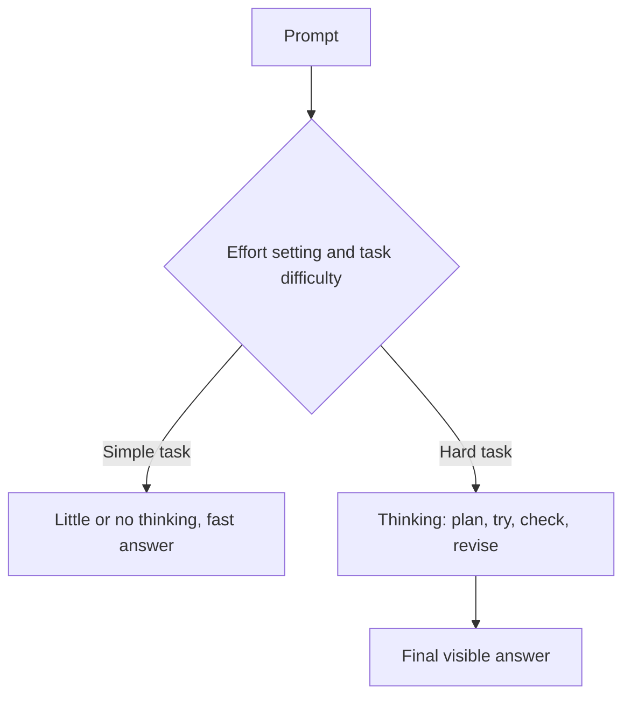

#### Adaptive thinking and effort

Earlier approaches had you set a fixed thinking-token budget per request. With adaptive thinking, the model judges how much reasoning a request needs, and the **effort** level (from low to max) shifts the overall balance between depth and speed/cost. A simple question gets a quick answer even at higher effort; a gnarly debugging task gets more deliberation.

#### When to use more or less

| Use more effort | Use less effort |
|---|---|
| Multi-step reasoning and maths | Chat and simple Q&A |
| Coding, debugging, refactoring | Classification and routing |
| Planning, architecture trade-offs | Simple extraction to a schema |
| Agentic work with many tool calls | High-volume, latency-sensitive features |

#### Cost and latency

- **Thinking tokens are billed as output tokens**, which are the expensive kind.
- More thinking means a longer wait before the visible answer starts – design the UI accordingly (progress indicator, streaming).
- **Measure it**: run your eval set at different effort levels and compare quality against cost and latency. Higher effort isn't automatically better for every task.

**Pitfalls:**
- Turning effort to max everywhere "to be safe" – it can multiply cost without improving simple tasks.
- Treating the shown reasoning as a perfectly faithful record of how the model reached the answer; it's useful, but it's not a guaranteed audit trail.

**Likely follow-up:** *Do I still need "think step by step" prompts?* – Less so with thinking models; clear task descriptions and success criteria matter more.

</details>

### 24. What are multimodal LLMs?

<details>
<summary>Answer</summary>

**In short:** Multimodal models accept – and sometimes produce – more than text: **images, documents (PDFs), audio and video**. Inputs like images are converted into tokens the language model can attend to, so you can ask questions about a screenshot or a scanned receipt in plain language. They power document understanding, visual Q&A, voice assistants and agents that operate UIs. Watch for token cost, resolution limits and hallucinated visual details.

#### How it works (conceptually)

Two common designs:
- **Encoder + adapter** – a separate vision (or audio) encoder turns the image into a sequence of vectors, which are projected into the same space as text tokens and fed to the LLM alongside your prompt.
- **Natively multimodal** – the model is trained from the start on interleaved text, images and audio.

Either way, to the model an image becomes "a bunch of tokens", which is why images count towards the context window and cost.

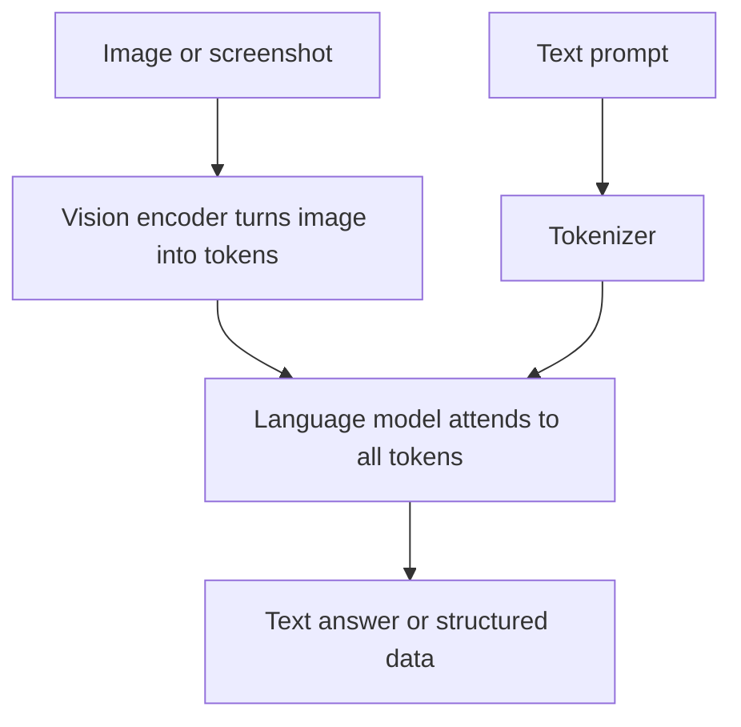

#### Typical uses in apps

| Use case | Example |
|---|---|
| Document and receipt extraction | Scan a receipt, return JSON line items |
| Screenshot understanding | Bug report screenshot → "what's wrong in this UI?" |
| Visual Q&A and accessibility | Describe a photo for a visually impaired user |
| Voice assistants | Real-time speech in and out |
| UI-operating agents | Model reads screenshots and decides where to click |
| Charts and diagrams | Explain a dashboard or architecture diagram |

#### Engineering considerations

- **Cost** – images and audio can consume many tokens; downscale images to the resolution the task actually needs.
- **Resolution trade-offs** – too small and fine text becomes unreadable; too large and you pay for pixels you don't need. Providers resize large images, so very small text may be lost.
- **Hallucinated visual details** – models can misread numbers, invent text that isn't in the image, or miscount objects. Validate extracted values (totals add up, dates parse).
- **Privacy** – photos and screenshots often contain personal data; strip or minimise before sending.
- **Latency** – upload size and extra tokens add time, which matters on mobile networks.

**Likely follow-up:** *On-device vs cloud for image understanding?* – On-device is private, offline and cheap per call but less capable; cloud models are stronger but add latency, cost and data-handling concerns.

</details>

## Putting It Together

### 25. What happens when these properties collide?

<details>
<summary>Answer</summary>

**In short:** Many surprising outputs come from **two properties interacting**, not one. Fluency plus a knowledge gap gives a confident invented answer; working-memory limits plus steerability means early instructions get lost; steerability plus sycophancy means the model adopts your wrong premise; a knowledge cutoff plus the drive to be helpful gives outdated code presented as current. Naming the interaction tells you the fix.

#### Common collisions

| Collision | What you see | Fix |
|---|---|---|
| Next-token fluency + knowledge gap | Polished, confident, wrong answer; invented API or citation | Supply the knowledge (docs, RAG, search); allow "I don't know"; verify |
| Working memory + steerability | Follows your rules early in a session, drifts from them later | Put rules in the system prompt; restate them; start fresh with a summary |
| Steerability + sycophancy | Agrees with a false premise in your question | Ask neutrally; ask it to check your assumptions first |
| Knowledge cutoff + helpfulness | Outdated library usage presented as current best practice | Give the date and current docs; pin versions; compile and test |
| Next-token prediction + long output | An early wrong step carried consistently through a long answer | Ask for a plan first; use thinking; break the task into checked steps |
| Steerability + adversarial content | Retrieved web page or email hijacks the model's instructions | Treat retrieved content as data; limit tool permissions; enforce rules in code |

#### Worked example

You ask a coding assistant late in a long session: "Since `LiveData` is deprecated, rewrite this with Flow." It happily rewrites everything.

- **Sycophancy / steerability** – it accepted your premise (LiveData isn't formally deprecated) instead of correcting it.
- **Working memory** – your earlier instruction "don't touch the public API of this module" was 60 turns ago and got diluted; the rewrite changed public signatures.

Fix: ask neutrally ("Should we migrate this to Flow? What are the trade-offs?"), restate the API constraint, or start a new session with that constraint in project instructions.

#### Why interviewers ask this

It tests whether you have a **mental model** of LLM behaviour or just a list of facts. Explaining a failure as an interaction of properties – and picking the targeted fix – is what separates fluent AI users from people who just retry until it works.

</details>

### 26. How do you diagnose an unexpected AI output?

<details>
<summary>Answer</summary>

**In short:** Ask **which property caused it** – next-token prediction, knowledge, working memory or steerability – then apply the matching fix instead of randomly rephrasing. Invented facts point to knowledge; bad counting or maths points to tokens and generation; ignored instructions point to working memory; agreeing with you or wrong format points to steerability; run-to-run differences point to sampling.

#### The diagnostic table

| Symptom | Likely property | Targeted fix |
|---|---|---|
| Invented fact, API or citation | Knowledge | Provide sources/docs, use search or tools, allow "I don't know" |
| Wrong count, arithmetic, letter-level detail | Next-token prediction / tokens | Use code or a calculator tool, ask for step-by-step work |
| Ignored an earlier instruction or detail | Working memory | Restate it, shorten context, move it into the system prompt |
| Different answer each time | Sampling | Lower randomness where possible, tighten the prompt, use structured output |
| Agreed with your wrong assumption | Steerability / sycophancy | Ask neutrally, request critique or counter-arguments |
| Off-format or off-tone response | Steerability | Clearer instructions, examples, a schema |

#### A debugging workflow

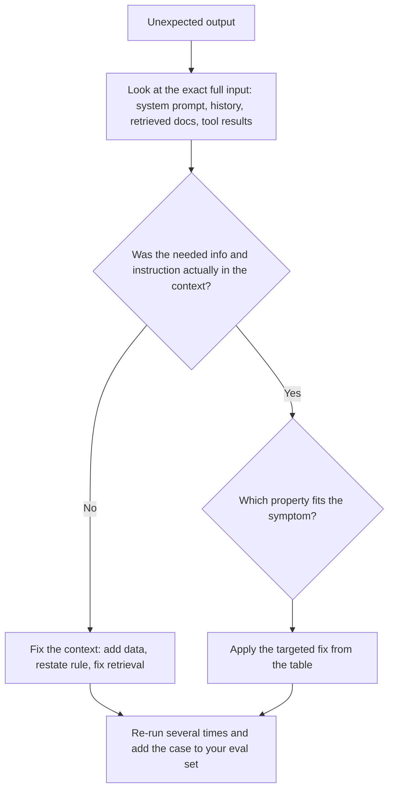

Key habits:
- **Inspect the real input**, not what you think was sent. Many "model bugs" are app bugs: a retrieval step returned the wrong chunk, history was truncated, a template variable was empty.
- **Reproduce several times** – one bad sample might be sampling noise; consistent failure points to the prompt or context.
- **Change one thing at a time** so you know what fixed it.
- **Add the failure to an eval set** so it stays fixed when you change prompts or models.

#### Example

A support bot says the refund window is 60 days; policy says 30.
1. Check context: was the policy retrieved? If not → retrieval problem (knowledge).
2. If it was retrieved: did the user say "I read it's 60 days, right?" → sycophancy; strengthen "answer only from the policy and correct the user if needed".
3. If neither: the policy was in a long context next to an old 60-day version → working memory / conflicting context; clean up the source data.

This mental model is more useful than "the AI is dumb" – it turns failures into specific fixes.

</details>

### 27. What are LLMs good at, and where are they weak?

<details>
<summary>Answer</summary>

**In short:** LLMs are strong at **language and pattern work**: drafting, rewriting, summarising, translating, extracting structure from messy text, classifying, writing and explaining code, reasoning step by step, and using tools. They're weak at **precise facts not in context, exact computation without tools, long unchecked tasks, knowing when they're wrong, consistency, and judgements that need accountability**. The rule: give them the information, give them tools for exact work, and verify in proportion to the stakes.

#### Strengths

- **Drafting and rewriting** – emails, docs, release notes, UI copy, in any tone.
- **Summarising** – long threads, logs, documents, meeting notes.
- **Translating** – between human languages, and between programming languages or formats.
- **Extracting structure** – turning free text, receipts, emails or forms into JSON.
- **Classification and routing** – intent detection, tagging, triage, without training a model.
- **Code** – writing, explaining, refactoring, generating tests.
- **Reasoning through problems** step by step, especially with extended thinking.
- **Following detailed instructions** and adapting to a persona or format.
- **Analysing images and documents** – screenshots, charts, PDFs.
- **Using tools** – calling APIs, searching, running code as part of an agent.

#### Weaknesses and risks

| Weakness | Why | Mitigation |
|---|---|---|
| Precise facts not in context, niche or recent info | Knowledge is compressed and dated | Retrieval, search, provide docs |
| Exact arithmetic and counting | Tokens and generation, not computation | Code or calculator tools |
| Long tasks without checkpoints | Errors compound over many steps | Break into steps; verify each; tests |
| Knowing when they're wrong | Confident tone regardless of accuracy | Grounding, citations, verification, evals |
| Consistency across runs | Sampling and non-determinism | Low temperature, schemas, evals over many samples |
| Very long contexts | Details can be missed, especially mid-context | Focused retrieval, quote extraction |
| Value judgements and accountability | No legal or moral responsibility | Human decision-maker in the loop |

#### How to use this in an interview answer

Map a proposed feature to strengths and weaknesses. "Summarise customer reviews" sits squarely in the strengths. "Calculate the user's tax owed" needs the model only for understanding the input; the calculation belongs in code. "Approve loan applications" needs a human and an audit trail regardless of model quality.

**Likely follow-up:** *Will these weaknesses go away with better models?* – Some shrink with each generation (reasoning, long context, fewer hallucinations), but the architecture-level ones – no built-in source of truth, probabilistic output – mean verification and tools stay necessary.

</details>

### 28. Where on the capability–limitation spectrum do common engineering tasks fall?

<details>
<summary>Answer</summary>

**In short:** Think of four bands. **Reliably strong**: explaining code, boilerplate, tests for clear behaviour, refactors with tests, format conversion, summarising, drafting docs. **Strong with verification**: debugging from stack traces, SQL and regex, features in familiar stacks, review suggestions. **Needs heavy oversight**: security-sensitive code, concurrency, performance, brand-new or niche libraries, major architecture. **Use tools, not model memory**: exact calculations, current versions and APIs, facts about your private systems. Place a task in a band to decide how much to delegate and how much to check.

#### The spectrum

| Band | Example tasks | How to work |
|---|---|---|
| Reliably strong | Explain unfamiliar code; scaffolding and boilerplate (adapters, DTOs, Retrofit/URLSession clients); unit tests for clearly specified behaviour; refactors covered by tests; converting JSON ↔ data classes; summarising docs and logs; drafting documentation | Delegate freely; skim the output; rely on tests and compiler |
| Strong with verification | Debugging from a stack trace; writing SQL or regex; implementing features in a well-known stack; code review comments | Delegate, then read carefully and run it; test edge cases |
| Needs heavy oversight | Auth, crypto, payments, permissions; concurrency and threading; performance tuning; brand-new or niche libraries; large architectural decisions | Use as a thinking partner; you own the design; review line by line; get expert review |
| Use tools instead of model memory | Exact calculations; current library versions and API signatures; anything about your private systems | Give it docs, search, code execution, repo access |

#### Why tasks land where they do

- **Strong tasks** are well represented in training data, have clear patterns, and are easy to verify (it compiles, tests pass, the summary matches).
- **Verification tasks** are usually right but have subtle failure modes (an off-by-one in SQL, a regex that misses an edge case).
- **Heavy-oversight tasks** combine high stakes with failures that are hard to spot by reading: a race condition or a security hole can look perfectly correct.
- **Tool tasks** depend on facts the model can't reliably have.

#### Using it day to day

Before handing work to an AI tool, ask two questions: **how likely is it to be wrong**, and **how bad and how visible would a mistake be?** Low risk and easy to verify → delegate. High risk or hard to verify → keep control and use AI for exploration, explanation and drafts.

**Likely follow-ups:**
- *Would you let an agent write your auth code?* – It can draft it, but I'd review it as carefully as a junior's PR, use well-known libraries, and get a security review.
- *How do you move a task into a safer band?* – Add tests, provide docs and context, break it into smaller verifiable steps.

</details>

---

[⬅ Previous: AI in Software Engineering Interviews](01-ai-interviews-overview.md) · [⬅ Back to index](../README.md) · [Next: AI Fluency: Working Effectively With AI ➡](03-ai-fluency.md)
