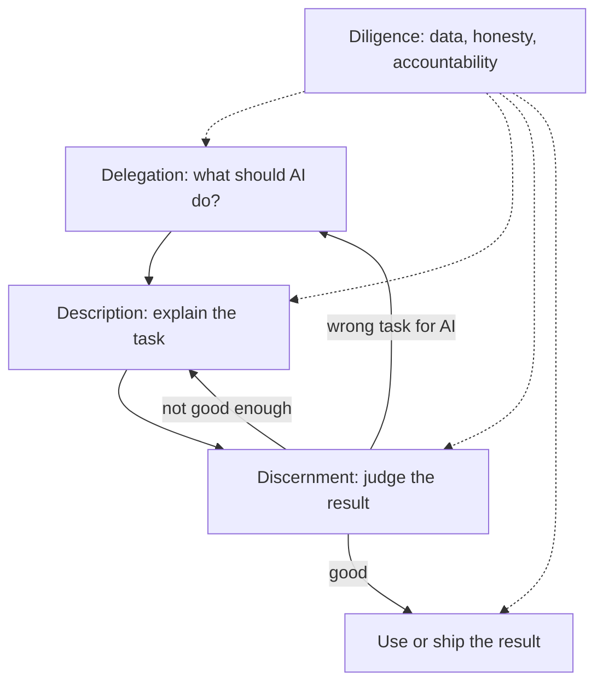
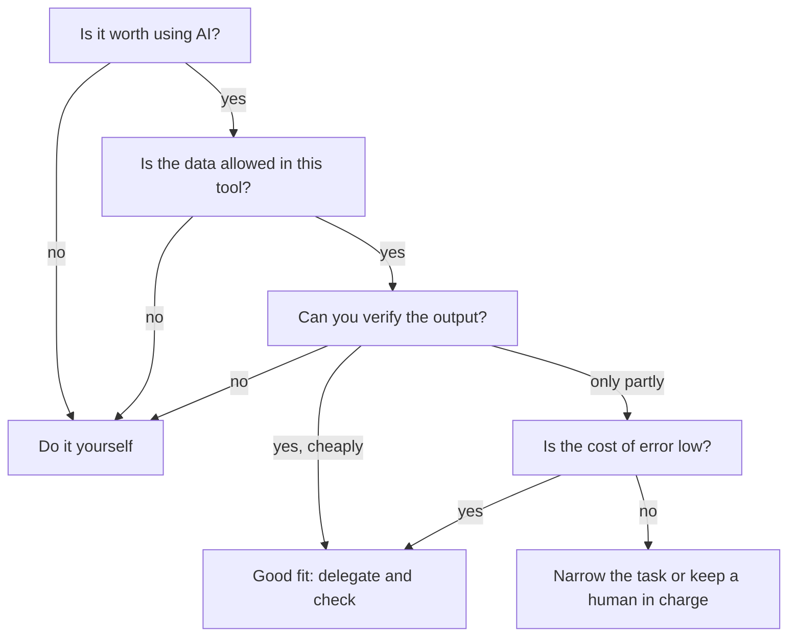
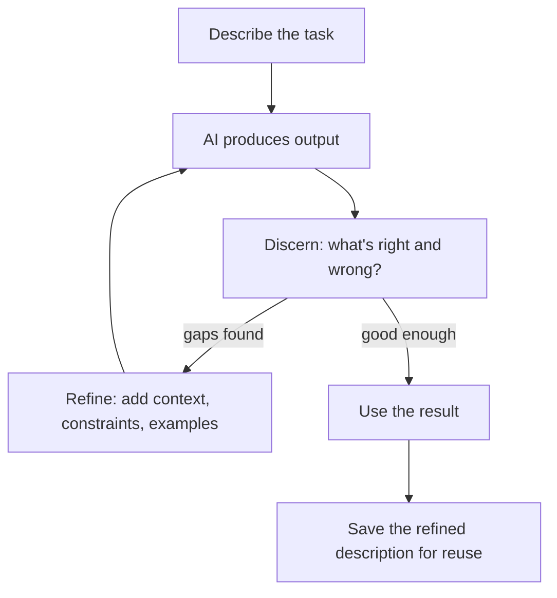
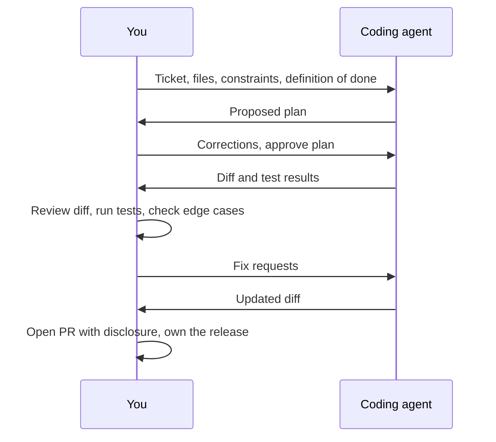

# AI Fluency: Working Effectively With AI

[⬅ Back to index](../README.md)

Covers: what AI fluency is and why it matters, the 4D framework (Delegation, Description, Discernment, Diligence) in depth, automation vs augmentation vs agency, project planning with AI, product/process/performance description, the description–discernment loop, creation/transparency/deployment diligence, deciding what to delegate, verifying output, data you shouldn't share, team habits, over-reliance, learning with AI, and applying the 4Ds to engineering work.

---

## The Framework

### 1. What is AI fluency?

<details>
<summary>Answer</summary>

**In short:** AI fluency is the ability to work with AI systems **effectively, efficiently, ethically and safely**: knowing what to ask AI to do, how to communicate the task, how to judge what comes back, and how to take responsibility for the result. Anthropic's AI Fluency course organises it into four competencies, the **4Ds**: Delegation, Description, Discernment and Diligence.

#### Where the term comes from

The framework was developed by Anthropic with Prof. Rick Dakan and Prof. Joseph Feller and is taught in Anthropic's free AI Fluency course. The idea is borrowed from language fluency: a fluent speaker doesn't just know vocabulary (the tool's buttons), they know how to get things done in the language, notice when they've been misunderstood, and adjust.

#### The four words, unpacked

| Word | What it means in practice |
|---|---|
| **Effectively** | You get results that actually solve the problem, not just plausible-looking text. |
| **Efficiently** | AI saves time overall, including the time spent prompting, checking and fixing. |
| **Ethically** | You're honest about AI's role and don't use it in ways that harm people. |
| **Safely** | You protect data, verify before shipping and keep humans accountable. |

#### Why it's framed as a skill set, not tool knowledge

Knowing that a tool has a "plan mode" or which model is fastest is useful, but that knowledge expires quickly. The 4Ds describe things you do with **any** assistant, coding agent or API: decide what to hand over, explain it well, check what comes back, and own the outcome. That's why interviewers ask about fluency: they want to know you'll use whatever tool the team adopts next responsibly and productively.

#### Example of the difference

Two engineers use the same coding agent. One pastes a ticket and merges whatever comes out. The other gives the agent the relevant files and constraints, asks for a plan first, reviews the diff, runs tests and tells the reviewer which parts were generated. Same tool, very different fluency.

**Likely follow-ups:**
- *Is AI fluency the same as prompt engineering?* No; prompting is mostly the Description part. Fluency also covers what to delegate, how to judge output and responsibility.
- *How do you show AI fluency in an interview?* Describe a concrete task using the 4Ds: what you delegated, how you described it, how you verified it, and how you handled data and disclosure.

</details>

### 2. Why does AI fluency matter, separately from knowing specific AI tools?

<details>
<summary>Answer</summary>

**In short:** Tools and models change every few months; the underlying skills don't. AI fluency is about **how you think and work with AI** (choosing what to hand over, communicating clearly, judging results critically and using AI responsibly), and those habits transfer to any assistant, coding agent or API.

#### The problem it solves

Without fluency, people tend to fail in one of two directions:

| Failure mode | What it looks like | Cost |
|---|---|---|
| **Under-use** | Only asking trivial questions, giving up after one bad answer, distrusting everything | Missing real productivity and quality gains |
| **Over-trust** | Accepting output without checking, pasting secrets, shipping generated code unread | Bugs in production, data leaks, loss of credibility |

Fluency sits between the two: you use AI a lot, but deliberately and with checks proportional to the stakes.

#### Why tool knowledge alone isn't enough

- **It expires.** Shortcuts, model names and feature sets change constantly. Habits like "give context, ask for a plan, verify the diff" work on every tool.
- **Tools don't tell you when they're wrong.** A model's confident tone is the same whether it's right or hallucinating. Only your judgement (Discernment) catches that.
- **Tools don't own outcomes.** No tool decides what data is safe to share or whether a reviewer should know code was generated. That's Diligence, and it's on you.

#### Fluency and capabilities go together

Fluency is the **human side**: how you work. Understanding **AI capabilities and limitations** is the **machine side**: what models are good at (drafting, summarising, pattern-following code) and where they fail (hallucinated facts, stale knowledge, weak arithmetic without tools, over-agreeableness). You need both: you can't delegate well if you don't know what the model can do, and knowing what it can do doesn't help if you don't check its work. See [AI Capabilities & Limitations](02-how-llms-work.md).

**Likely follow-ups:**
- *Which AI tools do you use?* Name them, but then pivot to how you use them; that's what the interviewer is really probing.
- *How do you keep up with fast-changing tools?* Try new ones on real tasks, keep reusable prompts and project instructions, and rely on habits that don't depend on one tool.

</details>

### 3. What is the 4D framework in one sentence each?

<details>
<summary>Answer</summary>

**In short:**
- **Delegation**: deciding *whether, when and how* to involve AI in a task.
- **Description**: communicating clearly what you want, how it should be done, and how the AI should behave.
- **Discernment**: evaluating the AI's output, process and behaviour critically.
- **Diligence**: taking responsibility for how AI is used and for what you produce with it.

#### How they fit together

They're not four separate checklists; they form a cycle. You decide what to hand over, describe it, judge the result, refine your description, and stay responsible the whole time.



#### The sub-parts (worth memorising)

| D | Sub-competencies |
|---|---|
| Delegation | Problem awareness, platform awareness, task delegation |
| Description | Product, process and performance description |
| Discernment | Product, process and performance discernment |
| Diligence | Creation, transparency and deployment diligence |

Note the symmetry: Description and Discernment share the same three lenses (product, process, performance). What you **describe** for each lens is what you then **judge** for that lens.

#### A one-line example

Writing a database migration with AI: you decide AI writes the first draft but you own the rollback plan (Delegation); you give it the schema, the target and the constraints (Description); you read it and run it against a copy of production data (Discernment); you don't paste real customer rows into the prompt, and you take responsibility if it breaks (Diligence).

**Likely follow-ups:**
- *Which D do people skip most?* Usually Discernment (not checking) and Diligence (not thinking about data or disclosure).
- *Is the order fixed?* No; it's a loop, and Diligence runs through all of it.

</details>

### 4. What are automation, augmentation and agency?

<details>
<summary>Answer</summary>

**In short:** They're three modes of working with AI described in the AI Fluency framework. **Automation**: AI performs a defined task from your instructions. **Augmentation**: you and AI collaborate as thinking partners. **Agency**: you configure AI to act more independently on your behalf, possibly with tools or other people. Each needs a different amount of up-front description and oversight.

#### The three modes

| Mode | Who drives | Typical examples | What matters most |
|---|---|---|---|
| **Automation** | You define the task; AI executes it | Summarise this doc, translate strings, extract fields from invoices, generate unit tests for a function | Clear spec and a way to check output at scale |
| **Augmentation** | Shared; back-and-forth | Brainstorming designs, debugging together, co-writing an RFC, exploring an unfamiliar codebase | Your judgement in each turn; the AI challenges and extends your thinking |
| **Agency** | AI acts within limits you set | A coding agent running a multi-step task, a support assistant talking to customers, an agent triaging alerts | Careful setup, permissions, guardrails, monitoring |

#### Why the distinction matters

The amount of trust you're extending grows from automation to agency, so the safety work grows too:

- **Automation** is mostly a Description and Discernment problem: specify precisely, then validate (often automatically: schema checks, tests, sampling).
- **Augmentation** keeps you in the loop on every step, so mistakes get caught quickly, but there's a risk of drifting into just agreeing with the AI.
- **Agency** means the AI takes actions you don't approve one by one. You describe its behaviour up front (instructions, tools, limits), restrict what it can touch (least privilege, sandboxes, approvals for risky actions) and monitor what it actually did (logs, reviews, evals).

#### One task, three modes

Handling app-store reviews:
- *Automation:* "Classify each review into bug / feature request / praise and output JSON."
- *Augmentation:* "Let's look at this week's bug reviews together and figure out which issues are worth fixing first."
- *Agency:* An agent that reads new reviews daily, files tickets for bugs and drafts replies for a human to approve.

**Common pitfalls:**
- Jumping to agency for a task that a simple automation would handle more predictably.
- Treating an agent like a chat: giving it vague instructions and no limits.

**Likely follow-ups:**
- *Which mode do you use most as an engineer?* Usually augmentation for design and debugging, automation for boilerplate and tests, and agency with a coding agent under review.
- *What makes agency risky?* Actions have side effects (writes, emails, deploys), and errors can compound over many steps before a human sees them.

</details>

## Delegation

### 5. What is Delegation?

<details>
<summary>Answer</summary>

**In short:** Delegation is deciding **what work should be done by you, by AI, or together**, based on a clear understanding of the goal, the task, and what the AI can and can't do well. It has three parts: problem awareness, platform awareness and task delegation.

#### The three parts

- **Problem awareness**: what are you actually trying to achieve, and what does "done well" look like? If you can't state the goal, no prompt will save you. "Make the app faster" is vague; "cut cold start on mid-range Android devices from 2.5s to under 1.5s" is a problem you can split up.
- **Platform awareness**: which tool or model fits? A chat assistant is good for explanations and drafts; a coding agent with repo access is good for multi-file changes; an API call with retrieval is right for a product feature. Each has limits: knowledge cut-off, context window size, whether it can run code or browse, and what data it's allowed to see.
- **Task delegation**: split the work. Hand AI the parts where it adds speed or quality (first drafts, summarising, code scaffolding, data extraction, test generation) and keep the parts that need your judgement, context, relationships or accountability (architecture decisions, trade-offs with product, final security sign-off).

#### Why it matters

Most bad AI experiences are delegation failures rather than model failures: asking AI to decide something it has no context for, or to produce something nobody can check. Good delegation also means **not** using AI where it adds risk without value. Writing a two-line config change yourself is often faster than explaining it.

#### Delegation as a spectrum

It's rarely all-or-nothing. For each task you choose a level:

| Level | Example |
|---|---|
| Human only | Deciding whether to ship a breaking API change |
| AI-assisted | You write the code; AI explains an unfamiliar library |
| AI-led, human reviewed | AI writes tests and migrations; you review and run them |
| AI autonomous within limits | An agent fixes lint errors across the repo on a branch |

**Likely follow-ups:**
- *What do you never delegate?* Decisions you're accountable for that you can't verify: security sign-off, decisions about people, legal commitments.
- *How does platform awareness change your choice?* If the tool can't run tests or see the codebase, you delegate smaller, self-contained pieces.

</details>

### 6. How does Delegation apply to planning a project?

<details>
<summary>Answer</summary>

**In short:** Break the project into tasks and decide for each one: **human only, AI-assisted, or AI-led with review**. Also plan where you'll verify each AI-produced piece and what context the AI will need, then revisit the split as you learn what works.

#### Worked example: building a new app feature

Say you're adding offline support for a notes screen.

| Task | Split | Why |
|---|---|---|
| Requirements, conflict-resolution rules, trade-offs | **You** (AI helps brainstorm edge cases) | You own product decisions and have context the AI doesn't |
| Exploring an unfamiliar library (e.g. a sync or DB library) | **AI-assisted** | Fast explanations and examples, verified against official docs |
| Data layer boilerplate, DAO/repository code, migrations | **AI-led, you review** | Pattern-heavy, easy to verify with tests |
| Unit and integration tests | **AI-led, you review** | Cheap to generate; you check they test real behaviour, not just the mock |
| Security and privacy review (what's stored on device, encryption) | **You** | High cost of error, accountability |
| Release notes, docs | **AI drafts, you edit** | Low risk, easy to review |

#### Plan the verification, not just the generation

For each AI-led piece, decide up front how you'll know it's right: tests, a code review, a manual QA pass, comparison with docs. If you can't name a check, that's a signal to keep the task human or narrow it.

#### Plan the context

AI does better when it gets what a new teammate would need: the ticket, relevant files, conventions (a project instruction file such as `CLAUDE.md` or `AGENTS.md`), constraints like min SDK or performance budgets, and examples of existing code to copy the style from.

#### Revisit the split

After the first few tasks, look at what happened. If AI-generated migrations kept needing rework, move them to "AI-assisted". If test generation worked well, delegate more of it.

**Common pitfalls:**
- Delegating the whole feature in one prompt, so nobody can review the result properly.
- Forgetting to budget time for review; AI shifts effort from writing to checking, it doesn't remove it.

</details>

### 7. How do you decide whether a task is a good fit for AI?

<details>
<summary>Answer</summary>

**In short:** Weigh **value** (does it save time or improve quality?), **verifiability** (can the output be checked efficiently?), **cost of error**, **context** (can you give the AI what it needs?) and **sensitivity** (does it involve confidential data or decisions about people?). The sweet spot is tasks that are slow to produce but quick to verify.

#### The five questions

- **Value**: does AI save meaningful time or improve quality? Explaining a tiny change can take longer than making it.
- **Verifiability**: can you, a test, or a reviewer check the output efficiently? Code with a good test suite is highly verifiable; a claim about an obscure regulation is not, unless you check the source.
- **Cost of error**: what happens if it's wrong? A wrong brainstorm idea costs nothing; a wrong payment calculation or a wrong medical summary is serious.
- **Context**: can you give the AI the information it needs? It doesn't know your internal systems, unwritten team conventions or last week's decision unless you tell it.
- **Sensitivity**: does it involve confidential data, personal data or decisions about people? Those need approved tools and extra care, or no AI at all.

#### A quick decision flow



#### Good and poor fits

| Good fits | Poor fits |
|---|---|
| First drafts of docs, emails, PR descriptions | Unverifiable facts presented as final |
| Summaries of material you provide | Decisions with legal accountability |
| Code with tests, boilerplate, refactors | Tasks where you can't judge quality |
| Data extraction with validation | Decisions about hiring, firing, performance |
| Research starting points you'll check | Anything involving data your policy forbids |

#### Why verifiability is the key

AI output looks equally confident whether it's right or wrong, so the real question is how expensive it is to tell the difference. "Generate 50 test cases" is great: you can read them fast. "Tell me if this contract is enforceable" is poor unless you're a lawyer who can check the reasoning.

**Likely follow-ups:**
- *Give an example of a task you decided not to use AI for.* Pick something high-stakes and hard to verify, e.g. a tricky concurrency fix in payment code where you wrote it yourself and used AI only to review.
- *What if a task is high-value but hard to verify?* Break it into smaller verifiable pieces, or add a check (tests, a second source, a reviewer).

</details>

### 8. What are signs you've delegated badly?

<details>
<summary>Answer</summary>

**In short:** You can't tell whether the output is correct, you spend longer fixing AI output than doing the task yourself, errors reach users or reviewers, you've handed over decisions you're accountable for, or you've stopped understanding your own work. The fix is usually to narrow what's delegated, give better context, or add a verification step.

#### The signs, and what each one means

| Sign | Likely cause | Fix |
|---|---|---|
| You can't tell if the output is correct | Task isn't verifiable by you | Add tests or a reviewer, or keep the task human |
| Fixing the output takes longer than doing it | Task too big, too vague, or too context-heavy | Split it smaller; give files, examples, constraints |
| Reviewers or users find errors you should have caught | Discernment skipped | Review every diff; scale checks with stakes |
| AI is making calls on security, hiring, legal | Delegated accountability | Pull those decisions back; use AI only for input |
| You no longer understand parts of your codebase | Too much autonomous generation without reading | Read what you merge; ask AI to explain changes |
| The same mistakes repeat across sessions | Context isn't being captured | Put conventions in project instructions or templates |

#### A realistic example

You ask a coding agent to "add pagination to the orders API". It changes 14 files, adds a new library, and the tests pass. In code review, a colleague asks why the cursor is based on a non-unique timestamp, and you can't answer because you didn't read that part. That's bad delegation: the task was too big to review in one go, and the key design decision (cursor strategy) should have been yours. Better: decide the cursor design yourself, then delegate the implementation in smaller steps.

**Common pitfalls:**
- Blaming the model when the real issue was vague delegation.
- Responding to bad output by delegating even more ("just fix it") instead of narrowing the task.

</details>

## Description

### 9. What is Description?

<details>
<summary>Answer</summary>

**In short:** Description is communicating with AI clearly enough to get useful results. It has three aspects: **product description** (what the output should be), **process description** (how the AI should approach it) and **performance description** (how the AI should behave in the collaboration).

#### The three aspects

- **Product description**: what you want as output: format, length, audience, style, constraints, and examples of good output. "A Kotlin data class with kotlinx.serialization annotations, no comments" is a product description.
- **Process description**: how the AI should approach it: steps to follow, things to consider, what to do when unsure. "First read the existing repository classes, follow their error-handling pattern, and list any assumptions before writing code."
- **Performance description**: how the AI should behave as a collaborator: concise or detailed, challenge your assumptions or just execute, ask questions first or proceed. "Push back if my approach has a flaw; don't just agree."

#### Why it matters

A model only knows what's in its training and what you put in the context. It has no idea about your audience, your codebase's conventions or what you tried yesterday. Most "the AI gave me a useless answer" moments come from a description that would also confuse a capable new colleague. A useful test: **would a smart contractor who has never seen your project be able to do this from your message?**

#### Description goes beyond the single prompt

It also includes the context you set up once and reuse: system prompts, project instruction files, custom instructions, attached reference docs, and reusable skills or templates. These are description that persists across conversations.

This is prompting understood broadly; see [Prompt Engineering](04-prompt-engineering.md) for the detailed techniques.

**Likely follow-ups:**
- *Which aspect do people forget most?* Performance; they rarely tell the AI to challenge them or to ask before guessing, then complain it's sycophantic or makes things up.
- *How long should a prompt be?* As long as it needs to be to remove ambiguity; detail about goals and constraints usually helps more than clever wording.

</details>

### 10. Give an example of product, process and performance description for one task.

<details>
<summary>Answer</summary>

**In short:** For "write release notes for version 3.2": **product** sets the output shape (customer-facing, under 200 words, grouped New/Improved/Fixed), **process** sets the method (use these PR titles, skip refactors, flag unclear items), and **performance** sets the behaviour (be concise, don't invent, ask before guessing). Each part prevents a different failure.

#### The example

Task: "Help me write release notes for version 3.2."

- **Product:** "Customer-facing release notes, under 200 words, grouped into New, Improved and Fixed, plain language, no internal ticket numbers."
- **Process:** "Use the merged PR titles below. Skip refactors and internal changes. If a change's user impact is unclear, list it separately as a question for me."
- **Performance:** "Be concise. Don't invent features. Ask me before guessing about anything ambiguous."

#### Put together as one prompt

```text
Write customer-facing release notes for version 3.2 of our Android app.

Output (product):
- Under 200 words, plain language, no internal ticket numbers.
- Three sections: New, Improved, Fixed.

How to work (process):
- Use only the merged PR titles listed below.
- Skip refactors, CI changes and dependency bumps.
- If a PR's user impact is unclear, don't include it; list it under
  "Questions for you" at the end.

How to behave (performance):
- Be concise. Don't invent features or details not in the PR titles.

PR titles:
<pr_titles>
...
</pr_titles>
```

#### What each part prevents

| Part | Failure it prevents |
|---|---|
| Product | Wrong output shape: 600 words, ticket IDs in customer notes, wrong tone |
| Process | Wrong approach: including "Bump Gradle to X" as a feature, guessing at impact |
| Performance | Unhelpful collaboration: inventing benefits, padding, not surfacing doubts |

#### Same idea for a coding task

- *Product:* "A unit test file for `PriceFormatter` using JUnit 5, one test per edge case."
- *Process:* "Read the class first, list the edge cases you see, then write tests. Don't modify the class."
- *Performance:* "If you think the class has a bug, tell me rather than writing a test that passes around it."

</details>

### 11. What prompting techniques does good Description rely on?

<details>
<summary>Answer</summary>

**In short:** Give context (goal, audience, why), be specific about format and constraints, show examples, break complex tasks into steps or ask for a plan, let the model think before answering when reasoning matters, define a role or perspective, and invite clarifying questions.

#### The techniques, with why each works

| Technique | Example | Why it works |
|---|---|---|
| **Give context** | "This is for new hires who know Kotlin but not our codebase." | The model tailors depth and vocabulary; without it, it guesses an average reader. |
| **Be specific** | "Return JSON with keys `title`, `severity`; no prose." | Removes ambiguity about format, length and constraints. |
| **Show examples** | Paste one good release note or one existing test | Examples communicate style faster and more precisely than adjectives. |
| **Break into steps / plan first** | "First outline the approach; wait for my OK before coding." | Lets you catch a wrong approach before it's built; reduces errors on multi-step work. |
| **Ask it to think first** | "Reason through the edge cases before writing the function." | Space to work through the problem improves accuracy on reasoning-heavy tasks. |
| **Define a role or perspective** | "Review this as a security engineer." | Focuses attention on a particular set of concerns. |
| **Invite questions** | "Ask me if anything is unclear before starting." | Turns hidden assumptions into explicit questions. |

#### Wrong vs right

```text
Weak:
  Write tests for this.

Better:
  Write JUnit 5 tests for the PriceFormatter class below.
  Context: used on the checkout screen; prices come from the server as
  minor units (cents) plus an ISO currency code.
  Cover: zero, negative refunds, currencies with 0 and 3 decimal places,
  very large values. Follow the style of the example test I've pasted.
  If the class behaviour looks wrong for any case, say so instead of
  writing a test that matches the bug.
```

The weak version will produce something, but probably happy-path tests in whatever style the model guesses.

**Common pitfalls:**
- Piling on "you are a world-class expert" phrasing instead of giving real context.
- Long, contradictory instructions accumulated over many edits; keep reusable prompts tidy.

See [Prompt Engineering](04-prompt-engineering.md) for the detailed techniques.

</details>

## Discernment

### 12. What is Discernment?

<details>
<summary>Answer</summary>

**In short:** Discernment is critically **evaluating what the AI produces and how it behaves**, through three lenses: **product** (is the output accurate, complete, appropriate?), **process** (did it take a sensible approach?) and **performance** (is it collaborating helpfully, or being too agreeable, overconfident or ignoring instructions?).

#### The three lenses

- **Product discernment**: is the output accurate, complete, relevant, well-reasoned and appropriate for the audience? Are facts and citations real? Does the code actually compile, handle errors and pass tests?
- **Process discernment**: did the AI follow a sensible approach? Did it skip steps, misread the task or make unjustified assumptions? For an agent: did it edit files it shouldn't have, or "fix" a failing test by deleting the assertion?
- **Performance discernment**: is the way it's collaborating helpful? Signs of trouble: agreeing with everything you say, sounding certain about things it can't know, ignoring constraints you set, or padding answers.

These mirror the three aspects of Description: whatever you asked for in product, process and performance terms is what you check.

#### Why it needs domain knowledge

Models produce fluent, confident text whether or not it's correct. Fluency is not evidence of accuracy. The only reliable defence is knowing enough to spot problems, or having a way to check (tests, sources, an expert). So: **the less you know about a topic, the more carefully you must verify AI output on it.** That's also why AI amplifies experienced engineers more than it replaces them: they can spot the subtle bug.

#### Example

An agent reports "All tests pass" after a refactor.
- *Product:* the code looks clean, but does it behave the same? Check the diff for changed logic.
- *Process:* did it run the full suite, or only one module? Did it modify or skip any tests?
- *Performance:* did it mention the two tests it marked `@Ignore`, or hide that in a long summary?

**Likely follow-ups:**
- *How do you discern in an area you don't know well?* Ask for sources and check them, cross-check with docs or another method, and get an expert to review anything high-stakes.
- *What's sycophancy?* The tendency of models to agree with the user; counter it by asking for critique and stating that disagreement is welcome.

</details>

### 13. What are warning signs in AI output that should trigger closer checking?

<details>
<summary>Answer</summary>

**In short:** Be suspicious of specific facts, numbers or citations you didn't provide; confident claims about recent events, versions or internal systems; code using APIs you don't recognise or skipping error handling; answers that agree too readily; generic padded text; internal inconsistencies; and conclusions without reasoning.

#### The signs and why each is a red flag

| Warning sign | Why it's risky |
|---|---|
| Very specific facts, numbers, quotes or citations you didn't provide | Models can generate plausible but invented details (hallucination); specificity looks authoritative but isn't evidence. |
| Confident claims about recent events, versions or internal systems | The model has a knowledge cut-off and has never seen your internal systems, unless they were given to it in context. |
| Code using APIs you don't recognise | It may invent methods or mix up library versions; check the docs or let the compiler tell you. |
| Code that skips error handling, edge cases, cancellation, threading | Models often write the happy path; failures hide in what's missing. |
| Answers that agree a little too readily with your assumptions | Models lean towards agreeing with the user (sycophancy). |
| Generic, padded text | Often means the model lacked context and filled the gap with filler. |
| Internal inconsistencies | Numbers that don't add up, or a summary that contradicts the body, show the output wasn't grounded. |
| Reasoning that jumps to a conclusion | No visible steps means nothing to check. |

#### Engineering examples

- A suggested Gradle dependency with a version number you can't find on Maven Central.
- A Swift snippet calling a SwiftUI modifier that doesn't exist on your target OS version.
- "This query is O(1)" for a query that clearly scans a table without an index.
- A summary of a 40-page doc that quotes a sentence you can't find in it.

#### What to do when you spot one

Don't just ask "are you sure?" (the model may simply flip its answer). Instead, check against the source: run the code, open the docs, search the provided document for the quote, or ask the model to point to the exact line it relied on.

</details>

### 14. What is the Description–Discernment loop?

<details>
<summary>Answer</summary>

**In short:** Working with AI is iterative: you **describe** the task, **discern** what's good and bad in the result, then **refine the description** with what you learned (constraints, examples, missing context, corrections) and repeat. Skilled users treat the first output as a draft and the conversation as a feedback loop.

#### How the loop works



#### Why it works

The first output is usually limited by what you forgot to say, not by what the model can do. Each round of discernment reveals missing information: an edge case, a format preference, a constraint the model couldn't have known. Feeding that back is usually more effective than rewriting the prompt from scratch or switching tools.

#### Making it compound

Over time, the refinements turn into reusable assets:
- **Reusable prompts and templates** (e.g. your team's code-review prompt).
- **Project instructions** (a `CLAUDE.md`, `AGENTS.md` or similar file with conventions the agent reads each session).
- **Skills or custom commands** that package a workflow.

That way you don't re-teach the same lesson in every conversation.

**Common pitfalls:**
- Giving up after one bad answer instead of refining.
- Iterating endlessly on a task that's a poor fit for AI; if three rounds haven't converged, revisit Delegation.
- Very long conversations where early mistakes stay in context; sometimes it's better to start fresh with the improved description.

</details>

### 15. Walk through a Description–Discernment loop on a real task.

<details>
<summary>Answer</summary>

**In short:** Example: parsing a CSV export into `Order` objects. The first attempt works on the happy path only; you add a sample file, the real date format and edge-case rules; then check performance and ask for streaming and tests. Each loop adds context the AI couldn't know, and the final description becomes a reusable prompt.

#### The walk-through

1. **Describe:** "Write a function to parse our CSV export into `Order` objects."
2. **Discern:** it works on the happy path, but ignores quoted commas and empty totals, and invents a date format.
3. **Refine description:** add a sample file, the real date format, and "handle quoted fields and missing totals; reject malformed rows with a clear error".
4. **Discern again:** better; now check performance on a 100 MB file and ask for tests.
5. **Refine:** "stream the file instead of loading it all; add tests for each edge case".

#### What the code might look like by the end

```kotlin
// Round 1 (typical first output): loads everything, naive split
fun parseOrders(file: File): List<Order> =
    file.readLines().drop(1).map { line ->
        val parts = line.split(",")               // breaks on "Smith, John"
        Order(parts[0], parts[1].toDouble(),       // crashes on empty total
              LocalDate.parse(parts[2]))           // assumes ISO date
    }

// Round 3 (after refining): streams, uses a real CSV parser, explicit errors
fun parseOrders(input: InputStream): Sequence<Result<Order>> {
    val fmt = DateTimeFormatter.ofPattern("dd/MM/yyyy")   // real export format
    return CsvReader(input.bufferedReader())              // handles quoted fields
        .rows()
        .drop(1)
        .mapIndexed { i, row ->
            runCatching {
                Order(
                    id = row[0],
                    total = row[1].takeIf { it.isNotBlank() }?.toBigDecimal(),
                    date = LocalDate.parse(row[2], fmt),
                )
            }.recoverCatching { e -> throw MalformedRowException(i + 2, e) }
        }
}
```

(`CsvReader` stands for whatever CSV library your project uses.)

#### What each round taught the AI

| Round | Missing context added |
|---|---|
| 1 → 2 | Real data shape: quoted fields, blanks, the actual date format |
| 2 → 3 | Non-functional needs: file size, memory, testability |

None of this was the model being "bad"; it was information only you had. After the task, save the final description (sample row, date format, error policy) as a project note so the next CSV task starts from round 3.

</details>

### 16. How do you verify AI output efficiently?

<details>
<summary>Answer</summary>

**In short:** Check the claims that matter (numbers, names, dates, quotes, citations, code behaviour) against sources; ask the AI to cite or quote provided documents and check those; for code, run tests and read the diff; use self-critique as a helper, not a substitute; use an independent method for important results; and scale scrutiny with the stakes.

#### Techniques

- **Check claims that matter**: numbers, names, dates, quotes, citations and code behaviour. Spot-check against sources instead of re-reading everything.
- **Ask for citations or quotes from provided documents**, then check them. "Quote the exact sentence from the spec that supports each point" makes verification fast: search for the quote.
- **For code: run it.** Tests, the compiler, a linter and static analysis are cheap, objective verifiers. Then read the diff, focusing on edge cases, error handling, concurrency and security.
- **Ask the AI to critique its own output** or list its assumptions and uncertainties. Useful for surfacing issues, but not a substitute for checking; a model can confidently approve its own mistake.
- **Use a second, independent method** for important results: another source, a quick calculation, a colleague, or a different model reviewing the work.
- **Scale scrutiny with stakes.**

#### Scaling checks with stakes

| Output | Reasonable level of checking |
|---|---|
| Brainstormed ideas, naming options | Skim; no verification needed |
| Internal summary of a meeting | Spot-check key decisions and owners |
| Code going to production | Tests pass, diff read line by line, edge cases checked |
| Security-sensitive code (auth, payments, crypto) | All of the above plus specialist review |
| Customer-facing facts, legal or medical content | Every claim checked against a primary source |

#### Make verification cheap up front

The most efficient verification is designed in during Description: ask for a structured output (JSON you can validate), for tests alongside the code, for quotes alongside claims, for small diffs rather than one huge one. Output that's easy to check gets checked.

**Common pitfalls:**
- "Tests pass" when the AI also wrote (or weakened) the tests; read the tests too.
- Asking "is this correct?" and accepting "yes".

</details>

## Diligence

### 17. What is Diligence?

<details>
<summary>Answer</summary>

**In short:** Diligence is taking **responsibility** for how AI is used and what is produced. It has three parts: **creation diligence** (choosing tools thoughtfully and protecting data), **transparency diligence** (being honest about AI's role where it matters) and **deployment diligence** (verifying and standing behind outputs before using or sharing them).

#### The three parts

- **Creation diligence**: choosing tools thoughtfully, considering data privacy (what you share with the AI and where it goes), and avoiding harmful uses. Questions: Is this tool approved? Does this prompt contain secrets or personal data? Could this use hurt someone?
- **Transparency diligence**: being honest with others about AI's role in your work where it matters: colleagues, clients, teachers, readers, reviewers. Not because AI use is shameful, but because people calibrate trust and review effort based on how something was made.
- **Deployment diligence**: verifying and standing behind outputs before using or sharing them. You remain accountable for the result, not the AI.

#### Why it's a separate competency

The other three Ds are about getting good output. Diligence is about **consequences**: data that leaves your control, people misled about how work was produced, and errors that reach users. A model can't be held accountable; a person always is. "The AI wrote it" doesn't move responsibility anywhere.

#### How it runs through the whole cycle

| Stage | Diligence question |
|---|---|
| Before (Delegation) | Is AI appropriate here, and is this tool allowed for this data? |
| During (Description) | Am I sharing only what's needed? Anything to anonymise? |
| After (Discernment) | Have I checked it enough for the stakes? |
| Sharing / shipping | Do the people relying on this know AI was involved where it matters? Am I ready to own it? |

**Likely follow-ups:**
- *Do you need to disclose every AI use?* No; follow team and context norms. Disclose where it changes how others should review or trust the work.

</details>

### 18. Give examples of creation, transparency and deployment diligence for an engineer.

<details>
<summary>Answer</summary>

**In short:** **Creation**: use approved tools, don't paste customer data or secrets, don't use AI to get around licences or security controls. **Transparency**: tell reviewers when a PR was largely AI-generated, follow disclosure norms, be honest in interviews. **Deployment**: test and review AI code before merging, check security, and own any bugs; "the AI wrote it" is never an excuse.

#### Creation diligence

- Using the AI tool your company has approved (with appropriate data terms), not a random browser extension.
- Not pasting customer data, production logs with personal data, API keys or `.env` files into prompts.
- Configuring coding agents with least privilege: no production credentials, approval required for destructive commands, network and file access limited where possible.
- Not using AI to work around licences (e.g. reproducing a paid library's code) or security controls.

#### Transparency diligence

- Telling reviewers when a large PR was mostly AI-generated, so they review it with appropriate care rather than assuming you reasoned through every line.
- Following team or company disclosure norms (some teams tag AI-assisted commits or PRs).
- Being honest in interviews and take-home tests about how you used AI, and following the rules if AI isn't allowed.
- Not presenting AI-generated analysis as your own deep investigation.

#### Deployment diligence

- Testing and reviewing AI-generated code before merging, especially error handling and edge cases.
- Checking for security issues: injection, hard-coded secrets, unsafe deserialisation, overly broad permissions, new dependencies you haven't vetted.
- Checking licences of any suggested dependencies.
- Owning bugs it causes: in a post-mortem, "the AI wrote it" isn't a root cause; "we merged code we didn't review well enough" is.

#### An interview-ready story

"On my last project I used a coding agent for most of a data-layer migration. I ran it in a sandboxed branch with no production credentials, gave it anonymised sample data instead of real exports, noted in the PR description which parts were generated so the reviewer focused there, and added integration tests before merging. When a bug in a generated mapper reached staging, I fixed it and added a test; it was my code once I merged it."

</details>

### 19. What should you avoid sharing with AI tools at work?

<details>
<summary>Answer</summary>

**In short:** Follow your organisation's AI policy. Generally be careful with customer personal data, credentials and secrets, confidential financials or unreleased product information, legal or HR matters, and anything covered by contracts or regulations, unless you're using an approved tool with appropriate data-protection terms. When in doubt, anonymise or summarise instead of pasting raw data.

#### Categories to be careful with

| Category | Examples | Why |
|---|---|---|
| Customer personal data | Names, emails, phone numbers, addresses, health or financial info in logs or DB dumps | Privacy law (e.g. GDPR) and customer trust |
| Credentials and secrets | API keys, passwords, tokens, private keys, `.env` files, signing configs | Anything shared may be stored or logged outside your control |
| Confidential business info | Unreleased features, financials, M&A, pricing strategy | Contractual and competitive risk |
| Legal and HR matters | Disputes, investigations, performance issues, salary data | Sensitive personal information and legal privilege |
| Third-party data under contract | Client code or data covered by NDAs | You may not have the right to share it |
| Regulated data | Payment card data, health records | Specific compliance rules apply |

#### Why the tool matters

Consumer AI tools and enterprise offerings can have very different data terms: whether your inputs are used for training, how long they're retained, who can access them, and where they're processed. Enterprise or API plans commonly offer no training on your data and retention controls, which is why companies approve specific tools. "Approved tool" is the line, not "the tool I happen to have open".

#### Practical habits

- **Anonymise or redact**: replace real values with placeholders (`user_123`, `example@test.com`) before pasting logs or data.
- **Summarise instead of pasting**: describe the shape of the data or the problem.
- **Use synthetic samples**: a few fake rows with the same structure are usually enough.
- **Watch what agents can read**: a coding agent with repo access may read `.env` files or config; keep secrets out of the repo and use ignore settings where the tool supports them.
- **When in doubt, ask** your security or privacy team.

**Common pitfalls:**
- Pasting a full stack trace or crash log that includes user emails or tokens.
- Assuming a tool is fine because a colleague uses it.

</details>

### 20. When should you not use AI at all?

<details>
<summary>Answer</summary>

**In short:** Don't use AI when the cost of an error is high **and** you can't verify the output; when the data isn't allowed in your AI tools; when the work requires personal accountability or judgement you can't delegate; when you're deliberately building a skill and need the practice; or when policy or context (some exams, interviews or clients) forbids it.

#### The cases, with examples

| Situation | Example | Why not |
|---|---|---|
| High cost of error **and** unverifiable | Telling a customer their legal or tax position; a production change you can't test | You'd be shipping something you can't stand behind |
| Data not allowed in your tools | Customer health data and only a consumer chatbot available | Policy and legal exposure |
| Personal accountability or judgement | Performance reviews, hiring decisions, sensitive personal messages, legal commitments | People are owed your judgement, and you're accountable for it |
| Deliberately building a skill | Learning a new language, practising algorithms for interviews | Doing it yourself is the point; outsourcing removes the learning |
| Policy or context forbids it | Some exams, live interviews, client contracts | Breaking the rules is a trust and integrity issue |

#### Note the "and" in the first rule

High stakes alone isn't a reason to avoid AI: you can use AI for high-stakes code if you test and review it thoroughly. Unverifiable alone isn't a reason either: unverifiable brainstorming is fine because nothing breaks if an idea is bad. It's the combination of high stakes and no way to check that rules AI out.

#### Also consider: is it simply not worth it?

Sometimes the honest answer is that AI doesn't help: a one-line fix you already know, or a task where explaining the context takes longer than doing it. Fluency includes noticing that.

**Likely follow-ups:**
- *Can you use AI to help write a performance review?* Commonly acceptable for polishing wording you've already decided on, depending on company policy; not for forming the judgement, and not by pasting sensitive details into an unapproved tool.

</details>

## Fluency in Practice

### 21. How can a team build good AI habits?

<details>
<summary>Answer</summary>

**In short:** Agree on approved tools and data rules; share effective prompts, templates, project instructions and skills; define where human review is mandatory; be transparent about AI use where it matters; measure impact rather than just usage; and regularly share what worked and what failed.

#### The habits

- **Agree on approved tools and data rules.** Everyone should know which tools are allowed and what data can go into them. Ambiguity leads to either shadow usage or nobody using AI.
- **Share effective prompts, templates, project instructions and skills** so knowledge compounds. A checked-in project instruction file (conventions, build commands, architecture notes) means every engineer's agent starts with the same context.
- **Define where human review is mandatory**: customer-facing text, code merges, legal content, database migrations, anything security-related.
- **Be transparent about AI use where it matters**, e.g. a note in PR descriptions for heavily generated changes so reviewers adjust.
- **Measure impact, not just usage**: cycle time, defect rates, review time, incident counts. "80% of engineers use the tool" says nothing about whether quality held up.
- **Run regular show-and-tell sessions** on what works and what failed. Failures are as useful as wins: "the agent rewrote our tests to pass" is a lesson everyone should hear.

#### What it looks like in a repo

```markdown
<!-- CLAUDE.md / AGENTS.md (checked into the repo) -->
#### Build and test
- ./gradlew testDebugUnitTest before proposing any change
#### Conventions
- Kotlin, MVVM, Hilt for DI, coroutines (no RxJava in new code)
- Never edit files under /generated
#### Rules
- Don't add dependencies without asking
- Never read or print values from local.properties or .env
```

(Shown with `####` headings here for formatting; a real file would use normal Markdown headings.)

#### Why team habits matter more than individual skill

Individual fluency doesn't scale if every engineer rediscovers the same prompts and mistakes. Shared instructions, review rules and post-mortems turn individual lessons into team defaults, and make AI use consistent enough that reviewers know what to expect.

**Common pitfalls:**
- Mandating AI usage targets, which rewards volume over quality.
- No review rules, so generated code gets lighter review exactly where it needs more.

</details>

### 22. How do you avoid over-relying on AI?

<details>
<summary>Answer</summary>

**In short:** Keep doing the thinking that matters: form your own view before asking AI on important decisions, use AI to challenge your reasoning rather than replace it, stay hands-on with fundamentals, and notice when you're accepting outputs you couldn't evaluate yourself. Over-reliance shows up as declining skills, unverified errors and loss of ownership.

#### What over-reliance looks like

- You can't explain code you merged last week.
- Your first move on any problem is to prompt, even for things you used to know.
- You accept answers in areas where you couldn't spot a mistake.
- Errors in your work are traced back to unchecked AI output.
- Debugging without AI feels impossible.

Interviewers probe exactly this when they ask how you use AI tools: they want to know you're still the engineer, not a relay for the model.

#### Habits that prevent it

| Habit | How it helps |
|---|---|
| Form your own view first on important decisions | AI becomes a second opinion, not the only one |
| Ask AI to critique your plan rather than make it | Keeps the reasoning yours while still catching gaps |
| Read and understand everything you ship | Maintains ownership and knowledge of your codebase |
| Stay hands-on with fundamentals, especially when learning | Keeps the skills you need to discern |
| Notice "I couldn't evaluate this" moments | Triggers verification, or learning the topic properly |
| Occasionally work without AI | Keeps you capable when the tool is unavailable or wrong |

#### The underlying reason

Discernment depends on your own expertise. If AI erodes that expertise, your ability to catch AI's mistakes erodes with it. That's a feedback loop worth avoiding: use AI in ways that keep your skills sharp, not in ways that replace them.

**Likely follow-ups:**
- *Doesn't this slow you down?* A little, on important work; it's cheaper than shipping errors you couldn't catch.
- *How do you handle juniors who rely on AI heavily?* Encourage them to explain their PRs, pair on debugging, and use AI as a tutor (see the next question).

</details>

### 23. How can you use AI to learn effectively instead of just getting answers?

<details>
<summary>Answer</summary>

**In short:** Ask AI to explain concepts and trade-offs, quiz you, review your attempt rather than write the solution, give hints before answers, and point you to official documentation to verify. Try the problem yourself first, then compare. Used this way AI is a patient tutor; used only for answers, it stops you building understanding.

#### Techniques

- **Attempt first, then compare.** Write your solution, then ask for a review: "Here's my implementation; what would you change and why?"
- **Ask for hints, not answers.** "Give me a hint about why this deadlocks, but don't fix it."
- **Ask for explanations and trade-offs.** "Explain why `StateFlow` vs `SharedFlow` here, and when I'd pick the other one."
- **Get quizzed.** "Ask me five questions on Swift concurrency, one at a time, and tell me what I got wrong."
- **Explain it back.** Describe a concept in your own words and ask the AI to find gaps.
- **Verify with primary sources.** Ask it to point to the relevant section of the official docs, then read that section.

#### Example prompt

```text
I'm learning Kotlin coroutines. Don't write code for me.
1. Ask me to explain what happens when a child coroutine throws.
2. Correct my explanation and point out what I missed.
3. Give me a small exercise to test it, then review my attempt.
4. Link the relevant section of the official Kotlin docs.
```

#### Why it works

Learning comes from effort: retrieving, attempting, getting feedback and correcting. Getting an answer handed to you skips the effort, so it feels productive but little sticks. Using AI as a tutor keeps the effort on you while making feedback instant. Some assistants also offer learning-oriented modes that do this by default.

**Common pitfalls:**
- Treating an explanation you've read as an understanding you have; test yourself.
- Trusting the AI's explanation of niche or very recent topics without checking docs.

</details>

### 24. How would you apply the 4Ds to adding a new feature to an app?

<details>
<summary>Answer</summary>

**In short:** **Delegation**: you own design and UX; AI helps explore the codebase, scaffold code and write tests; security-sensitive parts get extra review. **Description**: give the agent the ticket, relevant files, conventions, constraints and a definition of done, and ask for a plan first. **Discernment**: review the plan and every diff, run tests, check edge cases and verify unfamiliar APIs. **Diligence**: no secrets or customer data in prompts, disclose heavy AI use where expected, own the result in production.

#### Walk-through: adding "export transactions to CSV" to a finance app

**Delegation**
- *You:* scope, UX (where the button lives, what columns), privacy decisions (what data is exported, where the file is saved).
- *AI-assisted:* exploring the codebase to find the transaction repository and share-sheet code.
- *AI-led with review:* the CSV writer, the ViewModel wiring, unit tests.
- *Extra review:* file permissions, handling of sensitive fields.

**Description**
- The ticket, the relevant files, and the project instruction file with conventions.
- Constraints: "stream rows; can be 50k transactions", "use the existing `ShareHelper`", "amounts are stored in minor units".
- Definition of done: "tests for empty list, special characters in descriptions, multiple currencies; no new dependencies".
- "Propose a plan first and wait for my approval before writing code."

**Discernment**
- Review the plan: does it stream? Does it reuse existing helpers?
- Review every diff, not just the summary. Run the tests, and read the tests themselves.
- Check edge cases manually: commas and quotes in merchant names, locales with different decimal separators.
- Verify any unfamiliar API it used against the official docs.

**Diligence**
- Use anonymised sample transactions in prompts, never real user data.
- The agent runs without production credentials.
- Mention in the PR that the writer and tests were AI-generated, if your team expects that.
- Own it after release: if a bug appears, it's yours to fix.

#### The flow



#### Why this is a strong interview answer

It shows you use AI heavily but deliberately: you keep the decisions, give good context, verify properly and take responsibility. That's the combination interviewers look for when they ask "How do you use AI in your work?" Use a real feature from your own experience with the same four-part structure.

</details>

---

[⬅ Previous: AI Capabilities & Limitations](02-how-llms-work.md) · [⬅ Back to index](../README.md) · [Next: Prompt Engineering ➡](04-prompt-engineering.md)
