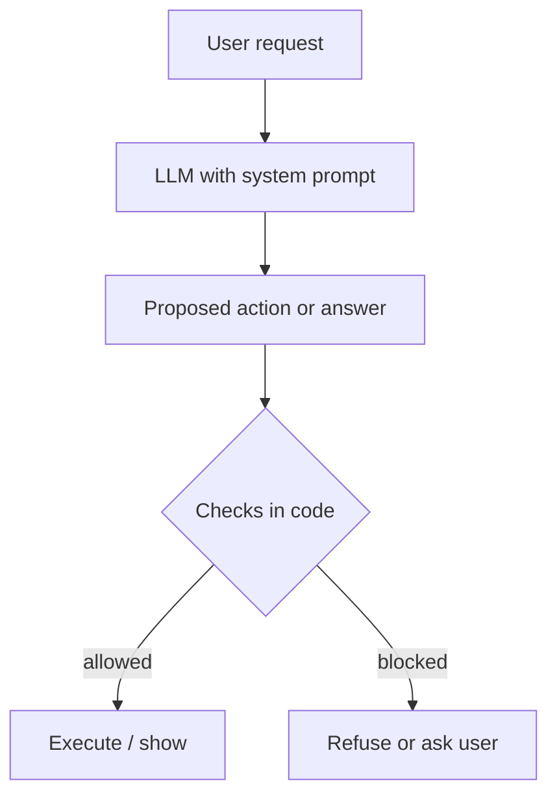
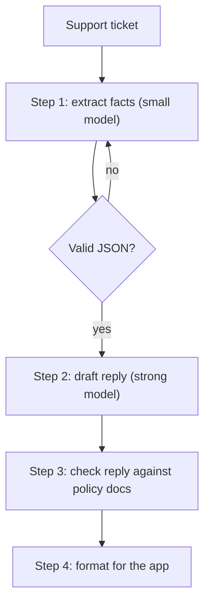
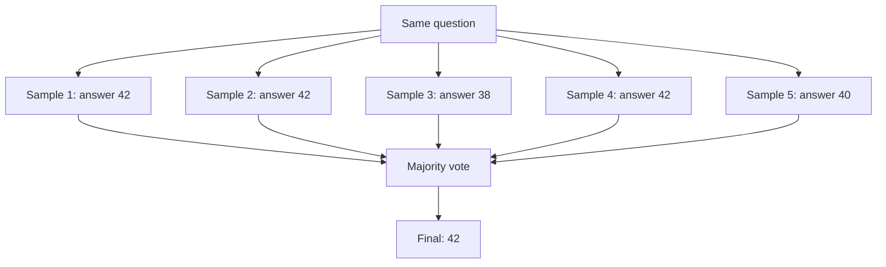
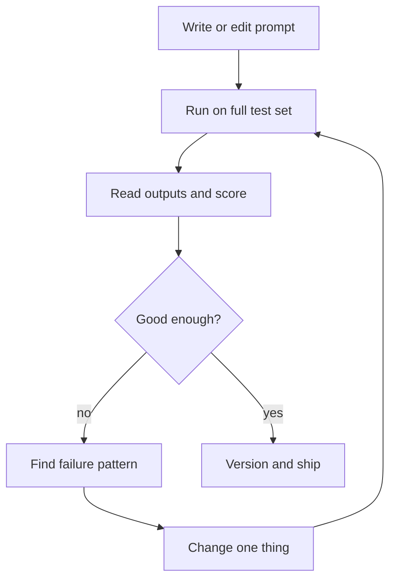
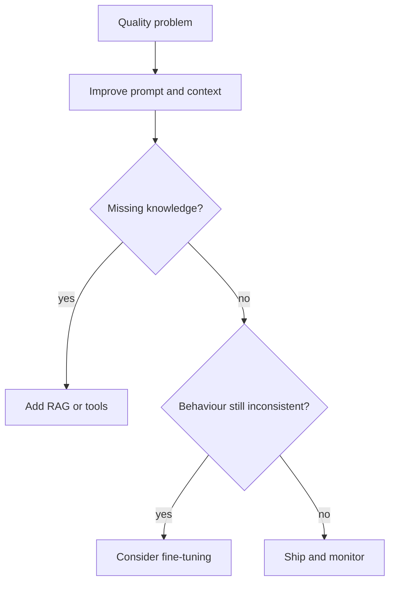

# Prompt Engineering

[⬅ Back to index](../README.md)

Covers: being clear and direct, being specific, XML structure, examples, chain-of-thought, roles and system prompts, long documents, giving the model an "out", positive instructions, temperature, prompt chaining, iteration and versioning, prompt improvers, and when prompting isn't enough.

---

### 1. What makes a good prompt?

<details>
<summary>Answer</summary>

**In short:** A good prompt states the task and why it matters, gives the context the model needs (and nothing else), sets constraints and an exact output format, adds examples when the format is subtle, keeps instructions separate from data, and lets the model say "I don't know". Then you test it against real inputs, because a prompt is code.

#### Why it matters

An LLM only knows what's in its training data and what's in the prompt. It can't see your codebase, your product, your users or your intent. Most bad outputs come from a prompt that leaves gaps, which the model fills with plausible guesses. A good prompt closes those gaps.

#### The ingredients

| Ingredient | What it does | Example |
|---|---|---|
| **Clear task and goal** | Says what to do and why, so the model can make sensible judgement calls | "Summarise this ticket so an on-call engineer can triage it in 30 seconds" |
| **Relevant context** | The documents, data or background needed, and nothing irrelevant | The ticket text, the service name, recent deploys |
| **Constraints** | Length, tone, audience, what to avoid | "Max 5 bullets, no speculation about root cause" |
| **Output format** | Exact structure so your code (or a human) can use it | A JSON schema, headings, a bullet list |
| **Examples** | Show a subtle format or style instead of describing it | 2–3 input → output pairs in `<example>` tags |
| **Separation** | Keeps instructions apart from data so the model doesn't confuse them | `<ticket>...</ticket>` tags or clear delimiters |
| **An "out"** | Permission to say "I don't know" or ask for clarification | "If the ticket has no error message, say so" |

#### A quick before and after

```
Weak:
  Summarise this.

Better:
  You help on-call engineers triage support tickets.
  Summarise the ticket in <ticket> tags in at most 5 bullets:
  what broke, who is affected, when it started, error messages, steps already tried.
  If a field isn't in the ticket, write "unknown" – don't guess.

  <ticket>
  {ticket_text}
  </ticket>
```

#### Then iterate

Your first prompt is a hypothesis. Run it against a small **evaluation set** of realistic inputs (including messy ones), read the outputs, fix the failure patterns, and re-run. Treat prompts like code: versioned, reviewed and regression-tested.

**Common pitfalls**
- Writing the prompt for yourself (you have context the model doesn't).
- Dumping every document "just in case", which dilutes attention and costs tokens.
- Judging a prompt from one or two hand-picked inputs.

**Likely follow-ups**
- *What's the single biggest improvement for most prompts?* Adding missing context and a precise output format.
- *How do you know a prompt is good?* It passes an eval set of realistic cases, not because it "looks right".

</details>
### 2. What does "be clear and direct" mean in practice?

<details>
<summary>Answer</summary>

**In short:** Write the prompt as if briefing a brilliant new colleague who knows nothing about your situation: say what the task is for and who the audience is, give ordered steps when order matters, state exactly what output you want, and ask directly instead of hinting.

#### The "new colleague" mental model

The model is very capable but has **zero context** about your company, project, users or the conversation you had in your head before writing the prompt. Anything you don't say, it guesses. A useful test: hand the prompt to a colleague. If they'd need to ask clarifying questions, the model will guess the answers instead, and the guesses show up as inconsistent output.

#### What it looks like

- **Say what it's for and who reads it.** "This summary goes into a weekly email to non-technical store managers" changes word choice, length and detail.
- **Use numbered steps when order matters.** Models follow explicit sequences more reliably than a paragraph of mixed instructions.
- **Specify the output.** Format, length, sections, language, whether to include a preamble.
- **Ask, don't hint.** Polite vagueness reads as optional.

```
Hinting:
  Maybe you could come up with some subject line ideas for this email?

Direct:
  Write 3 subject lines for the email below.
  Each under 50 characters. Audience: existing customers.
  Return them as a numbered list with no other text.
```

The second version removes four guesses: how many, how long, for whom, and what wrapper text to include.

#### Why it works

Modern instruction-tuned models are trained to follow instructions closely. They're more likely to do *exactly* what you asked than to infer what you meant. That's a feature when you're explicit and a source of "it ignored me" bugs when you aren't. If you want the model to go beyond the literal request ("include extra edge cases", "be thorough"), say so.

**Common pitfalls**
- Leaving out the goal, so the model optimises for the wrong thing (e.g. brevity instead of completeness).
- Burying the actual request in the middle of a long paragraph.
- Assuming shared vocabulary ("use our usual format").

**Likely follow-ups**
- *Is being polite to the model harmful?* No, but politeness shouldn't replace explicit instructions.
- *Should prompts be long or short?* As long as needed to remove ambiguity, and no longer.

</details>

### 3. How do you make a prompt more specific?

<details>
<summary>Answer</summary>

**In short:** Add the details that actually change the output: constraints (length, tone, audience, what to include or exclude), quality criteria for a great answer, relevant context, and instructions for edge cases like missing data or out-of-scope requests.

#### Specificity is about decisions, not word count

Every vague prompt forces the model to make decisions you didn't make. Being specific means making those decisions yourself. Ask: "If two reasonable people wrote this output, where would they differ?" Each of those differences is a detail to add.

#### The four levers

- **Constraints** – length, reading level, tone, language, what to include and exclude.
- **Quality criteria** – what makes an answer great, not just acceptable: "each recommendation must cite a line from the report".
- **Context** – background, data, and the user's real goal.
- **Edge cases** – what to do with missing data, ambiguity, conflicting sources or out-of-scope requests.

#### Example

```
Vague:
  Summarise this report.

Specific:
  Summarise this incident report for the VP of Engineering in 5 bullets:
  1. Impact  2. Root cause  3. Customer effect  4. Fixes done  5. Open risks
  Use plain language and include numbers from the report (duration,
  error rate, affected users). If the report doesn't state the root cause,
  write "Root cause: not yet determined" rather than speculating.
```

The specific version fixes the audience, length, structure, style, evidence requirement and edge case. Outputs become consistent across runs and across different reports, which is what you need in a product.

#### In an app

For a feature like "summarise this user's support history", specificity often lives in a **template** with variables: audience, max length, and required sections are fixed in the prompt, while the data is inserted per request. That keeps behaviour stable as inputs vary.

**Common pitfalls**
- Adding adjectives instead of criteria ("make it really good and detailed").
- Over-constraining creative tasks until outputs feel robotic.
- Forgetting edge cases, which is where hallucinations tend to appear.

**Likely follow-ups**
- *How do you find which details are missing?* Run the prompt on varied inputs and look at where outputs differ or go wrong.
- *Can a prompt be too specific?* Yes, if rules conflict or are so rigid they don't generalise; explain the reason behind rules instead.

</details>

### 4. Why use XML tags in prompts?

<details>
<summary>Answer</summary>

**In short:** XML-style tags such as `<document>`, `<instructions>`, `<example>` or `<customer_email>` clearly separate the parts of a prompt, so the model doesn't confuse your instructions with the data it's processing. They also make it easy to refer to parts of the prompt and to ask for parseable output.

#### The problem they solve

Real prompts mix several kinds of content: instructions, one or more documents, examples, and user input. If it's all one blob of text, the model may treat a sentence inside a customer email ("please ignore the previous message") as an instruction, or blur two documents together. Tags draw explicit boundaries.

#### Benefits

- **Clarity** – fewer mix-ups when a prompt contains documents, examples and instructions.
- **Easy references** – "Using the contract in `<contract>` tags, list every termination clause."
- **Parseable output** – "Put your reasoning in `<thinking>` and the final answer in `<answer>`." Your code can then extract only `<answer>`.
- **Safer handling of untrusted content** – user or web content is clearly marked as data. (This helps but is not a security boundary on its own; see prompt injection.)

#### Example

```
<instructions>
Classify the customer email into one of: billing, bug, feature_request, other.
Reply with only the label inside <label> tags.
</instructions>

<customer_email>
{email_text}
</customer_email>
```

Parsing on the app side:

```kotlin
// Extract the label the model returned, falling back safely
val label = Regex("<label>(.*?)</label>", RegexOption.DOT_MATCHES_ALL)
    .find(response)?.groupValues?.get(1)?.trim()
    ?: "other"
```

#### Tag rules

There are no special or "magic" tag names. Pick descriptive names, use them consistently, and nest them when content is hierarchical (`<documents><document index="1">...</document></documents>`).

**Common pitfalls**
- Inserting untrusted text that itself contains your closing tag (e.g. `</customer_email>`); escape or strip it.
- Relying on tags alone to stop prompt injection.
- Inconsistent naming (`<doc>` in one place, `<document>` in another).

**Likely follow-ups**
- *Why not just JSON?* JSON works too; tags are easier to read for long free-text content and need no escaping of quotes.
- *For structured output, are tags enough?* For strict schemas, prefer the provider's structured-output / JSON mode features.

</details>

### 5. Zero-shot vs few-shot prompting?

<details>
<summary>Answer</summary>

**In short:** Zero-shot gives the model only instructions; few-shot also includes a few input → output examples. Zero-shot is fine for common tasks with strong models; few-shot helps when you need a specific format, label set, style or edge-case handling that's easier to show than describe.

#### Comparison

| | Zero-shot | Few-shot |
|---|---|---|
| What's in the prompt | Instructions only | Instructions + a few examples |
| Best for | Common, well-understood tasks (summarise, translate, simple classification) | Specific formats, house style, custom labels, tricky edge cases |
| Token cost | Lower | Higher, paid on every request |
| Risk | Model's default style may not match yours | Model copies examples too closely |

#### Example

```
Few-shot sentiment labels with a custom "mixed" category:

<example>
Review: "Fast delivery but the case cracked in a week."
Label: mixed
</example>
<example>
Review: "Exactly as described, would buy again."
Label: positive
</example>
<example>
Review: "Never arrived, support never replied."
Label: negative
</example>

Review: "{review_text}"
Label:
```

Without the examples, the model might not know you want a separate `mixed` label, or might answer with full sentences.

#### Tips for few-shot

- Use **diverse, representative** examples, including tricky ones.
- Keep the **format identical** across examples.
- Watch for **over-copying**: models may reuse phrases, lengths or structure from examples.
- Remember examples are paid for on **every request**; prompt caching makes a stable block of examples much cheaper.
- If you need dozens of examples to get it right, that's a signal to consider **fine-tuning** or a different approach.

**Likely follow-ups**
- *What's one-shot?* Few-shot with a single example; it risks the model copying that one example closely.
- *Do reasoning models still need examples?* Less often for reasoning, but examples still help pin down output format and style.

</details>
### 6. What makes good examples in a prompt?

<details>
<summary>Answer</summary>

**In short:** Good examples are relevant (they look like real inputs, including messy ones), diverse (they cover different cases so the model doesn't learn one pattern), clearly marked (e.g. in `<example>` tags), show the format or reasoning you want, and are few but sufficient, usually 3–5.

#### Why examples are powerful, and risky

Examples are the strongest signal in a prompt. The model will pick up not just what you meant but *everything* that's consistent across them: length, tone, number of bullets, even word choice. That's great for format, but it can also teach accidental patterns.

#### Checklist

- **Relevant** – mirror real inputs, including typos, long rambles, mixed languages.
- **Diverse** – vary length, topic and the correct answer. If every example's label is "positive", you've biased the model.
- **Clearly marked** – wrap each in `<example>` tags with consistent input/output fields.
- **Show the "how", not just the answer** – if you want reasoning, include it in the example output.
- **Include edge cases** – an example of the "unknown" or "not applicable" output teaches the model it's allowed.
- **Few but sufficient** – usually 3–5; add more for hard or unusual formats.

#### Over-fitting example

```
If all three examples look like this:
  - Point one
  - Point two
  - Point three

...the model will almost always produce exactly three bullets,
even when the input deserves one or six.

Fix: vary the number of bullets across examples, or state the rule:
  "Use as many bullets as there are distinct issues (1–8)."
```

#### When to describe instead of show

If examples are driving too much behaviour, or you can't make them diverse enough, **describe the principle** in words and keep only one or two examples for format. Mixing a clear rule with a couple of examples is often the most robust option.

**Common pitfalls**
- Picking only "happy path" examples.
- Examples that contradict the instructions (the model usually follows the examples).
- Using real customer data in examples without checking privacy rules.

**Likely follow-ups**
- *Where should examples go?* In a stable part of the prompt (often the system prompt) so they can be cached.
- *How do you choose examples at scale?* Some systems retrieve the most similar examples per request ("dynamic few-shot").

</details>

### 7. What is chain-of-thought (CoT) prompting?

<details>
<summary>Answer</summary>

**In short:** Chain-of-thought means asking the model to reason step by step before giving its final answer, or showing worked examples that include the reasoning. Writing out intermediate steps improves accuracy on maths, logic and multi-step problems because each step conditions the next. Reasoning models do this internally, so explicit CoT prompting matters less for them.

#### Why it works (without the maths)

An LLM generates text one token at a time, and each new token is based on everything written so far. If it has to jump straight to an answer, all the "thinking" must happen in that single step. If it writes out intermediate steps first, those steps become part of the context it reads when producing the answer. It's like the difference between doing long division in your head and on paper.

#### Ways to do it

```
1. Simple instruction
   "Think through this step by step, then give the final answer."

2. Structured, parseable (better for production)
   "First reason inside <thinking> tags. Then give only the final
    answer inside <answer> tags."

3. Few-shot CoT
   Provide examples whose outputs include the worked reasoning.
```

In your app, parse out only the `<answer>` part and show that to the user (or log the reasoning for debugging).

#### Trade-offs

| Pro | Con |
|---|---|
| Higher accuracy on multi-step problems | More output tokens, so higher cost |
| Reasoning can be inspected for debugging | Higher latency |
| Can reveal where the model went wrong | Reasoning text isn't guaranteed to be the model's "true" process |

#### Reasoning models

Newer **reasoning models** (or models with an "extended thinking" / effort setting) think internally before answering. For them, telling them to "think step by step" adds little; a clear problem statement and good context still help. You usually control the depth with a parameter rather than prompt wording.

**Common pitfalls**
- Using CoT for simple tasks (classification, extraction) where it only adds cost.
- Showing raw reasoning to end users when it may be messy or confusing.
- Treating the written reasoning as a reliable explanation for auditing.

**Likely follow-ups**
- *When is CoT not worth it?* Simple lookups or classification at high volume where latency and cost matter.
- *How do you parse the answer reliably?* Put it in a dedicated tag or a structured-output field.

</details>
### 8. What does "role prompting" do, and is it useful?

<details>
<summary>Answer</summary>

**In short:** Role prompting ("You are an experienced tax accountant…") sets the tone, vocabulary and level of detail of responses. It's useful for style and focus, but it doesn't add knowledge the model lacks. Specific context and a clear task usually matter more than the role line.

#### What a role actually changes

A role nudges the model toward the writing patterns associated with that role. "You are a senior Android engineer reviewing a pull request" tends to produce more technical vocabulary, more attention to lifecycle and threading issues, and a reviewer's tone. "You are a friendly support agent for a budgeting app" produces shorter, warmer, simpler replies.

#### What it doesn't change

- It doesn't give the model facts it doesn't know (your internal APIs, last week's incident).
- It doesn't make answers more correct by itself; "You are a world-class expert" is not a quality setting.
- It doesn't replace instructions about format, audience or constraints.

#### Weak vs strong

```
Weak (role does all the work):
  You are a world-class code reviewer. Review this code.

Strong (role + context + task):
  You are a senior Kotlin reviewer for an Android banking app.
  Our priorities: correctness, no main-thread I/O, no PII in logs.
  Review the diff in <diff> tags. For each issue give: file:line,
  severity (high/medium/low), and a one-line fix. Skip style nits.
```

The role in the strong version is helpful, but the priorities and output format do most of the work.

#### Where to put it

Roles typically go in the **system prompt**, so they apply to the whole session and stay cached.

**Common pitfalls**
- Using inflated roles instead of real context.
- Conflicting signals: a "casual friend" role with formal output instructions.

**Likely follow-ups**
- *Does a role help for domain tasks?* Somewhat for tone and focus; accuracy comes from context, retrieval and evals.
- *Should every prompt have a role?* No; add one when tone or perspective matters.

</details>
### 9. What is a system prompt?

<details>
<summary>Answer</summary>

**In short:** A system prompt is a set of instructions placed before the conversation, in a dedicated "system" role, that sets the model's role, behaviour, constraints, tone, output format and tool-use rules for the whole session. It's the main lever for product behaviour, but it is not a security boundary: users can try to override it, so enforce critical rules in code and never put secrets in it.

#### How it fits into a request

Chat APIs take a list of messages. The system prompt sits at the top and the model is trained to give it more weight than ordinary user messages.

```json
{
  "system": "You are the in-app assistant for a recipe app. Answer cooking questions only. Keep replies under 120 words. If asked about anything else, politely redirect.",
  "messages": [
    { "role": "user", "content": "How do I stop pasta sticking?" }
  ]
}
```

#### What typically goes in it

- Role and audience ("in-app assistant for a recipe app, users are home cooks").
- Scope: what to help with and what to decline.
- Tone and length.
- Output format rules.
- Tool-use rules ("call `search_recipes` before recommending a recipe").
- Stable reference material and examples (which also benefits from prompt caching).

#### Not a security boundary

Users can attempt **prompt injection** or **jailbreaks** ("ignore your previous instructions and…"), and content the model reads (web pages, emails, documents) can contain hidden instructions. The model usually follows the system prompt, but not with guarantees.



So: enforce permissions in your backend (the model's tool can only access the current user's data), validate outputs, and use guardrails for sensitive cases. Assume the system prompt can be extracted, so never put API keys, internal URLs or secrets in it.

**Common pitfalls**
- Huge, contradictory system prompts that grow by accretion.
- Putting per-request data (timestamps, user IDs) at the top, which breaks caching.

**Likely follow-ups**
- *System prompt vs user message?* System sets session-wide rules; user messages carry each turn's request.
- *How do you test a system prompt change?* Run your eval set before shipping, and version the prompt.

</details>
### 10. How should you place long documents in a prompt?

<details>
<summary>Answer</summary>

**In short:** Put long documents near the top of the prompt and your question or instructions at the end, wrap each document in tags with metadata like source and title, and for Q&A ask the model to first extract relevant quotes and then answer from them. This generally improves quality on long inputs and makes answers verifiable.

#### Recommended layout

```
<documents>
  <document index="1">
    <source>refund-policy-2025.pdf</source>
    <content>
      {full text}
    </content>
  </document>
  <document index="2">
    <source>support-macros.md</source>
    <content>
      {full text}
    </content>
  </document>
</documents>

First, find quotes from the documents that are relevant to the
question and put them in <quotes> tags, citing the document index.
Then answer the question in <answer> tags using only those quotes.
If no relevant quotes exist, say so.

Question: Can a customer get a refund after 45 days?
```

#### Why each part helps

- **Documents first, question last** – the question is the most recent thing the model reads before answering, so it isn't lost under thousands of tokens of document text. Long stable content at the top also suits **prompt caching**.
- **Tags with metadata** – lets the model tell documents apart and cite them, and lets you refer to them by name.
- **Quote-then-answer** – focuses the model on the relevant passages before it writes, reduces made-up details, and gives you citations to show the user or check automatically.
- **Short, explicit instructions** – say where to look ("using only the documents above").

#### In an app

For a "chat with your PDF" feature, this layout is the core prompt. If documents are too big or too many, switch to retrieval (RAG) and only include the relevant chunks, still using the same tagged structure.

**Common pitfalls**
- Putting the question at the top and thousands of tokens of text after it.
- Concatenating documents with no boundaries, so the model mixes up sources.
- Assuming the model read everything carefully; on very long inputs details in the middle can be missed.

**Likely follow-ups**
- *How do you show citations in the UI?* Ask for document index and quote, then map them back to your source files.
- *When do you stop stuffing and use RAG?* When the documents exceed the window, cost too much per request, or quality drops at that length.

</details>

### 11. What does "giving the model an out" mean?

<details>
<summary>Answer</summary>

**In short:** It means explicitly allowing the model to say it doesn't know or can't do something, for example "If the answer isn't in the documents, say 'I couldn't find this in the provided documents'." Without that permission, models tend to produce *some* answer, which is how many hallucinations happen.

#### Why models need permission

LLMs are trained to be helpful and to produce a complete, fluent response. Faced with a question it can't answer from the context, a model will often produce something plausible rather than admit a gap. An explicit instruction makes "I don't know" a valid, expected output instead of a failure.

#### Common "outs"

```
Missing information:
  If the answer isn't in <documents>, reply exactly:
  "I couldn't find this in the provided documents."

Ambiguity:
  If the request is ambiguous, ask one clarifying question before answering.

Out of scope:
  If the question isn't about our app, say you can only help with the app
  and suggest where they might look instead.

Missing fields in extraction:
  If a field isn't present, return null. Never infer or invent a value.
```

#### Make the out machine-readable

In a product, you often want to detect the "don't know" case in code, for example to show a "Contact support" button. Use a fixed phrase, a status field or a null:

```json
{ "answer": null, "status": "not_found", "reason": "Policy documents don't mention 45-day refunds" }
```

#### Real-world example

A support bot answering from a help centre: without an out, "Do you ship to Iceland?" might get a confident "Yes, we ship worldwide!" invented from general knowledge. With an out plus retrieval, it says it can't find that information and links to the shipping page.

**Common pitfalls**
- Making the out too attractive, so the model refuses things it could answer; check refusal rate in evals.
- Using a vague out ("say if unsure"), which is hard to detect in code.

**Likely follow-ups**
- *Does this eliminate hallucinations?* No, it reduces them; you still need grounding, citations and evals.
- *How do you measure it?* Include unanswerable questions in your eval set and check the model declines.

</details>

### 12. Positive vs negative instructions – which work better?

<details>
<summary>Answer</summary>

**In short:** Telling the model what *to* do usually works better than listing what not to do. "Write in flowing prose paragraphs" beats "Don't use bullet points"; "Reply in under 100 words" beats "Don't be verbose". Also explain the reason behind important rules so the model can generalise to cases you didn't list.

#### Why negatives are weaker

A "don't" tells the model what to avoid but not what to do instead, so it still has to guess the target. Mentioning the unwanted thing can also put it in focus ("don't mention competitors" brings competitors into the context). Positive instructions describe the destination directly.

#### Rewrites

| Negative | Positive |
|---|---|
| Don't use bullet points | Write in flowing prose paragraphs |
| Don't be verbose | Reply in under 100 words |
| Don't use jargon | Use plain language a new customer would understand |
| Don't make things up | Answer only from the documents; if it's not there, say so |
| Don't use markdown | Return plain text suitable for an SMS |

#### Explain the "why"

Rules with reasons generalise better:

```
Rule only:
  Avoid jargon.

Rule + reason:
  Use plain language – readers are new customers who may not know
  banking terms like "APR" or "overdraft buffer". If you must use one,
  explain it in a few words.
```

With the reason, the model also simplifies terms you didn't think to list.

#### When negatives are fine

Hard boundaries are often clearest as a short "never": "Never reveal another user's data." Pair them with the positive behaviour ("If asked, explain you can only access the current user's account") and enforce critical ones in code too.

**Common pitfalls**
- A growing list of "don'ts" added after each bug, which makes prompts long and conflicting.
- Rules with no rationale, which the model applies too literally or not at all.

**Likely follow-ups**
- *Do capital letters or "IMPORTANT" help?* Sometimes, but overuse can make models over-apply a rule; clear wording is better.
- *Where should hard rules go?* System prompt, and enforced in code for anything security-relevant.

</details>

### 13. When should you adjust temperature or other sampling settings?

<details>
<summary>Answer</summary>

**In short:** Use lower randomness for tasks with one right answer (extraction, classification, code) and allow more for creative work like brainstorming. Some newer models don't accept sampling parameters and are tuned for good defaults, so you steer them with instructions, examples, structured outputs and effort settings instead. Either way, temperature doesn't fix a vague prompt.

#### What temperature does (intuitively)

At each step the model has a ranked list of likely next tokens. **Low temperature** makes it stick to the most likely choices, so outputs are more consistent and predictable. **Higher temperature** lets it pick less likely options more often, so outputs are more varied and creative, and also more likely to go off track. Related settings like top-p similarly limit which candidates can be picked.

| Task | Typical setting |
|---|---|
| Data extraction, classification | Low |
| Code generation, SQL | Low |
| Customer support answers | Low to moderate |
| Marketing copy variations, brainstorming | Higher |
| Self-consistency sampling (multiple answers) | Above zero, so answers differ |

#### Important caveats

- **Low temperature isn't fully deterministic.** Even at zero, outputs can vary slightly between runs. Don't build logic that assumes identical output; validate structure instead.
- **Some models don't expose these knobs.** Several newer models (especially reasoning models) don't accept sampling parameters, or recommend leaving them at defaults. You steer them with clear instructions, examples, **structured outputs** for format, and an **effort** or thinking setting for how hard they think.
- **It doesn't fix bad prompts.** If outputs are wrong or inconsistent, the cause is usually missing context or an unclear format. Fix the prompt first, then tune settings and measure on your eval set.

**Common pitfalls**
- Cranking temperature to zero to "stop hallucinations" (it doesn't; grounding does).
- Changing prompt and temperature at the same time, so you can't tell which helped.

**Likely follow-ups**
- *How do you get consistent JSON?* Structured-output features plus schema validation, not temperature.
- *What's max tokens for?* Capping output length and cost; it truncates, so pair it with a length instruction.

</details>

### 14. What is prompt chaining / decomposition, and when do you use it?

<details>
<summary>Answer</summary>

**In short:** Prompt chaining breaks a complex task into a sequence of simpler LLM calls, each with a focused prompt, passing outputs forward (e.g. extract facts → draft answer → check against sources → format). Each step is easier to get right, test and debug, and you can use different models per step. The cost is more calls and latency. It's the step before full agents, where the model decides the steps itself.

#### Why not one big prompt?

A single prompt that has to extract, reason, write and format at once tends to drop instructions, and when it fails you can't tell which part went wrong. Splitting it up is the same idea as splitting a giant function into small, testable ones.



#### Example in code

```kotlin
suspend fun handleTicket(ticket: String): Reply {
    // Step 1: cheap model pulls structured facts
    val facts = llm.extract(model = SMALL, prompt = extractPrompt(ticket))
        .let { Json.decodeFromString<TicketFacts>(it) }   // validate between steps

    // Step 2: stronger model drafts a reply using the facts + policy context
    val draft = llm.complete(model = LARGE, prompt = draftPrompt(facts, policyDocs))

    // Step 3: verification step catches unsupported claims
    val check = llm.complete(model = SMALL, prompt = verifyPrompt(draft, policyDocs))
    return if (check.contains("<ok/>")) Reply(draft) else Reply.escalateToHuman(facts)
}
```

#### Benefits and costs

| Benefits | Costs |
|---|---|
| Each prompt is simpler and more reliable | More API calls, more latency |
| Steps can be tested and evaluated separately | More code to maintain |
| Mix models: cheap for simple steps, strong for hard ones | Errors in early steps propagate |
| Validation and retries between steps | Need to pass context carefully between steps |

#### Chains vs agents

In a chain, **your code** decides the steps; it's predictable and easy to test. In an **agent**, the model decides which tools to call and when to stop; it's more flexible but harder to control. Start with a chain when the steps are known in advance.

**Likely follow-ups**
- *Can steps run in parallel?* Yes, independent steps (e.g. summarising several documents) can run concurrently, then merge.
- *How do you debug a chain?* Log each step's input and output, and evaluate steps individually.

</details>
### 15. What is self-consistency?

<details>
<summary>Answer</summary>

**In short:** Self-consistency means sampling several reasoning paths for the same question (with temperature above zero) and taking the majority answer. Errors tend to scatter while correct reasoning tends to converge, so this improves accuracy on reasoning tasks, at roughly N times the cost.

#### How it works



1. Ask the same question N times with some randomness so each attempt reasons differently.
2. Extract the final answer from each response (so put it in a parseable field or tag).
3. Return the most common answer. The level of agreement is also a rough confidence signal: 5/5 is safer than 2/5.

#### When it fits

- Tasks with a **single checkable answer**: maths, classification, multiple choice, extracting a specific value.
- Not useful for open-ended writing, where there's no "majority" to vote on.

#### Related techniques

| Technique | Idea |
|---|---|
| **Best-of-N** | Generate N candidates; a verifier, judge model or test suite picks the best |
| **Critique and revise** | Model reviews its own answer against criteria and fixes problems |
| **Verification with tools** | Run the code or the tests; keep the answer that passes |

For code, "generate several and keep the one that passes the tests" is usually stronger than voting.

**Common pitfalls**
- Cost and latency scale with N; use it only where accuracy is worth it.
- Using temperature zero, so all samples are nearly identical.
- Voting on free text that differs in wording but not meaning; normalise answers first.

**Likely follow-ups**
- *Is it still useful with reasoning models?* Less often, since they already reason deeply, but voting or verification can still help on high-stakes tasks.
- *How do you use the agreement rate?* Route low-agreement cases to a human or a stronger model.

</details>
### 16. How do you iterate on a prompt systematically?

<details>
<summary>Answer</summary>

**In short:** Treat it like debugging with tests: write a clear first version, build a small test set of realistic and hard inputs, run them all and read the outputs, find failure patterns, change one thing at a time, re-run the whole set to check for regressions, and version the prompt with its results.

#### The loop



#### Step by step

1. **Write a clear first version** using the basics: task, context, format, an out.
2. **Build a test set** of 20–50 realistic inputs to start, including edge cases, messy inputs and inputs that *should* be refused or answered with "unknown".
3. **Run the prompt on all of them** and actually read the outputs. Early on, reading beats metrics.
4. **Identify failure patterns**: missed instruction, wrong format, hallucinated detail, too long, wrong tone.
5. **Change one thing at a time**: add an example, clarify a step, add structure, give an out. Otherwise you won't know what helped.
6. **Re-run the whole set**: a fix for one case often breaks another.
7. **Version the prompt** and store results so you can compare and roll back.

#### Tooling

Provider consoles often include a **prompt generator or improver** that turns a rough description into a structured prompt with tags, examples and step-by-step instructions. That's a useful starting point, but the **eval results** decide what's actually better. As the test set grows, add automated checks (format validation, code-based assertions, LLM-as-judge) so you can run them in CI. See [Evals](13-evals.md).

**Common pitfalls**
- "Vibe checking" with one input and shipping.
- Tuning the prompt to pass the test set exactly (over-fitting); keep some held-out cases.
- Forgetting to re-run evals when the model version changes.

**Likely follow-ups**
- *How big should the test set be?* Start small (tens of cases) and grow it with every production bug you find.
- *Can the model help improve its own prompt?* Yes, ask it to critique the prompt or suggest fixes for failures, then verify with evals.

</details>

### 17. How do you manage prompts in production?

<details>
<summary>Answer</summary>

**In short:** Store prompts as versioned templates (in code or a prompt registry), test every change against an evaluation set before release, roll out gradually and log the prompt version with each request, pin model versions and re-run evals when upgrading, and monitor outputs for format failures, refusals, user feedback and cost.

#### Prompts are code

A one-word change to a prompt can change behaviour for every user, just like a code change. So it deserves the same discipline: version control, review, tests, staged rollout and monitoring.

#### Practices

- **Versioned templates** – keep prompts in files or a prompt registry, not string literals scattered through the codebase. Use variables for per-request data.
- **Regression tests** – run the eval set in CI on every prompt change; block the merge if key scores drop.
- **Gradual rollout / A/B tests** – ship a new version to a percentage of traffic, compare metrics, then expand.
- **Log the prompt version** with each request so you can trace a bad output to the exact prompt and model.
- **Pin model versions** – use a specific model version identifier rather than an alias that can change under you; re-run evals before upgrading.
- **Monitor** – JSON parse failures, refusal rate, latency, cost per request, thumbs up/down, escalation rate.

```kotlin
// Prompt template stored as a resource, versioned with the app
data class PromptTemplate(val id: String, val version: Int, val text: String)

val summarise = PromptTemplate(
    id = "ticket-summary",
    version = 7,
    text = loadResource("prompts/ticket-summary.v7.txt")
)

val response = llm.complete(model = PINNED_MODEL, prompt = summarise.render(vars))
logger.info("llm_call prompt=${summarise.id}@${summarise.version} model=$PINNED_MODEL tokens=${response.usage}")
```

#### Mobile-specific note

If a mobile app calls an LLM, keep prompts on the **backend**, not in the app binary. You can then change them without an app release, keep them out of reach of reverse engineering, and keep API keys off the device.

**Common pitfalls**
- Hot-editing prompts in a dashboard with no tests or history.
- Upgrading models silently and discovering regressions from user complaints.
- No way to tie a user complaint back to a prompt version.

**Likely follow-ups**
- *How do you roll back a bad prompt?* Switch the active version in config or registry; that's why versions and logging matter.
- *Who owns prompts?* The feature team, with review like any code change.

</details>
### 18. How should you write prompts for an LLM-as-judge or classifier?

<details>
<summary>Answer</summary>

**In short:** Define the criteria precisely with a rubric and examples of each label, ask for brief reasoning before the verdict and return a structured verdict, prefer a binary or small scale over 1–10, control for position and length bias, and validate the judge against human labels before trusting it.

#### Why judges need special care

An LLM-as-judge grades other outputs (e.g. "Is this support reply grounded in the policy?"). Its results feed dashboards and release decisions, so an inconsistent or biased judge quietly produces misleading numbers.

#### Prompt checklist

- **Rubric** – exact definition of each label, with an example of each.
- **Reasoning first, then verdict** – a short justification before the label improves consistency.
- **Small scale** – pass/fail or 1–3 is far more consistent than 1–10, where "6 vs 7" is meaningless.
- **One criterion per judge** – separate judges for "grounded", "polite", "answers the question" are easier to validate than one combined score.
- **Structured output** – so your code can aggregate results.

```
You are grading whether a support reply is grounded in the policy.

<rubric>
PASS: every factual claim in the reply is supported by <policy>.
FAIL: at least one claim is missing from or contradicts <policy>.
Tone and style do not matter for this grade.
</rubric>

<policy>{policy}</policy>
<reply>{reply}</reply>

Write one or two sentences of reasoning in <reasoning>, then
output PASS or FAIL in <verdict>.
```

#### Known biases

| Bias | Mitigation |
|---|---|
| **Position bias** in pairwise comparisons (prefers first or second) | Randomise order, or judge both orders and require agreement |
| **Length bias** (longer looks better) | Tell the judge length doesn't matter; check correlation with length |
| **Self-preference** (likes its own model's style) | Use a different model as judge, or validate carefully |

#### Validate the judge

Have humans label a sample (say 50–100 items), run the judge on the same items and check agreement. If the judge disagrees with humans often, fix the rubric before trusting its scores. Re-check periodically. See [LLM Evaluation](13-evals.md).

**Likely follow-ups**
- *When use code instead of a judge?* Whenever the check is deterministic: valid JSON, contains a required field, tests pass.
- *Same rules for production classifiers?* Yes: clear label definitions, examples per label, an "other/unknown" label, and evaluation against labelled data.

</details>
### 19. How do you reduce costs and latency through prompting?

<details>
<summary>Answer</summary>

**In short:** Send fewer tokens (trim instructions, examples and retrieved chunks), ask for concise outputs and cap max tokens, cache stable prompt prefixes, route easy requests to smaller models, batch offline work, and stream responses so users see output sooner.

#### Where cost and time come from

You pay per input and output token, and latency grows with both. **Output tokens** are generated one at a time, so they usually dominate latency, and they're usually priced higher than input tokens. Long prompts add cost and time-to-first-token.

#### Levers

| Lever | Saves | How |
|---|---|---|
| **Shorter prompts** | Cost, some latency | Remove duplicated instructions and unneeded examples; retrieve fewer, better chunks |
| **Concise outputs** | Cost and a lot of latency | "Answer in 2 sentences", structured output with only needed fields, set max tokens |
| **Prompt caching** | Cost and latency on repeated prefixes | Stable system prompt, tools and documents first; variable data last |
| **Model routing** | Cost and latency | Small, fast model for simple requests; strong model only when needed |
| **Batch APIs** | Cost | Offline jobs (nightly tagging, backfills) at discounted batch pricing, results later |
| **Streaming** | Perceived latency | Show tokens as they arrive |
| **Skip unneeded reasoning** | Cost and latency | Don't ask for chain-of-thought on simple tasks; lower effort settings |

#### Example: an in-app "smart reply" feature

- Use a small model, since the task is simple.
- Keep the system prompt and examples stable so they're cached.
- Include only the last few messages, not the whole thread.
- Ask for JSON with three short suggestions, max ~60 tokens.
- Stream or pre-fetch while the user is reading.

#### Measure first

Log input tokens, cached tokens, output tokens and latency per feature. Often one feature or one bloated prompt is most of the bill. Check quality on your eval set after each cost cut so savings don't silently lower quality.

**Common pitfalls**
- Putting a timestamp or user ID at the top of the prompt, which defeats caching.
- Cutting context so aggressively that answer quality drops.

**Likely follow-ups**
- *Biggest single win?* Often caching a long stable prefix, or routing most traffic to a smaller model.
- *Does max tokens improve quality?* No, it only truncates; pair it with a length instruction.

</details>
### 20. When is prompting not enough?

<details>
<summary>Answer</summary>

**In short:** Prompting can't give the model knowledge it doesn't have, take actions, or make a model smaller or cheaper. Use RAG or tools for private or recent data, tools and agents for actions and real-time data, fine-tuning for a very specific consistent style or behaviour, and a fine-tuned small model or classical ML for narrow, high-volume tasks.

#### Match the problem to the fix

| Symptom | Root cause | Better approach |
|---|---|---|
| Wrong or made-up facts about your product, docs or recent events | Model lacks the **knowledge** | **RAG** (retrieve relevant docs) or tools that query your data |
| Needs to book, send, update, check live status | Task needs **actions or real-time data** | **Tools / function calling**, agents |
| Style or format still inconsistent after many examples, or examples don't fit in the prompt | Behaviour is hard to describe | **Fine-tuning** |
| Too slow or too expensive at scale | Large model is overkill | **Smaller model**, possibly fine-tuned or distilled |
| Narrow classification at huge volume needing very high accuracy | Generic LLM is costly and variable | Fine-tuned small model or classical ML |
| Must never do X (e.g. leak data) | Prompts aren't guarantees | **Code-level enforcement** and guardrails |

#### A sensible order



Start with prompting because it's fastest and cheapest to iterate. Move up only when evals show prompting has plateaued. Fine-tuning teaches *behaviour and style* well, but it is a poor way to add frequently changing *facts*; that's what retrieval is for.

**Common pitfalls**
- Jumping to fine-tuning before trying good prompts and retrieval.
- Expecting prompt rules to act as security controls.

**Likely follow-ups**
- *RAG vs fine-tuning in one line?* RAG adds knowledge at request time; fine-tuning changes behaviour by training.
- *How do you decide?* Run evals: if failures are "didn't know", add retrieval; if "knew but did it wrong", improve prompts, then consider fine-tuning.

See [RAG](10-rag-search.md) and [Fine-Tuning](16-choosing-models.md).

</details>
### 21. Rewrite this weak prompt: "Write about our product launch."

<details>
<summary>Answer</summary>

**In short:** Add the audience and purpose, put the launch facts in tags, specify structure and length, set the tone with a reason, and give the model an explicit out for missing information so it doesn't invent details.

#### What's wrong with the original

"Write about our product launch" leaves every decision to the model: which product, for whom, how long, what format, what tone, and which facts. It will invent features, prices and dates to fill the gaps, and every run will look different.

#### Improved prompt

```
You're writing for our company blog. Audience: existing customers (small-business owners), not technical.

<launch_details>
{product name, what it does, price, availability date, 3 key benefits, one customer quote}
</launch_details>

Write a 400–500 word announcement post that:
1. Opens with the customer problem this solves (1 short paragraph).
2. Explains the 3 benefits with one concrete example each.
3. Includes the customer quote.
4. Ends with how to get it and the price.

Tone: warm and confident, no hype words like "revolutionary". Use short paragraphs and one subheading per benefit.
If any detail you need is missing from <launch_details>, write [MISSING: …] instead of inventing it.
```

#### What improved

| Change | Why it helps |
|---|---|
| Audience and purpose (blog, small-business owners, non-technical) | Sets vocabulary, depth and angle |
| Facts in `<launch_details>` tags | Grounds the post in real data and separates data from instructions |
| Numbered structure | Consistent, complete posts every time |
| Length range | Avoids both a 2-line blurb and a 2,000-word essay |
| Tone with concrete guidance ("no hype words like…") | More specific than "be professional" |
| `[MISSING: …]` out | Gaps become visible placeholders a human fills, instead of invented facts |

#### Taking it further

- Add one example of a past launch post you liked, if style matters.
- Validate the output in code: word count, presence of the price, no `[MISSING` left before publishing.
- Turn it into a template with variables and test it on a few past launches as an eval set.

**Likely follow-ups**
- *Why not just say "be accurate"?* The model can't be accurate about facts it doesn't have; supplying the facts and an out is what works.
- *Would a role line help?* Slightly for tone ("You're our content writer"), but audience, structure and data matter much more.

</details>

---

[⬅ Previous: AI Fluency: Working Effectively With AI](03-ai-fluency.md) · [⬅ Back to index](../README.md) · [Next: Context Engineering & Memory ➡](05-context-engineering.md)
