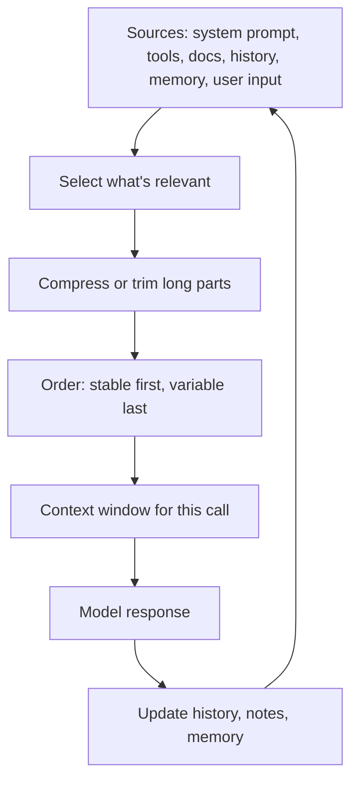
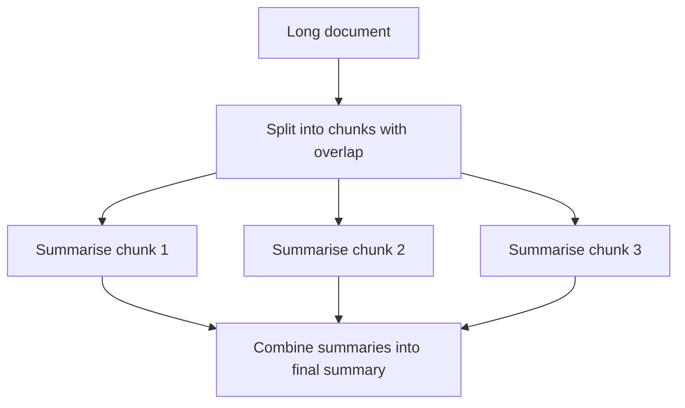
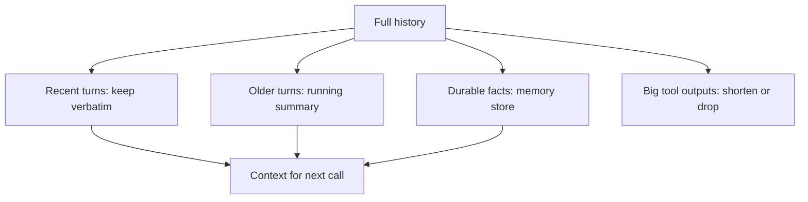
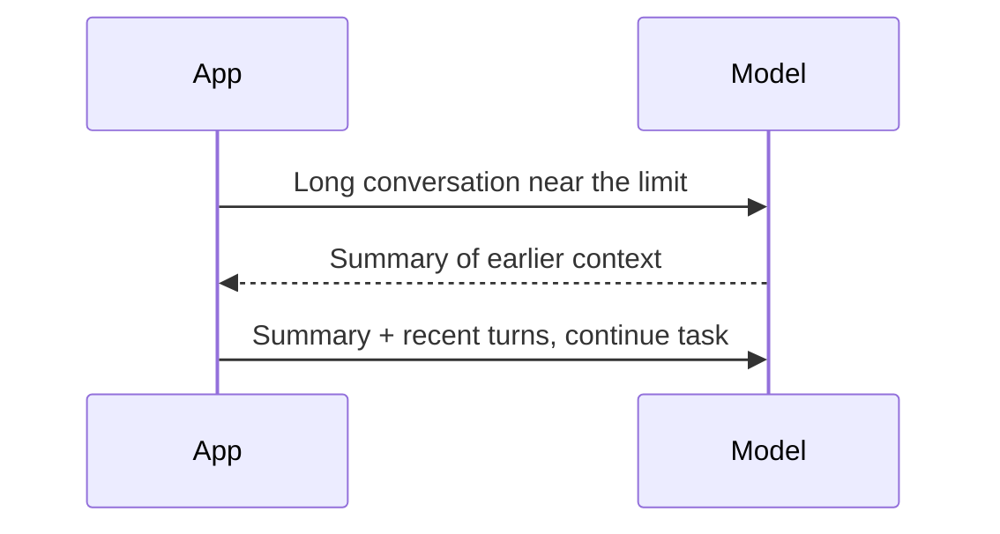
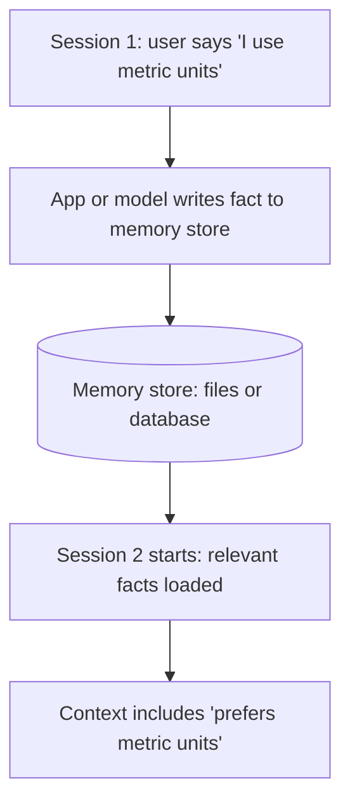
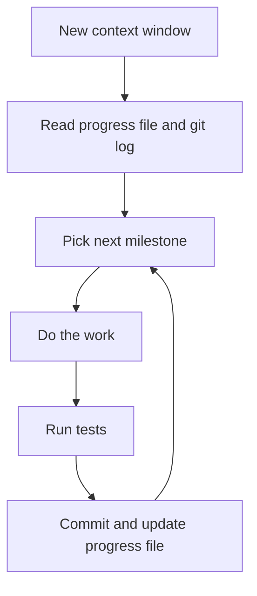
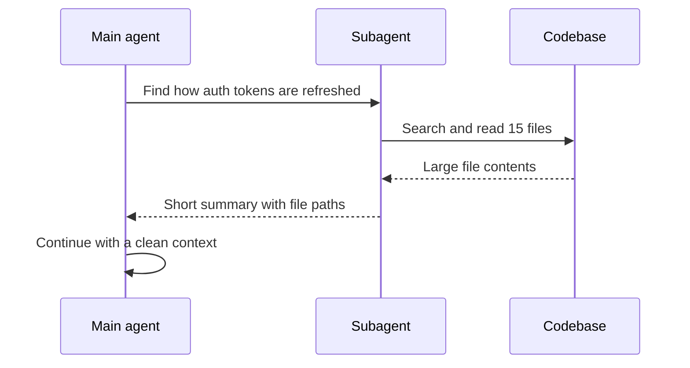
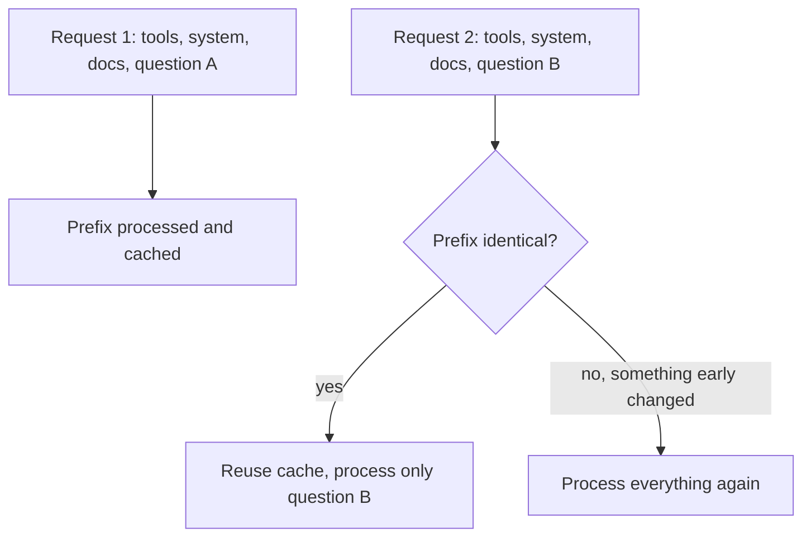

# Context Engineering & Memory

[⬅ Back to index](../README.md)

Covers: what goes into the context window, context engineering, long-context limits, managing conversation history, compaction and clearing old tool results, persistent memory and project instruction files, notes for long tasks, subagents for context isolation, and prompt caching's effect on context design.

---

### 1. What is context engineering?

<details>
<summary>Answer</summary>

**In short:** Context engineering is deciding everything that goes into the model's context window on each call: system instructions, tool definitions, retrieved documents, conversation history, memory, examples and the user's input. The goal is to include what's needed, exclude noise, order it sensibly, compress what's grown too long, and keep stable parts first so prompt caching works. For agents running many steps, it's often the main challenge.

#### Prompt engineering vs context engineering

Prompt engineering is about *how you word* the instructions. Context engineering is the bigger question of *what the model sees at all*. The model is stateless: on every call, the context window is its entire world. If the right fact isn't there, it can't use it; if lots of irrelevant text is there, it may get distracted.

| | Prompt engineering | Context engineering |
|---|---|---|
| Focus | Wording of instructions, examples, format | Selection and management of all inputs |
| Scope | Usually one prompt | Every call, across a whole session or agent run |
| Typical questions | "Is this instruction clear?" | "What should be in the window right now, and what should leave?" |

#### What good context engineering does



- **Include what's needed** – the right documents (via retrieval), the right tools, relevant memory.
- **Exclude noise** – stale tool outputs, irrelevant chat history, unused tool definitions.
- **Order sensibly** – long reference material first, question and key instructions near the end; stable content at the start for caching.
- **Compress** – summarise old turns, shorten tool results after use.
- **Externalise** – keep durable state in files, notes or a memory store and re-read it when needed.

#### Why it matters most for agents

An agent may run dozens of tool calls. Each file it reads and each search result lands in the context. Without management, the window fills with old output, quality drops, cost climbs, and eventually it hits the limit. Techniques like clearing old tool results, compaction, progress notes and subagents exist for exactly this.

**Likely follow-ups**
- *Is context engineering just RAG?* RAG is one part (retrieving documents); context engineering also covers history, tools, memory and ordering.
- *How do you measure it?* Token usage by component, plus eval quality at different context sizes.

</details>
### 2. What fills a model's context window in a real application?

<details>
<summary>Answer</summary>

**In short:** The system prompt, tool definitions, retrieved documents, conversation history, tool calls and their results, images or files, any loaded memory, the current request, and the model's own thinking and output for the turn. In agents, tool results usually grow fastest. Logging token usage per component is the first step to managing quality and cost.

#### A typical breakdown

| Component | Notes | Grows over time? |
|---|---|---|
| **System prompt** | Role, rules, examples | Stable |
| **Tool definitions** | Names, descriptions, JSON schemas for every tool; many tools (or many MCP servers) can be large | Stable, but can be big |
| **Retrieved documents** | RAG chunks for this question | Per request |
| **Memory** | User preferences, project instruction files | Mostly stable |
| **Conversation history** | All previous user and assistant turns | Yes |
| **Tool calls and results** | File contents, search results, logs, API responses | Yes, fastest in agents |
| **Images / files** | Screenshots, PDFs | Per request, can be large |
| **Current request** | The latest user message | Per request |
| **Thinking and output** | Reasoning tokens and the reply for this turn | Per turn |

All of these share one fixed-size window, and you pay for the input tokens on each call.

#### Why tool results dominate in agents

A coding agent that reads five files, runs the tests and greps the codebase might add tens of thousands of tokens in a few steps, much more than the conversation itself. A single verbose log or a large API response can crowd out everything else.

#### Measure it

```kotlin
// Rough per-component accounting before sending a request
data class ContextBudget(
    val system: Int, val tools: Int, val memory: Int,
    val retrieved: Int, val history: Int, val toolResults: Int, val userInput: Int
)

logger.info("context_tokens $budget total=${budget.sum()}")
```

Many APIs return token usage (input, output, cached) in the response, and some offer a token-counting endpoint. Logging this per feature shows where the space goes, for example that unused tool definitions are a third of every request.

**Common pitfalls**
- Loading every available tool into every request.
- Keeping full tool outputs in history long after they've been used.
- Forgetting that images and PDFs consume many tokens.

**Likely follow-ups**
- *How do you reduce tool definition size?* Only expose tools relevant to the task, and keep descriptions concise but clear.
- *Does output count against the window?* Yes, the reply (and any thinking) must fit within the limit too.

</details>

### 3. Does a bigger context window mean you should put everything in it?

<details>
<summary>Answer</summary>

**In short:** No. More context costs more, adds latency, and can dilute attention: models can miss or mix up details in very long inputs ("lost in the middle", sometimes called context rot). Include what's relevant for this step, and use long context only when the task genuinely needs the whole document, checking quality at that length.

#### The three costs of "just put it all in"

1. **Money** – you pay for every input token on every call. A 200-page manual attached to every chat message adds up quickly.
2. **Latency** – the model has to process all of it before producing the first token.
3. **Quality** – a large window means the model *can* accept the text, not that it uses all of it equally well. Studies and practice show details buried in the middle of long inputs are more likely to be missed, and irrelevant text can distract the model or lead it to use the wrong passage. This degradation as context grows is sometimes called **context rot**.

#### Analogy

A large window is like a large desk. You can spread 300 pages on it, but you'll find the right paragraph faster if only the 5 relevant pages are there.

#### What to do instead

- **Retrieve** only the relevant chunks (RAG) for the current question.
- **Summarise** long histories instead of keeping every turn.
- **Trim tool outputs** (e.g. return the matching lines, not the whole log).
- **Drop stale information** (old tool results, resolved sub-tasks).
- **Put key instructions where they won't be lost** – near the end, after long documents.

#### When long context is the right call

| Use long context | Prefer retrieval / trimming |
|---|---|
| Reviewing a full contract for inconsistencies | Answering FAQ questions from a large help centre |
| Summarising an entire meeting transcript | Chat over thousands of documents |
| Refactoring across a handful of related files | Repeated questions over the same large corpus |

Even then, **evaluate at that length**: test questions about details at the start, middle and end of the input.

**Likely follow-ups**
- *Does prompt caching make long context free?* Cheaper and faster for repeated prefixes, but attention dilution still applies.
- *How do you know you've hit context rot?* Quality on your evals drops as input grows, especially for details mid-document.

</details>

### 4. How do you handle text longer than a model's maximum length?

<details>
<summary>Answer</summary>

**In short:** Truncate (keep the most important part), chunk the text and process each chunk then combine the results (map-reduce), switch to a long-context model, retrieve only the relevant chunks (RAG), or summarise hierarchically (sections first, then a summary of summaries). The right choice depends on whether the task needs the whole text or only parts of it.

#### Options compared

| Approach | How it works | Good for | Watch out for |
|---|---|---|---|
| **Truncate** | Keep the most important part (often the beginning, or the most recent part of a log) | Quick classification, titles | Losing important content |
| **Chunk + aggregate (map-reduce)** | Split with some overlap, process each chunk, combine the per-chunk results | Summaries, extraction over long docs | Cross-chunk context is lost; combine step must be good |
| **Long-context model** | Send the whole thing to a model with a bigger window | Tasks needing the full text at once | Cost, latency, attention dilution |
| **Retrieve (RAG)** | Index chunks, fetch only the relevant ones per question | Q&A over large docs or many docs | Retrieval misses = wrong answers |
| **Hierarchical summarisation** | Summarise sections, then summarise the summaries | Very long books, transcripts, codebases | Detail lost at each level |

#### Map-reduce summarisation



```kotlin
suspend fun summariseLong(text: String): String = coroutineScope {
    val chunks = chunker.split(text, maxTokens = 8_000, overlapTokens = 300)
    // Map: summarise chunks in parallel
    val partials = chunks.map { chunk ->
        async { llm.complete(prompt = "Summarise the key points:\n<chunk>$chunk</chunk>") }
    }.awaitAll()
    // Reduce: merge partial summaries
    llm.complete(prompt = "Combine these section summaries into one summary:\n" +
        partials.joinToString("\n") { "<section>$it</section>" })
}
```

The **overlap** reduces the chance that a sentence or idea split across a chunk boundary is lost. For classification over chunks (e.g. "does any part of this contain PII?"), the combine step can be simple: flag the document if any chunk is flagged, or take the most common label.

#### Choosing

- Need an answer to a specific question? **Retrieve.**
- Need a view of the whole thing (summary, overall tone)? **Map-reduce or long context.**
- Only care about the start or end (e.g. latest log lines)? **Truncate deliberately.**

**Likely follow-ups**
- *How do you pick chunk size?* Big enough to hold a coherent idea, small enough for focus; split on natural boundaries like headings or paragraphs.
- *How do you keep references in summaries?* Carry chunk IDs or page numbers through each step.

</details>
### 5. How do you manage conversation history in a long chat?

<details>
<summary>Answer</summary>

**In short:** Keep recent turns verbatim and summarise older turns into a running summary, store durable facts (preferences, decisions) separately and re-inject them when relevant, shrink large tool outputs once used, start a fresh conversation for a new task, and use server-side features like automatic compaction or context editing where available.

#### The problem

Chat APIs are stateless: your app resends the conversation on each turn. A long chat means every request carries more tokens (cost and latency go up), quality can drop as old, irrelevant turns pile up, and eventually you hit the context limit.

#### Techniques



- **Sliding window + running summary** – keep the last N turns word for word; fold older turns into a short summary that's updated periodically.
- **Separate memory for durable facts** – "user prefers metric units", "we decided to use Room, not SQLDelight". Store them in a structured store and inject them at the top when relevant, rather than hoping they survive in the summary.
- **Shrink tool outputs** – once a search result or file content has been used, replace it with a short note ("read `AuthRepository.kt`, 240 lines").
- **Fresh conversation for a new task** – carry over only a short summary.
- **Server-side features** – some providers offer automatic **compaction** (summarising older context as the window fills) and **context editing** (clearing old tool results).

```kotlin
fun buildMessages(history: List<Message>, summary: String?, facts: List<String>): List<Message> {
    val recent = history.takeLast(10)                     // keep last turns verbatim
    val preamble = buildString {
        if (facts.isNotEmpty()) append("<user_facts>\n${facts.joinToString("\n")}\n</user_facts>\n")
        if (summary != null) append("<earlier_conversation_summary>\n$summary\n</earlier_conversation_summary>")
    }
    return listOf(Message.user(preamble)) + recent
}
```

**Common pitfalls**
- Summaries that drop decisions or constraints the user stated early on.
- Truncating from the start and accidentally removing the system prompt or key instructions.
- Re-summarising summaries repeatedly until meaning drifts.

**Likely follow-ups**
- *How many turns to keep?* Depends on turn size; budget by tokens, not message count.
- *Who writes the summary?* Usually a cheap model call triggered when history passes a token threshold.

</details>

### 6. What is compaction, and what's the difference from clearing context?

<details>
<summary>Answer</summary>

**In short:** Compaction summarises earlier context when a conversation approaches its limit and replaces it with the summary, so the session can continue with the key information kept. Clearing (or context editing) removes specific old content, like used tool results, entirely. Starting fresh (e.g. `/clear` in Claude Code) wipes the context for an unrelated task. Compaction keeps continuity but loses detail.

#### Comparison

| | Compaction | Clearing / context editing | Starting fresh |
|---|---|---|---|
| What happens | Older context is **summarised**; summary replaces it | Specific old content (e.g. old tool results) is **removed** | Whole conversation is dropped |
| Keeps | Gist: goals, decisions, progress | Everything except the cleared parts | Nothing (except persistent memory files) |
| Loses | Exact details, verbatim outputs | The removed content | All in-session context |
| Best for | Long sessions on the same task | Agents that read lots of tool output | Switching to an unrelated task |
| Examples | Claude Code and the Claude API (server-side compaction) | Context editing that clears old tool results | `/clear` in Claude Code |

#### How compaction works



The summary aims to keep what matters: the goal, decisions made, files changed, current status and next steps. Everything else is gone, so if the agent later needs an exact error message from an hour ago, it has to look it up again.

#### Why clear tool results

In agent runs, most tokens are tool results the agent has already acted on: the contents of a file it already edited, a search it already used. Removing them frees space without losing the conversation's reasoning. The agent can re-run the tool if it needs the data again.

#### Practical advice

- For long agent tasks, don't rely on compaction alone: have the agent **write important state to files** (a progress note, a to-do list, git commits) that it can re-read after compaction.
- Start fresh when the next task is unrelated; old context is just noise.
- In Claude Code, a project instruction file (`CLAUDE.md`) is reloaded after a fresh start, so put lasting conventions there, not in chat.

**Likely follow-ups**
- *Why not always start fresh?* You lose useful in-progress context; compaction keeps the thread going.
- *Can compaction cause errors?* Yes, if the summary drops a constraint; external notes reduce that risk.

</details>

### 7. How do persistent memory and project instruction files work?

<details>
<summary>Answer</summary>

**In short:** Models are stateless, so "memory" is information an application stores and re-injects into the context. Examples are project instruction files like `CLAUDE.md` in Claude Code (loaded at the start of every session), memory tools where the model or app writes facts to a store and reads them back later, and user memory in assistants that surfaces preferences in new chats.

#### Stateless model, stateful app

The model remembers nothing between calls. Anything that looks like memory is your application (or the provider's product) saving text somewhere and putting it back into the context later.



#### Three common forms

- **Project instruction files** – e.g. `CLAUDE.md` in Claude Code: build and test commands, code conventions, architecture notes, "don't edit generated files". Loaded at the start of every session. Keep them short, specific and current; outdated instructions cause confidently wrong behaviour.
- **Memory tools / stores** – the model gets tools to write and read memories (often as files or database entries) and decides what to save, or the app extracts facts after each conversation.
- **User memory in assistants** – preferences and past context surfaced in new chats. Ideally visible and editable by the user.

Example project instruction file:

```markdown
#### Build
- ./gradlew assembleDebug ; tests: ./gradlew testDebugUnitTest

#### Conventions
- Kotlin, Jetpack Compose, MVVM with StateFlow
- No network calls in ViewModels; use repositories
- Never edit files under build/ or generated/
```

#### Design questions for a memory feature

| Question | Why it matters |
|---|---|
| What's worth remembering? | Too much memory is just noise in every future context |
| How do you avoid storing wrong facts? | A misremembered fact gets repeated confidently forever |
| What about sensitive data? | Health, financial or third-party info needs consent and care |
| Can users see and delete it? | Trust and privacy laws (e.g. right to erasure) |
| When is a memory loaded? | Always, or only when relevant (retrieved by topic) |
| How do memories expire? | Preferences and projects change |

**Likely follow-ups**
- *Is memory the same as fine-tuning?* No, memory is retrieved text in the context; fine-tuning changes the model.
- *How do you scale memory?* Store many items and retrieve only the relevant ones, like RAG over the user's own facts.

</details>

### 8. How do agents keep track of long tasks across many steps or sessions?

<details>
<summary>Answer</summary>

**In short:** They keep durable state outside the context window: a plan or progress file the agent updates and re-reads, git commits and test results as checkpoints, structured state (e.g. JSON) for things like test status, and free-form notes for reasoning and next steps. When a new context starts, the agent re-reads its notes and the code instead of relying only on a compressed summary.

#### The problem

A large task (say, migrating an app from one networking library to another) can take hours and more steps than fit in one context window. After compaction or a fresh session, the agent's memory of the earlier work is partial at best. Without external state it repeats work, forgets decisions or declares victory too early.

#### What durable state looks like

```json
{
  "goal": "Migrate networking from Volley to Retrofit",
  "milestones": [
    { "name": "Add Retrofit + API interfaces", "status": "done" },
    { "name": "Migrate auth endpoints", "status": "done", "commit": "a1b2c3d" },
    { "name": "Migrate feed endpoints", "status": "in_progress" },
    { "name": "Remove Volley dependency", "status": "todo" }
  ],
  "tests": { "passing": 182, "failing": 3, "failing_names": ["FeedRepositoryTest.pagination"] }
}
```

Plus a free-form `NOTES.md`-style file: "Feed pagination uses a cursor, not page numbers; see `FeedApi.kt`. Next: fix pagination test."

#### Techniques

- **Plan / progress file** – a to-do list the agent updates after each step and re-reads at the start of each session.
- **Git commits as checkpoints** – each milestone committed; `git log` and `git diff` show what's done and allow rollback.
- **Tests as ground truth** – test results tell the agent what actually works, which is more reliable than its own summary.
- **Structured + free-form** – JSON for status the agent shouldn't rewrite loosely; notes for reasoning and next steps.
- **Re-read on restart** – read the progress file, recent commits and relevant code rather than trusting a compacted summary.
- **Milestones with verification** – break the task up and verify each part (tests, build) before moving on.



**Likely follow-ups**
- *Why not just rely on compaction?* Summaries lose detail; files are exact and survive any context reset.
- *How does this relate to how humans work?* Same as a good engineer's handoff notes and ticket updates.

</details>

### 9. How do subagents help with context management?

<details>
<summary>Answer</summary>

**In short:** A subagent runs a sub-task in its own fresh context window ("search the codebase for how auth works", "review this diff") and returns only a concise result to the main agent. The main context isn't flooded with everything the subagent read, so it stays focused and cheaper. Use subagents for exploration, research and parallel work; avoid them for tightly coupled steps where the main agent needs all the details.

#### How it works



The subagent might read 50,000 tokens of code, but the main agent only receives a few hundred tokens of findings. It's the same idea as delegating to a colleague: you get their conclusion, not their entire browser history.

#### Good uses

- **Exploration and search** – "where is X implemented?", "which screens use this API?"
- **Research** – reading docs or many web pages and summarising.
- **Independent reviews** – a fresh-context reviewer for a diff isn't biased by the main agent's reasoning.
- **Parallel work** – several subagents investigating separate areas at once.

#### When not to use them

- **Tightly coupled steps** – if the main agent needs exact details (every line it'll edit), a summary loses information and the work gets repeated.
- **Small tasks** – spawning a subagent has overhead: extra calls, latency and token cost.
- **Shared mutable state** – multiple agents editing the same files can conflict.

| Use a subagent | Keep it in the main agent |
|---|---|
| Wide search with a short answer | Editing code it just read |
| Reading lots, reporting little | Steps that depend on precise prior output |
| Independent, parallelisable tasks | Quick one-off lookups |

**Common pitfalls**
- Vague instructions to the subagent, which starts with no context; brief it fully.
- Not asking for a specific output format (paths, line numbers), so results are hard to use.

**Likely follow-ups**
- *Do subagents save total tokens?* Not always; total usage can go up, but the main context stays small and focused.
- *How is this different from multi-agent systems?* It's one form of it: an orchestrator delegating isolated tasks.

</details>

### 10. What is prompt caching and how do you design for it?

<details>
<summary>Answer</summary>

**In short:** Providers can cache the processed state of a repeated prompt prefix (the KV cache), so later requests that start with the same prefix are cheaper and faster. Design for it by putting stable content first (system prompt, tool definitions, long documents, few-shot examples) and variable content last, and by not changing the prefix unnecessarily (e.g. no timestamps at the top).

#### Why it exists

Before generating, the model processes every input token. If 90% of each request is the same system prompt and documents, it's wasteful to process them from scratch every time. With caching, the provider stores the processed prefix and reuses it when the next request starts with exactly the same tokens.

#### How matching works

Caching works on an **exact prefix**: the cache is reused up to the first token that differs. Everything after a change must be processed again.



Depending on the provider, caching is automatic or you mark cache breakpoints explicitly (for example, the Claude API uses `cache_control` markers on content blocks). Caches expire after a short period of inactivity, and there's usually a minimum prefix length for caching to apply. Check your provider's docs for the exact pricing and rules.

#### Designing for it

- **Stable first**: tool definitions → system prompt → long reference documents → few-shot examples → conversation history → latest user message.
- **No volatile values early**: timestamps, request IDs, user names or randomly ordered tool lists at the top break the cache for everything after them.
- **Deterministic serialisation**: build the prompt the same way every time (same tool order, same JSON key order).
- **Append, don't rewrite** history in chat, so each turn extends the cached prefix.

```kotlin
// Wrong: changes every request, invalidates the cache
val system = "Current time: ${Instant.now()}\n" + BASE_SYSTEM_PROMPT

// Right: stable prefix first, volatile data at the end
val system = BASE_SYSTEM_PROMPT
val userMessage = "<current_time>${Instant.now()}</current_time>\n$question"
```

#### Where it pays off

Chatbots with long system prompts, document Q&A over the same document, and agents that resend the same tools and growing history on every step. Check the cached-token counts in the API's usage response to confirm it's working.

**Likely follow-ups**
- *Does caching change the output?* No, it only avoids reprocessing; results are the same as without caching.
- *Does it help with first-request latency?* No, the first request with a new prefix pays full cost; later ones benefit.

</details>
### 11. How should you order content in a prompt for both quality and caching?

<details>
<summary>Answer</summary>

**In short:** Put stable content first (tool definitions, system prompt, long reference documents, few-shot examples) and variable content last (the latest user message, per-request data). That lets the provider cache the stable prefix, and long reference material at the top with the question at the end also tends to improve answers. Keep changing values like timestamps and request IDs out of the early part of the prompt.

#### Recommended order

```
1. Tool definitions            stable    (cached)
2. System prompt               stable    (cached)
3. Long reference documents    stable    (cached)
4. Few-shot examples           stable    (cached)
5. Conversation history        grows by appending
6. Per-request data            variable  (retrieved chunks, current time, user state)
7. Latest user question        variable
```

#### Why the same order serves both goals

- **Caching** needs an identical prefix. Anything that changes per request must come after everything that doesn't, otherwise it breaks the cache for all content after it.
- **Quality** on long inputs tends to be better when documents come first and the question and instructions come last. The question is then the freshest thing the model reads before answering, rather than something it read 50,000 tokens ago.

The two goals happen to agree, so you rarely have to trade one for the other.

#### Wrong vs right

```
Wrong:
  [Request ID: 8f3a…, time: 2026-11-20T10:31:02Z]
  [User question]
  [System instructions]
  [Product manual: 40k tokens]

  → Cache never hits (first line changes every time),
    and the question is buried before the manual.

Right:
  [System instructions]
  [Product manual: 40k tokens]
  [Examples]
  [Current time, user plan tier]
  [User question]

  → Manual and instructions cached across all users;
    question sits right before the answer.
```

#### Edge cases

- **Retrieved chunks** differ per question, so they go after the stable part, not inside it.
- **Per-user stable content** (e.g. a user's memory) can sit after the global prefix: it's cached for that user's next turns even if it differs across users.
- **Dynamic tool lists** – if tools change per request, the cache breaks from the very start; keep the tool set stable where possible.

**Likely follow-ups**
- *What if instructions must change by user tier?* Put tier-specific instructions after the shared prefix, or keep a few fixed variants that each get cached.
- *How do you verify it's working?* Watch cached-token counts and latency in your logs after deploying.

</details>

---

[⬅ Previous: Prompt Engineering](04-prompt-engineering.md) · [⬅ Back to index](../README.md) · [Next: Structured Outputs & Extraction ➡](06-structured-outputs.md)
