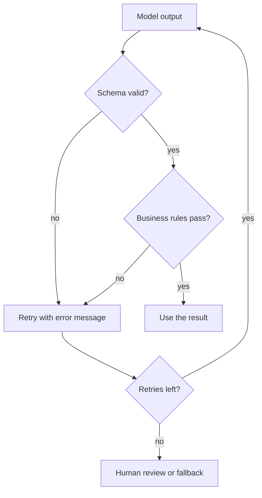
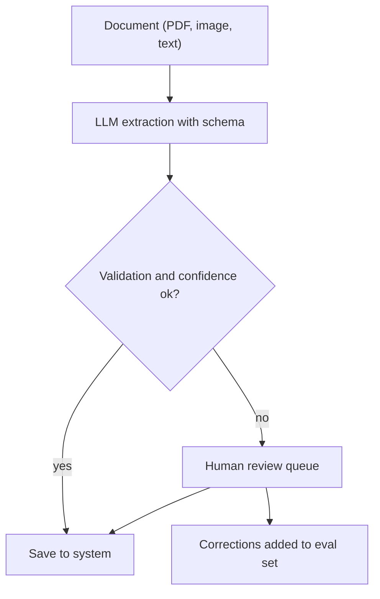
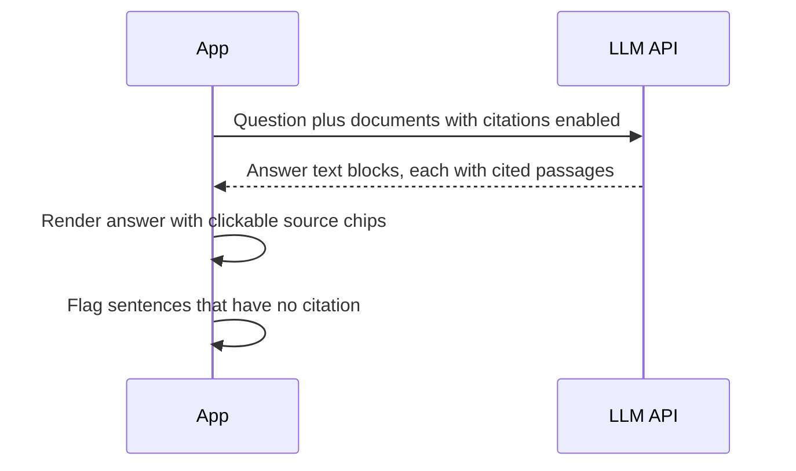

# Structured Outputs & Extraction

[⬅ Back to index](../README.md)

Covers: getting reliable JSON, schemas and structured-output modes, strict tool inputs, validation and retries, extraction from documents, classification outputs, citations, and checking stop reasons.

---

### 1. How do you get reliable structured output (JSON) from an LLM?

<details>
<summary>Answer</summary>

**In short:** Use the provider's **structured outputs (JSON schema) mode** or **tool calling with a strict schema**, which constrain generation so the output always matches the schema. Then **validate it in code** (Pydantic, Zod, kotlinx.serialization) and retry with the error message if a business rule fails. Prompting alone ("reply in JSON") is the weakest option.

#### Why this is a problem at all

An LLM produces text one token at a time. If you just ask for JSON, it usually complies, but now and then you get a stray "Here is the JSON:" preamble, a markdown code fence, a trailing comma, a missing closing brace (because the output was truncated), or a field named `customerName` instead of `customer_name`. At a few hundred requests a day that is a few broken screens; at a million it is a steady stream of production errors.

#### The options, from most to least reliable

| Approach | How it works | Reliability |
|---|---|---|
| Structured outputs / JSON schema mode | You pass a JSON schema; the provider uses **constrained decoding**, meaning at each step only tokens that keep the output valid against the schema are allowed | Output is guaranteed to parse and match the schema (on supported models and schema features) |
| Tool calling (strict mode where available) | You define a tool whose input schema is your data shape; the model "calls" it and you read the arguments | Same guarantee in strict mode; good when the model also chooses an action |
| Prompt-only JSON | Schema and example in the prompt, "respond with JSON only", low temperature | Usually works, occasionally breaks; needs parsing defences |

#### A typical pipeline

```python
from pydantic import BaseModel, ValidationError
from typing import Literal

class Ticket(BaseModel):
    category: Literal["billing", "bug", "feature_request", "other"]
    priority: Literal["low", "medium", "high"]
    summary: str

def classify(text: str, attempts: int = 2) -> Ticket:
    error_hint = ""
    for _ in range(attempts):
        raw = call_llm_with_schema(          # your wrapper around the provider's structured-output mode
            schema=Ticket.model_json_schema(),
            prompt=f"Classify this support ticket.\n<ticket>{text}</ticket>{error_hint}",
        )
        try:
            return Ticket.model_validate_json(raw)   # shape + types checked in code
        except ValidationError as e:
            error_hint = f"\nYour previous answer was invalid: {e}. Fix it."
    raise RuntimeError("Could not get a valid ticket")  # route to fallback / human review
```

#### Tips that improve results

- Keep schemas **simple and flat**; deeply nested or very large schemas are harder for the model and some schema features are not supported in constrained mode.
- Use **enums** for categorical fields so the model cannot invent a new label.
- Make "not found" explicit (nullable fields) so the model does not guess.
- Give field **descriptions**; the model reads them like instructions.

**Pitfalls**
- Assuming schema-valid means correct. It only guarantees shape (see question 4).
- Not checking the stop reason: a response cut off at `max_tokens` can still be incomplete.
- Stripping code fences with regex in prompt-only mode and calling it done.

**Likely follow-ups**
- *What is constrained decoding?* The decoder masks out tokens that would break the schema, so invalid JSON can't be produced.
- *What if my provider has no JSON mode?* Use tool calling, or prompt with an example plus validate-and-retry.

</details>

### 2. How do you design a good output schema?

<details>
<summary>Answer</summary>

**In short:** Keep it **small and flat**, use **enums** for categories, give every field a clear name and description, allow `null` for "not present" instead of forcing a guess, and optionally put a short `reasoning` field **before** the decision fields. Treat the schema as an API contract and version it.

#### Why schema design matters

The schema is effectively part of your prompt. The model reads field names and descriptions to decide what to put where, and it generates fields **in order**. A confusing schema produces confusing output even when the JSON is perfectly valid.

#### Principles

| Principle | Why |
|---|---|
| Flat and small | Fewer places to go wrong; easier to validate; nest only for real lists (e.g. line items) |
| Enums for categories | Prevents invented labels like `"Billing Issue"` vs `"billing"` |
| Descriptive names + descriptions | `invoice_total_incl_tax` beats `amount` |
| Nullable for missing data | A required field with no data invites hallucination |
| Reasoning before decision | The model generates left to right, so a reason written first can inform the decision |
| Confidence or evidence field | Lets you route uncertain cases to review |
| Versioned | Mobile clients and downstream services parse it |

#### Example

```json
{
  "type": "object",
  "properties": {
    "reasoning": {
      "type": "string",
      "description": "One or two sentences explaining the classification."
    },
    "category": {
      "type": "string",
      "enum": ["billing", "bug", "feature_request", "other"]
    },
    "order_id": {
      "type": ["string", "null"],
      "description": "Order ID if the customer mentions one, otherwise null. Do not guess."
    },
    "needs_human": { "type": "boolean" }
  },
  "required": ["reasoning", "category", "order_id", "needs_human"],
  "additionalProperties": false
}
```

Notice `order_id` is required but nullable: the model must explicitly say "not found" rather than silently omit or invent it.

**Pitfalls**
- Putting `reasoning` *after* the answer: it then just rationalises a decision already made.
- Free-text fields where a category would do; you then need a second parsing step.
- Changing field names without versioning and breaking an older app release.

**Likely follow-ups**
- *Should I show the reasoning to users?* Usually no; it is for debugging, evals and review queues.
- *How do you handle a list of unknown length?* An array of small objects, with a sensible max you check in code.

</details>

### 3. Structured outputs vs tool calling for getting JSON?

<details>
<summary>Answer</summary>

**In short:** Use **structured outputs** when the whole response should be data (extraction, classification, form filling). Use **tool calling** when the model has to decide **whether and which** action to take and supply validated arguments. On supported models both use constrained decoding (tool calling in strict mode), so both guarantee schema-valid JSON.

#### How they differ

| | Structured outputs | Tool calling |
|---|---|---|
| What you get | The response itself is JSON matching your schema | A tool-call block with arguments matching the tool's input schema |
| Who decides to produce it | Always produced | The model may call a tool, call a different one, or answer in text |
| Best for | Extraction, classification, generating a UI model | Agents and actions: search, create ticket, fetch weather |
| Multiple shapes | One schema per request | Several tools, each its own schema |
| Follow-up | Done, parse and use | You run the tool, send the result back, the model continues |

#### Mental model

Structured outputs is "fill in this form". Tool calling is "here is a toolbox; use what you need". Historically people used a fake tool plus "force the model to call this tool" to get JSON. That still works with some models, but note that some newer models don't allow *forcing* a specific tool, and dedicated structured outputs is now the cleaner option when you just need JSON back.

```python
ticket = create(                     # structured outputs: always a Ticket-shaped JSON
    model=..., messages=..., output_schema=TICKET_SCHEMA)

response = create(                   # tool calling: model may pick create_ticket, lookup_order, or neither
    model=..., messages=..., tools=[CREATE_TICKET, LOOKUP_ORDER])
for block in response.content:
    if block.type == "tool_use":
        run_tool(block.name, block.input)   # input already matches the tool schema (in strict mode)
```

(Parameter names are illustrative; each provider names them differently.)

**Pitfalls**
- Using tool calling for pure extraction and then handling the case where the model "chose" not to call the tool.
- Forgetting that in tool calling the arguments are proposals: validate and authorise before executing anything.

**Likely follow-ups**
- *Can I combine them?* Yes: an agent can use tools during the task and return its final answer in a structured format.
- *Which is cheaper?* Roughly the same; tool definitions add input tokens to every request.

</details>

### 4. Why validate model output even with structured outputs?

<details>
<summary>Answer</summary>

**In short:** A schema guarantees **shape**, not **truth**. The JSON can be perfectly valid and still wrong: an invoice total that doesn't match the line items, a date in the future, an order ID that doesn't exist. Add business validation in code, retry with the error or send to human review on failure, and track failure rates as a quality metric.

#### Two layers of validation



Constrained decoding handles the first diamond. Only your code can handle the second, because only your code knows the business rules and has access to your database.

#### Examples of business checks

```python
def check_invoice(inv: Invoice, db) -> list[str]:
    errors = []
    if abs(sum(li.amount for li in inv.line_items) - inv.subtotal) > 0.01:
        errors.append("Line items do not add up to subtotal")
    if inv.invoice_date > date.today():
        errors.append("Invoice date is in the future")
    if not db.vendor_exists(inv.vendor_id):
        errors.append(f"Unknown vendor_id {inv.vendor_id}")
    return errors
```

If `errors` is non-empty, one retry with "Your previous answer had these problems: ..." fixes a surprising share of cases. If it still fails, send it to a person rather than writing bad data.

#### Why log failure rates

How often validation fails is a cheap, always-on quality signal. A jump after a prompt change or model upgrade tells you something regressed before users complain.

**Pitfalls**
- Retrying forever (cost and latency explode); cap at one or two retries.
- Silently "fixing" output in code (e.g. recomputing totals) and hiding a real extraction problem.
- Trusting IDs and URLs from the model without looking them up.

**Likely follow-ups**
- *Is validation enough to stop hallucinations?* No, it catches checkable errors only; evals and grounding (citations) cover the rest.

</details>

### 5. How do you extract data from documents reliably?

<details>
<summary>Answer</summary>

**In short:** Give the model the document clearly delimited, define a schema with descriptions and "null if not present", ask for **supporting quotes or page references** for each field, validate in code against known data, and route low-confidence or failed cases to human review whose corrections feed your eval set.

#### The steps

1. **Provide the document clearly.** Pass text, PDFs or images using the API's document/image inputs, or wrap text in tags like `<document>...</document>` so instructions and content can't be confused. For scans, image input or an OCR step comes first.
2. **Define the schema.** Each field has a description and is nullable: "Due date in ISO 8601. null if not stated. Do not infer."
3. **Ask for evidence.** For each important field, a `source_quote` or page number. This makes guesses visible and lets reviewers check quickly.
4. **Validate in code.** Totals add up, dates are plausible, the vendor exists in your system, the currency is one you support.
5. **Human in the loop.** Low confidence, failed validation or high-value documents go to a review queue. Corrections become new eval cases, so quality improves over time.



#### Example field definition

```json
"total_amount": {
  "type": ["object", "null"],
  "properties": {
    "value": { "type": "number" },
    "currency": { "type": "string", "enum": ["USD", "EUR", "INR"] },
    "source_quote": { "type": "string", "description": "Exact text from the document" },
    "page": { "type": "integer" }
  }
}
```

**Pitfalls**
- Very long documents: split by page or section, extract per chunk, then merge, or the model can miss details buried in the middle.
- Asking for too many fields at once; split into focused calls if quality drops.
- Not measuring accuracy per field; "92% overall" can hide a field that is wrong half the time.

**Likely follow-ups**
- *How do you measure accuracy?* A labelled set of documents, field-level exact or fuzzy match, tracked per release.
- *LLM or traditional OCR/templates?* Templates win for one fixed layout at huge volume; LLMs win for varied layouts.

See the [document extraction design](20-ai-system-design.md).

</details>

### 6. How do you build a reliable classifier with an LLM?

<details>
<summary>Answer</summary>

**In short:** Define each label precisely with examples and edge cases, include an "other/unclear" label, constrain the output to the label set with an enum, optionally ask for a one-sentence reason first, and measure on a labelled set, especially the confusion between similar labels. At very high volume, consider a small fast model or training a cheaper classifier on LLM-generated labels.

#### Why LLM classifiers fail

Usually not because the model is weak, but because the **labels are vague**. If two humans would disagree on whether "my card was charged twice" is `billing` or `bug`, the model will be inconsistent too. Most of the work is writing a clear label guide.

#### A good classification prompt

```text
Classify the support message into exactly one category.

billing: charges, refunds, invoices, payment methods.
  Example: "I was charged twice this month" -> billing
bug: the app behaves incorrectly or crashes.
  Edge case: a payment screen crash is a bug, not billing.
feature_request: asks for something the product does not do.
other: anything else, or if you are unsure.

<message>{text}</message>
```

The output schema is `{"reason": string, "category": enum[...]}`, so the model cannot invent a label.

#### Evaluating it

Build a labelled set (a few hundred real examples is a good start) and check accuracy plus a **confusion matrix**, a table of "true label vs predicted label". It shows exactly where the model mixes things up (e.g. `bug` vs `feature_request`), which tells you which definitions to sharpen.

#### Scaling cheaply

| Volume | Approach |
|---|---|
| Low to medium | A capable model with a good prompt |
| High | A small fast model, prompt-tuned against the eval set |
| Very high | Use the LLM to label data, then train or fine-tune a cheap classifier, keeping the LLM for unclear cases |

**Pitfalls**
- No "other" label, which forces wrong confident answers.
- Testing on a handful of examples and shipping.
- Changing label definitions without re-running the eval.

**Likely follow-ups**
- *Multi-label?* Use an array of enums and evaluate per label.
- *Confidence scores?* Self-reported confidence is only a rough signal; agreement across samples or a second model is more reliable.

</details>

### 7. What are citations features, and why use them?

<details>
<summary>Answer</summary>

**In short:** Some APIs (e.g. Claude's citations on document inputs) return an answer split into parts, each pointing to the **exact passages** (character ranges, pages) of the documents you supplied that support it. Users can verify answers, you can check grounding automatically, and unsupported claims stand out because they have no citation. It is more trustworthy than asking the model to write citations as free text, which can itself be hallucinated.

#### The problem it solves

In a "chat with your documents" feature, users need to know whether an answer actually comes from their documents. If you prompt "cite your sources", the model may produce a plausible-looking quote or page number that doesn't exist. A built-in citations feature ties each part of the answer to real locations in the input, which the API returns as structured data rather than prose.

#### How it fits into an app



On the client you can render each cited span as a link that scrolls to the highlighted passage in the PDF, similar to footnotes.

#### Benefits

- **Verifiability**: users click through and check.
- **Automatic grounding checks**: an eval can measure what share of claims carry a citation.
- **Hallucination spotting**: an uncited factual sentence is a red flag.
- **Compliance**: legal, medical and finance features often need traceability.

**Pitfalls**
- A citation proves the passage exists, not that it fully supports the claim; spot-check in evals.
- Citations only cover documents you pass in, so they don't help with the model's general knowledge.

**Likely follow-ups**
- *How would you do this without a citations feature?* Number the chunks, ask the model to reference chunk IDs, and verify quoted text against the source in code.

</details>

### 8. Why must you check the stop reason of a response?

<details>
<summary>Answer</summary>

**In short:** The stop reason tells you **why generation ended**: finished normally, hit `max_tokens` (output truncated, so JSON may be incomplete), wants to call a tool, paused, or **refused** (declined by safety systems). Code that reads the text without checking can parse truncated JSON, ignore a pending tool call, or show an empty answer. Handle each case explicitly.

#### What can go wrong if you ignore it

- A long extraction stops at `max_tokens`: your parser fails on half a JSON object, or worse, a lenient parser accepts a partial list and you save incomplete data.
- The model asked for a tool (`tool_use`), but your code treats the response as the final answer and shows the user nothing.
- The response was a refusal and your UI shows a blank bubble.

#### Handle each case

| Stop reason (Claude naming) | Meaning | What to do |
|---|---|---|
| `end_turn` | Finished normally | Use the response |
| `max_tokens` | Hit your output limit | Raise `max_tokens`, ask it to continue, or split the task; never parse as complete |
| `tool_use` | Wants a tool run | Execute the tool, send the result back, continue the loop |
| `stop_sequence` | Hit one of your custom stop strings | Expected if you set one |
| `pause_turn` | A long server-side tool turn paused | Send the conversation back to let it continue |
| `refusal` | Declined by safety systems | Show a graceful message; use fallback options where the provider supports them |

```python
match response.stop_reason:
    case "end_turn":
        return parse(response)
    case "tool_use":
        return run_tool_loop(response)
    case "max_tokens":
        raise TruncatedOutput("Increase max_tokens or split the input")
    case "refusal":
        return SafeMessage("Sorry, I can't help with that request.")
    case _:
        log.warning("Unhandled stop reason %s", response.stop_reason)
```

Other providers use different names (e.g. a "finish reason" of `length` instead of `max_tokens`), but the idea is the same.

**Pitfalls**
- Only testing the happy path, so truncation shows up first in production on long inputs.
- Not logging stop reasons; a rising share of `max_tokens` is an early warning.

**Likely follow-ups**
- *Does structured output mode remove the need?* No, a truncated response still can't be complete.

</details>

---

[⬅ Previous: Context Engineering & Memory](05-context-engineering.md) · [⬅ Back to index](../README.md) · [Next: Building With LLM APIs ➡](07-building-with-llm-apis.md)
