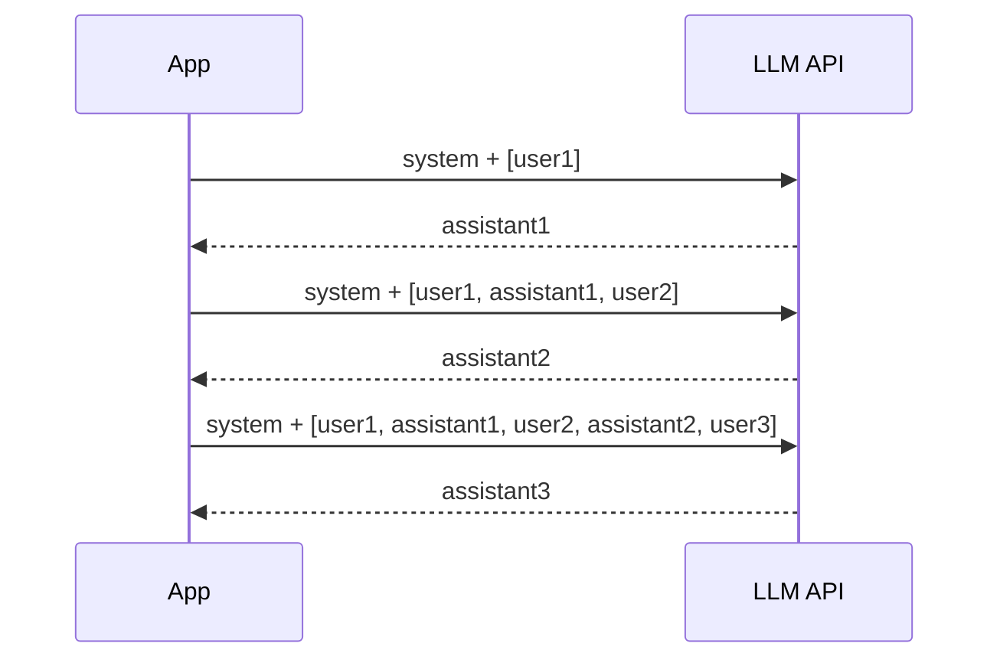
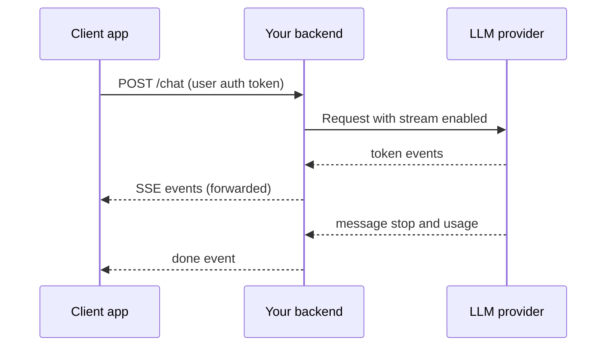
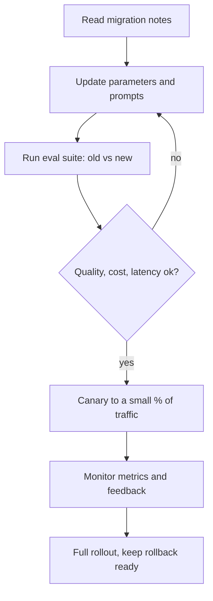
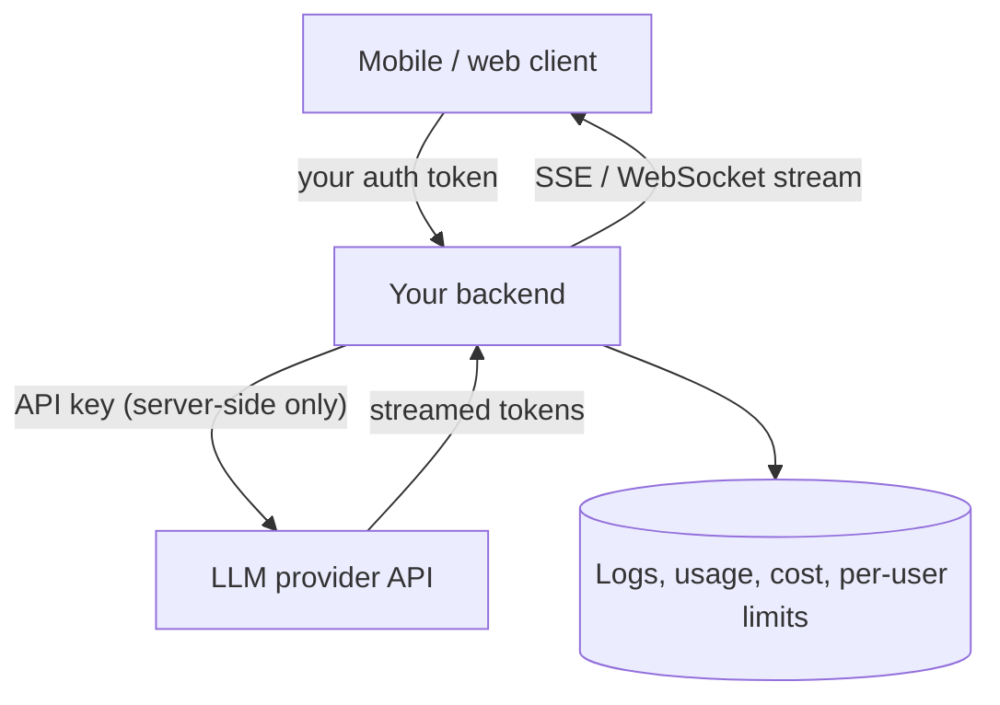

# Building With LLM APIs

[⬅ Back to index](../README.md)

Covers: how a chat API request works, roles and multi-turn conversations, system prompts, max tokens and stop reasons, streaming, errors, retries and rate limits, API key security, model versions, token counting, batch processing, effort and thinking controls, SDKs, cloud platforms, integrating an LLM into a mobile or web app, testing code that calls an LLM, and common first-time mistakes.

---

### 1. What does a typical LLM API request look like?

<details>
<summary>Answer</summary>

**In short:** You send a **model** ID, an optional **system** prompt, the conversation as a list of **messages** (alternating `user` and `assistant` turns), and **max_tokens**, plus optional tools, output schema, thinking/effort settings and streaming. You get back content blocks, a **stop reason** and **usage** (token counts).

#### The parts of a request

A request to a messages-style API (e.g. Claude's Messages API) contains:

| Field | What it does |
|---|---|
| `model` | Which model to use (an exact ID in production) |
| `system` | Instructions for the whole conversation: role, rules, tone, format |
| `messages` | The conversation as alternating `user` and `assistant` turns; content can be text, images, documents, tool calls and tool results |
| `max_tokens` | Maximum output length |
| Optional | `tools`, output format/schema, thinking or effort settings, `stream`, metadata |

```python
import anthropic
client = anthropic.Anthropic()   # reads the API key from the ANTHROPIC_API_KEY environment variable

response = client.messages.create(
    model="claude-opus-5-5",
    max_tokens=1024,
    system="You are a concise assistant for a travel company.",
    messages=[{"role": "user", "content": "Suggest 3 weekend trips from Bengaluru."}],
)
print(response.content[0].text)
print(response.stop_reason, response.usage.input_tokens, response.usage.output_tokens)
```

#### The response

- **content**: a list of blocks, not a single string. Usually a `text` block, but it can include `tool_use` blocks (the model wants a tool run) or thinking blocks. That is why robust code loops over blocks instead of always reading `content[0].text`.
- **stop_reason**: why generation ended (see question 4).
- **usage**: input and output token counts (and cached tokens), which you log for cost tracking.

Think of it like any REST call: a JSON body in, a JSON body out. Nothing is remembered on the server between calls.

**Pitfalls**
- Hardcoding `content[0].text`, which breaks when the first block is a tool call or thinking.
- Leaving `max_tokens` too low and getting truncated answers.

**Likely follow-ups**
- *Where does the "memory" come from?* You resend the history each time (question 2).
- *What is a token?* A chunk of text, roughly a short word or part of a word; pricing and limits are counted in tokens.

</details>

### 2. How do multi-turn conversations work with a stateless API?

<details>
<summary>Answer</summary>

**In short:** The API remembers nothing between calls, so **your application stores the conversation** and sends the full history every time: append the user's message, call the API, append the assistant's full response, repeat. That means long chats cost more per turn, you control (and can trim) what the model sees, and you must persist conversations yourself.

#### How it works



Each request is self-contained. The "chat" exists only because your code keeps a list and sends it again. This is similar to a stateless REST backend where the client sends a session token, except here the client sends the whole session.

#### Consequences

| Consequence | What to do |
|---|---|
| Input tokens grow every turn, so cost and latency rise | **Prompt caching** for the unchanged prefix; summarise or drop old turns |
| Very long chats hit the context window | Trim history, summarise older turns, or keep facts in a separate memory store |
| You decide what the model sees | You can edit, redact or remove turns (e.g. strip personal data) |
| Nothing persists by default | Store conversations in your database if users expect to resume them |

#### Append full content blocks

When the response contains tool calls or thinking blocks, append the **entire** `response.content`, not just the text. Tool results must reference the tool call they answer, and dropping blocks causes API errors or confused behaviour.

**Pitfalls**
- Two devices updating the same conversation without ordering, producing interleaved or duplicate turns.
- Trimming history mid-tool-call, leaving a tool result without its call.

**Likely follow-ups**
- *Do some APIs keep state for you?* Some offer server-side conversation or agent features, but the underlying model call is still stateless; understand what is stored and for how long.

</details>

### 3. What's the difference between the system prompt and user messages?

<details>
<summary>Answer</summary>

**In short:** The **system prompt** holds the application's (operator's) persistent instructions: role, rules, tone, format, tool-use guidance. **User messages** carry the end user's requests and data. Keep your rules in the system prompt, keep user-supplied content in user turns, clearly delimited, and remember the system prompt is neither secret nor tamper-proof, so enforce critical rules in code.

#### Who writes what

| | System prompt | User messages |
|---|---|---|
| Written by | You, the developer | The end user (and content you insert, like retrieved documents) |
| Lifetime | Whole conversation | One turn |
| Typical content | "You are a support assistant for Acme. Answer only about Acme products. Use bullet points." | "How do I reset my password?" plus pasted text |
| Trust level | Trusted | Untrusted |

```python
client.messages.create(
    model="claude-opus-5-5",
    max_tokens=1024,
    system=(
        "You are a support assistant for Acme's banking app. "
        "Only answer questions about the app. Never ask for passwords or OTPs."
    ),
    messages=[{
        "role": "user",
        "content": f"<user_message>{user_text}</user_message>",
    }],
)
```

#### Why "not secret, not tamper-proof"

Users can sometimes coax a model into revealing its system prompt or ignoring it (prompt injection), and documents you insert can contain instructions too. So:

- Don't put API keys, internal URLs or anything sensitive in the system prompt.
- Enforce real rules in code: permission checks before tool calls, output filters, rate limits.
- Wrap user and retrieved content in tags so the model can tell instructions from data.

**Pitfalls**
- Putting per-user data (name, account status) in the system prompt in a way that breaks prompt caching; put stable content first and variable content later.
- Relying on "never do X" in the prompt as your only safety control.

**Likely follow-ups**
- *Where do retrieved documents go?* Usually in a user turn (or a dedicated section), clearly delimited and treated as data.

</details>

### 4. What are max_tokens and stop reasons?

<details>
<summary>Answer</summary>

**In short:** **max_tokens** caps how long the output can be; if the model hits it, the response is cut off (`stop_reason: "max_tokens"`). The **stop reason** tells you why generation ended, and you must handle each one: `end_turn`, `max_tokens`, `tool_use`, `stop_sequence`, `pause_turn` and `refusal`.

#### max_tokens

It is a ceiling, not a target: the model doesn't try to fill it. It protects you from runaway cost and latency.

- **Short tasks** (classification, a yes/no, a title): set it low.
- **Long tasks** (reports, code, extraction of big documents): set it generously and **stream** the response, because long non-streamed requests risk timeouts.

#### Stop reasons (Claude naming)

| Stop reason | Meaning | Your code should |
|---|---|---|
| `end_turn` | Finished naturally | Use the answer |
| `max_tokens` | Truncated at your limit | Not treat it as complete; raise the limit, continue, or split the task |
| `tool_use` | Wants a tool run | Run the tool, send the result, call again |
| `stop_sequence` | Hit a custom stop string you set | Use the text up to it |
| `pause_turn` | A long server-side tool turn paused | Send the conversation back to continue |
| `refusal` | Declined by safety systems | Show a graceful message |

```python
if response.stop_reason == "max_tokens":
    log.warning("Truncated output for request %s", request_id)
    raise TruncatedOutput()
```

Other providers call this a "finish reason" and use different names (for example `length`), but the cases are the same.

**Pitfalls**
- Parsing truncated JSON or showing a half-sentence as the final answer.
- Setting a huge `max_tokens` everywhere "just in case" without streaming, then hitting timeouts.

**Likely follow-ups**
- *Does max_tokens include the input?* No, it limits output; input plus output must still fit in the context window.
- *Does thinking count?* Thinking tokens count toward output and are billed as output.

</details>

### 5. Why stream LLM responses, and how?

<details>
<summary>Answer</summary>

**In short:** Generation takes seconds, so streaming tokens as they are produced makes the app feel responsive: users start reading after the **time to first token (TTFT)** instead of waiting for the whole answer. Stream from the provider to your backend and on to the client via **Server-Sent Events (SSE)** or WebSockets, and handle cancellation, partial rendering and mid-stream errors.

#### Why it matters

A 600-token answer can take many seconds to generate. Without streaming, the user stares at a spinner for that whole time. With streaming, text appears within about a second and keeps flowing, the same perceived-speed trick as progressive image loading. Long requests are also less likely to hit HTTP timeouts when streamed.

#### How it flows



```python
with client.messages.stream(
    model="claude-opus-5-5",
    max_tokens=2048,
    messages=history,
) as stream:
    for text in stream.text_stream:
        send_sse_event(text)               # forward each chunk to the client
    final = stream.get_final_message()     # full message, stop_reason and usage for logging
```

On Android you might read the SSE stream with OkHttp and expose it as a Kotlin `Flow<String>` that the UI collects; on iOS, `URLSession` bytes with `AsyncSequence`.

#### Things to handle

- **Cancellation**: when the user leaves the screen or taps stop, cancel the upstream request so you stop paying for tokens nobody reads.
- **Partial rendering**: markdown and code blocks are incomplete mid-stream; render tolerantly and re-render as text arrives.
- **Errors mid-stream**: the connection can drop after half the answer; show what you have plus a retry option.
- **Structured outputs** can also be streamed and parsed incrementally, e.g. to fill a UI list item by item.

**Pitfalls**
- Buffering the stream in a proxy or load balancer, which silently turns streaming back into one big response.
- Forgetting to log usage at the end of the stream.

**Likely follow-ups**
- *SSE or WebSocket?* SSE is simpler for one-way server-to-client streaming over plain HTTP; WebSockets when you need two-way real-time messages.

</details>

### 6. How should an app handle API errors, retries and rate limits?

<details>
<summary>Answer</summary>

**In short:** Retry **transient** failures (429 rate limits, 5xx/overloaded, timeouts, connection errors) with **exponential backoff and jitter**, respecting `retry-after`. Don't retry 4xx request errors (bad request, auth, not found); fix the request. Catch specific error types, throttle to stay within your limits, and have a fallback for prolonged outages.

#### Which errors to retry

| Error | Retry? | Why |
|---|---|---|
| 429 rate limited | Yes, after `retry-after` / backoff | You exceeded requests- or tokens-per-minute |
| 500, 529 overloaded, other 5xx | Yes, with backoff | Provider-side, usually temporary |
| Timeout, connection reset | Yes | Network blip |
| 400 invalid request | No | The request itself is wrong (bad parameter, too long) |
| 401 / 403 | No | Bad key or no permission |
| 404 | No | Wrong model ID or endpoint |

Official SDKs retry a few times by default with backoff, so check that before adding your own layer (double retry layers multiply load).

#### Backoff with jitter

Exponential backoff waits 1s, 2s, 4s, 8s...; **jitter** adds randomness so thousands of clients that failed at the same moment don't all retry at the same moment and cause another spike.

```python
import anthropic, random, time

def call_with_retry(**kwargs):
    for attempt in range(4):
        try:
            return client.messages.create(**kwargs)
        except anthropic.RateLimitError:
            wait = 2 ** attempt + random.random()   # or read the retry-after header
        except anthropic.APIConnectionError:
            wait = 2 ** attempt + random.random()
        except anthropic.BadRequestError:
            raise                                   # don't retry: fix the request
        time.sleep(wait)
    return fallback_response()                      # cheaper model, cached answer, or friendly message
```

#### Staying within limits

- **Throttle or queue** on your side to keep within tokens-per-minute and requests-per-minute limits.
- Spread bulk work over time, or move it to a **batch API** (question 10).
- Apply **per-user** limits so one user can't exhaust the whole app's quota.

**Pitfalls**
- A generic `catch (e: Exception)` that retries bad requests forever.
- Retrying non-idempotent side effects (e.g. a tool that sends an email) along with the model call.

**Likely follow-ups**
- *What's a good fallback?* A different model or provider for the same task, a cached answer, or a clear "try again later" message.

</details>

### 7. How do you keep API keys safe?

<details>
<summary>Answer</summary>

**In short:** Never put provider API keys in client apps (mobile or browser) or in source code; call the model **from your backend**. Store keys in a secrets manager or environment variables, use separate keys per environment and service, rotate them, set **spend limits** and monitor usage, and revoke immediately if one leaks.

#### Why not in the app

Anything shipped in an APK, IPA or JavaScript bundle can be extracted: decompiling an APK or reading a web bundle takes minutes, and obfuscation only slows it down. A leaked LLM key means someone else runs workloads on your bill, possibly with your rate limits, and possibly gets access to data your account can see.

```kotlin
// Wrong: key ships inside the APK
val client = LlmClient(apiKey = BuildConfig.LLM_API_KEY)

// Right: the app calls your backend with the user's session token;
// only the backend holds the provider key
val reply = api.chat(ChatRequest(message), authToken = session.token)
```

#### Checklist

| Practice | Why |
|---|---|
| Keys only on the server, in a secrets manager or env vars | Not in code, not in the app |
| Separate keys per environment (dev, staging, prod) and per service | Limit blast radius; easy to revoke one |
| Rotate regularly | Limits how long a silent leak is useful |
| Spend limits and usage alerts per key | Spot a leak by an unusual spike |
| Short-lived credentials / workload identity where supported (e.g. via a cloud platform) | No long-lived secret to steal |
| Secret scanning in repos and CI | Catch committed keys; revoke immediately if found |

**Pitfalls**
- Committing a `.env` file, or a key in a sample project that later becomes public.
- Thinking "the endpoint is private" protects a key embedded in the app.

**Likely follow-ups**
- *What about on-device models?* No key is needed for a local model; the risks shift to model size, quality and device performance.

</details>

### 8. Why pin model versions, and how do you upgrade safely?

<details>
<summary>Answer</summary>

**In short:** Different model versions behave differently (style, verbosity, instruction following, supported parameters), so production should use an explicit model ID, not a moving alias. Upgrade like any dependency: read the migration notes, run your **eval suite** on the new model, review prompts, compare cost and latency, and roll out gradually with monitoring. Track deprecation dates.

#### Why pinning matters

A model is a dependency, like a library version. If an alias silently points to a newer model, your output format, tone or tool-calling behaviour can change overnight with no code change on your side, which is very hard to debug. Pinning makes behaviour changes a deliberate deploy.

#### A safe upgrade process



Things to look for:
- **Parameters** can change or be removed between generations (e.g. older models used a fixed thinking budget, newer ones use effort settings).
- **Prompts** written for older models may be over-prescriptive (lots of CAPITALISED rules); newer models often follow them too literally.
- **Cost and latency** may differ, and the same text can count as a different number of tokens.

**Pitfalls**
- Upgrading because a new model is "better" without measuring on your own tasks.
- Waiting until the deprecation date and migrating in a rush.

**Likely follow-ups**
- *Aliases are useful when?* Prototyping and internal tools where you want the latest without effort.

</details>

### 9. How do you count tokens, and why does it matter?

<details>
<summary>Answer</summary>

**In short:** Use the provider's **token-counting endpoint** before a call, or the `usage` field returned with every response after it. Don't use a different provider's tokenizer, because tokenizers differ between model families and even generations. Token counts drive cost, latency, context-window limits and rate limits.

#### What a token is, practically

A token is a chunk of text, often a word or part of one; code, non-English text and unusual strings usually take more tokens per character. You don't need to know the algorithm, only that **you can't count tokens reliably by counting words**.

#### How to count

```python
count = client.messages.count_tokens(
    model="claude-opus-5-5",
    system=system_prompt,
    messages=history,
)
print(count.input_tokens)        # before sending: will this fit, what will it cost?

response = client.messages.create(...)
log_usage(response.usage)        # after: input, output and cache tokens actually billed
```

#### Why it matters

| Concern | How tokens affect it |
|---|---|
| Cost | Billed per input and output token; output is usually priced higher |
| Latency | More output tokens means longer generation |
| Context window | Input plus output must fit; long documents or chats can overflow |
| Rate limits | Often expressed in tokens per minute |

Logging input, output and cached tokens **per request, per feature, per user** is the basis of any cost analysis ("the summarise feature costs X per active user per month").

**Pitfalls**
- Estimating with another provider's tokenizer and getting budgets wrong.
- Forgetting that images, PDFs and tool definitions also consume input tokens.

**Likely follow-ups**
- *How do you cut token usage?* Prompt caching, trimming history, shorter system prompts, retrieving fewer but better chunks, and lower effort or a smaller model where quality allows.

</details>

### 10. When should you use a batch API?

<details>
<summary>Answer</summary>

**In short:** For **non-urgent, high-volume** work: evaluations, back-filling summaries, classifying a large backlog, generating descriptions offline. Batch APIs process requests asynchronously (results within hours) at a significant discount (Claude's Message Batches are 50% off). Track each request by its custom ID, since results can come back in any order, and handle per-request errors and expired items.

#### Real-time vs batch

| | Regular API | Batch API |
|---|---|---|
| Latency | Seconds | Asynchronous, up to hours |
| Price | Standard | Discounted (50% for Claude's Message Batches) |
| Rate-limit pressure | Competes with live traffic | Processed separately |
| Use for | Anything a user is waiting on | Offline jobs |

Example: an e-commerce app wants an AI-written summary for 200,000 products. Nobody is waiting on it, so you submit it as batches overnight, pay half price, and keep your real-time rate limits free for the in-app assistant.

#### The workflow

1. Build a list of requests, each with a **custom ID** (e.g. the product ID).
2. Submit the batch and store the batch ID.
3. Poll for status (or check periodically from a scheduled job).
4. When done, read the results and **match each by custom ID**; order is not guaranteed.
5. Handle each result's outcome: succeeded, errored (fix and resubmit) or expired (resubmit).

```python
for result in client.messages.batches.results(batch_id):
    if result.result.type == "succeeded":
        save_summary(product_id=result.custom_id, message=result.result.message)
    else:
        retry_queue.add(result.custom_id)    # errored or expired
```

**Pitfalls**
- Using batch for user-facing features, then seeing hour-long waits.
- Assuming results come back in submission order.

**Likely follow-ups**
- *Can you combine batching with prompt caching?* Yes, shared prefixes (like a long instruction block) can still benefit.

</details>

### 11. What do effort and thinking settings control?

<details>
<summary>Answer</summary>

**In short:** On current Claude models, **adaptive thinking** lets the model decide how much to reason, and the **effort** setting (low, medium, high, xhigh, max) controls how thorough it is and how many tokens it spends overall, including thinking, tool calls and explanation length. Use lower effort for chat, classification and high-volume routes, higher effort for coding, complex analysis and long agentic tasks, and tune it per route with evals. (Older models used a fixed "thinking budget" in tokens instead.)

#### What "thinking" is

Before giving its final answer, a model can produce internal reasoning (thinking tokens): working through the problem, checking steps, planning tool calls. More reasoning usually helps on hard problems and is wasted on easy ones. Thinking tokens are billed as output and add latency.

#### Effort as a dial

| Effort | Typical routes | Trade-off |
|---|---|---|
| Low | Chat replies, classification, extraction at high volume | Fastest, cheapest; may miss subtle cases |
| Medium / high | General assistants, moderate analysis, most coding | Balanced |
| xhigh / max | Hard debugging, complex multi-step agent tasks, deep analysis | Slowest, most tokens; best on hard problems |

Analogy: it is like telling a colleague "quick answer is fine" vs "take your time and be thorough". The same person, different depth.

#### How to choose

Don't set one global value. Each feature (route) has its own needs, so run your eval suite at two or three effort levels and pick the lowest that meets the quality bar. Re-check when you change models.

**Pitfalls**
- Maxing effort everywhere, then wondering why cost and latency doubled.
- Carrying over a token-based thinking budget from an older model when migrating; check the migration notes.

**Likely follow-ups**
- *Can users see the thinking?* Depending on the API and settings, you may get thinking content or a summary; don't rely on it as a user-facing explanation.

</details>

### 12. SDK vs raw HTTP – which should you use?

<details>
<summary>Answer</summary>

**In short:** Use the **official SDK** for your language whenever one exists. It handles authentication, retries, timeouts, streaming, typed requests and responses, typed errors and tool-use helpers, and keeps up with API changes. Use raw HTTP only where no SDK exists or for quick experiments, and avoid unofficial "compatible" wrappers in production.

#### What the SDK gives you for free

| Concern | Raw HTTP | Official SDK |
|---|---|---|
| Auth headers, API version header | Write yourself | Built in |
| Retries with backoff | Write yourself | Built in (configurable) |
| Streaming (SSE parsing) | Parse events yourself | Iterators / helpers |
| Types | Untyped JSON | Typed objects, autocomplete |
| Errors | Inspect status codes | Typed exceptions (rate limit, bad request...) |
| New features | Read docs, update models | Usually available in an update |

Raw HTTP is fine for a quick check from a terminal:

```bash
curl https://api.anthropic.com/v1/messages \
  -H "x-api-key: $ANTHROPIC_API_KEY" \
  -H "anthropic-version: 2023-06-01" \
  -H "content-type: application/json" \
  -d '{"model":"claude-opus-5-5","max_tokens":256,
       "messages":[{"role":"user","content":"Hello"}]}'
```

For a mobile app the "SDK vs HTTP" question is usually about your **backend**, because the app talks to your server, not to the provider.

**Pitfalls**
- Unofficial wrappers that lag behind features (new content block types, stop reasons) or silently change defaults.
- Pinning an ancient SDK version and missing fixes.

**Likely follow-ups**
- *What about multi-provider libraries?* Handy for switching providers, but they can hide provider-specific features; check they support what you need.

</details>

### 13. Can you use models through cloud platforms instead of the provider directly?

<details>
<summary>Answer</summary>

**In short:** Yes. Claude, for example, is available directly via Anthropic's API and through Amazon Bedrock, Google Cloud Vertex AI and Microsoft Foundry. Reasons to go through a cloud platform: existing contracts and billing, data residency and private networking inside your cloud, and consolidated security and IAM. Trade-offs: some features may arrive later or differ, model IDs and client setup differ, and pricing may differ.

#### Comparison

| | Provider API directly | Through a cloud platform |
|---|---|---|
| Billing | Separate account with the provider | On your existing cloud bill and commitments |
| Auth | Provider API keys | Cloud IAM roles, often no long-lived key |
| Networking | Public internet endpoint | Can stay within your cloud's network and regions |
| New features | Usually first | Can arrive later or differ |
| Model IDs, SDK setup | Provider's | Platform-specific |

#### When each makes sense

- A startup with no big cloud commitment: going direct is simplest and gets new features first.
- An enterprise already running on one cloud, with compliance teams and spend commitments: going through that cloud often wins on procurement, IAM and data-residency grounds.

**Pitfalls**
- Building a feature around a capability, then finding it isn't available (yet) on your platform; check feature availability first.
- Hardcoding model IDs; they differ between platforms, so keep them in config.

**Likely follow-ups**
- *Can you use several?* Yes, some teams use one as a fallback for the other during outages, behind a thin internal interface.

</details>

### 14. Write a minimal multi-turn chat loop.

<details>
<summary>Answer</summary>

**In short:** Keep a `history` list, append each user message, call the API with the full history, check the stop reason, append the assistant's **full content blocks**, print the text, and repeat. That shows you understand the API is stateless and the app owns the conversation.

```python
import anthropic
client = anthropic.Anthropic()
history = []

while True:
    user = input("You: ")
    if user in ("exit", "quit"):
        break
    history.append({"role": "user", "content": user})
    response = client.messages.create(
        model="claude-opus-5-5", max_tokens=2048,
        system="You are a helpful, concise assistant.",
        messages=history,
    )
    if response.stop_reason == "refusal":
        print("Assistant: Sorry, I can't help with that.")
        history.pop()                      # drop the refused turn so the history stays valid
        continue
    history.append({"role": "assistant", "content": response.content})   # keep full content blocks
    print("Assistant:", "".join(b.text for b in response.content if b.type == "text"))
```

#### Talking points

- **The app owns history**: each call sends everything; the API remembers nothing.
- **Full content blocks** are appended, not just text, so thinking or tool blocks stay intact if you add them later.
- **Stop reasons are checked**: here only `refusal`; a real app also handles `max_tokens` and `tool_use`.
- **Turns alternate**: popping the refused user message avoids two user turns in a row.

#### What you'd add in production

| Addition | Why |
|---|---|
| Streaming | Responsive UI |
| History trimming / summarisation | Stay within the context window and control cost |
| Prompt caching | Cheaper, faster repeated prefix (system prompt and early turns) |
| Error handling and retries | Rate limits and overloads happen |
| Persistence | Resume conversations across sessions and devices |
| Tool loop | If the assistant can take actions |

**Likely follow-ups**
- *How would you add tools?* While `stop_reason == "tool_use"`, run each requested tool, append a user turn with the tool results, and call again.

</details>

### 15. How should a mobile or web app integrate an LLM feature?

<details>
<summary>Answer</summary>

**In short:** The client never talks to the provider with your API key. It calls **your backend** with its normal user auth; the backend adds the system prompt, context and tools, enforces per-user limits, calls the model, validates output, logs usage and **streams** the result back via SSE or WebSocket. The client renders partial output, handles errors and cancels when the user leaves.



#### Responsibilities by layer

| Layer | Does |
|---|---|
| Client (Android, iOS, web) | Auth, UI state, render streamed markdown, cancel on leave, retry button, offline handling |
| Backend | Holds the key; builds prompt (system prompt + user data + retrieved docs); tools; per-user rate limits and quotas; output validation and moderation; logging cost and quality |
| Provider | Runs the model |

#### Client side (Android sketch)

```kotlin
class ChatViewModel(private val repo: ChatRepository) : ViewModel() {
    private var job: Job? = null
    val reply = MutableStateFlow("")

    fun send(message: String) {
        job?.cancel()
        job = viewModelScope.launch {
            reply.value = ""
            repo.streamReply(message)                      // Flow<String> backed by SSE from your backend
                .catch { reply.value += "\n\nSomething went wrong. Tap to retry." }
                .collect { chunk -> reply.value += chunk } // append and re-render markdown
        }
    }
    // viewModelScope cancels the stream when the screen goes away,
    // which closes the connection so the backend can stop generation
}
```

#### Other considerations

- **Per-user quotas**: one user (or a script with a stolen session) shouldn't be able to run up your bill.
- **Timeouts and errors**: friendly messages and a retry, never a raw stack trace.
- **On-device models** suit small, private or offline features (summarise a note, smart reply); use the cloud for complex ones. Many apps mix both.
- **Privacy**: tell users what is sent to an AI provider, and avoid sending more personal data than needed.

**Pitfalls**
- Calling the provider directly from the app "just for the prototype" and shipping it.
- No cancellation, so generation (and billing) continues after the user has left.

**Likely follow-ups**
- *How do you protect the backend endpoint itself?* Normal user auth, per-user rate limits, abuse detection, and App Check / App Attest style device attestation where available.

</details>

### 16. How do you test code that calls an LLM?

<details>
<summary>Answer</summary>

**In short:** Separate two concerns. **Your code's logic** (parsing, validation, retries, the tool loop) gets normal deterministic unit tests with the LLM client behind an interface and replaced by a **fake**. **The AI behaviour's quality** gets an **eval suite** run against the real model with graders, run before releases and on prompt or model changes, not on every unit-test run.

#### Layer 1: unit tests with a fake

Put the model behind an interface you own, then inject a fake that returns canned responses, including the awkward ones.

```kotlin
interface LlmClient {
    suspend fun complete(request: LlmRequest): LlmResponse
}

class FakeLlmClient(private val responses: ArrayDeque<LlmResponse>) : LlmClient {
    val requests = mutableListOf<LlmRequest>()
    override suspend fun complete(request: LlmRequest): LlmResponse {
        requests += request
        return responses.removeFirst()
    }
}

@Test
fun `truncated output is not saved as a complete summary`() = runTest {
    val fake = FakeLlmClient(ArrayDeque(listOf(
        LlmResponse(text = "{\"title\": \"Q3 rep", stopReason = StopReason.MAX_TOKENS)
    )))
    val result = Summariser(fake).summarise(doc)
    assertTrue(result is SummaryResult.Failed)
}
```

Cases worth covering: normal answer, malformed or truncated output, refusal, a tool call followed by a final answer, rate-limit error then success (retry logic), timeout.

#### Layer 2: evals for quality

| | Unit tests | Evals |
|---|---|---|
| Tests | Your code | The model's behaviour with your prompt |
| Model | Fake | Real |
| Deterministic | Yes | No |
| Cost / speed | Free, fast | Costs money, slower |
| When | Every commit | Prompt or model change, before release, nightly |
| Graders | Assertions | Format checks, code checks, LLM-as-judge, human review |

#### In between: recorded fixtures

Recorded real responses can serve as regression fixtures for integration tests: capture a real response once, replay it in CI, and refresh the recordings deliberately when you change models.

**Pitfalls**
- Calling the real API in unit tests: flaky, slow, costs money.
- Asserting on exact model wording in evals, which breaks on harmless rephrasing.

**Likely follow-ups**
- *How do you build an eval set?* Start with 20 to 50 real examples covering normal and edge cases, add every production failure you find.

</details>

### 17. What are common mistakes engineers make when first adding an LLM to an app?

<details>
<summary>Answer</summary>

**In short:** The classics are shipping the API key in the client, no usage limits, parsing free text instead of using structured outputs, ignoring stop reasons, no streaming, no evaluation, trusting user input inside prompts and model output inside actions, and logging personal data forever. Each has a simple fix.

| Mistake | What goes wrong | Fix |
|---|---|---|
| API key in the client | Extracted from the APK or bundle; someone runs up your bill | Call the model from your backend only |
| No limits | One user (or attacker) causes a huge bill | Per-user rate limits, quotas, spend alerts |
| Parsing free text with regex | Breaks on small wording changes | Structured outputs or tool calling, plus validation |
| Ignoring stop reasons | Truncated or refused responses break the UI | Handle `max_tokens`, `refusal`, `tool_use` explicitly |
| No streaming | Users stare at a spinner for 10 seconds | Stream tokens to the UI |
| No evaluation | "It worked on my three examples" | An eval set, run on every prompt or model change |
| Trusting user input in prompts | Prompt injection changes behaviour | Delimit untrusted content; enforce rules in code |
| Trusting model output in actions | Unsafe tool execution (deleting data, sending emails) | Validate, authorise and confirm risky actions |
| Logging prompts with personal data forever | Privacy and compliance risk | Redact, limit retention, restrict access |

#### How to talk about it in an interview

These are the same instincts you already have as an app engineer, applied to a new dependency: secrets stay on the server, external input is untrusted, every network call can fail, and you test before you ship. The new parts are that the dependency is **non-deterministic** (so you need evals, not just unit tests) and its output can be **wrong while looking right** (so you validate meaning, not just format).

**Likely follow-ups**
- *Which would you fix first?* The key in the client and missing limits, because they are security and cost incidents waiting to happen; quality issues come next.

</details>

---

[⬅ Previous: Structured Outputs & Extraction](06-structured-outputs.md) · [⬅ Back to index](../README.md) · [Next: Tool Use (Function Calling) ➡](08-tool-use.md)
