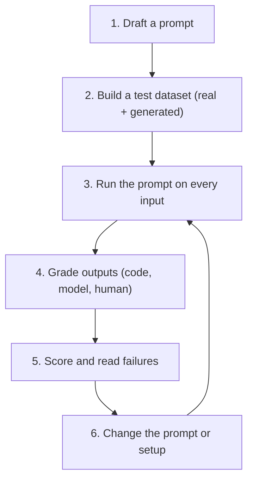
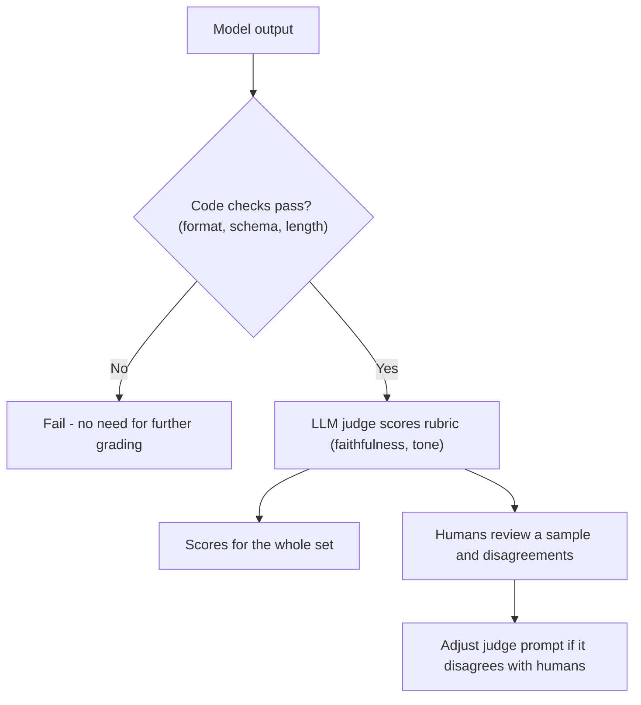
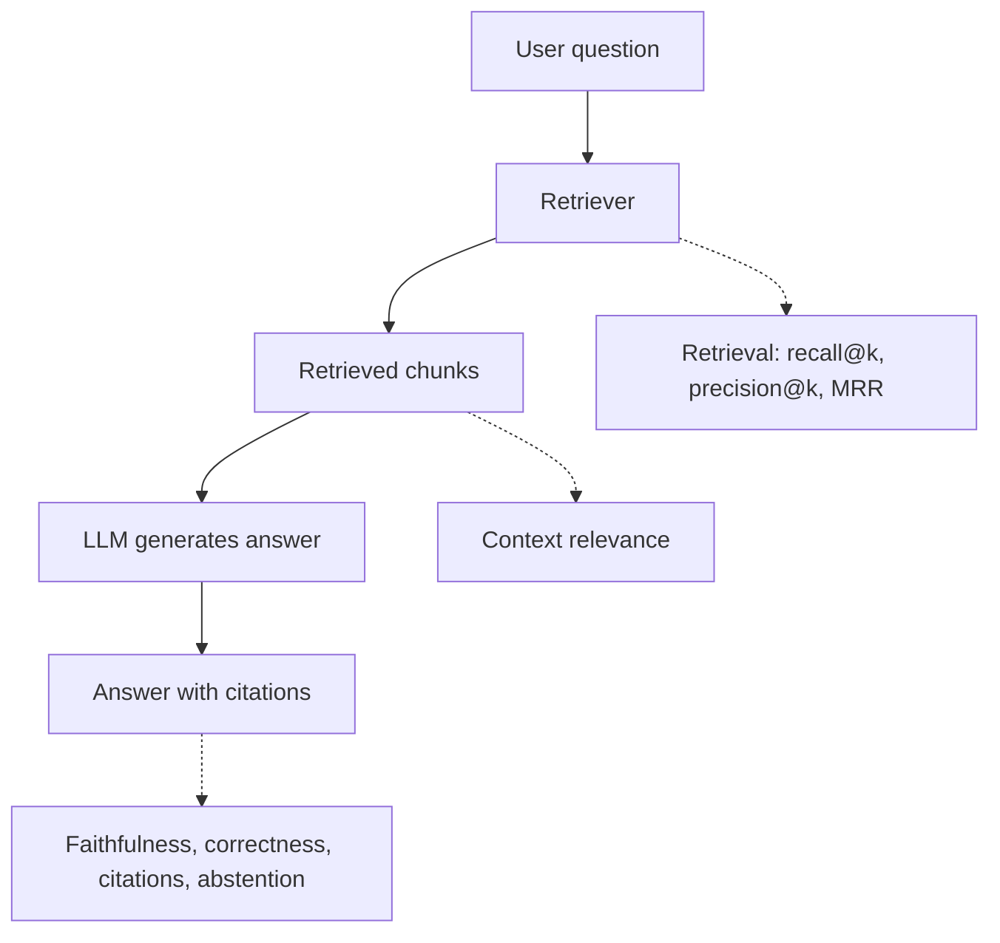
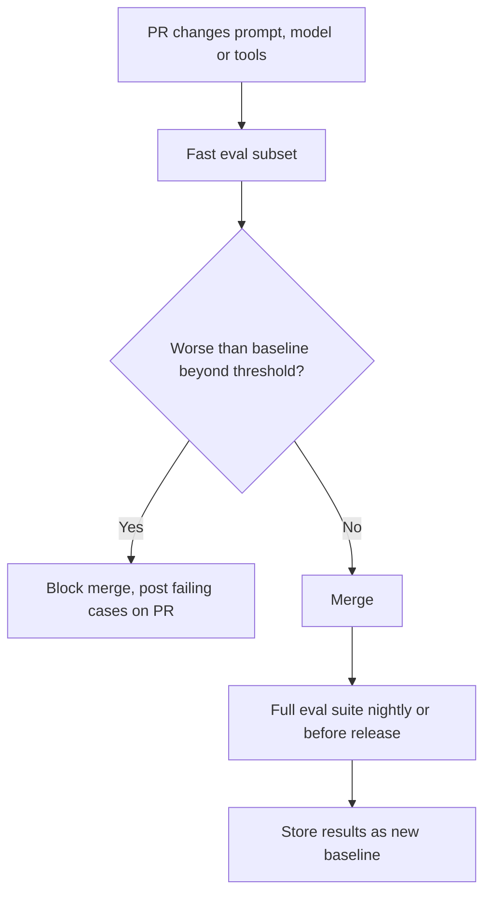
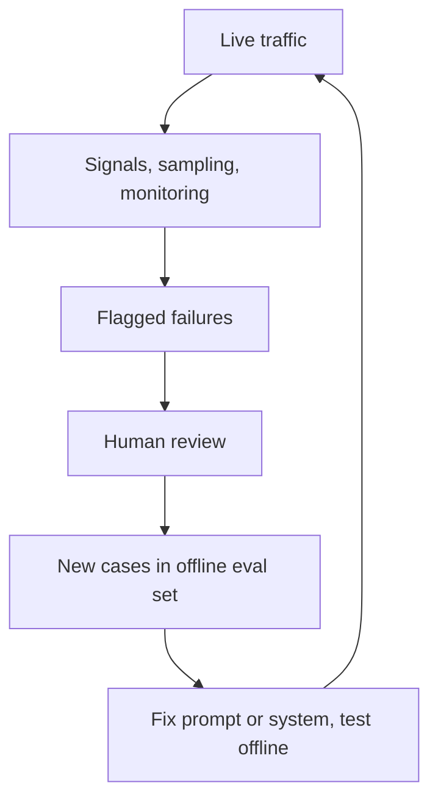
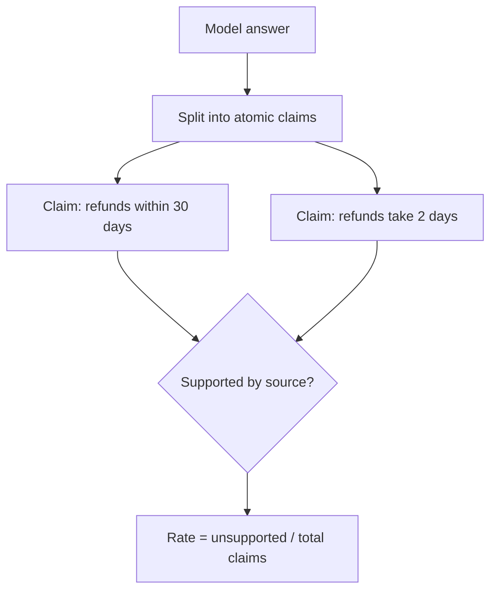
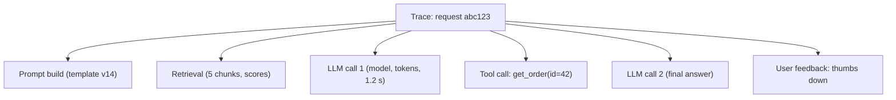
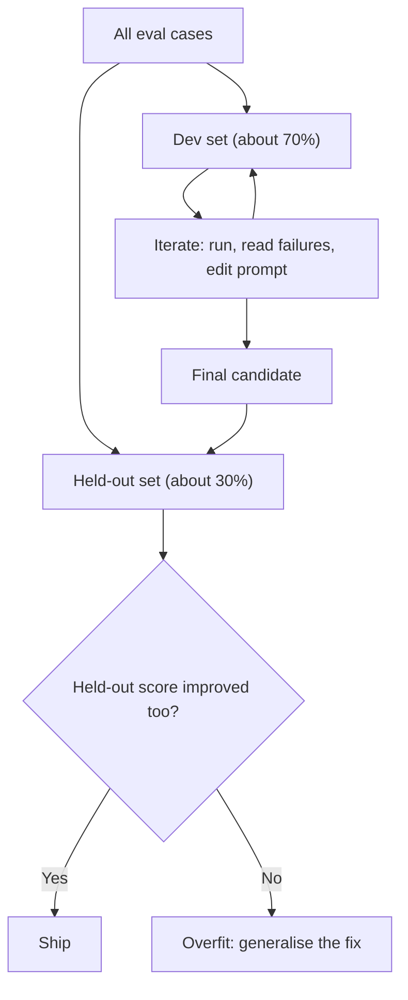
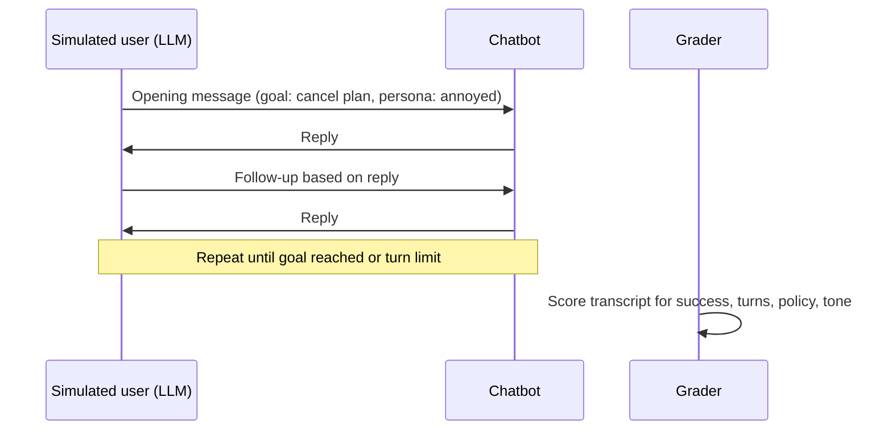

# Evals (Evaluating AI Features)

[⬅ Back to index](../README.md)

Covers: why evals matter, the eval workflow, building and generating test datasets, code-based, model-based and human grading, writing rubrics, LLM-as-judge pitfalls, evaluating RAG, tool use and agents, CI regression testing, online evaluation and monitoring, comparing prompts and models, and measuring hallucinations.

---

### 1. Why is evaluating LLM applications hard?

<details>
<summary>Answer</summary>

**In short:** LLM outputs are open-ended (many answers can be correct) and non-deterministic (the same input can give different outputs), quality has many dimensions at once, and small prompt or model changes fix some cases while breaking others. So you can't rely on `assertEquals` or public benchmarks; you need task-specific evaluation sets ("evals") that you run continuously, the way you run unit and integration tests.

#### Why normal testing breaks down

In ordinary code, `formatPrice(1999)` returns `"$19.99"` every time, so one assertion settles it. With an LLM feature, "summarise this support ticket" has hundreds of acceptable outputs, and running the same prompt twice may give two different ones. The problems stack up:

| Problem | What it means in practice |
|---|---|
| **Open-ended output** | Exact-match comparison fails on correct answers that are worded differently. |
| **Non-determinism** | One passing run proves little; you need pass rates over several runs. |
| **Many quality dimensions** | An answer can be correct but rude, well-written but made up, perfect but too slow or too expensive. |
| **Fragile changes** | Adding "be concise" to fix one case can silently drop important detail in twenty others. |
| **Model updates** | A provider upgrade or a model switch changes behaviour across the board, even with the same prompt. |
| **Benchmarks don't transfer** | A model that tops a public leaderboard may still be worse at *your* invoice-extraction task. |

#### What teams do about it

- Build a **task-specific eval set**: real inputs from your product plus edge cases, each with a way to grade it.
- Use **several kinds of graders**: code checks for format, an LLM judge for nuance, humans for calibration.
- Run evals on **every change** (prompt, model, retrieval settings, tools), and keep monitoring in production.

A useful way to say it in an interview: "Evals are to LLM features what tests are to normal code. Without them every prompt change is a guess."

**Likely follow-ups:**
- *Can't you just set temperature to 0?* It reduces randomness but doesn't remove it fully, and it doesn't fix the open-ended-output problem: you still need to judge quality.
- *Why not use public benchmarks?* They measure general ability, not your data, your prompt and your definition of "good".

</details>

### 2. What does a typical prompt-eval workflow look like?

<details>
<summary>Answer</summary>

**In short:** Draft a prompt, build a test dataset, run the prompt on every input, grade the outputs (with code, a model or humans), look at the score and the failures, change the prompt, and re-run the *whole* set. You keep the version with the best score, and the full re-run makes sure a fix for one case doesn't break others.



#### Each step

1. **Draft a prompt**: a first version that works on a few examples you tried by hand.
2. **Build a dataset**: inputs that represent real use, including tricky cases (see the next two questions).
3. **Run**: call the model for every input with the exact production setup (same system prompt, model, temperature, tools).
4. **Grade**: each output gets a score or pass/fail from a grader.
5. **Score and read failures**: the overall number tells you *whether* you improved; reading the failing outputs tells you *why*.
6. **Change**: rewrite instructions, add examples, change the model, fix retrieval, then go back to step 3.

#### A minimal harness

```python
import json  # eval_harness.py - a tiny eval loop

def run_eval(prompt_version: str, dataset_path: str) -> float:
    cases = [json.loads(line) for line in open(dataset_path)]
    passed = 0
    for case in cases:
        output = call_model(prompt_version, case["input"])   # your LLM call
        ok = grade(output, case)                             # code / model grader
        passed += ok
        if not ok:
            print(f"FAIL [{case['category']}] {case['id']}: {output[:120]}")
    score = passed / len(cases)
    print(f"{prompt_version}: {score:.0%} ({passed}/{len(cases)})")
    return score

run_eval("v1", "evals/support_triage.jsonl")
run_eval("v2", "evals/support_triage.jsonl")   # compare on the same set
```

**Pitfalls:**
- Only re-running the case you were fixing. The point of the loop is to catch what else moved.
- Looking only at the number. A score can rise while a critical category gets worse.
- Changing several things at once, so you can't tell which change helped.

</details>

### 3. How do you build an evaluation set?

<details>
<summary>Answer</summary>

**In short:** Start from real user inputs (logs, support tickets) plus hand-written cases, about 50–200 to begin with. Cover common cases, edge cases, adversarial and unanswerable inputs; give each one an expected answer or grading criteria; tag them by category; and add every production bug as a new case. Keep it separate from data used for few-shot examples or fine-tuning.

#### Step by step

1. **Collect real inputs.** Logs, support tickets, search queries, beta feedback. Real users phrase things in ways you wouldn't invent (typos, half sentences, mixed languages).
2. **Cover the distribution.** Make sure you have:
   - common, "happy path" cases (most of your traffic),
   - **edge cases** (very long input, empty input, unusual formats),
   - adversarial inputs (prompt injection, attempts to get off-topic or unsafe output),
   - unanswerable questions (the right answer is "I don't know" or a clarifying question),
   - other languages or locales, if your users use them.
3. **Write how to grade each case.** Options, from strictest to loosest: an exact expected output, a reference answer, a list of facts that must appear, a rubric, or a check function.
4. **Tag by category.** `billing`, `refund`, `injection`, `non-english`... so you can see "overall up 2%, but refunds down 15%".
5. **Grow it from production.** Every bug report or bad output becomes a new test case, like a regression test.
6. **Keep it clean.** If an example is also used as a few-shot example in the prompt, the model has effectively seen the answer, and your score is inflated.

#### What a case looks like

```json
{"id": "refund-017",
 "category": "refund",
 "input": "i bought the yearly plan 20 days ago can i get my money back",
 "must_include": ["30-day refund window", "how to request"],
 "must_not": ["promise a refund amount"],
 "notes": "Eligible: within 30 days"}
```

**Pitfalls:**
- Only "nice" examples written by the team: the eval passes, production fails.
- No categories, so a regression in one area is hidden by the average.
- Letting the set go stale while the product and its users change.

</details>

### 4. How do you generate a test dataset with an LLM?

<details>
<summary>Answer</summary>

**In short:** Describe your task to a model and ask it for realistic, diverse inputs (typical cases, edge cases, adversarial cases, different user types and writing styles), usually as JSON so they're easy to load. Then review and edit them, mix in real examples from logs, and add expected outcomes or grading criteria. Generated data gets you started fast; real data keeps the set honest.

#### Why generate data at all

Before launch you often have no logs, and writing 100 varied inputs by hand is slow and tends to reflect only how *you* write. A model can produce a wide first draft in seconds.

#### How to do it well

- **Give context:** what the feature does, who the users are, what can go wrong.
- **Ask for variety on purpose:** list the dimensions you want covered (user type, tone, length, language, difficulty) rather than "give me 50 examples", which tends to produce 50 near-duplicates.
- **Ask for structured output** so it loads straight into your harness.
- **Generate in batches** with different emphasis per batch (one for edge cases, one for adversarial inputs).

```text
You are helping test a customer-support assistant for a subscription app.
Generate 20 realistic user messages as a JSON array of objects with
fields "input", "category" and "difficulty".
Cover: refunds, billing errors, cancellations, login problems, and
questions the assistant should NOT answer (legal advice, other companies).
Vary the users: angry, confused, non-native English, very short, very long.
Include typos and informal writing like real chat messages.
```

#### Review is not optional

Generated inputs are often too clean, too polite, repetitive, or unrealistic ("Dear Support Team, I would like to enquire..."). Read them, delete the weak ones, edit some to be messier, and label the expected outcome yourself. Don't let the same model also write the "correct" answers without checking them; it will happily mark its own mistakes as correct.

**Pitfalls:**
- Treating the generated set as ground truth without review.
- Never replacing it with real data once the feature has users.

</details>

### 5. What kinds of automatic metrics are used?

<details>
<summary>Answer</summary>

**In short:** Code-based checks (exact match, JSON schema validity, regex, unit tests passing) are the cheapest and most reliable. Then come reference-based text metrics like BLEU/ROUGE or BERTScore (limited for open-ended answers), classifiers (toxicity, PII, language), LLM-as-judge for things that need judgement, and operational metrics (latency, tokens, cost, refusal and format-failure rates). Use deterministic checks wherever possible.

| Type | Examples | Good for | Limits |
|---|---|---|---|
| **Code-based checks** | Exact match, JSON parses and matches schema, regex, required fields present, generated code passes unit tests, SQL returns the right rows, number within tolerance | Classification, extraction, structured output, code generation | Can't judge tone, helpfulness or nuance |
| **Reference-based text metrics** | BLEU/ROUGE (word overlap with a reference), BERTScore (embedding similarity) | Rough signal for translation or short summaries | A correct answer worded differently scores low; weak for open-ended text |
| **Classifier-based** | Toxicity, PII detection, language detection | Safety and policy checks at scale | Only as good as the classifier |
| **LLM-as-judge** | A model grades against a rubric or a reference answer | Faithfulness, helpfulness, tone, following instructions | Costs tokens; has biases; must be checked against humans |
| **Operational** | Latency, tokens, cost per request, refusal rate, format-failure rate | Every feature | Says nothing about correctness on its own |

#### Example: code checks for structured output

```python
import json, jsonschema

def grade_extraction(output: str, case: dict) -> bool:
    try:
        data = json.loads(output)                          # 1. valid JSON?
        jsonschema.validate(data, INVOICE_SCHEMA)          # 2. right shape?
    except (json.JSONDecodeError, jsonschema.ValidationError):
        return False
    return abs(data["total"] - case["expected_total"]) < 0.01   # 3. right value?
```

The rule of thumb: if you *can* check it with code, do, because it's free, instant and gives the same answer every time. Save LLM judges for the parts that really need judgement.

**Likely follow-ups:**
- *Why is ROUGE weak for chatbots?* It counts shared words with a reference, so a correct paraphrase scores badly and a fluent wrong answer with the right keywords scores well.
- *What's the most overlooked metric?* Format-failure rate: how often the output can't be parsed at all.

</details>

### 6. Code-based vs model-based vs human grading – when to use each?

<details>
<summary>Answer</summary>

**In short:** Use code-based grading for anything objectively checkable (formats, exact values, tests passing); it's fast, cheap and deterministic. Use model-based grading (an LLM judge) for nuanced qualities like helpfulness, tone or faithfulness to sources. Use human grading for subjective or high-stakes quality and to calibrate the LLM judge. Most real setups combine all three.

| Grader | Good for | Trade-offs |
|---|---|---|
| **Code-based** | Exact answers, formats, schema validity, keywords, numbers, tests passing, length | Fast, cheap, deterministic; can't judge nuance |
| **Model-based (LLM judge)** | Helpfulness, tone, faithfulness to sources, rubric criteria | Scales judgement; needs a precise rubric and calibration against humans; costs tokens |
| **Human** | Subjective quality, high-stakes domains, calibrating judges | Most reliable for nuance; slow and expensive |

#### How they fit together



A practical example for a "reply to customer email" feature:
- **Code:** reply is under 150 words, contains no email addresses or phone numbers, is in the customer's language.
- **LLM judge:** does it answer the actual question? Does it promise only what the policy allows? Is the tone polite?
- **Humans:** the support lead reviews 30 random replies a week and every case where the judge was unsure.

**Pitfalls:**
- Using an LLM judge for something a regex could check: slower, costlier and less reliable.
- Trusting an LLM judge you've never compared with human labels.
- Relying only on humans: you can't run that on every commit.

</details>

### 7. How do you write a good grading rubric?

<details>
<summary>Answer</summary>

**In short:** Break "quality" into specific criteria that can each be checked on their own ("mentions the refund deadline", "doesn't promise anything not in the policy", "under 120 words"). Prefer pass/fail per criterion, or a small scale with clearly defined levels, over a vague 1–10. Include examples of passing and failing answers, ask the grader to give a short reason before each verdict, and test the rubric on examples where you already know the right grade.

#### Why vague rubrics fail

"Rate the helpfulness of this answer from 1 to 10" gives noisy results: what's the difference between a 6 and a 7? Two humans disagree, and an LLM judge drifts depending on wording. Specific, binary criteria are far more consistent.

#### Bad vs good

```text
BAD
Rate how good this support reply is from 1-10.

GOOD
Grade the reply against each criterion. For each, write one sentence
of reasoning, then PASS or FAIL.

1. Answers the customer's actual question.
2. States the 30-day refund window if the customer asks about refunds.
3. Promises nothing that is not in the policy text provided.
4. Is under 120 words.
5. Is polite and does not blame the customer.

Example PASS for criterion 3: "You can request a refund within 30 days."
Example FAIL for criterion 3: "We'll refund you right away, no questions asked."

Return JSON: {"criteria": [{"id": 1, "reason": "...", "verdict": "PASS"}, ...]}
```

#### Tips

- **One idea per criterion**, so a failure tells you exactly what went wrong.
- **Defined anchors** if you need a scale: "3 = all key facts, 2 = one missing, 1 = several missing or wrong".
- **Reason first, then verdict**: it makes the grader consider the evidence before deciding, and the reasons help you debug.
- **Move checkable parts to code**: "under 120 words" doesn't need an LLM.
- **Calibrate**: grade 20–30 examples yourself, run the rubric, and fix the wording wherever it disagrees with you.

</details>

### 8. What is LLM-as-judge, and what are its pitfalls?

<details>
<summary>Answer</summary>

**In short:** LLM-as-judge means using a model to grade outputs, either by scoring one answer against a rubric or reference (single-answer grading) or by picking the better of two answers (pairwise comparison). It scales human-like judgement cheaply, but judges have known biases: position bias, verbosity bias, self-preference and sensitivity to the judge prompt. Mitigate with precise rubrics, small scales, reasoning before the verdict, position swapping, a strong judge model, and above all by checking the judge's agreement with human labels before trusting it.

#### Two modes

| Mode | How it works | Good for |
|---|---|---|
| **Single-answer grading** | Judge sees input, output (and maybe a reference answer) and scores it against a rubric | Tracking quality over time, CI checks |
| **Pairwise comparison** | Judge sees two outputs for the same input and picks the better one | Comparing two prompts or models; humans and models find "which is better" easier than absolute scores |

#### Known biases

- **Position bias:** in pairwise mode, the judge tends to favour the answer in a particular position (often the first).
- **Verbosity bias:** longer, more detailed-looking answers get higher scores even when they're not better.
- **Self-preference:** a judge may favour outputs in its own model family's style.
- **Prompt sensitivity:** small wording changes in the judge prompt shift the scores.
- **Leniency:** without strict criteria, judges tend to rate most outputs as good.

#### Mitigations

```python
def pairwise_judge(question, answer_a, answer_b) -> str:
    # Run both orders to cancel out position bias
    first = judge(question, answer_a, answer_b)    # returns "A", "B" or "TIE"
    second = judge(question, answer_b, answer_a)   # positions swapped
    second = {"A": "B", "B": "A", "TIE": "TIE"}[second]
    return first if first == second else "TIE"     # disagreement -> no winner
```

- Precise rubric with examples (see the previous question); binary or small scales.
- Ask for reasoning before the verdict.
- Tell the judge explicitly that length isn't a quality signal.
- Use a strong model as judge, and if possible a different one from the model being graded.
- **Validate against humans:** label 50–100 examples by hand, run the judge, and measure how often it agrees. If agreement is low, fix the rubric before using the scores.

**Likely follow-ups:**
- *Can the same model judge its own output?* It can, but self-preference is a risk; a different, strong model plus human calibration is safer.
- *How often do you re-check the judge?* Whenever you change the judge prompt or model, and periodically with fresh human labels.

</details>

### 9. When do you need human evaluation?

<details>
<summary>Answer</summary>

**In short:** Use human evaluation for subjective qualities (tone, helpfulness, creativity), high-stakes domains (medical, legal, financial), calibrating LLM judges, and final checks before major launches. Make it reliable with clear guidelines, trained raters, several raters per item with measured agreement, and side-by-side comparisons, which are easier and more consistent than absolute scores.

#### When automated grading isn't enough

- **Subjective quality:** "is this marketing copy on-brand?" depends on taste that's hard to write into a rubric.
- **High stakes:** a doctor or lawyer needs to confirm a medical or legal answer is safe; an LLM judge can be confidently wrong in the same way the model is.
- **Calibration:** human labels are the "ground truth" you measure the LLM judge against.
- **Before big launches** or model switches, as a final sanity check.
- **Reading failures:** humans spot new problem types that no metric was designed to catch.

#### Making it reliable

| Practice | Why |
|---|---|
| Written guidelines with examples | Raters judge the same thing the same way |
| Training round on known examples | Catches raters who misread the guidelines |
| 2–3 raters per item | One person's taste doesn't decide the result |
| Measure inter-rater agreement | If humans disagree a lot, the task or guidelines are unclear |
| Side-by-side (A vs B) comparisons | "Which is better?" is easier and more consistent than "rate 1–5" |
| Blind the raters | They shouldn't know which version is the new one |

**Pitfalls:**
- Having only the engineer who wrote the prompt do the rating (biased toward their own work).
- Collecting scores without guidelines, then finding the numbers can't be compared.
- Using humans for things code could check, which wastes the most expensive grader you have.

</details>

### 10. How many test cases do you need?

<details>
<summary>Answer</summary>

**In short:** Start small, about 20–50 well-chosen cases, so you can iterate fast, then grow to hundreds as the feature matures, adding every production failure. Covering categories and edge cases matters more than the raw count. Small sets have large error bars: going from 80% to 84% on 50 cases is two examples and may be noise, so look at which cases changed and use larger sets before big decisions.

#### Why start small

Early on, prompts change hourly. A 30-case set runs in a minute and you can actually read every failure. A 2,000-case set is slow, expensive and you won't look at the outputs.

#### Why grow later

As the feature stabilises, you want to catch rarer problems and make decisions (switch model? ship v2?) with confidence. More cases also lets you track per-category scores that aren't just two or three examples each.

#### The noise problem, in plain numbers

| Eval size | One case is worth | "80% → 84%" means |
|---|---|---|
| 25 cases | 4 points | 1 case changed: almost certainly noise |
| 50 cases | 2 points | 2 cases changed: probably noise |
| 500 cases | 0.2 points | 20 cases changed: more likely real |

And since outputs are non-deterministic, the same prompt can score 80% one run and 84% the next. Running each case a few times and averaging helps.

#### Practical guidance

- **Coverage first:** make sure each important category and known edge case has several examples.
- **Look at the diff, not just the total:** which cases flipped from pass to fail and back?
- **Bigger set for bigger decisions:** use the quick set while iterating, the full set before release.

</details>

### 11. How do you evaluate a RAG system specifically?

<details>
<summary>Answer</summary>

**In short:** Evaluate the parts separately. Retrieval: did it find the right chunks (recall@k, precision@k, MRR)? Context relevance: how much of what was retrieved is useful? Faithfulness: is every claim in the answer supported by the retrieved context? Answer correctness and relevance, citation accuracy, and abstention: does it say "I don't know" when the documents don't contain the answer? Separating them tells you *which* part to fix.

#### Why separate the parts

A wrong answer from a RAG system can come from two very different places: retrieval didn't find the right document, or retrieval worked and the model ignored or misread it. One end-to-end score can't tell you which, and the fixes are completely different (better chunking or search vs a better prompt or model).



#### The metrics

| Metric | Question it answers | How to measure |
|---|---|---|
| **Recall@k** | Was the relevant chunk anywhere in the top k results? | Label questions with their relevant chunk IDs; code check |
| **Precision@k** | How many of the top k results are relevant? | Same labels |
| **MRR** | How high up was the first relevant result? | Same labels; rewards ranking it first |
| **Context relevance** | How much of the retrieved text is actually useful? | LLM judge per chunk |
| **Faithfulness / groundedness** | Is every claim in the answer supported by the retrieved text? | Split answer into claims; LLM judge or NLI model checks each one |
| **Answer correctness and relevance** | Is it right, and does it address the question? | Reference answer or rubric |
| **Citation accuracy** | Do the cited sources really support the claims they're attached to? | LLM judge per citation |
| **Abstention** | Does it say "I don't know" for unanswerable questions? | Include questions with no answer in the docs |

#### Practical tips

- Include **unanswerable questions** in the set; otherwise you reward a system that always makes something up.
- Re-run the retrieval metrics whenever you change chunk size, embedding model or search settings; they're cheap because they need no LLM call for generation.
- A system can be **faithful but wrong** (it faithfully repeated an outdated document): fix the data, not the prompt.

See [RAG](10-rag-search.md).

</details>

### 12. How do you evaluate tool use and agents?

<details>
<summary>Answer</summary>

**In short:** Check the outcome (did the task really succeed? check the final state, such as database rows, files or tests passing, not just the text answer), check the tool calls (right tool, valid arguments, no unnecessary or unsafe calls), measure efficiency (steps, tokens, time, cost), run each task several times and report pass rates because agents are non-deterministic, and read the transcripts of failures to see where the reasoning went wrong.

#### Why agents are harder to evaluate

An agent takes many steps, each one a model decision, and the same task can be solved in different valid ways. The final message ("Done! I've booked your meeting") can also be wrong: the agent may claim success when the tool call failed. So you grade **what happened**, not what it says happened.

#### What to check

| Level | Example checks |
|---|---|
| **Outcome** | Calendar event exists with the right time and attendees; tests pass after the coding agent's change; the refund row is in the database |
| **Tool calls** | Called `search_flights` before `book_flight`; arguments are valid (date format, IDs exist); never called `delete_account`; no repeated identical calls |
| **Efficiency** | Number of steps, tokens, wall-clock time, cost per task |
| **Robustness** | Works when a tool returns an error or a timeout; asks a clarifying question when the request is ambiguous |
| **Safety** | Asks for confirmation before irreversible actions; stays within its permissions |

#### Example test

```python
def test_reschedule_meeting():
    env = make_sandbox(calendar=[Meeting("1:1 with Sam", "2026-03-02T10:00")])
    results = [run_agent(env.copy(), "Move my 1:1 with Sam to Tuesday 3pm")
               for _ in range(5)]                       # several runs

    def passed(r):
        m = r.env.calendar.find("1:1 with Sam")
        return (m.start == "2026-03-03T15:00"           # outcome check
                and "delete_event" not in r.tool_names  # no destructive shortcut
                and len(r.steps) <= 6)                  # efficiency budget

    pass_rate = sum(passed(r) for r in results) / len(results)
    assert pass_rate >= 0.8
```

Run agents against a **sandbox** (fake calendar, test database, temporary repo) so evals are repeatable and can't do real damage.

**Pitfalls:**
- Grading only the final text answer.
- Requiring one exact sequence of tool calls when several are valid; check the important constraints instead.
- A single run per task, which hides a 60% success rate behind one lucky pass.

</details>

### 13. How do you run evaluations in a CI/CD pipeline?

<details>
<summary>Answer</summary>

**In short:** Keep eval sets and grading code in the repo. On every change to prompts, models, retrieval settings or tools, run the eval suite (a fast subset per commit, the full set nightly or before release). Compare against the current production baseline per category and block the release on regressions beyond a threshold. Run several samples per case and look at pass rates, track cost and latency too, and keep results and traces so you can inspect failures.

#### Why prompts belong in CI

A prompt is code: a one-line change can break behaviour as badly as a code change. And some changes you don't make yourself, like a provider updating a model version. Evals in CI turn "I think it's fine" into a check that runs every time.



#### Example pipeline step

```yaml
on:  # .github/workflows/evals.yml (sketch)
  pull_request:
    paths: ["prompts/**", "src/ai/**", "evals/**"]
jobs:
  evals:
    runs-on: ubuntu-latest
    steps:
      - uses: actions/checkout@v4
      - run: pip install -r evals/requirements.txt
      - run: python evals/run.py --suite fast --samples 3 --baseline main --max-drop 0.03
        env:
          LLM_API_KEY: ${{ secrets.LLM_API_KEY }}
```

#### Things to get right

- **Per-category thresholds:** a 1% drop overall might hide a 20% drop on safety cases; safety categories can have a zero-tolerance rule.
- **Multiple samples** per case so a random bad run doesn't block a good change (and a lucky run doesn't pass a bad one).
- **Cost and latency budgets** as checks too: a prompt that doubles token usage should get noticed.
- **Pin model versions** where the provider allows it, so a baseline means something.
- **Keep artifacts:** outputs and traces for every failing case, linked from the PR.
- **Watch CI cost:** full LLM-judged suites cost money; use the fast subset per PR.

</details>

### 14. How do you evaluate LLM features in production (online)?

<details>
<summary>Answer</summary>

**In short:** Combine user signals (thumbs up/down, edits to generated text, accept/copy rates, retries, abandonment, escalation to a human), A/B tests for prompt or model changes measured on business metrics, automatic grading of a sample of live traffic (LLM judges or classifiers for faithfulness, toxicity, format), operational monitoring (latency, errors, tokens and cost, refusal rate, drift in what users ask), and human review queues for flagged conversations. Feed every failure back into the offline eval set.

#### Offline vs online

Offline evals run on a fixed dataset before release. Online evaluation measures what happens with real users, who will always ask things your dataset didn't include. You need both: offline to catch regressions before shipping, online to find what you didn't anticipate.

#### What to measure

| Signal | Examples | Note |
|---|---|---|
| **Explicit feedback** | Thumbs up/down, ratings | Few users click; skewed toward unhappy ones |
| **Implicit feedback** | Accepted the suggestion, copied the text, edited it heavily, hit "regenerate", gave up, asked for a human | Often more informative than thumbs, and you get it for every user |
| **A/B tests** | New prompt vs old on task completion, retention, support tickets | The real test of business value |
| **Sampled auto-grading** | LLM judge checks faithfulness on 1–5% of traffic; classifiers flag toxicity or PII | Gives a quality trend without labelling everything |
| **Operational** | p95 latency, error and timeout rates, tokens and cost per request, refusal rate | Alert on sudden changes |
| **Drift** | New topics or languages appearing in inputs | Tells you the eval set needs updating |
| **Human review** | Queue of low-rated or flagged conversations | Where new failure types are found |

#### Closing the loop



**Pitfalls:**
- Reading thumbs-down rate alone; most users never click anything.
- Logging user conversations without privacy controls (consent, PII redaction, retention limits).
- Finding a failure in production and fixing it without adding it to the eval set, so it can come back.

</details>

### 15. How do you compare two models or prompts fairly?

<details>
<summary>Answer</summary>

**In short:** Use the same eval set and the same grading for both, run several samples per input, report results per category with confidence intervals (small sets have big error bars), include cost and latency, use pairwise comparisons with swapped positions for subjective quality, and check the difference is statistically meaningful before declaring a winner. Read the cases where they disagree: that's often more informative than the overall score.

#### A fair comparison checklist

| Control | Why |
|---|---|
| Same dataset, same graders | Otherwise you're comparing tests, not models |
| Same settings where they apply (temperature, max tokens, tools) | Settings change behaviour |
| Prompt adapted fairly to each model | A prompt tuned for model A may underrate model B |
| Several samples per input | Non-determinism can swing a single run |
| Per-category results | "B is better overall" may hide "B is much worse at refunds" |
| Error bars | 82% vs 85% on 60 cases is often not a real difference |
| Cost and latency side by side | A 2% gain at 3x the cost may not be worth it |
| Blind, position-swapped pairwise judging | Removes judge and human bias toward a position or a known model |

#### Error bars without the maths

You don't need to compute statistics by hand to get the idea: the fewer cases you have, the more the score jumps around by chance. Practical checks:
- Re-run the *same* prompt a few times. If its score varies by 3 points, a 3-point difference between two prompts means nothing.
- Use the larger eval set for the final decision.
- Many eval tools report confidence intervals for you; use them.

#### Example report

| Category | Prompt A | Prompt B |
|---|---|---|
| Billing (120 cases) | 91% | 93% |
| Refunds (80 cases) | 88% | 79% |
| Injection attempts (40 cases) | 100% | 100% |
| Avg cost per request | $0.004 | $0.003 |
| p95 latency | 2.1 s | 1.6 s |

B is cheaper and faster, but the refund drop needs investigating before switching.

**Likely follow-ups:**
- *What if the eval says B is better but users don't like it?* Trust production signals and A/B tests; the eval set is missing something, so add those cases.

</details>

### 16. How do you measure hallucination rate?

<details>
<summary>Answer</summary>

**In short:** For grounded tasks (RAG, summarisation), split each answer into atomic claims and check each claim against the source documents with an LLM judge or NLI model; hallucination rate = unsupported claims ÷ total claims. For factual Q&A, use questions with verified answers and score correct, incorrect and abstained ("I don't know") separately, since abstaining is better than being wrong. Also track citation validity, and verify a sample by hand to calibrate the automated checks.

#### Two kinds of hallucination

| Kind | Example | How to measure |
|---|---|---|
| **Unfaithful to the source** (grounded tasks) | The policy says 30 days; the summary says 60 | Claim-by-claim check against the provided documents |
| **Factually wrong** (open questions) | Invents a library function or a court case | Questions with verified answers; check the answer |

#### Claim-by-claim checking



An "atomic claim" is a single checkable fact. "You can get a refund within 30 days, and it takes 2 business days to arrive" contains two claims; if the source only mentions the 30 days, one of two is unsupported.

#### Scoring factual Q&A fairly

Count three outcomes, not two:

| Outcome | Meaning |
|---|---|
| Correct | Matches the verified answer |
| Incorrect | Wrong answer stated with confidence (the real harm) |
| Abstained | "I don't know" or asks for clarification |

If you only score "correct vs not correct", a model that guesses wildly can look as good as one that admits uncertainty. Include questions that have *no* answer in the source, to check the model says so.

#### Also

- **Citation validity:** does each cited source exist, and does it support the sentence it's attached to?
- **Human spot checks:** LLM judges miss subtle errors; a regular human-verified sample tells you how far to trust the automated rate.

</details>

### 17. What is "vibe checking", and why is it not enough?

<details>
<summary>Answer</summary>

**In short:** Vibe checking is trying a handful of prompts by hand and judging whether the outputs "feel right". It's useful early on to explore what the model can do, but it covers few cases, misses regressions, and is biased by whatever examples you happened to try last. Mature teams move quickly to a systematic eval set, tracked metrics and automated runs, while still reading real outputs regularly, because metrics can miss problems too.

#### Why it's tempting

It's fast, needs no setup, and in the first hour of building a feature it's the right thing to do: you're learning whether the idea works at all.

#### Why it breaks down

- **Few cases:** you try 5 inputs; users send 50,000 different ones.
- **No regression detection:** you change the prompt to fix input #6 and never re-try inputs #1–5.
- **Recency and confirmation bias:** you remember the last impressive answer and test the cases you expect to pass.
- **Not shareable:** "it looked good to me" can't be compared between versions or teammates.
- **Model and provider changes:** after an update you'd have to vibe-check everything again by hand.

#### The healthy progression

| Stage | What you do |
|---|---|
| Prototype | Vibe check freely; write down interesting inputs as you go |
| Early feature | Turn those notes into a 20–50 case eval set with simple graders |
| Pre-launch | Grow the set, add an LLM judge calibrated on human labels, run in CI |
| Production | Online monitoring, feed failures back, keep reading real outputs |

The last point matters: numbers don't replace looking. Reading 20 real outputs a week regularly turns up problems no metric was designed to catch.

</details>

### 18. What should you log and trace in an LLM application?

<details>
<summary>Answer</summary>

**In short:** Per request: pseudonymised user/session IDs, the prompt template and its version, model and parameters, the full input context (or references to it), retrieved documents and their scores, every tool call with arguments and results, the output, latency per step, token counts and cost, errors, and user feedback. Use tracing tools (OpenTelemetry-based or LLM-specific platforms such as Langfuse, LangSmith, Arize Phoenix), and respect privacy: redact PII, set retention limits, restrict access.

#### Why it matters

When a user reports "the assistant told me something wrong", you need to answer: what exactly did the model see, which prompt version was live, what did retrieval return, which tools ran? Without traces you can't reproduce the bug, and you can't turn it into an eval case.

#### A trace is a tree of steps



#### What to record

| Field | Why |
|---|---|
| Pseudonymised user and session IDs | Group a conversation, without storing identity directly |
| Prompt template + version | Know which prompt produced the output |
| Model name, version and parameters | Behaviour depends on them |
| Input context (or a reference to it) | Reproduce the call |
| Retrieved documents + scores | Debug RAG: wrong retrieval vs wrong generation |
| Tool calls, arguments, results, errors | Debug agents |
| Output | What the user saw |
| Latency per step, tokens, cost | Performance and budget |
| User feedback | Link quality signals to the exact trace |

#### Privacy

Prompts often contain personal data. Redact PII before storing, set retention limits, restrict who can read traces, and follow your privacy policy and user consent. Logging "everything" without these controls creates a security and compliance problem.

**Likely follow-ups:**
- *How does this connect to evals?* Bad traces from production become new eval cases, and stored traces let you re-run old inputs against a new prompt.

</details>

### 19. How do you use evals to improve a prompt without overfitting?

<details>
<summary>Answer</summary>

**In short:** Split the test set. Iterate on a development set, and check final candidates on a held-out set you don't look at while tuning. If the dev score rises but the held-out score doesn't, you've fitted the prompt to specific examples rather than improved it. Also keep categories balanced, prefer general instructions over case-specific patches, and refresh the held-out set with new production examples over time.

#### What overfitting looks like with prompts

You look at failing cases one by one and patch each: "If the user mentions a Pixel 7, say...", "If the order ID starts with Q...". The dev score climbs to 98%, but the prompt is now a list of special cases that only help the exact examples you saw. On new inputs it does no better, and sometimes worse, because the patches confuse the model.

#### The split



#### Good habits

- **Don't read held-out failures while tuning.** Once you look at them and fix them, they become dev cases.
- **Fix the cause, not the instance:** instead of "if the user mentions a Pixel 7...", write "If the user mentions a specific device, check the compatibility list before answering."
- **Keep categories balanced** in both sets so held-out measures the same mix.
- **Refresh** the held-out set with new production cases periodically, since you'll inevitably learn its contents over time.

</details>

### 20. How do you evaluate a multi-turn chatbot?

<details>
<summary>Answer</summary>

**In short:** Use scripted conversations (fixed multi-turn test cases with checks at each turn), simulated users (an LLM plays a user with a goal and persona, and a grader judges whether the goal was reached, in how many turns, and whether policies were followed), conversation-level metrics (task success, turns to resolution, escalations, policy violations, tone), and production sampling (automatically grade a sample of real conversations and review failures by hand).

#### Why single-turn evals aren't enough

Many chatbot failures only show up across turns: forgetting the order number the user gave earlier, contradicting itself, asking for information it already has, or drifting off-topic after a few messages. A set of independent question-answer pairs can't catch these.

#### Scripted conversations

Fixed conversations with checks after specific turns:

```python
conversation = [
    ("user", "Hi, my order 48213 arrived damaged"),
    ("check", lambda r: "48213" in r or "order" in r.lower()),
    ("user", "Can I get a replacement instead?"),
    ("check", lambda r: "48213" in r and "photo" in r.lower()),  # remembers ID, asks for evidence
]
```

Good for regression testing specific behaviours; cheap and repeatable. Weakness: real users don't follow the script.

#### Simulated users



The simulated user gets a goal ("get a refund for a duplicate charge"), a persona ("impatient, short messages") and private facts (order ID, dates) to reveal only when asked. This explores many conversation paths cheaply. Weakness: simulated users are more cooperative and articulate than real ones, so treat it as a supplement.

#### Conversation-level metrics

| Metric | Question |
|---|---|
| Task success | Did the user get what they came for? |
| Turns to resolution | How long did it take? |
| Escalation rate | How often did it hand off to a human? |
| Policy violations | Did it promise something it shouldn't, or leak data? |
| Consistency | Did it contradict itself or forget earlier facts? |
| Tone | Polite and on-brand throughout? |

And in production, sample real conversations, grade them with an LLM judge, and have humans review the failures.

</details>

### 21. Which metrics would you use to evaluate a summarisation feature?

<details>
<summary>Answer</summary>

**In short:** Faithfulness (no claims the source doesn't support, checked claim by claim with an LLM judge or NLI model), coverage (includes the key points, checked against a human-written list of must-include facts), conciseness and format (length limits, required sections, checked with code), and usefulness for the intended reader (rubric-based LLM judge or human ratings). Older overlap metrics like ROUGE correlate weakly with quality for modern summaries, so use them only as a rough signal.

#### The metrics

| Metric | What it catches | How to check |
|---|---|---|
| **Faithfulness** | Invented or distorted facts (the worst failure) | Split summary into claims; check each against the source |
| **Coverage** | Missing the key points | Human-written must-include list per document; judge checks each is present |
| **Conciseness and format** | Too long, missing required sections | Code: word count, headings present, bullet count |
| **Usefulness** | Technically correct but not useful for the reader | Rubric judge ("could a manager decide from this?") or human ratings |
| **ROUGE (optional)** | Rough word overlap with a reference summary | Library call; treat as a weak signal |

#### Why faithfulness and coverage pull against each other

A very short summary is easy to keep faithful but misses points; a long one covers everything but has more room for errors and isn't concise. Measuring both stops you from "improving" one by sacrificing the other.

#### Example: summarising support tickets for an on-call engineer

- **Code:** at most 5 bullets; includes a "Customer impact" line.
- **Must-include list:** affected service, error message, number of users affected, when it started.
- **Faithfulness judge:** every bullet supported by the ticket thread.
- **Usefulness rubric:** "An engineer who hasn't read the ticket knows what's broken and what to check first."

#### Why ROUGE falls short

It counts words shared with a reference summary. A good summary written in different words scores low, and a summary that copies the right words but gets a number wrong can score high. Modern models write abstractive summaries (rephrased, not copied), which is exactly where overlap metrics are weakest.

**Pitfalls:**
- Only measuring "reads well": fluent summaries can still be wrong.
- Long source documents: check whether facts from the end of the document are covered as well as facts from the start.

</details>

---

[⬅ Previous: AI Coding Assistants & Claude Code](12-ai-coding-assistants.md) · [⬅ Back to index](../README.md) · [Next: Guardrails, Safety & Security ➡](14-guardrails-safety.md)
