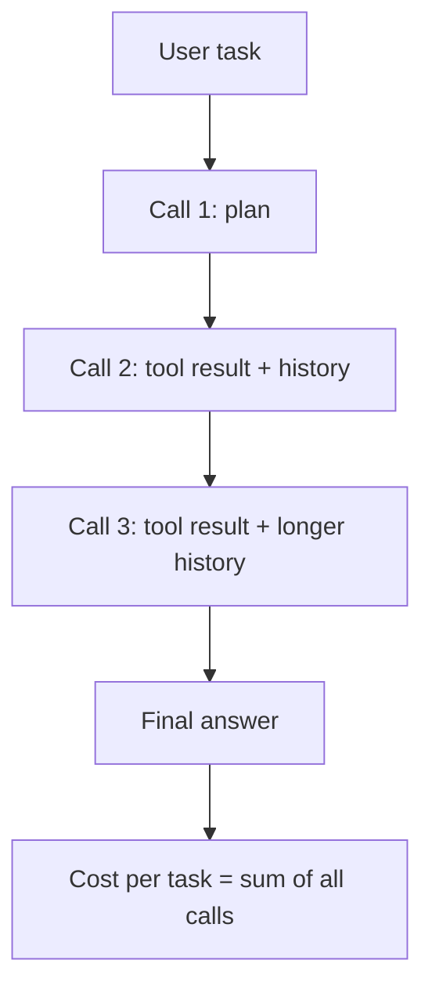
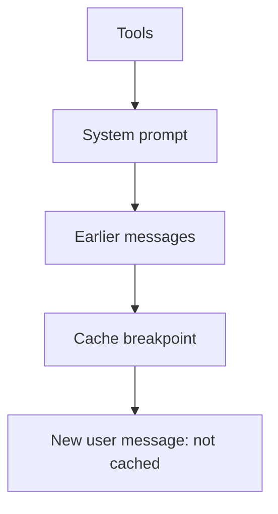
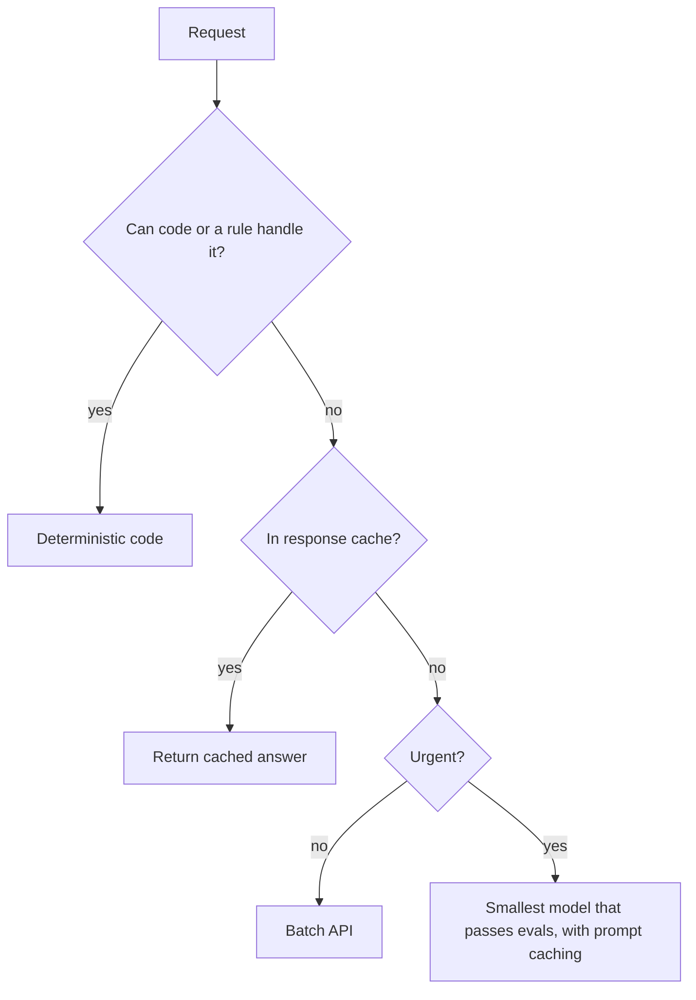
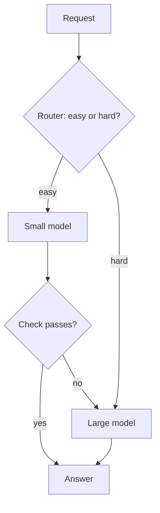
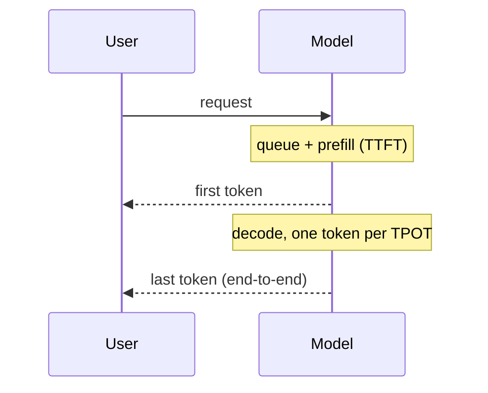

# Efficiency: Cost, Latency & Scale

[⬅ Back to index](../README.md)

Covers: token economics, estimating cost, prompt caching and its rules, batch processing, choosing effort and model size, routing, output length, latency metrics and levers, streaming, agent cost control, rate limits, and monitoring spend.

---

### 1. What drives the cost of an LLM feature?

<details>
<summary>Answer</summary>

**In short:** You pay per token. Cost is driven by **input tokens** (system prompt, tool definitions, retrieved context and the conversation history, re-sent every turn), **output tokens** (several times pricier per token, including thinking tokens), **which model** you use, and **how many calls** a task needs. Caching and batch discounts lower it. Measure **cost per completed task**, not per request.

#### The pieces

| Driver | Why it matters |
|---|---|
| **Input tokens** | Everything you send on every call: system prompt, tool definitions, RAG chunks, chat history. APIs are stateless, so a 20-turn chat re-sends all earlier turns each time. |
| **Output tokens** | Usually several times more expensive per token than input, and they include "thinking"/reasoning tokens on models that think before answering. |
| **Model choice** | Small and large models can differ in price by an order of magnitude or more. |
| **Number of calls** | Agents and chains make many calls per user task: plan, tool call, reflect, retry. |
| **Discounts** | Cached input and batch processing are much cheaper than standard requests. |

#### Why "cost per completed task"

A cheap model that needs three retries, or an agent that takes 15 steps instead of 5, can cost more than one call to a stronger model. Compare options on the total cost to actually finish the user's job at acceptable quality.



Note how each agent step re-sends a growing history: input tokens grow roughly with the square of the number of steps unless you cache or trim.

**Common pitfalls**
- Forgetting that tool definitions count as input tokens on every call.
- Comparing models by price per token instead of price per successful task.

**Likely follow-ups**
- *Biggest hidden cost?* Usually long, re-sent context: history, big tool lists, or too many retrieved chunks.
- *How to estimate?* See [question 2](#2-how-do-you-estimate-the-cost-of-an-llm-feature).

</details>

### 2. How do you estimate the cost of an LLM feature?

<details>
<summary>Answer</summary>

**In short:** `cost per request = input tokens × input price + output tokens × output price`, then multiply by request volume. Output usually costs several times more per token than input, and cached input is cheaper. Measure real token counts from a prototype rather than guessing, and add calls per task for agents.

#### Worked example

A support bot: 3,000 input tokens (system prompt + retrieved chunks + history) and 300 output tokens per request, 1M requests per month. At illustrative prices of $1 per million input tokens and $5 per million output tokens:

| Part | Calculation | Cost |
|---|---|---|
| Input | 3,000 × $1 / 1M | $0.003 |
| Output | 300 × $5 / 1M | $0.0015 |
| **Per request** | | **$0.0045** |
| **Per month** | × 1M requests | **~$4,500** |

Now add prompt caching: if 70% of input tokens are served from cache at a 90% discount, input becomes 0.3 × $0.003 + 0.7 × $0.003 × 0.1 ≈ $0.0011. The request costs about $0.0026, or ~$2,600/month (ignoring the small extra cost of writing the cache).

The same arithmetic as code:

```typescript
function costPerRequest(t: {input: number; cached: number; output: number},
                        p: {input: number; cachedRead: number; output: number}) {
  // prices are per million tokens
  const uncached = t.input - t.cached;
  return (uncached * p.input + t.cached * p.cachedRead + t.output * p.output) / 1_000_000;
}
```

#### Steps to a real estimate

1. Build a prototype and log actual token usage from the API response (don't estimate from word counts).
2. Use realistic inputs: long conversations, big documents, not just the happy path.
3. Multiply by calls per task (agents) and expected volume, including retries.
4. Apply discounts you'll actually get (cache hit rate, batch share).
5. Add headroom for growth and for evals, which also cost tokens.

#### Self-hosting

Compare GPU cost per hour ÷ tokens per hour you actually achieve **at your latency target**. GPUs sitting idle at night still cost money, so utilisation matters a lot.

**Common pitfalls**
- Using the first turn of a chat as the average; later turns carry much more history.
- Forgetting thinking tokens, which are billed as output.

</details>
### 3. How does prompt caching work, and what are its rules?

<details>
<summary>Answer</summary>

**In short:** The provider stores the processed state of a **prompt prefix**, so later requests that start with exactly the same content skip reprocessing it. Cached reads cost a small fraction of normal input (roughly 5–10% of the input price on Claude, depending on the model) and reduce time to first token; writing to the cache costs a little more than normal input. It's an exact **prefix match**, so anything that changes early in the prompt breaks caching for everything after it.

#### Why it works

Before generating, the model processes all input tokens (the "prefill"). For a long system prompt or document, that's most of the work. If many requests share the same beginning, the provider can keep that processed state and reuse it.



#### Rules to remember (Claude)

- **Prefix match in the order tools → system → messages.** Any change in the prefix invalidates everything after it. Changing a tool definition invalidates the system prompt and messages cache too.
- **Breakpoints**: you mark cache breakpoints (up to 4) or use automatic caching.
- **Minimum prefix length**: a few hundred to a few thousand tokens depending on the model. Shorter prefixes silently don't cache.
- **Expiry**: caches expire after a short time without use (5 minutes by default; a longer TTL is available at a higher write cost).
- **Silent invalidators**: timestamps or request IDs in the system prompt, non-deterministic JSON key order, changing the tool list, switching models.
- **Verify** with the cache-read and cache-write token counts in the response's usage data.

#### Structure prompts for caching

```text
Wrong (cache never hits):
  system: "Current time: 2026-11-20T10:31:07Z. You are a support agent..."

Right (stable first, variable last):
  tools:    [fixed list, stable order]
  system:   "You are a support agent..."   <- cache breakpoint here
  messages: [... history ...]              <- breakpoint on the latest stable turn
  user:     "Current time: 10:31. My question is..."
```

**Common pitfalls**
- Building the tool list from a dictionary or set whose order changes between requests.
- Assuming caching works without checking usage numbers.
- Prefix below the minimum length, so nothing caches and nothing errors.

**Likely follow-ups**
- *Is the response cached?* No, only the input prefix processing; the model still generates a fresh answer.
- *Other providers?* Most major providers offer some form of prefix caching, some automatically; the rules and discounts differ.

</details>

### 4. Which workloads benefit most from prompt caching?

<details>
<summary>Answer</summary>

**In short:** Anything that re-sends a large, stable prefix many times: chatbots with long system prompts and growing conversations, Q&A over the same long document, agents re-sending tool definitions and history every step, prompts with many few-shot examples, and coding assistants re-sending repository context. In these cases savings of 50–90% on input cost and noticeably faster responses are common.

#### What makes a good fit

Caching pays off when three things are true: the shared prefix is **large**, it's **identical** across requests, and requests come **often enough** to hit the cache before it expires.

| Workload | Stable prefix | Fit |
|---|---|---|
| Chatbot with a long system prompt | System prompt + earlier turns | Excellent |
| "Chat with this PDF" | The whole document | Excellent |
| Agents | Tools + system + growing history, re-sent every step | Excellent |
| Many-example few-shot classifier | Examples | Good |
| Coding assistant | Repo files and instructions | Good |
| One-off short prompts, each different | Little or none | Poor |
| Rare requests (a few per hour) | Expires between requests | Poor, unless using a longer TTL |

#### Example: agents

An agent doing 20 steps re-sends its tools, system prompt and all previous steps each time. Without caching you pay full price for that growing history 20 times. With a breakpoint on the latest message, each step mostly pays the cheap cache-read rate for everything before the newest step.

**Common pitfalls**
- Personalising the top of the system prompt (user name, date), which makes every user's prefix unique.
- Low traffic per prefix, so the cache keeps expiring and you pay write costs without reads.

</details>

### 5. How do you reduce output tokens without hurting quality?

<details>
<summary>Answer</summary>

**In short:** Ask for exactly the format you need ("answer in 3 bullets", "return only the JSON"), don't ask for explanations you won't show, set a sensible max tokens, use lower effort on simple routes, and use schemas for structured tasks so the model doesn't add prose. Re-run your evals after each change to confirm quality held.

#### Why output matters most

Output tokens cost more per token than input and are generated one at a time, so they dominate both **cost** and **latency**. Cutting a 600-token answer to 200 tokens makes it cheaper and roughly three times faster to finish.

#### Techniques

| Technique | Example |
|---|---|
| Specify format and length | "Reply in at most 3 bullet points, under 60 words." |
| Return only what code needs | "Return only JSON matching the schema. No explanation." |
| Use structured output / schemas | Field `category` with an enum instead of a paragraph |
| Drop unseen reasoning in the answer | If users don't see "why", don't ask for it in the output |
| Max tokens | A cap as a safety net (handle the truncated case) |
| Lower effort / less thinking | Simple classification doesn't need extended reasoning |

```text
Before: "Classify this ticket and explain your reasoning."   -> ~250 tokens
After:  "Classify this ticket. Return {"category": one of [billing, bug, other]}." -> ~10 tokens
```

**Common pitfalls**
- Setting max tokens too low, so answers or JSON get cut off mid-way. Check for a "max tokens" stop reason.
- Removing reasoning on tasks that genuinely need it, which hurts accuracy. Let evals decide.
- Telling the model "be brief" without specifying a format; explicit format works better.

</details>

### 6. What are the main ways to reduce LLM inference cost?

<details>
<summary>Answer</summary>

**In short:** Use the right-size model (smaller or routed for simple tasks), send fewer tokens (shorter prompts, fewer retrieved chunks, concise outputs, summarised history), cache (prompt prefix caching and response caching), use batch APIs for offline work (often ~50% cheaper), and avoid unnecessary LLM calls by using plain code where it works. If you self-host, use smaller or quantised models and an efficient serving engine.

#### The levers

| Lever | What to do | Typical impact |
|---|---|---|
| **Right-size the model** | Small or fine-tuned/distilled model for simple tasks; **routing** between cheap and expensive models | Large, prices differ by an order of magnitude or more |
| **Fewer tokens** | Trim the system prompt, retrieve fewer and better chunks, concise outputs, summarise old history | Medium to large |
| **Prompt caching** | Stable prefix first, cache breakpoints | Large on input for repeated prefixes |
| **Response caching** | Exact-match cache for repeated questions; semantic cache for near-duplicates | Large for FAQ-style traffic |
| **Batch APIs** | Send non-urgent jobs (nightly summaries, backfills, evals) as batches | Often ~50% off |
| **Avoid calls** | Rules, regex, lookups or code before (or instead of) an LLM | Varies |
| **Self-hosting** | Smaller/quantised open models, an efficient serving engine | Depends on scale and utilisation |

#### Where to start

Log token usage per feature first; then attack the biggest line. Common wins in order: fix caching, trim context, route easy traffic to a smaller model, batch offline work.



**Common pitfalls**
- Semantic caching that returns an answer for a *similar but different* question; set strict thresholds and don't use it for personalised answers.
- Optimising cost without re-running evals.

</details>
### 7. What is model routing / cascading?

<details>
<summary>Answer</summary>

**In short:** **Routing** uses a classifier (or small LLM) to send each request to the right model up front, so easy requests go to cheap, fast models. **Cascading** tries the cheap model first and escalates to a stronger model only if confidence is low or a check fails. Both cut cost and latency when most traffic is easy, but you need evals to prove quality holds on the routed requests.

#### Side by side

| | Routing | Cascading |
|---|---|---|
| Decision | Before calling any model | After the cheap model answers |
| Needs | A good classifier of difficulty or domain | A reliable check of answer quality |
| Latency on hard requests | One call | Two calls (cheap, then strong) |
| Risk | Misrouting a hard request to a weak model | Weak check passes a bad answer |



This diagram combines both: route first, then cascade if the small model's answer fails a check.

#### Making it work

- The router can be rules ("contains code → large model"), a small classifier, or a cheap LLM call.
- The cascade check can be a schema validation, a test run (for code), a grounding check, or a confidence score.
- Evaluate each route on its own slice of the eval set; an average can hide that one category got much worse.

**Common pitfalls**
- Splitting traffic across models loses prompt cache reuse and creates two behaviour profiles to maintain.
- Router errors on rare but important requests.

**Likely follow-ups**
- *Simpler alternative?* One strong model at lower effort; see [question 8](#8-how-do-you-choose-an-effort-level-or-model-size-for-a-route).

</details>
### 8. How do you choose an effort level or model size for a route?

<details>
<summary>Answer</summary>

**In short:** Measure it on your eval set rather than guessing. Coding and long agentic tasks usually benefit from higher effort and stronger models; chat, classification, extraction and other high-volume routes often do just as well on low effort or a small model. Before building a multi-model cascade, try the **most capable model at a lower effort**: it's often good enough and keeps one cache and one behaviour profile. Tune per route, not globally.

#### What "effort" means

Some models let you control how much they think before answering (an effort or reasoning/thinking budget setting). More effort means more thinking tokens: better answers on hard problems, but higher cost and latency. Model size is the other dial: bigger models are smarter but pricier and slower.

#### A practical process

1. Build an eval set per route (for example "ticket classification", "code review", "summarise call").
2. Run a small grid: a few model sizes × a few effort levels.
3. Record quality, cost per task and latency for each.
4. Pick the cheapest/fastest setting that meets your quality bar.

| Route | Quality | Cost per task | p95 latency | Choice |
|---|---|---|---|---|
| Classify ticket, small model, low effort | 96% | lowest | fastest | ✔ |
| Classify ticket, large model, high effort | 97% | ~10× | slower | not worth it |
| Fix failing test, small model | 41% | low | fast | too weak |
| Fix failing test, large model, high effort | 78% | high | slow | ✔ |

(Numbers are illustrative; your evals decide.)

**Common pitfalls**
- Choosing one global setting for the whole app.
- Comparing on a handful of examples; small differences need enough cases to be meaningful.
- Not re-checking when a new model version comes out.

</details>

### 9. Which latency and throughput metrics matter?

<details>
<summary>Answer</summary>

**In short:** **TTFT** (time to first token) is how long until output starts, and drives perceived responsiveness. **TPOT/ITL** (time per output token / inter-token latency) is how fast text streams. **End-to-end latency** ≈ TTFT + TPOT × output tokens. **Throughput** is total tokens or requests per second across users, and **goodput** is throughput of requests that meet latency targets. Bigger batches raise throughput but slow each request.

#### The metrics

| Metric | What it measures | Dominated by |
|---|---|---|
| **TTFT** | Time until the first token arrives | Queueing + prefill (processing the input) |
| **TPOT / ITL** | Time between output tokens, e.g. 20–50 ms/token | Model size, hardware, load |
| **End-to-end latency** | Total time for the full response | ≈ TTFT + TPOT × output tokens |
| **Throughput** | Tokens/second or requests/second across all users (per GPU if self-hosting) | Batching, hardware |
| **Goodput** | Throughput counting only requests that met the latency target | Both of the above |

#### Worked example

TTFT 500 ms, 30 ms per token, 400-token answer: 0.5 s + 0.03 × 400 = **12.5 s** end to end. With streaming, the user sees text after 0.5 s, which feels fast. Cut the answer to 100 tokens and it's 3.5 s.



#### The throughput vs latency trade-off

Servers batch many users' requests together on a GPU. Bigger batches use the hardware better (higher throughput, lower cost per token) but each request waits more and generates slower. Hosted APIs make this trade-off for you; if you self-host, you tune it.

**Common pitfalls**
- Reporting averages; track p50, p95 and p99, because tail latency is what users complain about.
- Measuring only end-to-end when TTFT is what users feel in a streaming UI.

</details>
### 10. What are the main levers for reducing latency?

<details>
<summary>Answer</summary>

**In short:** Stream the response, generate fewer output tokens, use prompt caching for long prompts, use a smaller/faster model or lower effort, run independent calls and tools in parallel, cut round trips, precompute or cache what you can, and use faster serving options where offered.

#### The levers and what they affect

| Lever | Improves | Notes |
|---|---|---|
| **Streaming** | Perceived latency (to TTFT) | Biggest UX win for chat |
| **Fewer output tokens** | End-to-end | Generation is the slowest part |
| **Prompt caching** | TTFT on long prompts | Skips reprocessing the prefix |
| **Smaller model / lower effort** | TTFT and per-token speed | Check quality with evals |
| **Parallelise** | End-to-end for multi-step work | Independent LLM calls, tool calls, guardrails |
| **Fewer round trips** | End-to-end for agents | Combine steps; programmatic tool calling for many tool calls |
| **Precompute / cache** | Everything | Generate offline; cache frequent answers |
| **Faster serving options** | Per-token speed | e.g. a premium fast mode on some models |

#### Parallelising

```typescript
// Sequential: ~3 calls of latency
const summary = await summarise(doc);
const tags = await extractTags(doc);
const safety = await moderate(doc);

// Parallel: ~1 call of latency (the slowest one)
const [summary2, tags2, safety2] = await Promise.all([
  summarise(doc), extractTags(doc), moderate(doc),
]);
```

#### Think about perceived latency too

Show progress ("Searching your documents…"), stream partial results, and render the parts you have. On mobile, start the request as early as possible (for example when the user opens the screen) if it's safe to do so.

**Common pitfalls**
- Agents that make many small sequential calls; each round trip adds TTFT and network time.
- Optimising the model call while slow retrieval or guardrails dominate; profile the whole request.

</details>

### 11. How do you handle rate limits and failures from LLM APIs?

<details>
<summary>Answer</summary>

**In short:** Retry 429s and 5xx errors with **exponential backoff and jitter**, respecting `Retry-After`; rate-limit and queue on your side to stay within your request and token quotas; fall back to another model or provider when one is degraded; use timeouts and circuit breakers; make agent actions idempotent so retries don't repeat side effects; and degrade gracefully in the UI.

#### Why LLM APIs need extra care

Requests are slow (seconds, not milliseconds), quotas are often counted in **tokens per minute** as well as requests per minute, and providers occasionally get overloaded. A burst of traffic can hit limits even when your average is fine.

#### Retry with backoff and jitter

```kotlin
suspend fun <T> withRetry(maxAttempts: Int = 5, block: suspend () -> T): T {
    var delayMs = 1_000L
    repeat(maxAttempts - 1) {
        try {
            return block()
        } catch (e: ApiException) {
            if (e.status != 429 && e.status !in 500..599) throw e   // don't retry 400s
            val wait = e.retryAfterMs ?: (delayMs + Random.nextLong(0, delayMs)) // jitter
            delay(wait)
            delayMs = minOf(delayMs * 2, 30_000L)
        }
    }
    return block()  // last attempt, let it throw
}
```

Jitter stops many clients from retrying at the same moment and overloading the API again.

#### Other layers

- **Client-side rate limiting / queues** sized to your quota, with priority for interactive traffic over background jobs.
- **Fallback** to another model or provider; an LLM gateway centralises this along with keys, logging and limits.
- **Timeouts** so a hung request doesn't block a user forever; **circuit breakers** to stop hammering a failing provider.
- **Idempotency** in agent workflows: retrying "create order" must not create two orders (use idempotency keys or check state first).
- **Graceful UI**: "This feature is busy, try again in a moment" instead of a spinner forever.

**Common pitfalls**
- Retrying 400-type errors (bad request, context too long), which will never succeed.
- Fallback models with different behaviour that haven't been through your evals.

</details>
### 12. How do you monitor and control AI spend in production?

<details>
<summary>Answer</summary>

**In short:** Log tokens (input, cached, output) and cost **per request, feature, customer and model**; build dashboards and alerts on cost per task and sudden spikes; set spend limits per API key or workspace; cap per-user usage with rate limits and quotas; review the biggest cost drivers regularly; and include cost in eval reports when comparing prompts and models.

#### What to log on every call

```json
{
  "feature": "support_chat",
  "customer_id": "acme",
  "model": "large-model-v2",
  "input_tokens": 3120,
  "cache_read_tokens": 2800,
  "output_tokens": 287,
  "cost_usd": 0.0019,
  "task_id": "t-81234",
  "step": 3
}
```

Tagging by `task_id` lets you compute **cost per completed task**, the number that actually matters.

#### Controls

| Control | Purpose |
|---|---|
| Dashboards by feature, customer, model | See where money goes |
| Alerts on spikes and cost per task | Catch bugs (agent loops, broken caching) early |
| Spend limits per API key / workspace | Hard ceiling on damage |
| Per-user rate limits and quotas | Stop abuse and runaway free-tier usage |
| Agent step and token budgets | Stop loops |
| Cost in eval reports | Make cost a first-class factor when choosing prompts and models |

#### Usual suspects in a cost review

A long system prompt, an uncached prefix (check the cache-read numbers), too many retrieved chunks, verbose outputs, or an agent loop taking far more steps than needed. Often one feature or one customer is most of the bill.

**Common pitfalls**
- Only seeing the monthly invoice, with no breakdown by feature.
- No per-customer view, so you can't tell if a pricing plan is losing money.

**Likely follow-ups**
- *How do you price an AI feature?* Know cost per task and usage distribution, then set plan limits or usage-based pricing so heavy users don't make it unprofitable.

</details>

---

[⬅ Previous: Guardrails, Safety & Security](14-guardrails-safety.md) · [⬅ Back to index](../README.md) · [Next: Choosing Models & Approaches ➡](16-choosing-models.md)
