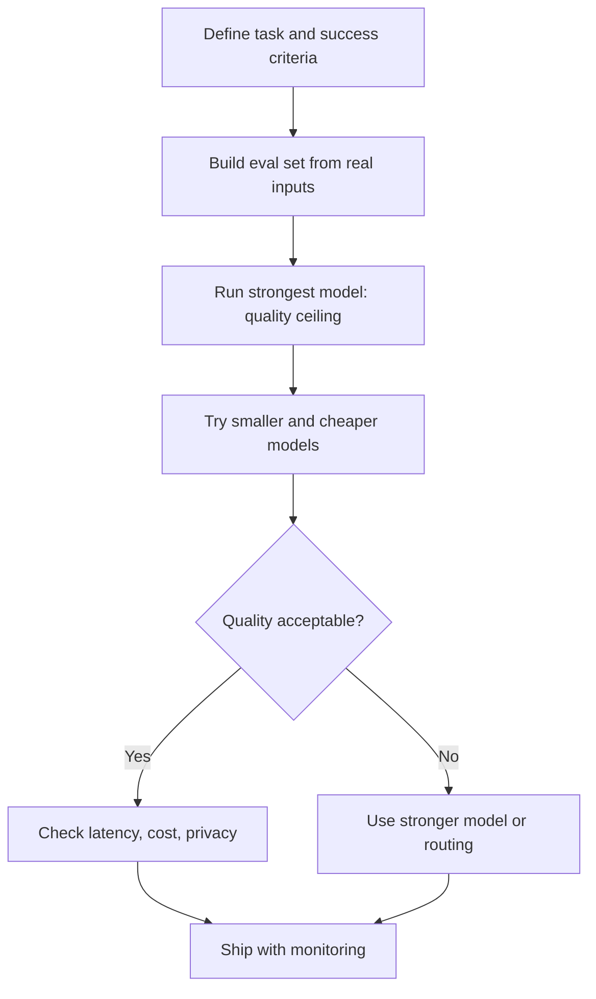
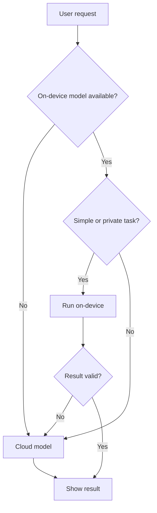
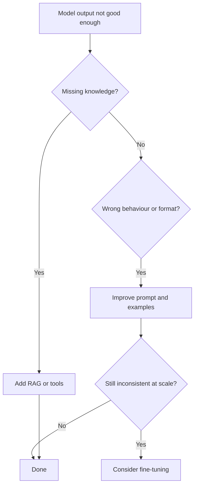
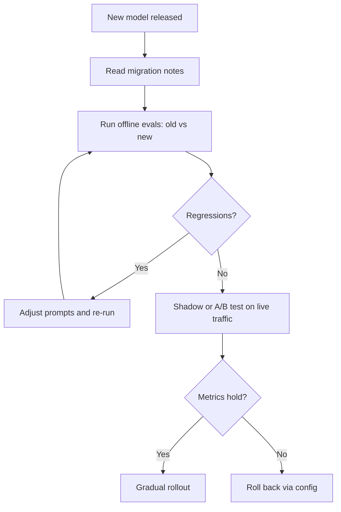

# Choosing Models & Approaches

[⬅ Back to index](../README.md)

Covers: model tiers and trade-offs, choosing a model for a feature, open-weight vs API models, small and on-device models, prompting vs RAG vs fine-tuning, comparing vendors, upgrading models safely, and benchmarks vs your own evals.

---

### 1. How do model tiers differ (e.g. Claude Opus, Sonnet, Haiku)?

<details>
<summary>Answer</summary>

**In short:** Providers sell a family of models that trade capability for speed and cost. For Claude, **Opus** is the most capable tier (hard reasoning, complex coding, long agentic tasks), **Sonnet** is the balanced everyday tier, and **Haiku** is the fastest and cheapest (high-volume, latency-sensitive work). You pick per task using your own evals, and many products use more than one.

#### Why tiers exist

Bigger, more capable models cost more to run and respond more slowly. Not every task needs the strongest model: classifying a support ticket into one of five categories doesn't need the same model that refactors a large codebase. Tiers let you pay for capability only where it matters.

| Tier | Strengths | Typical uses | Trade-off |
|---|---|---|---|
| **Opus** | Deepest reasoning, best at complex coding and long multi-step agent work | Hard analysis, architecture/refactoring, orchestrating agents, difficult grading | Highest price per token, slower |
| **Sonnet** | Strong capability at moderate cost and speed | Everyday coding assistants, agents, enterprise chat, RAG answers | Middle ground on everything |
| **Haiku** | Fastest, cheapest | Classification, extraction, routing, sub-agents, real-time chat, moderation | Weaker on hard reasoning and nuance |

There may also be specialised or frontier tiers above these; names and line-ups change over time, so check the provider's current model list rather than memorising it. Other vendors have the same pattern (a large flagship, a mid model, a small "mini/flash" model).

#### Using several tiers in one product

A common design is to mix tiers:

- **Routing:** a cheap model classifies the request; easy ones go to Haiku, hard ones to Opus or Sonnet.
- **Orchestrator + workers:** a strong model plans the work and smaller models do many parallel, simple sub-tasks.
- **Cascade:** try the cheap model first; escalate if validation fails or confidence is low.

```python
def answer(request):
    tier = classify_difficulty(request)          # cheap, fast model
    model = {"easy": "haiku", "normal": "sonnet", "hard": "opus"}[tier]
    return call_model(model, request)
```

**Pitfalls:**
- Defaulting to the biggest model everywhere and then being surprised by the bill and latency.
- Defaulting to the smallest everywhere and blaming "AI" for poor quality.
- Hard-coding model IDs across the codebase, which makes upgrades painful; keep them in config.

**Likely follow-ups:**
- *How do you know a smaller tier is good enough?* Run the same eval set on both and compare quality, cost and latency.
- *Does a bigger model always win?* Usually on hard tasks, but on simple ones the difference can be negligible while cost is several times higher.

</details>

### 2. How do you choose the right model for a feature?

<details>
<summary>Answer</summary>

**In short:** Define the task and build a small evaluation set first, establish the quality ceiling with a strong model, then try cheaper and faster models and measure what you lose. Weigh quality against latency, cost at your expected volume, context length, tool-use ability and privacy needs, and decide by results on your own data, not leaderboards.

#### Step by step



1. **Define the task precisely.** "Summarise support tickets into three bullet points with the customer's main issue first" is testable; "summarise stuff" isn't.
2. **Build an eval set.** Even 30 to 100 real examples with expected outputs or a grading rubric beats intuition.
3. **Start strong.** Running the best model tells you what's achievable. If even that fails, the problem is the prompt, the context or the task design, not the model choice.
4. **Step down.** Try mid and small tiers with the same prompt. Often a smaller model gets 95% of the quality at a fraction of the cost.
5. **Check the non-quality constraints:**

| Constraint | What to measure |
|---|---|
| Latency | Time to first token (matters for chat), tokens per second (matters for long outputs), total time |
| Cost | Price per request × expected daily volume, including caching and batch discounts |
| Context length | Does your largest realistic input fit, with room for output? |
| Capabilities | Vision, PDFs, tool use, structured output reliability |
| Privacy and compliance | Data retention terms, region/residency, certifications |

6. **Consider routing** if traffic is mixed: a cheap model for easy requests, an expensive one for hard ones.

#### Example

A mobile app wants "smart reply" suggestions in chat. Latency matters more than depth, volume is huge, and outputs are short. A small, fast model is the natural fit. The same app's "explain this contract" feature is low volume and high stakes, so a top-tier model is worth it.

**Pitfalls:**
- Picking a model from a leaderboard or a tweet without testing on your inputs.
- Evaluating only quality and discovering at launch that p95 latency is 12 seconds.
- Forgetting cost scales with volume: a cheap-looking per-request price can be huge at millions of requests a day.

**Likely follow-ups:**
- *How big should the eval set be?* Big enough to cover your main input categories and known edge cases; start small and grow it from production failures.
- *Would you ever change models after launch?* Yes, when a new model is better or cheaper; the eval set makes that a measured decision.

</details>

### 3. Open-weight vs closed (API) models – how do you choose?

<details>
<summary>Answer</summary>

**In short:** Closed API models are usually the most capable and need no infrastructure, but your data goes to the provider and they control versions. Open-weight models give you full control (hosting, fine-tuning, data never leaves your environment) at the cost of running them yourself. Choose on quality needed, cost at your volume, latency, privacy/compliance, customisation needs and team capacity, and many companies use both.

#### What the terms mean

- **Closed (API) models**: you call the model over an API (or a cloud platform that hosts it). You never see the weights.
- **Open-weight models**: the trained weights are published and you can download and run them on your own hardware or a hosting provider. "Open-weight" is more accurate than "open-source" because the training data and code often aren't released, and licences vary.

| Closed APIs (OpenAI, Anthropic, Google) | Open-weight (LLaMA, Mistral, Qwen, DeepSeek, Gemma) |
|---|---|
| Usually the most capable models | Strong and improving quickly; full control |
| No infrastructure to run; pay per token | You host it: GPUs, scaling, ops (or use a hosting provider) |
| Data leaves your environment (with contractual protections) | Data can stay on-premise / on-device |
| Limited customisation (prompting, some fine-tuning) | Full fine-tuning, quantisation, custom serving |
| Model versions can change or be retired | You choose when to upgrade |

#### How to decide

- **Quality:** if the task needs frontier reasoning or coding, a closed model is usually ahead. For narrow tasks (classification, extraction), a well-tuned open model can be enough.
- **Cost:** APIs are cheap at low volume because you pay nothing when idle. At very high, steady volume, self-hosting can be cheaper, but only once you count GPUs, engineers and on-call.
- **Privacy and compliance:** regulated data, air-gapped environments or strict residency rules can push you to self-hosting. Note that enterprise API agreements and cloud-hosted options often satisfy compliance too, so check before assuming.
- **Customisation:** if you need deep fine-tuning or custom serving tricks, open weights give you that.
- **Team capacity:** running inference well (batching, GPU utilisation, autoscaling, monitoring) is real engineering work.

#### The hybrid pattern

A common setup: an API model for hard, lower-volume tasks, plus a small open model (self-hosted or on-device) for high-volume simple tasks or data that must not leave your environment. An abstraction layer lets you swap either side.

**Pitfalls:**
- Comparing only per-token price and ignoring the operational cost of self-hosting.
- Ignoring licence terms of open-weight models (some restrict commercial use or use above certain scale).
- Assuming open-weight means "free": GPUs are not.

**Likely follow-ups:**
- *Is self-hosting automatically more private?* Only if your own infrastructure is secure; it removes the third party, not the risk.
- *Can you fine-tune closed models?* Some providers offer it for some models, but with less control than open weights.

</details>

### 4. What are small language models (SLMs) and when should you use them?

<details>
<summary>Answer</summary>

**In short:** Small language models are models with roughly 0.5–15B parameters (e.g. Phi, Gemma, small LLaMA/Qwen/Mistral variants, on-device models like Gemini Nano and Apple's on-device foundation model). Use them for high-volume, simple or narrow tasks where low latency, low cost, privacy or offline use matter more than broad knowledge and deep reasoning.

#### Why they exist

Large frontier models are expensive and need data-centre hardware. Many real tasks are narrow: "is this message spam?", "extract the date and amount from this receipt", "which of these 8 intents is the user asking for?". A small model can do these well, much faster and cheaper, and can even run on a phone or laptop.

#### Strengths and weaknesses

| Good at | Weaker at |
|---|---|
| Classification, extraction, routing, short rewrites | Broad world knowledge |
| Low latency and high throughput | Complex multi-step reasoning |
| Running on-device or offline | Long, nuanced writing and hard coding |
| Keeping data private (local inference) | Following very long, complex instructions |
| Very low cost per request | Handling unusual inputs gracefully |

#### Making them good enough

Small models are often **fine-tuned or distilled** for a narrow task. Distillation means using a big model to generate high-quality example outputs, then training the small model on them so it imitates the big model on that one task. The result can match a large model on that task while being far cheaper.

#### Typical uses

- A router that decides which bigger model or tool handles a request.
- On-device features: smart replies, summarising a notification, proofreading.
- Bulk processing: tagging millions of records overnight.
- Guardrail classifiers that check inputs or outputs.

**Pitfalls:**
- Expecting a small model to handle open-ended chat as well as a frontier model.
- Skipping evals: quality drops can hide in edge cases.

**Likely follow-ups:**
- *How do you decide between an SLM and a big model?* Run both on your eval set; if the small one meets the bar, its cost and latency usually win.
- *What is quantisation?* Storing weights at lower precision (e.g. 4-bit) to shrink memory use and speed up inference, with a small quality loss.

</details>

### 5. How do you run LLMs on-device (phones, laptops)?

<details>
<summary>Answer</summary>

**In short:** Use small models (roughly 1–8B parameters), aggressively quantised (often 4-bit), run through runtimes that use the device's NPU/GPU: Apple's **Foundation Models framework** and Core ML/MLX, Android's **Gemini Nano** via ML Kit GenAI APIs/AICore, LiteRT, ExecuTorch or llama.cpp. You gain privacy, offline use and no per-token cost; you pay with lower capability, memory and battery limits, and download size. The common pattern is on-device for simple/private tasks with a cloud fallback for complex ones.

#### Two ways to get a model on the device

1. **Use the OS-provided model.** Apple's Foundation Models framework (on supported devices) and Android's Gemini Nano through AICore / ML Kit GenAI APIs (on supported devices) give you a model that's already installed and managed by the OS. You don't ship weights; you check availability and call an API.
2. **Bundle or download your own model.** Convert an open-weight model to a mobile format and run it with LiteRT, ExecuTorch, Core ML, MLX or llama.cpp. More control, but you handle the download (often hundreds of MB to several GB), updates and device compatibility.

#### Why it's hard

| Constraint | Effect |
|---|---|
| Memory | A 4-bit 3B model needs roughly 2 GB of RAM; phones share RAM with every other app |
| Battery and heat | Sustained inference drains battery and triggers thermal throttling, slowing generation |
| Capability | Small models are much weaker than cloud models at reasoning and knowledge |
| Device fragmentation | Not every device has the NPU, RAM or OS version needed |
| Download size | Users won't wait for a multi-GB download on mobile data |

#### Hybrid design



Always check availability at runtime and degrade gracefully. A sketch on Android:

```kotlin
// Pseudocode-level sketch: check availability, fall back to cloud
suspend fun summarise(text: String): String {
    return if (onDeviceModel.isAvailable()) {
        onDeviceModel.summarise(text)        // private, offline, free
    } else {
        cloudApi.summarise(text)             // needs network and consent
    }
}
```

**Pitfalls:**
- Assuming every user's device supports the on-device model; many older or low-end devices won't.
- Sending private data to the cloud fallback without telling users or getting consent.
- Running long generations on the main thread or without cancellation.

**Likely follow-ups:**
- *Why quantise?* It cuts memory and speeds up inference enough to fit on a phone, with a modest quality loss.
- *When would you not use on-device?* When the task needs strong reasoning, large context or up-to-date knowledge.

</details>

### 6. Prompting vs RAG vs fine-tuning – how do you decide?

<details>
<summary>Answer</summary>

**In short:** Match the technique to what's missing. If the model knows enough but behaves wrongly, improve the **prompt**. If it lacks knowledge (private, recent or large), use **RAG or tools**. If it needs to take actions or read live data, use **tool use**. Use **fine-tuning** only for consistent specialised behaviour that prompting can't reach, or to make a smaller model good at a narrow high-volume task. Try them roughly in that order.

| Need | Start with |
|---|---|
| Better instructions, format, tone | **Prompting** (examples, structure, system prompt) |
| Knowledge the model lacks (private, recent, large) with citations | **RAG / tools** |
| Actions or live data | **Tool use** |
| Consistent specialised behaviour that prompting can't reach, or a cheaper smaller model for a narrow high-volume task | **Fine-tuning** (where offered) |

#### Why this order



- **Prompting** is free to change, instant to test and works with any model. Most problems are solved here: clearer instructions, a few examples, a defined output format.
- **RAG** (retrieval-augmented generation) fetches relevant documents at request time and puts them in the prompt. Facts stay up to date because you update the documents, not the model, and you can cite sources.
- **Tools** let the model call your APIs: look up an order, check stock, book a meeting.
- **Workflows** (chaining several prompts, validating outputs) fix many reliability issues before you need training.
- **Fine-tuning** trains the model further on your examples. It's slow to iterate, needs good training data, must be redone when you change base model, and is a poor way to add facts.

#### Example

A banking support bot gives wrong fee amounts. That's missing knowledge: add RAG over the fee schedule. It also sounds too casual: that's behaviour, so fix the system prompt. Fine-tuning would only come in if, say, you later wanted a small cheap model to classify millions of messages with the quality of a large one.

**Pitfalls:**
- Jumping to fine-tuning because it sounds more "serious" before trying a better prompt.
- Fine-tuning to teach facts that change monthly.
- Using RAG when the real problem is a vague prompt.

**Likely follow-ups:**
- *Can you combine them?* Yes, a fine-tuned model can still use RAG and tools; they solve different problems.
- *How do you know which is needed?* Look at the failures in your eval set: missing facts, wrong format, or wrong actions each point to a different fix.

</details>

### 7. When should you fine-tune an LLM instead of prompting or using RAG?

<details>
<summary>Answer</summary>

**In short:** Fine-tune when you need consistent format, style or behaviour that prompting can't reliably achieve, when you want a smaller fine-tuned model to match a big model on a narrow high-volume task (cheaper and faster), or when the domain has specialised skills or language. Don't fine-tune mainly to add facts; use RAG for that. Always try prompting and RAG first, with an eval set to prove fine-tuning actually helps.

#### What fine-tuning does

You take an existing model and train it further on many examples of input and desired output from your task. The model's behaviour shifts toward those examples, so you no longer need long instructions in every prompt. You don't need to know the training internals to use it: providers and tools offer it as a managed job where you upload examples.

#### Good reasons to fine-tune

- **Consistent format, style, tone or behaviour** that prompting can't reliably achieve, e.g. matching a very specific house style across thousands of outputs.
- **A narrow task at high volume** where a **smaller fine-tuned model** can match a large model's quality at a fraction of the cost and latency.
- **Domain-specific skills or language**: medical notes, legal drafting, a niche programming language.
- **Shorter prompts**: behaviour is baked in rather than repeating long instructions every call, which saves tokens and latency.

#### Bad reasons

- **Adding facts.** Facts change, retraining is slow, and the model can still hallucinate "learned" facts with no source to cite. RAG keeps facts fresh and citable.
- **Fixing a vague prompt.** If you haven't tried clear instructions and examples, fine-tuning is premature.
- **Small data.** A handful of examples won't move behaviour reliably; few-shot prompting does the same thing more cheaply.

#### The costs people forget

| Cost | Why it matters |
|---|---|
| Training data | You need hundreds to thousands of high-quality, reviewed examples |
| Iteration speed | Each change means a new training run, not a prompt edit |
| Lock-in | A fine-tune is tied to one base model; upgrading means retraining |
| Maintenance | Data drift means retraining over time |
| Availability | Not every provider or model supports fine-tuning |

#### How to decide in practice

1. Build an eval set.
2. Get the best result you can with prompting, examples and RAG.
3. If there's still a measurable gap, fine-tune and run the same evals. Ship only if it beats the prompted baseline on quality, cost or latency.

**Likely follow-ups:**
- *What's distillation?* Using a large model's outputs as training data to fine-tune a smaller model on a specific task.
- *Can a fine-tuned model still use RAG?* Yes; fine-tuning shapes behaviour, RAG supplies facts.

</details>

### 8. How do you choose between several LLM vendors for a production feature?

<details>
<summary>Answer</summary>

**In short:** Build a task-specific eval set first, then compare vendors on quality, latency, cost at your projected volume, context length and tool-use/structured-output reliability. Check non-functional needs: privacy terms, data residency, compliance, rate limits, SLAs and deprecation policies. Avoid lock-in with an abstraction layer and portable prompts, and re-evaluate periodically because the landscape shifts every few months.

#### A practical process

1. **Build a task-specific evaluation set and grading method first.** Without it, every comparison is anecdotal.
2. **Compare the functional side:**

| Dimension | What to test |
|---|---|
| Quality | Scores on your eval set, broken down by category |
| Latency | Time to first token and tokens/s **at your real prompt sizes**, p50 and p95 |
| Cost | Projected monthly cost at expected volume, including prompt caching and batch discounts |
| Context | Can it handle your largest inputs? Does quality hold up at that length? |
| Features | Tool use, structured output (JSON schema) reliability, vision, streaming |

3. **Check the non-functional side:**
   - Data privacy terms: is data used for training? How long is it retained?
   - Regional hosting and data residency (e.g. EU-only processing).
   - Compliance certifications your customers require.
   - Rate limits, enterprise SLAs and support.
   - Model deprecation policy: how much notice before a model is retired?
   - Availability through your cloud platform (some models are offered via major cloud providers, which can simplify contracts and networking).
4. **Avoid lock-in:**
   - Put an abstraction layer or LLM gateway between your app and vendors.
   - Keep prompts in config, and keep them reasonably portable (they'll still need per-model tuning).
   - Keep evals runnable against any model.
5. **Re-evaluate periodically.** A new model release can change the best choice.

```python
class LLMClient:  # thin abstraction: switching vendor is a config change
    def complete(self, messages, *, model: str, max_tokens: int) -> str: ...

client = get_client(settings.LLM_PROVIDER)   # "anthropic", "openai", ...
reply = client.complete(msgs, model=settings.MODEL_ID, max_tokens=500)
```

**Pitfalls:**
- Comparing vendors with prompts tuned for only one of them; each model deserves a quick prompt pass.
- Ignoring p95 latency and rate limits until launch day.
- Over-abstracting: lowest-common-denominator wrappers can block you from vendor features like caching or tool use.

**Likely follow-ups:**
- *Would you use multiple vendors at once?* Sometimes: for failover during outages, or different vendors for different tasks.
- *What's an LLM gateway?* A proxy service that routes requests to providers and adds logging, retries, rate limiting, caching and cost tracking.

</details>

### 9. How do you test whether a new model version is safe to switch to?

<details>
<summary>Answer</summary>

**In short:** Run your full eval suite on the old and new model with the same prompts, compare quality per category, refusals, format failures, cost and latency, read the provider's migration notes, adjust prompts that were tuned for the old model, then shadow test or A/B test on real traffic before switching fully, keeping the ability to roll back.

#### Why it isn't just "newer is better"

A new model is usually better on average, but your feature depends on specific behaviours: an exact JSON format, a certain tone, a refusal policy, a length. Any of those can shift. Newer models also tend to follow instructions more literally, so prompts written with heavy emphasis ("ALWAYS", "NEVER", repeated warnings) for an older model can make a newer one over-apply rules.

#### The upgrade process



1. **Read the migration notes.** Parameters, defaults, supported features or token counting can change.
2. **Offline evals, side by side.** Same inputs, same prompts. Compare:
   - Quality per category (an average can hide a regression in one category).
   - Refusal rate (too many or too few).
   - Format failures (invalid JSON, missing fields).
   - Output length, cost per request and latency.
3. **Tune prompts** for the new model, often by simplifying them, and re-run.
4. **Shadow test**: send real traffic to the new model in parallel without showing its output, and compare. Or **A/B test** with a small percentage of users.
5. **Gradual rollout** with monitoring, and the model ID in config so rollback is instant.

**Pitfalls:**
- Using an alias like "latest" in production so the model changes under you without testing.
- Looking only at the average score.
- Leaving the upgrade until the old model's retirement date forces a rushed switch.

**Likely follow-ups:**
- *How do you shadow test without doubling cost?* Sample a fraction of traffic, not all of it.
- *What if the new model is better but cost goes up?* Make it a product decision with the numbers: quality gain vs cost per task.

</details>

### 10. Why aren't public benchmarks enough to choose a model?

<details>
<summary>Answer</summary>

**In short:** Public benchmarks measure general abilities on fixed tasks that may not resemble yours, can be contaminated (test questions leaked into training data) or saturated (every top model scores near the max), and ignore your constraints: cost, latency, format reliability and your domain's language. Use them to shortlist models, then decide with your own evals on real inputs.

#### What benchmarks are good for

Benchmarks are standard test sets (coding problems, maths questions, knowledge quizzes, agent tasks) that let everyone compare models on the same questions. They're useful for a rough sense of which models are strong at which kind of task, and for spotting big capability jumps between generations.

#### Why they're not enough

| Problem | What it means for you |
|---|---|
| **Task mismatch** | A top score on competition maths says little about summarising your customer emails |
| **Contamination** | If benchmark questions appeared online, models may have seen them in training, inflating scores |
| **Saturation** | When every model scores 90%+, differences are noise |
| **Missing constraints** | Benchmarks don't measure your latency, cost, JSON reliability or refusal behaviour |
| **Prompt sensitivity** | Scores depend on how the benchmark prompts the model, which isn't how you'll prompt it |
| **Domain language** | Your jargon, abbreviations and messy real inputs aren't in the test |

#### What to do instead

1. Use benchmarks and leaderboards to pick 2–4 candidates.
2. Run them on **your own eval set** built from real (anonymised) inputs, including edge cases you've seen fail.
3. Score what matters for your feature: correctness, format, tone, latency, cost.
4. Pick the model that meets the bar at the best cost.

A small, representative eval set of your own is worth more than any leaderboard position.

**Likely follow-ups:**
- *How do you build your own eval set quickly?* Collect 50–100 real inputs, write expected outputs or a rubric, and add every production failure you find.
- *Are human-preference leaderboards better?* They capture general user preference, but still not your task or constraints.

</details>

### 11. How do you run AI models locally as a developer, and when would you?

<details>
<summary>Answer</summary>

**In short:** Tools like **Ollama**, **LM Studio**, **llama.cpp** (and MLX on Apple silicon) download open-weight models in quantised formats and run them on your laptop, often exposing a local HTTP API compatible with common client libraries. Use them for privacy, offline work, free experimentation and predictable tests; expect them to be weaker and slower than frontier cloud models.

#### How it works

1. Install a runner (Ollama, LM Studio, llama.cpp, or MLX on a Mac).
2. Pull a model, usually a quantised version (e.g. 4-bit) so it fits in memory.
3. The runner loads it onto your CPU/GPU and exposes a chat interface and/or a local HTTP endpoint. Many runners offer an API shaped like popular cloud APIs, so existing client code can point at `localhost` with a base-URL change.

```python
client = OpenAICompatibleClient(  # same client code, pointed at localhost
    base_url="http://localhost:11434/v1", api_key="unused")
reply = client.chat(model="llama3.1:8b", messages=[{"role": "user", "content": "Hi"}])
```

#### Why you'd do it

- **Privacy:** data never leaves the machine, useful for experimenting with sensitive data.
- **Offline work:** planes, restricted networks.
- **No per-token cost:** run thousands of experiments or bulk jobs for free (beyond electricity).
- **Predictable behaviour for tests:** a pinned local model won't change under you.
- **Learning:** seeing how small models behave, how quantisation affects quality, how sampling settings change output.

#### Limits

| Limit | Detail |
|---|---|
| Capability | Smaller models are noticeably weaker than frontier cloud models at complex reasoning and coding |
| Memory | Needs roughly the model's size in RAM/VRAM: a 4-bit 8B model needs around 5–6 GB |
| Speed | Generation is slower on modest hardware, especially without a good GPU or Apple silicon |
| Maintenance | You manage model updates yourself |

#### A common setup

Local models for prototyping, private data experiments and cheap bulk tasks; cloud models for production features that need the best quality.

**Pitfalls:**
- Judging what "AI can do" from a small local model; frontier models are much stronger.
- Assuming local results will match the cloud model you ship with; re-run evals on the production model.

**Likely follow-ups:**
- *Can you ship a locally-run model to production?* Yes, by self-hosting it on servers, but that's an ops decision (see open-weight vs API).
- *What's quantisation's trade-off?* Less memory and faster inference for a small quality loss; very low bit-widths hurt quality more.

</details>

---

[⬅ Previous: Efficiency: Cost, Latency & Scale](15-efficiency-cost-latency.md) · [⬅ Back to index](../README.md) · [Next: Multimodal Inputs & Model Features ➡](17-multimodal-features.md)
