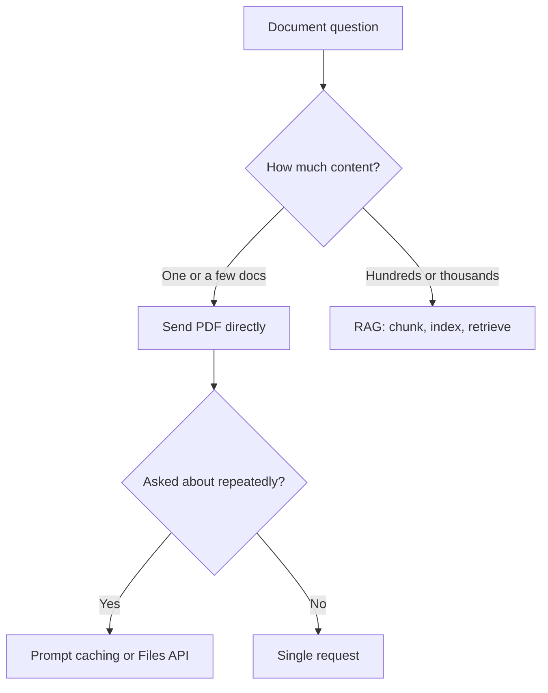
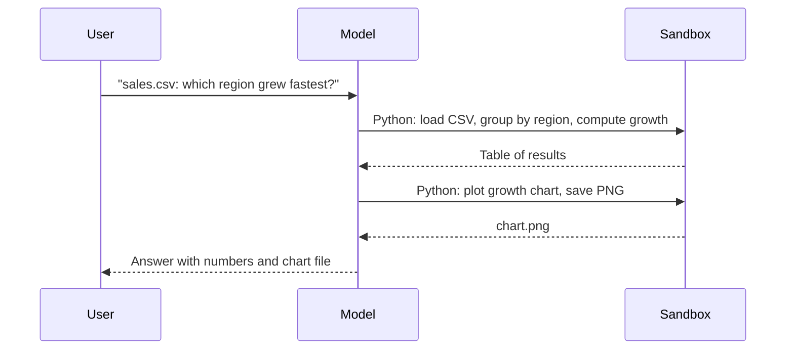
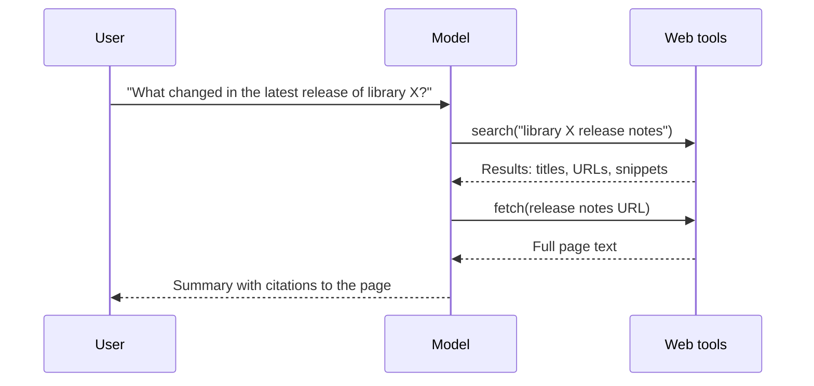
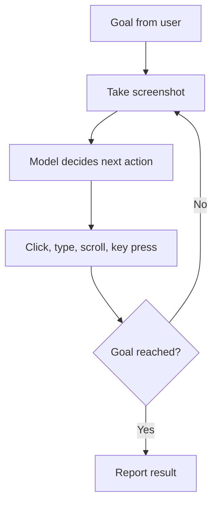
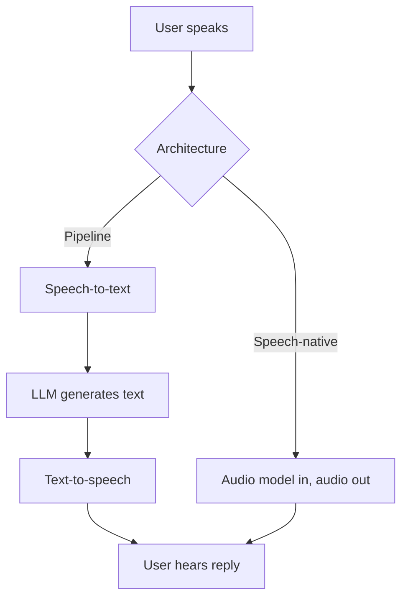
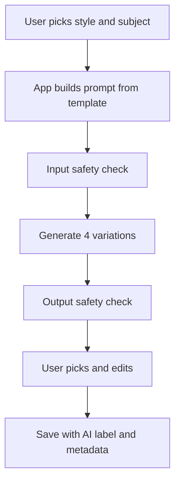
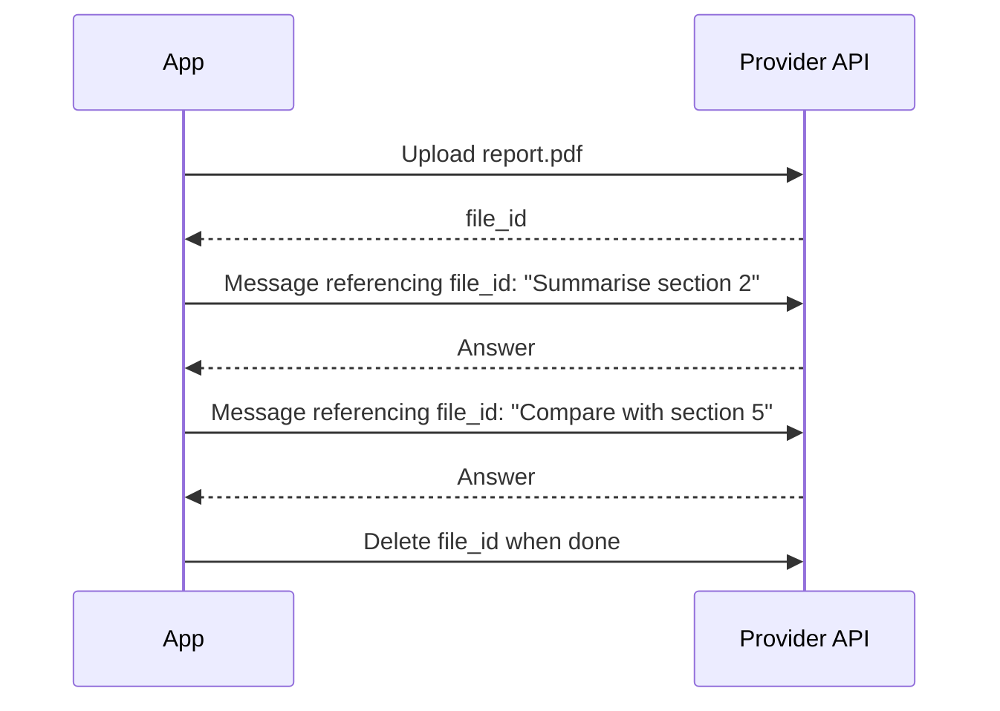

# Multimodal Inputs & Model Features

[⬅ Back to index](../README.md)

Covers: image understanding, PDFs and documents, citations, extended thinking, code execution and file outputs, web search and fetch, computer use, voice, image generation, and the Files API.

---

### 1. How do you get good results from image inputs?

<details>
<summary>Answer</summary>

**In short:** Send clear images at a sensible resolution (sharp enough to read, not so huge they waste tokens), put the images **before** the question and refer to them explicitly, ask specific questions, and for charts or screenshots ask the model to describe what it sees before answering. Verify anything involving counting, precise measurement or tiny text, because those are weak spots.

#### How image input works

Vision-capable models accept images alongside text in the same request. The image is converted into tokens internally, so it costs tokens roughly in proportion to its pixel size, and very large images are typically downscaled by the provider anyway. That means sending a 6000×4000 photo usually buys you nothing except cost and latency.

```json
{
  "role": "user",
  "content": [
    { "type": "image", "source": { "type": "base64", "media_type": "image/png", "data": "..." } },
    { "type": "text", "text": "This is a screenshot of our checkout screen. List every visible error message." }
  ]
}
```

#### Practical tips

| Tip | Why it helps |
|---|---|
| Resize to a sensible size before upload | Fewer tokens, lower latency; text must still be legible |
| Images before the question | The model reads the image with the question in mind, similar to long documents |
| Label multiple images ("Image 1: before, Image 2: after") | Avoids confusion about which image you mean |
| Be specific ("read the total on the receipt") | Vague prompts get vague descriptions |
| Describe first, then answer | For charts and UIs, a description step reduces misreading |
| Crop to the relevant area | Small details become larger and clearer |

#### Known weak spots

- **Counting** many similar objects.
- **Precise spatial measurements** ("how many pixels apart", exact coordinates).
- **Tiny or low-contrast text**, handwriting, rotated images.
- **Fine visual differences** between two near-identical images.

For these, verify results, crop or zoom, or combine with traditional tools (OCR, barcode scanners, image-diff libraries).

#### Mobile example

A receipt-scanning feature: on the device, crop and compress the photo, then send it with a prompt that asks for structured JSON (merchant, date, total, currency). Validate the JSON in code and show the extracted fields for the user to confirm before saving.

**Pitfalls:**
- Uploading full-resolution camera photos for every request.
- Trusting extracted numbers without user confirmation in money-related flows.
- Forgetting that images may contain personal data (faces, addresses) that you're now sending to a provider.

**Likely follow-ups:**
- *Can the model read text in images?* Yes, usually well for clear printed text; verify small, handwritten or noisy text.
- *How do you cut image cost?* Resize, crop, and only send images when the task actually needs them.

</details>

### 2. How do models handle PDFs and documents?

<details>
<summary>Answer</summary>

**In short:** APIs like Claude's accept PDFs directly: the model sees both the **extracted text and page images**, so it can read charts, tables and layouts, not just text. Limits apply (file size and page count), and long PDFs use many tokens. For repeated questions over the same document use prompt caching or a Files API upload, and for huge document sets use retrieval instead of sending everything.

#### What happens under the hood

When you send a PDF, the provider processes each page in two ways: it extracts the text layer and it renders the page as an image. The model gets both, which is why it can answer questions about a bar chart or a scanned table that has no text layer. It's also why PDFs cost more than plain text: each page costs text tokens plus image tokens.

#### Choosing an approach by size



| Situation | Approach |
|---|---|
| User uploads one contract and asks a question | Send the PDF directly |
| User asks many follow-ups about the same PDF | Upload once (Files API) and/or use prompt caching so repeated input is cheaper |
| Company knowledge base of 10,000 documents | Retrieval: index chunks, send only the relevant ones |
| Text-only documents where layout doesn't matter | Extracting text yourself can be cheaper |

#### Tips

- Put the document before the question in the prompt.
- Ask for page references or quotes so users can check the answer; some APIs offer built-in citations that point to exact passages.
- Check the provider's documented limits on file size and page count; split very long documents.
- For structured extraction (invoice fields), ask for JSON and validate it.

**Pitfalls:**
- Sending a 300-page PDF on every chat turn without caching.
- Assuming scanned, low-quality pages will be read perfectly.
- Stuffing many large documents into context instead of retrieving: cost goes up and answer quality can drop.

**Likely follow-ups:**
- *What are citations here?* A feature where the answer includes references to the exact source passages, so users can verify claims.
- *Why not always use RAG?* For a single document, sending it whole is simpler and gives the model full context.

</details>

### 3. When should you turn on extended thinking or higher effort?

<details>
<summary>Answer</summary>

**In short:** Turn it on for tasks that need multi-step reasoning: complex analysis, maths, planning, debugging, hard coding, agentic tasks with many decisions, and grading against nuanced rubrics. Leave it off (or low) for simple lookups, short rewrites, classification or chat where speed matters. Thinking adds tokens and latency, so compare quality against cost on your evals.

#### What it is

Extended thinking (also called reasoning mode, or controlled by an "effort" setting on some APIs) lets the model generate internal reasoning before its final answer. It works like letting someone work through a problem on scratch paper instead of answering instantly. You pay for those reasoning tokens and wait for them, but on hard problems the final answer is often much better.

#### When it helps and when it doesn't

| Worth it | Usually not worth it |
|---|---|
| Debugging a tricky failure from logs and code | Classifying a ticket into categories |
| Planning a multi-step agent task | Rewriting a sentence in a friendlier tone |
| Maths, logic, data analysis | Simple fact lookups or RAG answers from clear sources |
| Complex code generation or refactoring | Real-time chat where latency is critical |
| LLM-as-judge grading with detailed rubrics | High-volume extraction with a fixed schema |

#### How to decide

1. Run your eval set with thinking off, and with it on (or at low, medium and high effort).
2. Compare quality, latency and cost per request.
3. Turn it on only where the quality gain justifies the cost. You can also make it dynamic: enable it for requests your router flags as hard.

#### Product considerations

- **Latency:** thinking delays the first visible token. Show a "thinking…" state, or stream a summary of progress if the API provides one.
- **Budgets:** many APIs let you cap thinking tokens or choose an effort level. Set limits so a single request can't run away.
- **Don't over-prompt:** with thinking on, you usually don't need "think step by step" instructions.

**Pitfalls:**
- Enabling maximum effort globally "to be safe", multiplying cost and latency for no gain on simple tasks.
- Showing users a long blank wait without feedback.

**Likely follow-ups:**
- *Does thinking replace a good prompt?* No; it improves reasoning, but unclear instructions and missing context still produce bad answers.
- *Can you show the thinking to users?* Depends on the provider; often you get a summary, and it shouldn't be treated as a guaranteed faithful explanation.

</details>

### 4. What can a code-execution tool add to an AI feature?

<details>
<summary>Answer</summary>

**In short:** A code-execution tool lets the model **write and run code in a sandbox**, so it can analyse uploaded CSVs and spreadsheets precisely, do exact calculations, create charts, transform data and generate files (reports, documents, presentations) to return to the user. It turns "the model estimates" into "the model computes", which is far more reliable for data work. Mind the sandbox limits (often no internet, time and memory caps) and verify outputs.

#### Why it matters

Language models predict text. They're good at reasoning about numbers but unreliable at doing arithmetic over thousands of rows "in their head". With code execution, the model writes a small program (usually Python), the sandbox runs it, and the model sees the real result.



#### What it enables

| Use | Example |
|---|---|
| Data analysis | "Which product category had the highest return rate last quarter?" over a CSV |
| Exact maths | Loan amortisation, unit conversions, statistics |
| Charts | Generate a PNG chart from user data |
| File transformation | Clean and reformat a spreadsheet, convert formats |
| File generation | Produce a report, slide deck or document for download |

#### Limits and safeguards

- **Sandbox limits:** typically no internet access by default, limited CPU time, memory and installed libraries. Large datasets may not fit.
- **Wrong code still runs:** the model can write code that executes but answers the wrong question (wrong column, wrong filter). Show the code or key steps for important results, and check outputs.
- **Security:** only run model-written code in an isolated sandbox, never on your own servers with real credentials.
- **Cost and latency:** multiple run-and-inspect loops add time; tell the user what's happening.

**Pitfalls:**
- Asking the model to "calculate" totals over large data without code execution and trusting the result.
- Running model-generated code in an environment with access to production data or secrets.

**Likely follow-ups:**
- *How is this different from function calling?* Function calling runs your predefined functions; code execution runs arbitrary code the model writes, which needs a sandbox.
- *How do users get generated files?* The tool returns file references that your app downloads (often via a Files API) and shows to the user.

</details>

### 5. How do web search and web fetch tools work in an assistant?

<details>
<summary>Answer</summary>

**In short:** **Web search** lets the model issue search queries and get back results with URLs and snippets, which it can cite in its answer; **web fetch** retrieves the full content of a specific page or PDF. Configure domain allow/block lists, cap uses per request, and show citations to users. Treat fetched content as untrusted (prompt injection risk), and remember each search adds latency and cost.

#### How the loop works

These are tools the model chooses to call, just like your own functions, except the provider (or your code) executes them.



1. The model decides its training data isn't enough (recent or specific info).
2. It calls **search** and gets a list of results.
3. It may call **fetch** on the most promising URLs to read them fully.
4. It answers, citing the sources.

#### Configuration you control

| Setting | Why |
|---|---|
| Allowed / blocked domains | Restrict to trusted sources (e.g. your docs site) or block unreliable ones |
| Max uses per request | Bounds cost and latency |
| Citations shown in the UI | Lets users verify claims |
| Location or locale (if supported) | More relevant local results |

#### Risks

- **Prompt injection:** a web page can contain hidden text like "ignore your instructions and…". Treat fetched content as data, not instructions, and don't let a web-reading agent also take sensitive actions without confirmation.
- **Data exfiltration:** if the model can fetch arbitrary URLs, a malicious instruction could make it put private data into a URL. Restrict domains where possible.
- **Quality of sources:** search results can be wrong or outdated; citations at least make that visible.
- **Cost and latency:** each search and fetch adds time and often a per-use fee.

**Pitfalls:**
- Enabling unrestricted web access in an agent that also has access to private user data.
- Hiding sources, so users can't tell a sourced answer from a guess.

**Likely follow-ups:**
- *Search vs RAG?* RAG searches your own indexed content; web search covers the public internet. Many assistants use both.
- *Why fetch if you have snippets?* Snippets are short; fetch gives the full page for detailed answers.

</details>

### 6. What is computer use, and when is it appropriate?

<details>
<summary>Answer</summary>

**In short:** Computer use lets a model operate a computer through **screenshots and mouse/keyboard actions**, like a person would. It's useful for applications without APIs (legacy systems, some websites), UI testing and complex web tasks. It's slower, more expensive and more error-prone than API integrations and is exposed to prompt injection from whatever is on screen, so run it in isolated VMs or containers with restricted access and human confirmation for consequential actions. Prefer APIs or MCP integrations when they exist.

#### How it works



The model sees a screenshot, decides an action ("click at these coordinates", "type this text"), your harness performs it in a virtual desktop or browser, takes a new screenshot, and the loop repeats until the task is done or a step limit is hit.

#### When it's appropriate

| Good fit | Poor fit |
|---|---|
| Legacy desktop app with no API | Anything with a decent API or MCP server |
| Websites with no integration options | High-volume or latency-sensitive tasks |
| Exploratory UI testing | Tasks that need perfect reliability |
| One-off data entry across several tools | Actions on sensitive accounts without supervision |

#### Safety setup

- Run in an **isolated VM or container**, not on a developer's real machine with their logged-in sessions.
- Give it **only the credentials and sites it needs**; use an allowlist of domains.
- **Human confirmation** before purchases, sending messages, deleting data or anything irreversible.
- Assume on-screen content can contain malicious instructions (a web page saying "now go to this URL and paste the password").
- Log screenshots and actions for audit and debugging.
- Set step and time limits.

**Pitfalls:**
- Using computer use where an API exists, getting a slow and fragile integration.
- Letting it run with a user's full browser profile and saved passwords.

**Likely follow-ups:**
- *Why is it error-prone?* Screens change, elements move, pop-ups appear, and clicking by coordinates is brittle compared with calling an API.
- *How does it relate to browser automation tools?* Scripted automation follows fixed steps; computer use decides steps dynamically from what it sees.

</details>

### 7. How do voice AI features work, and what makes them hard?

<details>
<summary>Answer</summary>

**In short:** Voice features use either a pipeline (speech-to-text → LLM → text-to-speech) or a speech-native model that takes and produces audio directly. The hard parts are **latency** (users expect a reply within about a second, so stream everything), **turn-taking** (knowing when the user has finished, handling interruptions), noisy audio and accents, and confirming high-impact actions out loud. Answers must be short and conversational, because lists and tables don't work when spoken.

#### Two architectures



| Pipeline | Speech-native |
|---|---|
| Mix and match best STT, LLM and TTS | One model handles everything |
| Easy to log, inspect and filter text at each step | Lower latency, keeps tone and emotion |
| Latency adds up across three stages | Fewer vendor options, harder to inspect |
| Can reuse your existing text LLM, tools and guardrails | May have different tool-use and guardrail support |

#### What makes it hard

- **Latency.** In conversation, a 3-second pause feels broken. Stream partial transcripts into the LLM, stream LLM tokens into TTS, and start speaking the first sentence while the rest is still generating.
- **Turn-taking.** Voice activity detection decides when the user stopped talking. Too eager and you cut them off mid-thought; too slow and it feels laggy.
- **Interruptions (barge-in).** If the user starts talking while the assistant speaks, stop playback immediately and listen.
- **Audio quality.** Background noise, accents, speakerphones, names and numbers are where transcription errors happen.
- **Confirming actions.** "I'll transfer £500 to John Smith. Shall I go ahead?" Spoken confirmation for anything consequential, since there's no screen to review.
- **Output style.** Prompt for short sentences, no markdown, no bullet lists, numbers spoken naturally.

#### Mobile considerations

Handle audio focus and interruptions (calls, other apps), microphone permissions, background behaviour, and poor connectivity. On-device speech recognition can cut latency and keep audio private.

**Pitfalls:**
- Reusing a chat prompt that produces long markdown answers, which sounds terrible read aloud.
- Waiting for the full LLM response before starting speech.

**Likely follow-ups:**
- *How do you measure voice latency?* Time from the user stopping speaking to the first audio of the reply.
- *How do you handle misheard names or numbers?* Read them back for confirmation before acting.

</details>

### 8. What should you consider when using AI image generation in a product?

<details>
<summary>Answer</summary>

**In short:** Think about prompting for style and composition, consistency across images (reference images, style guides), safety filters and policy (real people, brands, harmful content), the provider's copyright and licensing terms, disclosure or watermarking (e.g. content credentials), cost per image, and human review for anything published. Check common weak spots: text inside images, hands and exact layouts.

#### Product checklist

| Area | What to decide |
|---|---|
| **Prompting** | Do users write prompts, or does your app build them from structured options (style, subject, colours)? Templates give more consistent results |
| **Consistency** | Use reference images, fixed style descriptions, or seeds where supported, so a set of images looks like it belongs together |
| **Safety and policy** | Filter prompts and outputs: real people, children, violence, sexual content, trademarks and logos |
| **Legal** | Read the provider's terms on ownership and commercial use; avoid prompts that imitate specific living artists or copy protected characters |
| **Disclosure** | Label AI-generated images; consider provenance metadata like content credentials and any watermarking the provider applies |
| **Cost and latency** | Images take seconds and cost per image; generate variations on demand, cache results, set quotas |
| **Review** | Human review for anything published under your brand (marketing, product listings) |

#### Common weak spots

- **Text in images:** improving, but misspellings still happen. For exact text, overlay real text in your app instead.
- **Hands, small details and counts** (e.g. "exactly five people").
- **Precise layouts:** UI mockups, diagrams and charts with correct data are better built with code.
- **Brand accuracy:** logos and product details are often subtly wrong.

#### Example flow



**Pitfalls:**
- Letting free-text prompts through with no moderation in a public app.
- Publishing generated images with incorrect product details.
- Ignoring storage and privacy for user-uploaded reference photos.

**Likely follow-ups:**
- *How do you keep a consistent character across images?* Reference images, detailed fixed descriptions, and provider features for style or subject consistency where available.
- *What is content provenance?* Metadata attached to a file that records how it was made, so others can see it was AI-generated.

</details>

### 9. What is a Files API, and why use it?

<details>
<summary>Answer</summary>

**In short:** A Files API lets you **upload a file once** (PDF, image, dataset) and reference it by ID in many requests instead of re-sending its bytes every time. It's useful for multi-turn analysis of the same document, code-execution workflows over datasets, and downloading files the model generated. Treat uploaded files like any stored user data: manage retention and deletion.

#### The problem it solves

Without it, every request that needs a 20 MB PDF must include the whole file (often base64-encoded) in the request body. For a 10-turn conversation about that PDF, you upload it 10 times: slow on mobile networks, wasteful, and bulky in your logs.



#### Typical uses

- **Multi-turn document Q&A:** upload once, ask many questions.
- **Code execution:** give the sandbox a dataset by file ID; get generated charts or reports back as file IDs to download.
- **Shared assets:** a product catalogue PDF referenced by many requests.

It pairs well with **prompt caching**: the Files API avoids re-uploading the bytes, while caching reduces the cost of the model re-processing the same content across requests. They solve different problems.

#### Data handling

- Files are stored by the provider until you delete them (or per their retention policy), so treat them as user data under your privacy policy.
- Delete files when the conversation or task ends, or on user request.
- Track which file IDs belong to which user, so one user can never reference another's file.
- Check the provider's documented size and type limits, and whether the feature is generally available or beta for your use.

**Pitfalls:**
- Uploading files and never deleting them.
- Exposing raw file IDs to clients without checking ownership on your backend.

**Likely follow-ups:**
- *Does uploading make the document free to use in later requests?* No; you still pay input tokens when the model processes it, though caching can reduce that.
- *Should mobile apps upload directly to the provider?* Usually no: upload to your backend, which holds the API key and calls the provider.

</details>

---

[⬅ Previous: Choosing Models & Approaches](16-choosing-models.md) · [⬅ Back to index](../README.md) · [Next: Designing AI Products & UX ➡](18-ai-product-design.md)
