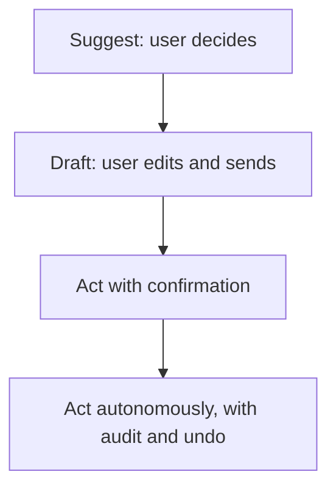
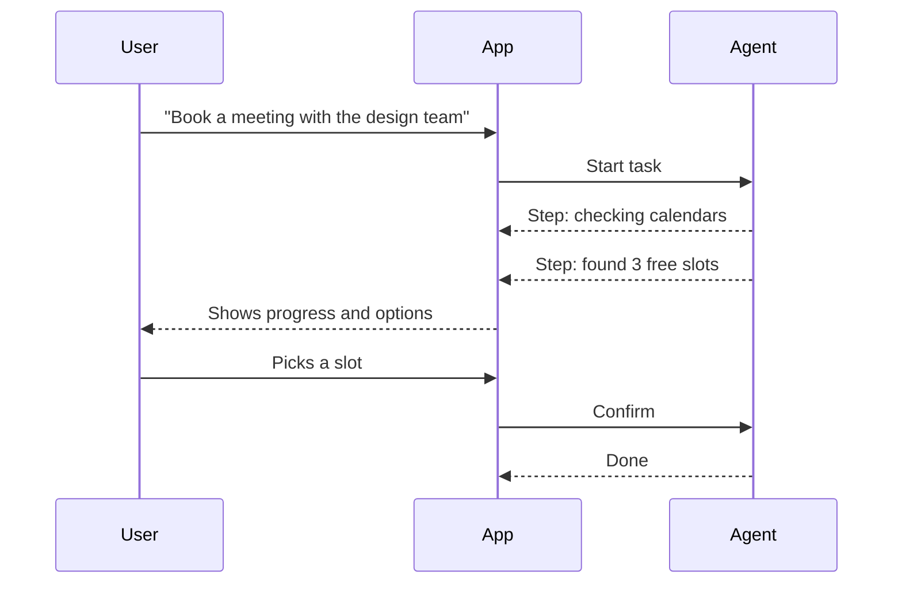
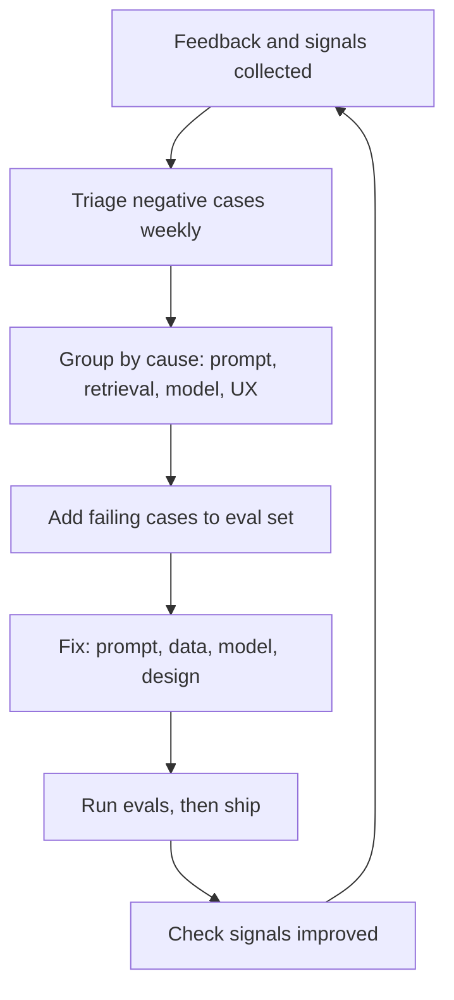
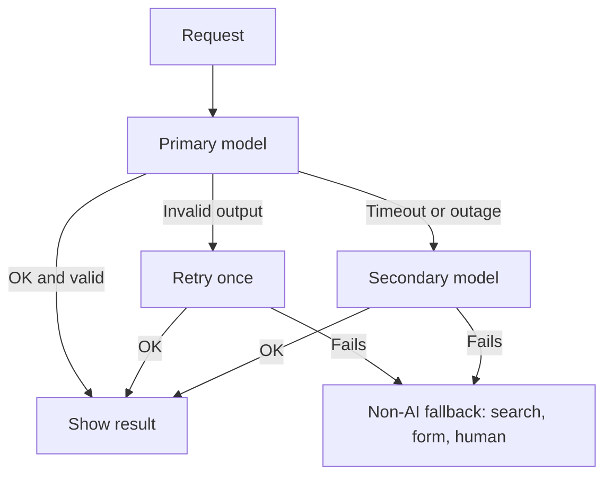
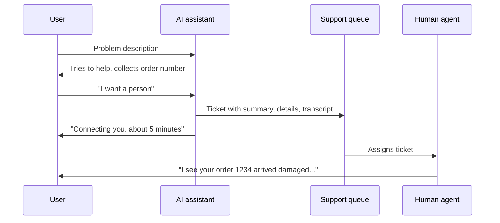
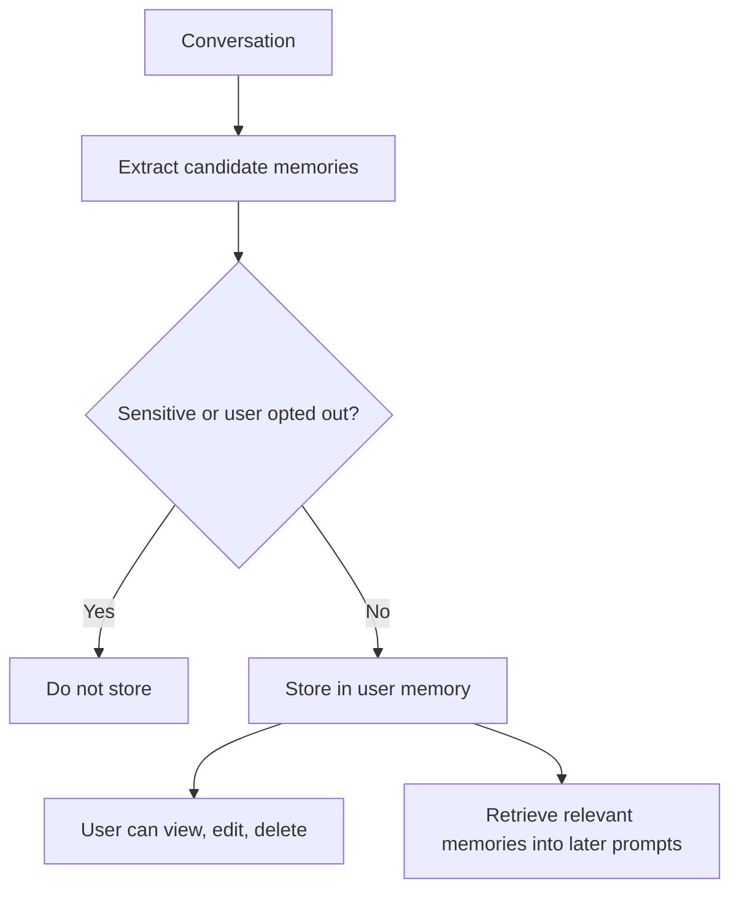
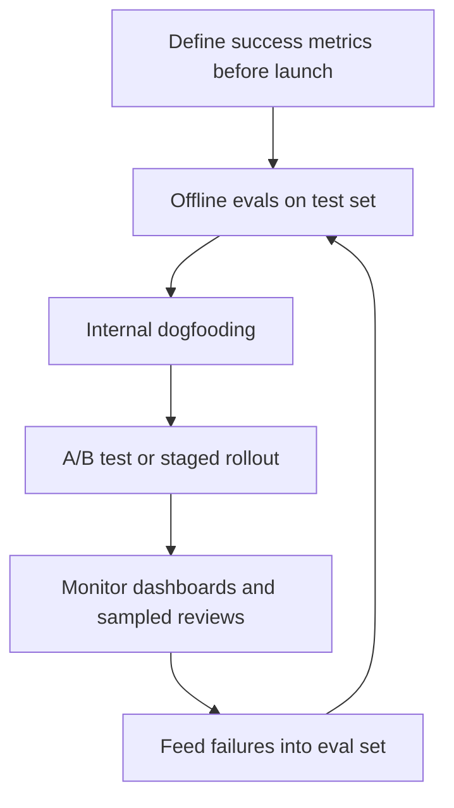

# Designing AI Products & UX

[⬅ Back to index](../README.md)

Covers: choosing where AI adds value, setting expectations, streaming and progress UX, showing sources, editing and control, feedback loops, failure and fallback states, human handoff, AI disclosure, personalisation and memory UX, cost-aware design, and measuring success.

---

### 1. How do you decide where AI belongs in a product?

<details>
<summary>Answer</summary>

**In short:** Start from **user problems with clear value**: tasks that are slow, repetitive or need lots of information pulled together, where outputs can be checked and mistakes are tolerable or catchable. Prefer AI that **assists** users inside their existing workflow (drafts, suggestions, summaries) before fully autonomous features, and avoid "AI for its own sake": a chatbot bolted onto a product rarely beats an AI capability built in where the work happens.

#### A simple filter

For each candidate feature, ask:

| Question | Good sign | Warning sign |
|---|---|---|
| Is there a real user pain? | Users spend lots of time on it today | "Competitors have AI" is the main reason |
| Is the task suited to LLMs? | Language, summarising, drafting, classifying, extracting | Exact arithmetic, guaranteed-correct facts, deterministic rules |
| Can users verify the output? | Short drafts, summaries with sources | Long outputs nobody will check |
| What does an error cost? | A bad suggestion is ignored | Wrong medical, legal or financial action |
| Is there data and context? | You have the documents, history, structure | The model would have to guess |
| Do the economics work? | Cost per use is small vs the value | High volume, low value per call |

#### Assist before automate



Start at the top and move down only when evals and real usage show the feature is reliable. Each step down raises the stakes of errors, so it needs stronger guardrails.

#### Embedded beats bolted-on

A generic chat panel makes users figure out what to ask. Embedded features meet them in context:

- An email app with "summarise this thread" on long threads.
- A code review tool that suggests a fix next to the failing check.
- A support dashboard that drafts a reply in the reply box, already grounded in the ticket.
- A notes app that turns a voice memo into action items.

**Pitfalls:**
- Using an LLM where a simple rule or a search box would be cheaper and more reliable.
- Shipping full automation first, then losing user trust after a few visible mistakes.

**Likely follow-ups:**
- *How do you validate an idea quickly?* Prototype with a strong model and real (anonymised) data, test with a few users, and build a small eval set before investing heavily.
- *When is a chat interface the right choice?* When the task really is open-ended (exploration, Q&A over many docs), not as a default for every feature.

</details>

### 2. How do you set the right user expectations for an AI feature?

<details>
<summary>Answer</summary>

**In short:** Be clear about what the feature does and doesn't do, show example prompts or starting points, label it as AI, say it can make mistakes where that matters, and avoid marketing language that implies perfect accuracy. Good onboarding with strong starting examples improves both output quality and trust.

#### Why it matters

Users arrive with wildly different mental models: some think AI is magic and trust everything, others assume it's useless. Both cause problems. Over-trust leads to unverified errors; under-trust means nobody uses the feature. The goal is **calibrated trust**: users rely on it where it's good and check it where it's weak.

#### Techniques

| Technique | Example |
|---|---|
| State the scope | "Answers questions about your account and our help articles. Can't make changes to your plan." |
| Show examples | Suggested prompts or chips: "Summarise this week's tickets", "Draft a reply" |
| Label AI output | An "AI-generated" tag or icon on drafts and summaries |
| Honest caveats in context | "Check important details" near outputs in high-stakes areas, not a giant disclaimer everywhere |
| Show sources | Links to the documents an answer came from |
| Empty states that teach | The first screen explains what to try, instead of a blank text box |
| Consistent naming | Don't promise an "expert" or "agent" if it's a suggestion tool |

#### Example

A "smart search" in a banking app: the placeholder says "Ask about your transactions, e.g. 'How much did I spend on travel in March?'", answers show the transactions they're based on, and the UI says it can't move money. Users learn both what to ask and how to check the result.

**Pitfalls:**
- A blank chat box with no guidance, which leads to poor first results and abandonment.
- Disclaimers so generic and frequent that everyone ignores them.
- Marketing copy ("always accurate") that the product can't live up to.

**Likely follow-ups:**
- *Do disclaimers reduce liability on their own?* No; they help set expectations, but the design still needs verification, guardrails and safe defaults.
- *How do you know expectations are off?* Feedback, support tickets and usage logs show people asking for things the feature can't do.

</details>

### 3. What UX patterns handle AI latency?

<details>
<summary>Answer</summary>

**In short:** Stream text as it's generated, show **progress for agents** (current step, tools being used), let users cancel, use optimistic UI for quick actions, precompute likely outputs in the background (e.g. summaries), and run long tasks asynchronously with a notification when they finish.

#### Why latency is different with AI

LLM responses can take from under a second to minutes for agents. Users tolerate waiting if they can see progress and stay in control; a spinner for 20 seconds feels broken.

#### Patterns by wait time

| Expected wait | Pattern |
|---|---|
| Under ~1 s | Normal UI; optimistic updates |
| A few seconds | **Stream tokens** so text appears right away; skeleton placeholders for structured output |
| 10 s to a minute | **Step-by-step progress** ("Searching docs… Reading 3 files… Writing answer"), cancel button |
| Minutes or more | **Run in the background**, let the user leave, notify when done (push notification, email, badge) |
| Predictable needs | **Precompute** ahead of time: summarise a thread when it arrives, not when the user taps |

#### Streaming on mobile

Time to first token matters more than total time for perceived speed. Streaming usually means server-sent events from your backend, rendered incrementally.

```kotlin
// Sketch: collect a stream of text chunks into UI state
viewModelScope.launch {
    _ui.value = UiState.Generating("")
    aiRepository.streamReply(prompt)              // Flow<String> of chunks
        .catch { _ui.value = UiState.Error(it) }
        .collect { chunk ->
            val current = (_ui.value as? UiState.Generating)?.text.orEmpty()
            _ui.value = UiState.Generating(current + chunk)
        }
}
```

Cancelling the coroutine (user taps "Stop") should also cancel the upstream request so you stop paying for tokens.

#### Agent progress



**Pitfalls:**
- Waiting for the full response before showing anything.
- Streaming JSON that the UI can't render until it's complete; stream user-facing text, or render partial structured fields carefully.
- No cancel button on long or expensive operations.

**Likely follow-ups:**
- *How do you speed up the model itself?* Smaller models, shorter prompts, prompt caching, less output, parallel calls.
- *How do you stream structured output?* Use partial parsing or stream a text summary while the structured result completes.

</details>

### 4. Why show sources and let users edit outputs?

<details>
<summary>Answer</summary>

**In short:** **Sources and citations** let users verify claims and build the right level of trust; **editing** turns AI output into a draft the user controls rather than a final answer. Both reduce the harm of errors and increase adoption. Track edits as quality signals: heavily edited outputs point to prompt or retrieval problems.

#### Sources

LLMs can produce confident, fluent text that's wrong. Showing where an answer came from changes the user's job from "trust or don't" to "check if needed".

- Link each claim (or paragraph) to the document, page or record it came from.
- Let users open the source in one tap.
- If there's no supporting source, say so rather than inventing one.
- Validate citations on the backend: check that cited IDs actually exist in the retrieved set.

#### Editing

| AI as final answer | AI as editable draft |
|---|---|
| User must accept or reject the whole thing | User fixes the 10% that's wrong |
| An error goes straight out to the customer | The user reviews before it leaves |
| Low trust, low adoption | Users stay in control and adopt faster |

Good editing UX: output lands in a normal editable field, "regenerate" and "make shorter / more formal" options, undo, and nothing is sent or saved without the user's action.

#### Edits as a quality signal

Compare the AI draft with what the user finally sent (edit distance or a simple "changed a lot / a little / nothing" bucket).

- Mostly unedited: the feature is working.
- Heavily rewritten: investigate. Maybe the tone is wrong (prompt), facts are missing (retrieval), or the task is a poor fit.
- Collect examples of heavy edits (with privacy safeguards) and add them to your eval set.

**Pitfalls:**
- Fake or broken citations, which destroy trust faster than having none.
- Auto-sending AI output with no review step in customer-facing flows.

**Likely follow-ups:**
- *What if the user doesn't check sources?* Design so high-risk claims are highlighted and the default action is safe; sources help but don't replace guardrails.
- *Is edit rate always bad?* No; some edits are personal style. Look at trends and the type of edits.

</details>

### 5. How should you collect and use user feedback?

<details>
<summary>Answer</summary>

**In short:** Collect lightweight in-context feedback (thumbs up/down with optional reasons, "regenerate", corrections) plus **implicit signals** (copy, accept, edit distance, abandonment, follow-up questions). Review negative feedback regularly, add failing cases to your eval set, and close the loop by checking whether fixes actually improved the signals. Respect privacy when reviewing conversations.

#### Explicit vs implicit feedback

| Explicit | Implicit |
|---|---|
| Thumbs up/down | User copied or accepted the output |
| Reason chips ("wrong", "too long", "unsafe") | User edited it heavily |
| Free-text comments | User regenerated or rephrased the question |
| Corrections ("the answer should be X") | User abandoned the flow or escalated to a human |
| Rare: most users don't click | Plentiful, but noisier to interpret |

Use both: explicit feedback tells you **why**, implicit signals tell you **how often**.

#### The feedback loop



#### Design tips

- Keep it one tap; optional reason chips after a thumbs-down.
- Log feedback with the request ID, model version and prompt version so you can reproduce the case.
- Don't let raw thumbs counts drive decisions alone; a few vocal users can skew them.
- Tell users when their feedback led to a fix (release notes), which encourages more of it.

#### Privacy

Feedback often comes attached to real conversations. Be clear in your privacy policy about who can review them, restrict access, redact personal data before adding to eval sets, and honour deletion requests.

**Pitfalls:**
- Collecting feedback that nobody reviews.
- Fixing a reported case by special-casing the prompt, then breaking other cases without evals to catch it.

**Likely follow-ups:**
- *Can you train on user feedback?* Possibly, with consent and clear terms, but most teams use it first for evals and prompt fixes.
- *Which implicit signal is most useful?* Usually acceptance or edit rate for drafting features, and escalation rate for support bots.

</details>

### 6. How do you design failure states and fallbacks?

<details>
<summary>Answer</summary>

**In short:** Plan for the model refusing, timing out, returning invalid output, giving a low-confidence answer, or the provider being down. Show helpful messages, offer retry or an alternative path (search results instead of an answer, a form, a human), keep the user's input, and never fail silently. For critical flows, have a non-AI fallback.

#### Failure types and responses

| Failure | Detection | User-facing response |
|---|---|---|
| Timeout or provider outage | Timeouts, 5xx, rate-limit errors | "This is taking longer than usual", retry, fall back to a secondary model or non-AI path |
| Invalid output (bad JSON, missing fields) | Schema validation | Retry once automatically; if it still fails, show a graceful error |
| Refusal | Refusal detected in response | Explain what the feature can help with; suggest rephrasing or another route |
| Low confidence / no sources found | Retrieval returned nothing relevant, validator flags it | "I couldn't find this in our docs", show search results or offer a human |
| Guardrail blocked output | Your moderation check | Neutral message, no leak of the blocked content |

#### Fallback chain



#### Principles

- **Never lose the user's input.** If generation fails, their typed prompt or uploaded file should still be there.
- **Never fail silently.** An empty box or a frozen spinner is worse than an honest error.
- **Keep core flows working without AI.** If the AI summary fails, the user can still read the original document; if the AI checkout assistant is down, the normal checkout works.
- **Use timeouts and circuit breakers** so a slow provider doesn't block your whole app.
- **Log every failure** with request IDs, so you can see patterns.

**Pitfalls:**
- Showing raw error messages or stack traces from the provider.
- Making a critical flow (login, payment) depend on an LLM call with no fallback.
- Infinite automatic retries that multiply cost during an outage.

**Likely follow-ups:**
- *How do you detect low confidence?* Proxy signals: no relevant retrieval results, failed validation, a classifier or second model check, or the model saying it isn't sure.
- *Should you switch vendors automatically on outage?* It can work if prompts are tested on both; otherwise fall back to a non-AI path.

</details>

### 7. How do you design handoff from AI to a human (e.g. support)?

<details>
<summary>Answer</summary>

**In short:** Hand off when the user asks, confidence is low, the topic is sensitive or high-value, or the AI fails repeatedly. Pass a **summary of the conversation and the details collected** so the user doesn't have to repeat themselves, set expectations about wait times, and let human agents see what the AI said. Measure resolution rates on both sides.

#### When to hand off

| Trigger | Example |
|---|---|
| User asks | "Talk to a person", "agent", repeated frustration |
| Low confidence | No relevant knowledge found, validator fails |
| Sensitive topic | Bereavement, fraud, safety, complaints, legal threats |
| High value or risk | Large refunds, account closure, enterprise customers |
| Repeated failure | Same question rephrased three times, loops |
| Policy requires it | Regulated decisions that must be made by a human |

Always make the human option easy to find. Hiding it to protect "deflection rate" damages trust.

#### What a good handoff looks like



The handoff package typically includes:

- A short AI-written **summary** of the issue and what's been tried.
- **Structured details** already collected (account, order number, error codes).
- The **full transcript** for reference.
- Detected **sentiment or urgency**, for routing.

#### Measure both directions

- Resolution rate and CSAT for AI-only conversations.
- Handoff rate, and why (from triggers).
- Time to resolution after handoff; whether humans had to re-ask for details.
- Cases humans resolve easily that the AI didn't: these become eval cases and knowledge-base fixes.

**Pitfalls:**
- Making users repeat everything to the human agent.
- AI promising something (a refund, a timeline) the human team can't honour.
- No handoff path outside business hours, with no message saying when someone will reply.

**Likely follow-ups:**
- *Should the AI keep helping humans after handoff?* Often yes: it can suggest replies and pull up knowledge for the agent ("agent assist").
- *How do you stop the AI from over-escalating?* Tune triggers using real conversation data and track both handoff and resolution rates.

</details>

### 8. How do you design memory and personalisation responsibly?

<details>
<summary>Answer</summary>

**In short:** Make memory **visible and controllable**: users can see what's remembered, edit or delete it, and turn it off. Don't remember sensitive information by default, explain how memory is used, avoid surprising users with information from unrelated past contexts, and keep project or workspace memories separate.

#### How memory usually works

"Memory" in AI products is usually not the model learning. It's your app storing facts or summaries (e.g. "prefers metric units", "works on the Android team") and inserting relevant ones into the prompt in later conversations. That means it's ordinary user data, with all the usual privacy duties.



#### Design principles

| Principle | In practice |
|---|---|
| Visible | A "What I remember about you" screen listing stored memories |
| Controllable | Edit, delete one, delete all, turn memory off, temporary or incognito chats |
| Minimal | Store what's useful for the product, not everything said |
| Sensitive data off by default | Health, finances, religion, relationships, precise location: don't remember unless the user asks |
| Scoped | Work project memory doesn't leak into personal chats; workspace A doesn't see workspace B |
| Explained | Tell users when a memory was used ("Based on your preference for…") |
| Not creepy | Don't surface an old, unrelated detail in a way that surprises the user |

#### Example of getting it wrong

A user once asked about divorce lawyers. Months later, the shopping assistant suggests "gifts for a newly single person". Technically personalised, deeply unwelcome. Scoping and sensitive-topic rules prevent this.

#### Engineering concerns

- Memories are personal data: encryption, access control, retention limits, export and deletion (GDPR-style rights).
- Memories can be wrong or outdated; let users correct them, and prefer recent information.
- Stored memories are a prompt-injection vector: content saved from an untrusted document could later steer the model. Treat memories as data, not instructions.

**Pitfalls:**
- Silent memory with no way to inspect or delete it.
- Mixing team or shared-workspace data into one user's personal memory, or the reverse.

**Likely follow-ups:**
- *Memory vs long context?* Long context holds one conversation; memory persists selected facts across conversations.
- *Is deleting a memory enough?* Make sure it's also gone from caches, logs and any derived indexes, per your retention policy.

</details>

### 9. How do you measure whether an AI feature is successful?

<details>
<summary>Answer</summary>

**In short:** Combine **quality** (eval scores, error and hallucination rates, edit rates), **usage and outcomes** (adoption, task completion, time saved, conversion, resolution rate), **user sentiment** (feedback, CSAT), **cost** (per task, per user) and **safety** (incidents, policy violations, refusals). Define success metrics before launch and run A/B tests where possible.

#### A balanced scorecard

| Category | Example metrics |
|---|---|
| **Quality** | Offline eval scores, hallucination rate on sampled outputs, format failure rate, edit rate |
| **Usage** | Adoption (% of eligible users who try it), repeat usage, retention of users who use it |
| **Outcomes** | Task completion, time saved, conversion, support tickets resolved without a human |
| **Sentiment** | Thumbs up/down ratio, CSAT, qualitative feedback |
| **Cost** | Cost per request, per successful task, per active user; versus revenue or savings |
| **Latency** | Time to first token, p95 total time |
| **Safety** | Guardrail triggers, policy incidents, inappropriate refusals |

No single metric is enough. High usage with falling CSAT, or great quality at a cost that doesn't make business sense, both mean the feature isn't working.

#### Offline vs online



- **Offline evals** tell you whether the model output is good on known cases.
- **Online metrics** tell you whether users and the business actually benefit.
- **A/B tests** isolate the effect: users with the feature vs without, compared on outcome metrics, not just clicks.

#### Example

An AI reply-drafting feature for support agents. Success could be: median handle time down 20%, CSAT unchanged or better, drafts sent with light or no edits over 60% of the time, cost per ticket under a set amount, and no increase in escalations or complaints.

**Pitfalls:**
- Measuring only usage ("1 million AI messages!") without outcomes.
- Choosing metrics after launch to fit the results.
- Ignoring guardrail metrics: a feature can win on engagement while increasing harmful outputs.

**Likely follow-ups:**
- *How do you measure hallucinations in production?* Sample outputs for human or LLM-as-judge review against sources, and track user reports.
- *What if quality is good but adoption is low?* Usually a discoverability or expectations problem: placement, onboarding and examples.

</details>

### 10. How does cost affect product design for AI features?

<details>
<summary>Answer</summary>

**In short:** AI cost scales with usage, unlike most software, so design for it: pick model size per feature, cache aggressively, limit context and output length, set per-user quotas or tiered plans for heavy features, precompute in batch where real-time isn't needed, and track cost per active user against revenue. Expensive features (like long agent runs) may need an explicit user trigger instead of running automatically.

#### Why AI changes the economics

Traditional features cost roughly the same whether a user clicks once or a hundred times. LLM features charge per token on every call. A feature that auto-summarises every email for every user can quietly become the biggest line in your cloud bill.

#### Design levers

| Lever | Example |
|---|---|
| Right model per feature | Small model for autocomplete, large model for "analyse this report" |
| Caching | Prompt caching for long shared system prompts; cache identical results (the same article summary for all users) |
| Shorter context | Retrieve the top few relevant chunks instead of the whole document; trim chat history |
| Shorter output | Ask for concise answers; set max output tokens |
| Batch and precompute | Nightly batch jobs (often discounted) instead of real-time calls where freshness isn't critical |
| Explicit triggers | "Generate summary" button instead of summarising every item automatically |
| Quotas and tiers | Free tier gets N uses per day; heavy features in paid plans |
| Routing | Cheap model first, expensive model only when needed |

#### Estimating cost early

```text
cost per request  = input_tokens × input_price + output_tokens × output_price
monthly cost      = cost per request × requests per user per day × active users × 30
```

Do this before building. If a feature costs more per user than they pay, redesign it (smaller model, fewer calls, user-triggered) or price it accordingly.

#### Monitoring

- Log tokens and cost per request, tagged by feature and user tier.
- Dashboards for cost per active user and per successful task.
- Alerts on spikes (a loop in an agent, a bot abusing a free tier).
- Per-user and per-feature hard limits as a safety net.

**Pitfalls:**
- Running expensive AI on every page load "in case the user wants it".
- No per-user rate limits, so one script or abusive user generates a huge bill.
- Optimising cost so hard that quality drops below what users value.

**Likely follow-ups:**
- *How do you lower cost without hurting quality?* Measure with evals while trying smaller models, caching and shorter prompts; keep changes that hold the quality bar.
- *Should cost be visible to users?* Sometimes, via usage meters or credits for heavy features, so expectations match plan limits.

</details>

---

[⬅ Previous: Multimodal Inputs & Model Features](17-multimodal-features.md) · [⬅ Back to index](../README.md) · [Next: Responsible AI & Governance ➡](19-responsible-ai-governance.md)
