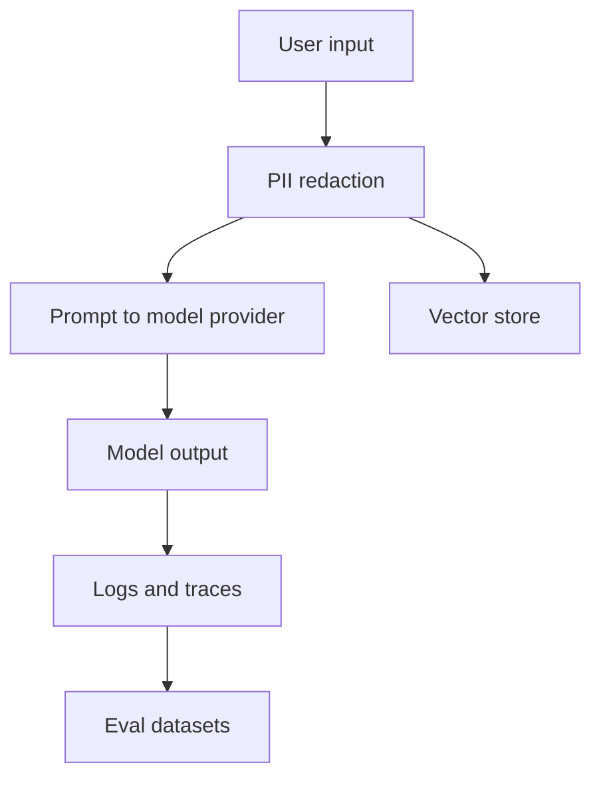
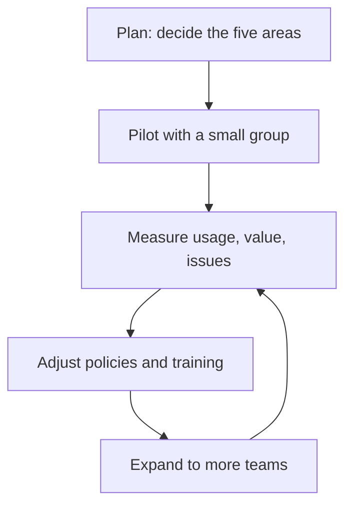
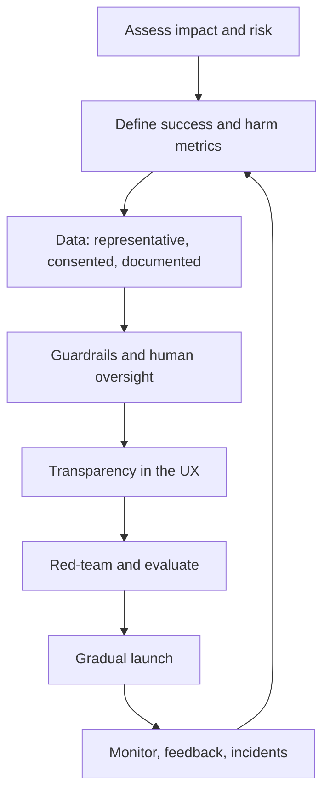

# Responsible AI & Governance

[⬅ Back to index](../README.md)

Covers: bias, fairness and inclusion, transparency and disclosure, privacy and data handling, intellectual property, workplace AI policies, rolling out AI in an organisation, regulation (EU AI Act), designing responsibly, and environmental considerations.

---

### 1. Where does bias in ML systems come from?

<details>
<summary>Answer</summary>

**In short:** Bias mostly comes from the **data and the process around the model**, not from the algorithm. Training data reflects past discrimination, under-represents some groups, uses unfair proxies or subjective labels, and the model's own decisions can feed back into future data. Simply deleting a sensitive field like gender or race does not fix it, because other fields act as **proxies**.

#### Why this matters to a regular engineer

You might never train a model, but you will ship features that use one: a CV-screening helper, a support bot, a recommendation list, an image filter. If the model treats some users worse, your feature does too, and "the model did it" is not an acceptable answer to users, regulators or your own team.

#### The main sources

| Source | What happens | Example |
|---|---|---|
| **Historical bias** | The data faithfully records an unfair past, and the model learns to repeat it | Past hiring data where most hires were men, so the model scores men higher |
| **Representation / sampling bias** | Some groups appear rarely in the data, so the model is worse for them | Face datasets with few darker-skinned faces; speech models trained mostly on one accent |
| **Measurement bias** | The thing you measure is a poor or uneven proxy for what you care about | Using arrests as a proxy for crime, when some areas are policed more heavily |
| **Labelling bias** | Human annotators bring their own judgements | Dialect speech labelled "toxic" more often than the same meaning in standard English |
| **Aggregation bias** | One model for groups that genuinely behave differently | One medical threshold applied to populations where the marker means different things |
| **Feedback loops** | The model's output changes the world, which becomes new training data | Predictive policing sends more patrols to an area, which produces more arrests there, which "confirms" the prediction |

LLMs add a twist: they are trained on huge amounts of internet text, so they absorb stereotypes in that text. They can produce different quality or tone of answers depending on the name, language or dialect in the prompt.

#### Why removing the sensitive attribute isn't enough

If you drop "race" but keep postcode, first name, school and shopping history, the model can often reconstruct the same signal. This is called **proxy discrimination**. The fix is to **measure outcomes per group** (you often need the sensitive attribute for evaluation, handled carefully) rather than hoping blindness works.

#### What you can actually do

- Evaluate quality **by slice**: language, region, accent, age group, device type, not just overall accuracy.
- Add diverse examples to your eval set, including names and dialects from your real user base.
- Keep a human in the loop for high-impact decisions (hiring, credit, moderation bans).
- Watch for feedback loops once the feature is live; compare outcomes over time.

**Common pitfalls**
- Reporting one overall accuracy number that hides a group where the model is much worse.
- Assuming a big, well-known model is "neutral" out of the box.
- Treating bias as a one-time check before launch instead of something to monitor.

**Likely follow-ups**
- *How would you test an LLM feature for bias?* Run the same prompts with only names, genders or dialects swapped and compare outputs, plus per-slice metrics on a representative eval set.
- *Is all bias bad?* Some differences are legitimate (a medical model should consider age); the question is whether the difference is justified and relevant to the task.

</details>

### 2. When and how should you disclose AI use?

<details>
<summary>Answer</summary>

**In short:** Tell people when they are **talking to an AI**, when content they rely on is **AI-generated** in a context where that matters, and when AI **influences decisions about them**. Do it clearly, at the moment it matters, and follow your organisation's and industry's rules, since several regulations already require it for chatbots and deepfakes. Hidden AI use tends to destroy trust when people find out.

#### Why disclosure matters

People calibrate their trust based on what they think they are dealing with. If a customer thinks a human agent promised them a refund, or a reader thinks a quote was checked by a journalist, they act differently than if they knew it came from a model that can make mistakes. Disclosure lets them judge the output correctly, and it protects you: discovering undisclosed AI use later feels like deception.

#### When to disclose

| Situation | Disclose? | Why |
|---|---|---|
| Customer-facing chatbot or voice agent | Yes, up front | Users have a right to know they aren't talking to a person; many laws require it |
| AI-generated images, audio or video of realistic people or events | Yes, label it | Deepfakes can mislead; labelling is increasingly required |
| AI decides or heavily influences a decision about someone (loan, hiring screen, moderation ban) | Yes, plus a way to contest | Fairness and legal requirements around automated decisions |
| Journalism, academic work, client deliverables | Usually yes, per the rules of that field | Readers and clients assume a human produced and checked it |
| You used autocomplete or a grammar tool on an internal email | Usually not needed | Low stakes; you still own and reviewed the content |
| AI-assisted code you reviewed and committed | Follow team policy | Some teams tag it for review or licence tracking |

The rule of thumb: the more someone **relies on** the content, and the more it would **change their view** to learn AI was involved, the more you should disclose.

#### How to disclose well

- **At the point of interaction**, not buried in terms of service: "You're chatting with an AI assistant. It can make mistakes."
- **Say what it means**: limitations, that a human can be reached, how to report a problem.
- **Label generated media** visibly, and where possible with machine-readable provenance metadata (content credentials).
- **Keep it honest**: don't give a bot a human name and photo that suggests it is a person.

As an app developer, this is a UX task: a clear badge on AI answers, a "Talk to a human" option, and labels on generated images.

**Common pitfalls**
- Disclosure hidden in a footer that nobody sees.
- A bot persona designed to pass as human.
- Assuming that because you reviewed AI output, disclosure never matters; in some fields (academic work, publishing) the rules require it anyway.

**Likely follow-ups**
- *Does disclosure reduce user trust?* Sometimes slightly at first, but discovered hidden AI use does far more damage.
- *What regulations touch this?* The EU AI Act has transparency duties for chatbots and deepfakes; consumer-protection and sector rules apply too.

</details>

### 3. How do you protect privacy in ML systems?

<details>
<summary>Answer</summary>

**In short:** Collect and keep **as little personal data as possible**, strip or pseudonymise **PII** before it reaches training data, prompts or logs, lock down access with encryption and permissions, and for LLM apps only send data to providers under proper agreements (no training on your data, limited or zero retention). Where data is very sensitive, process it **on-device** or with a self-hosted model.

#### Why AI makes privacy harder

Traditional apps store data in known tables. AI features spread data into new places: prompts sent to a third-party API, conversation logs kept for debugging, embeddings in a vector store, eval datasets copied into spreadsheets, and in some cases model training. Models can also **memorise** and repeat rare training data. Each of these is a new leak path.



Every arrow is a place to ask: does this data need to be here, who can see it, and how long does it stay?

#### Core practices

- **Data minimisation**: only send the fields the model needs. A support bot summarising a ticket doesn't need the customer's card number.
- **Retention limits**: delete logs and transcripts after a defined period.
- **Redact or pseudonymise PII** in prompts, logs and eval sets (replace "Priya Sharma, +91..." with placeholders).
- **Access control and encryption** at rest and in transit; separate environments for sensitive data; audit who reads logs.
- **Permission-aware retrieval** in RAG, so a user never gets content they couldn't open directly.

#### Privacy-preserving techniques

- **On-device processing**: the data never leaves the phone (on-device speech recognition, keyboard suggestions, photo classification).
- **Federated learning**: devices improve a shared model locally and send back only model updates, not raw data.
- **Differential privacy**: adds carefully designed noise so aggregate patterns are learned without revealing any individual.

You don't need the maths for an interview; know what each one is for.

#### For LLM-powered apps specifically

Wrong: the raw customer record goes straight into the prompt and the logs.

```python
prompt = f"Summarise this ticket: {ticket.full_record}"
log.info(prompt)
```

Better: minimise, redact, and log without PII.

```python
fields = {"issue": ticket.description, "product": ticket.product}
safe_text = redact_pii(fields["issue"])          # emails, phones, card numbers -> [REDACTED]
prompt = f"Summarise this ticket about {fields['product']}: {safe_text}"
log.info("summary_request", ticket_id=ticket.id)  # IDs, not content
```

- Use enterprise/API terms where the provider does not train on your data, and zero-data-retention options where available.
- Check where data is processed (region) for regulations like GDPR.
- Consider on-device or self-hosted models for health, finance or legal data.

**Common pitfalls**
- Redacting prompts but logging the full model response, which often repeats the PII.
- Copying production conversations into an eval sheet shared across the company.
- Using a consumer AI tool with company or customer data.

**Likely follow-ups**
- *How do you redact PII?* Pattern matching for structured data (emails, phone numbers, IDs) plus an NER model or service for names and addresses; test it, as nothing is perfect.
- *What about the right to be forgotten?* You need to be able to delete a user's data from logs, vector stores and datasets, which is easy only if you designed for it.

</details>

### 4. What intellectual-property questions come up with AI-generated content?

<details>
<summary>Answer</summary>

**In short:** The main questions are **who owns** AI-assisted output (depends on jurisdiction and the provider's terms; purely machine-generated work may not be copyrightable in some places), whether the output **reproduces someone else's copyrighted work**, how to handle **licences of AI-generated code**, and whether **confidential inputs** were exposed. Practically: read provider terms, review anything you publish, treat AI-generated code like third-party code, and involve legal for high-stakes uses.

#### The four questions

**1. Ownership of the output.** Copyright law in many places is built around human authorship. Where a human made meaningful creative choices (selecting, editing, arranging), the result is more likely protectable; output produced with only a short prompt may not be. This varies by country and is still developing, so avoid absolute claims in an interview. Separately, the provider's terms of service say what rights they give you over outputs.

**2. Reproducing protected material.** Models can sometimes produce text, code or images very close to something in their training data, especially famous works or common code snippets. If you publish that, you may infringe even though you never saw the original.

**3. Licensing of generated code.** If an assistant suggests a block that matches a GPL-licensed project, shipping it in a proprietary app could create licence obligations. Some coding tools offer filters that block or flag suggestions matching public code.

**4. Confidential inputs.** Pasting a client's contract or unreleased source code into an unapproved tool can breach confidentiality agreements, regardless of who owns the output.

#### Practical steps

| Step | What it looks like |
|---|---|
| Read the provider terms | Who owns outputs, is your input used for training, is there **IP indemnity** (some enterprise plans offer it) |
| Review before publishing | A human checks marketing copy, images and docs for anything that looks copied |
| Don't prompt for copies | Avoid "write it exactly like [author]" or "reproduce the lyrics of..." |
| Treat AI code like third-party code | Code review, licence scanning, enable duplicate-detection filters where available |
| Use approved tools for confidential data | Enterprise plans with data protections, not personal accounts |
| Escalate high-stakes cases | Legal review for product names, logos, published books, anything you'll defend in court |

**Common pitfalls**
- Assuming "the AI wrote it, so it's free to use."
- Generating a logo with an image model and trademarking it without checking similarity to existing marks.
- Engineers using personal AI accounts on company code.

**Likely follow-ups**
- *Can you copyright AI-generated code?* It depends on jurisdiction and how much human authorship is involved; in practice, companies treat reviewed and edited code as their own and focus on licence and security risk.
- *What is IP indemnity?* A promise from the provider to defend customers against certain copyright claims arising from outputs, usually with conditions such as using the provided filters.

</details>

### 5. What should a workplace AI policy cover?

<details>
<summary>Answer</summary>

**In short:** A good policy says **which tools are approved**, **what data may and may not go into them**, **which outputs need human review**, when to **disclose** AI use, what uses are **prohibited**, basic **security** rules (no secrets in prompts, scoped integrations), how to **report problems**, what **training** is expected, and **who owns** AI decisions. It should be short, practical and updated as tools change.

#### Why companies need one

Without a policy, people either avoid AI (losing productivity) or use whatever they like, including personal accounts with customer data. A policy turns "can I use this?" into a quick, clear answer and gives security and legal teams something to enforce.

#### What it covers

| Area | Example contents |
|---|---|
| **Approved tools and plans** | "Use the company's enterprise AI assistant and approved coding assistant. Personal accounts are not allowed for work data." |
| **Data rules** | A table by data class: public (OK anywhere), internal (approved tools only), confidential/customer PII (approved tools with data protections, minimised), secrets and credentials (never) |
| **Human review** | Code is reviewed like any other PR; customer-facing text and legal/financial content need human sign-off |
| **Disclosure** | When to tell clients, readers or users that AI was involved |
| **Acceptable and prohibited uses** | OK: drafting, summarising, coding help. Not OK: automated decisions about employees, generating fake reviews, uploading candidate CVs to unapproved tools |
| **Security** | No API keys or passwords in prompts; integrations/MCP servers only with least-privilege access; be careful with agents that can take actions |
| **Reporting** | How to report a data leak, harmful output or a tool behaving unexpectedly |
| **Training** | Basic AI fluency: limitations, hallucinations, verifying output, prompt injection awareness |
| **Ownership** | Who approves new tools, updates the policy and handles exceptions |

#### Keeping it usable

- Write it as **examples**, not legal abstraction: "You can paste a public error message; you can't paste a customer's account export."
- Make the **approved path easy**: if the sanctioned tool is good and available, people stop using shadow tools.
- **Review it regularly**: AI tools change capabilities (agents, integrations, memory) quickly, and each change can change the risk.

**Common pitfalls**
- A blanket ban, which drives use underground ("shadow AI").
- A long legal document nobody reads.
- No owner, so the policy goes stale as new tools appear.

**Likely follow-ups**
- *How would you enforce it?* Single sign-on to approved tools, data-loss prevention on known AI sites, audit logs, and training; mostly by making the right path easiest.
- *How do you handle a new tool request?* A lightweight review: data handling terms, security, integrations it needs, then approve, approve with limits, or reject.

</details>

### 6. What decisions shape an organisation's rollout of an AI assistant?

<details>
<summary>Answer</summary>

**In short:** Anthropic's enterprise rollout guidance groups the decisions into five areas: **structure and identity** (organisation/workspace setup, SSO, provisioning), **access** (who gets which tools and features, in which phases), **governance** (policies, data controls, allowed integrations, retention), **spend** (budgets, limits, cost allocation), and **visibility** (usage analytics, audit logs, measuring adoption and impact). Writing these down in a rollout plan avoids ad-hoc, inconsistent adoption.

#### Why a structured rollout

Giving everyone a login on day one tends to produce uneven adoption, surprise bills, unclear data handling and no way to say whether it helped. Deciding these five areas up front makes the rollout repeatable and defensible to security, finance and leadership.

#### The five areas

| Area | Questions to answer | Example decision |
|---|---|---|
| **Structure and identity** | How are organisations/workspaces arranged? How do people sign in? How are accounts created and removed? | One organisation, workspaces per department; SSO via the company identity provider; automatic provisioning and deprovisioning |
| **Access** | Who gets it first? Which features (chat, coding tools, integrations) for which roles? | Phase 1: engineering and support pilot; phase 2: all knowledge workers; code tools for engineers only |
| **Governance** | Which policies apply? What data is allowed? Which integrations/connectors? How long is data retained? | Connectors to the wiki and ticket system allowed; HR system not yet; retention set per policy |
| **Spend** | What's the budget? Per-user or per-team limits? How are costs charged back? | Seat-based for chat; usage limits on API and agent tools; costs allocated per department |
| **Visibility** | How do we see usage and prove value? What do we audit? | Usage dashboards, audit logs to the security team, quarterly survey plus metrics like time saved on target workflows |

#### A typical phased rollout



The pilot group should include enthusiastic users and sceptics, and real workflows to measure. Training and internal champions often matter as much as the tool configuration.

**Common pitfalls**
- No deprovisioning, so leavers keep access.
- Enabling every integration at once without checking what data each one exposes.
- Measuring only logins, not whether work got better or faster.

**Likely follow-ups**
- *How do you measure impact?* Pick specific workflows (support reply time, PR cycle time, document drafting time) and compare before and after, alongside usage and satisfaction.
- *Who should own the rollout?* Usually a cross-functional group: IT/security, legal, a business sponsor, and champions from the teams using it.

</details>

### 7. What is the EU AI Act, and how does regulation affect AI engineering?

<details>
<summary>Answer</summary>

**In short:** The EU AI Act (adopted 2024, with obligations phasing in from 2025 onwards) regulates AI by **risk level**: some uses are **banned**, **high-risk** uses (hiring, credit, education, critical infrastructure, medical devices) must meet strict requirements, **limited-risk** systems have **transparency** duties, and **general-purpose AI models** have their own documentation obligations. For engineers, regulation shows up as concrete work: documentation, logging, evaluation evidence, human oversight and data governance.

#### The risk tiers

| Tier | Examples | What's required |
|---|---|---|
| **Unacceptable risk** | Social scoring by authorities, certain manipulative techniques, certain biometric uses | Banned |
| **High risk** | AI in hiring, credit scoring, education, critical infrastructure, medical devices | Risk management, data quality, technical documentation, logging, human oversight, accuracy and robustness, before and after launch |
| **Limited risk** | Chatbots, AI-generated or manipulated content (deepfakes) | Transparency: tell users they're interacting with AI; label deepfakes |
| **Minimal risk** | Spam filters, game AI, most everyday features | No specific new obligations |
| **General-purpose AI models** | Large foundation models offered to others | Documentation and copyright-related obligations; extra duties for models with systemic risk |

The key idea: the **use case** decides the obligations, not the technology. The same LLM can be minimal risk in a writing helper and high risk if it screens job applicants.

#### Other rules you'll hear about

- **GDPR**: data protection, lawful basis for processing, data subject rights, and rules on solely automated decisions with significant effects.
- **Sector regulations**: finance, healthcare, and others add their own requirements.
- **NIST AI Risk Management Framework**: a voluntary US framework widely used to structure AI risk work.

#### How it changes engineering work

| Requirement | What you build |
|---|---|
| Documentation | Model/system cards: purpose, data, limitations, evaluation results |
| Logging and traceability | Audit logs of inputs, outputs, model versions and decisions |
| Evaluation evidence | Stored eval results, including per-group performance, for each release |
| Human oversight | Review queues, override buttons, escalation paths |
| Transparency | AI disclosure in the UI, labels on generated media |
| Data governance | Records of data sources, consent, quality checks, retention |

Good engineering practice and compliance overlap heavily: if you already version prompts, keep eval results and log decisions, you are most of the way there.

**Common pitfalls**
- Assuming it only applies to EU companies; it can apply to providers and deployers whose systems are used in the EU.
- Treating compliance as a launch-day document instead of ongoing monitoring.
- Quoting precise deadlines from memory in an interview; say "phasing in from 2025" unless you're sure.

**Likely follow-ups**
- *Is a customer-support chatbot high risk?* Usually not; it has transparency duties (tell users it's AI). It could become higher risk if it makes significant decisions about people.
- *What is a provider vs a deployer?* The provider develops and places the system on the market; the deployer uses it in their operations; both have obligations.

</details>

### 8. How do you design an AI feature responsibly from the start?

<details>
<summary>Answer</summary>

**In short:** Treat responsibility as part of the design, not a final check: **assess impact** (who could be harmed and how badly), define **success and harm metrics**, use **representative, consented data**, add **guardrails and human oversight proportional to risk**, be **transparent** with users, **red-team and evaluate before launch**, **roll out gradually**, and **monitor** with a rollback and incident process.

#### The steps



**1. Assess the use case's impact.** Who uses it, who is affected by it (not always the same people), and what's the worst realistic outcome? A recipe suggester and a loan pre-screener need very different care.

**2. Define success and harm metrics.** Besides accuracy, measure harms: wrong or harmful answers, **fairness by slice** (does it work equally for different languages or groups?), and **over-refusal** (refusing legitimate requests is also a failure).

**3. Use the right data.** Representative of real users, collected with consent, documented (where it came from, what's in it, known gaps).

**4. Guardrails and oversight proportional to risk.** Low risk: input/output filters and good prompts. Higher risk: human approval before actions, confirmations, limits on what tools can do.

**5. Be transparent.** Tell users it's AI, what it can't do, and how to report problems or reach a human.

**6. Red-team and evaluate.** Try to break it: prompt injection, jailbreaks, edge cases, misuse. Run your eval set and check per-slice results.

**7. Launch gradually.** Internal users, then a small percentage, with feature flags.

**8. Monitor and respond.** Sample outputs for quality, watch feedback and complaints, and have a clear rollback path (feature flag off, revert prompt version) and an incident owner.

#### Example: an AI reply-drafting feature for support agents

- Impact: medium; wrong replies could mislead customers, but agents review before sending.
- Metrics: edit rate, factual errors in sampled drafts, quality across the languages supported.
- Guardrail: drafts never auto-send; grounded in policy docs; PII redacted in logs.
- Rollout: one team first, compare handle time and CSAT, then expand.

**Common pitfalls**
- Only measuring the happy path.
- Adding human review that is so tedious reviewers rubber-stamp everything.
- No kill switch.

**Likely follow-ups**
- *How do you decide how much oversight is needed?* By impact and reversibility: irreversible or high-impact actions need human approval; easily corrected suggestions don't.
- *What is red-teaming?* Deliberately trying to make the system fail or misbehave before real users or attackers do.

</details>

### 9. What is the environmental impact of AI use, and how can teams reduce it?

<details>
<summary>Answer</summary>

**In short:** Training and running large models uses significant **electricity**, and data centres also use **water** for cooling, plus the embodied impact of the hardware. Teams reduce their footprint mostly through **efficiency**: use the smallest model that meets quality, cache, avoid unnecessary calls and oversized contexts, batch offline work, and don't use an expensive agent when a single call works. Efficiency usually lowers cost and latency too, so it's an easy argument to win.

#### Where the impact comes from

- **Training**: a large one-off energy cost for the model provider.
- **Inference**: every request runs on GPUs or other accelerators. For a widely used product, the total inference energy across millions of requests can be large.
- **Infrastructure**: cooling (often water), hardware manufacturing, and the carbon intensity of the local electricity grid.

As an app developer you mostly control **inference**: how many calls you make, how big the model is, and how many tokens each call processes.

#### What teams can do

| Lever | How | Bonus |
|---|---|---|
| Right-size the model | Small/fast model for classification, routing, extraction; large model only where needed | Cheaper and faster |
| Trim context | Send relevant chunks, not whole documents; summarise long histories | Lower cost, often better quality |
| Cache | Prompt caching for repeated long prefixes; cache identical answers where safe | Lower latency and cost |
| Avoid unnecessary calls | Don't call the model for things code can do (date parsing, simple rules); debounce typing-triggered features | Fewer failures too |
| Batch offline work | Use batch APIs for non-urgent jobs (nightly summaries, backfills) | Usually discounted |
| Simplest architecture | A single call or fixed workflow instead of an open-ended agent that loops many times | More predictable |
| On-device models | For small tasks, run locally | Privacy and offline support |

```kotlin
// Wasteful: calls the model on every keystroke
searchField.doOnTextChanged { text, _, _, _ -> viewModel.aiSuggest(text) }

// Better: debounce, skip tiny inputs, cancel stale requests (in the ViewModel)
queryFlow
    .debounce(400)
    .filter { it.length >= 3 }
    .distinctUntilChanged()
    .mapLatest { aiRepository.suggest(it) }   // cancels the previous call
```

**Common pitfalls**
- Defaulting to the largest model "to be safe".
- Agents with no step limit that loop on failure.
- Re-sending the full conversation and documents every turn without caching.

**Likely follow-ups**
- *How would you measure it?* Track tokens and calls per feature; some cloud providers publish emissions data, but tokens and model size are the practical proxy.
- *Is this a real concern or PR?* It is real at scale, and since it aligns with cost, it's usually worth doing anyway.

</details>

---

[⬅ Previous: Designing AI Products & UX](18-ai-product-design.md) · [⬅ Back to index](../README.md) · [Next: AI System Design ➡](20-ai-system-design.md)
