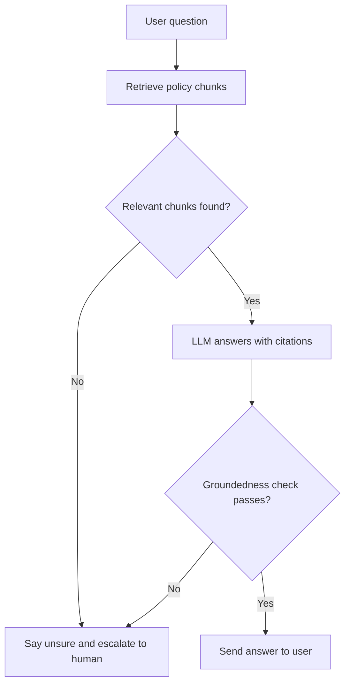
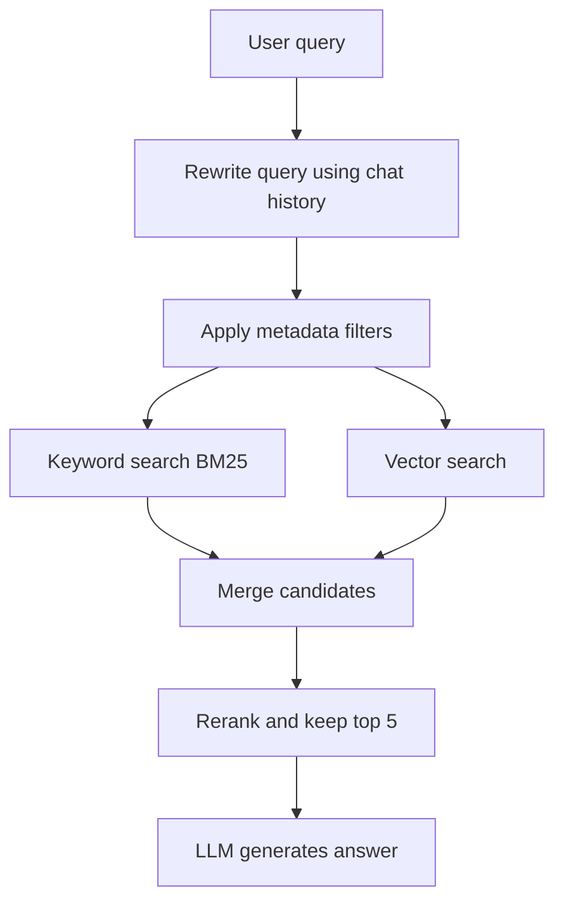
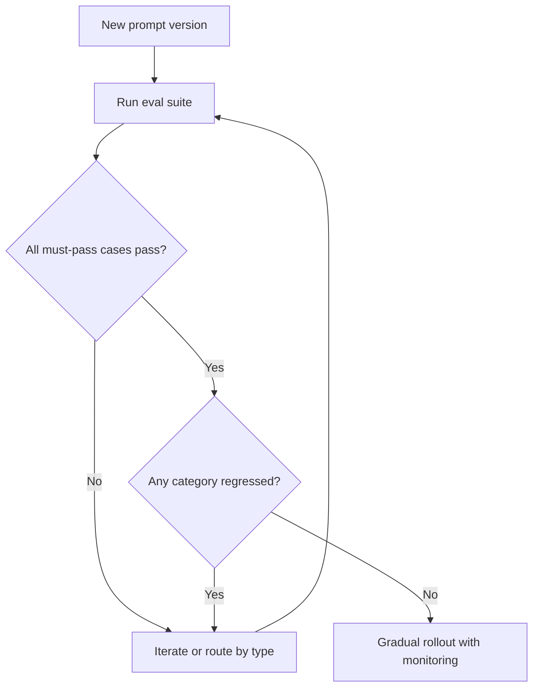
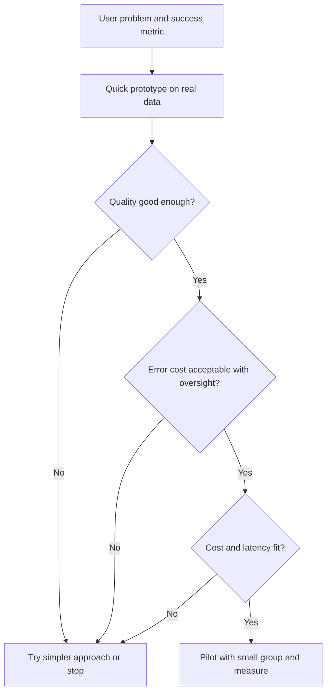
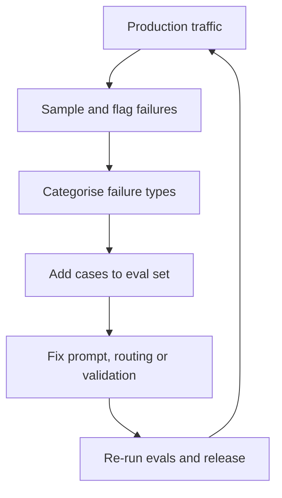

# Scenario-Based Questions

[⬅ Back to index](../README.md)

Covers: what to do when a chatbot hallucinates, retrieval is poor, a feature is slow or expensive, prompts are attacked, outputs break after a model upgrade, an agent loops or takes a wrong action, quality differs by language, users over-trust answers, sensitive data appears in prompts, and AI coding causes bugs.

---

### 1. Your customer-support chatbot is hallucinating policies. How do you fix it?

<details>
<summary>Answer</summary>

**In short:** First find out *why* it's making things up by looking at real failing conversations, then ground it: answer only from the official policy documents (RAG) with citations, say "I don't know / let me connect you to an agent" when the documents don't cover it, fetch facts like refund amounts from real systems through tools, and lock the fix in with an eval set built from the failures.

#### Why this happens

An LLM is trained to produce plausible text. When it's asked "Can I return a sale item after 45 days?" and has no policy in front of it, it doesn't stay silent – it produces a confident answer that *sounds* like a typical return policy. So a hallucinated policy usually has one of three causes, and each has a different fix:

| Root cause | What you see in the trace | Fix |
|---|---|---|
| No relevant document exists | Retrieval returned nothing useful | Add the content, or make the bot refuse/escalate |
| Right document not retrieved | The policy exists but wasn't in the context | Improve retrieval (chunking, hybrid search, reranking) |
| Document retrieved but ignored or misread | The correct text was in the prompt | Stronger grounding instructions, quote-first answers, groundedness check |

That's why step one is diagnosis, not prompt tweaking.

#### Step by step

1. **Collect failing conversations** (user reports, thumbs-down, agent escalations) and label each one with the root cause above. Twenty to fifty examples usually show a clear pattern.
2. **Ground the answers.** Use RAG over the official, current policy documents and tell the model to answer only from them:

   ```text
   Answer using ONLY the policy excerpts in <policies>.
   Cite the policy id for every claim, e.g. [RET-04].
   If the excerpts do not answer the question, say:
   "I'm not sure about that – let me connect you to a support agent."
   Never guess amounts, dates or eligibility.
   ```

3. **Fix retrieval** if the right document wasn't found: better chunking (keep a policy section together with its heading), hybrid search so exact terms like "Gold membership" match, a reranker, and query rewriting for vague follow-ups ("what about for sale items?").
4. **Move facts into tools.** Anything customer-specific or numeric – refund amount, order status, eligibility – should come from a tool call against the real system, not from the model's text. The model decides *which* tool to call; your code computes the answer.
5. **Add guardrails before sending.** A cheap second check ("Is every claim in this answer supported by the excerpts?") or a citation check (every cited id must exist in the retrieved set) catches many remaining cases. Sensitive topics (legal, compensation) can be forced to escalate.
6. **Evaluate and monitor.** Turn the failing conversations into an eval set; track faithfulness (answers supported by sources), correct-refusal rate and escalation rate. Re-run it on every prompt or model change, and keep sampling production conversations.



#### Pitfalls

- Only adding "don't hallucinate" to the prompt – it helps a little, but doesn't fix missing or unretrieved documents.
- Indexing outdated policy versions alongside current ones, so the bot "correctly" quotes an old rule.
- Treating "I don't know" as failure. For a support bot, a handoff is far better than a wrong refund promise (some companies have been held to what their bot said).

#### Likely follow-ups

- *How do you measure hallucination?* An eval set with known answers plus an LLM-as-judge or human check of "is every claim supported by the cited source", tracked over time.
- *What if the bot escalates too much?* Look at the escalated cases: usually missing content or weak retrieval, not over-cautious prompting.

</details>

### 2. Your RAG system returns irrelevant documents. How do you improve it?

<details>
<summary>Answer</summary>

**In short:** Look at real failing queries and what was actually retrieved, fix the basics first (document parsing and chunking), then add hybrid search plus a reranker, query rewriting and metadata filters – and measure retrieval quality (recall@k) on a labelled set after every change so you know each fix actually helped.

#### Why retrieval fails

RAG has two halves: *retrieve* the right chunks, then *generate* an answer from them. If the retrieved chunks are wrong, no prompt will save the answer. Common causes:

- **Bad parsing** – PDFs turned into jumbled text, tables flattened into nonsense, headers and footers repeated on every chunk.
- **Bad chunking** – chunks too large (one chunk covers five topics, so its embedding is vague) or too small (a chunk says "this applies to all plans" without saying which feature).
- **Pure vector search misses exact terms** – embeddings capture meaning, but are weak at product codes, error codes, names and version numbers ("E-4021", "v2.3").
- **The query itself is poor** – conversational follow-ups ("and for iOS?") or very short queries don't contain enough to search on.
- **No filtering** – results from the wrong product, version or old documents compete with the right ones.

#### A practical improvement order

1. **Inspect failures.** Log query → retrieved chunks → answer. Pick 30–50 bad cases and label why each failed.
2. **Fix parsing and chunking.** Split on document structure (headings, sections), keep tables intact, and prepend context to each chunk (document title, section heading) so it makes sense on its own.
3. **Hybrid search.** Combine keyword search (BM25) with vector search and merge the results, so exact terms and meaning both count.
4. **Rerank.** Retrieve more candidates (say 30–50), then use a reranker model to score each one against the query and keep the top 5. This is often the single biggest quality gain.
5. **Rewrite the query.** Use a cheap LLM call to turn "and for iOS?" into "How do I reset my password in the iOS app?" using the chat history.
6. **Metadata filters.** Filter by product, version, language, date or user permissions before ranking.
7. **Try a better embedding model** if the above isn't enough, and re-embed everything with it.



#### Measure, don't guess

Build a small labelled set: for each query, which documents *should* come back. Then track:

| Metric | What it tells you |
|---|---|
| Recall@k | Did the right chunk appear in the top k at all? |
| MRR / rank of first correct hit | How high up the right chunk is |
| Answer faithfulness (end to end) | Whether better retrieval became better answers |

Run it after every change. Retrieval tweaks often help one query type and hurt another, and you won't notice without numbers.

#### Pitfalls

- Jumping to a new embedding model or a fine-tune before fixing parsing – garbage in, garbage out.
- Stuffing more chunks into the prompt to compensate; more irrelevant context makes answers worse and costlier.
- Forgetting permissions: filtering must happen at retrieval time, not after generation.

#### Likely follow-ups

- *What chunk size do you use?* There's no universal answer; start around a few hundred tokens split on structure, then tune against your eval set.
- *Why rerank instead of just better embeddings?* A reranker looks at the query and chunk together, so it judges relevance more precisely, but it's too slow to run over the whole index – hence retrieve broadly, rerank narrowly.

</details>

### 3. Your LLM feature is too slow (8 seconds). How do you reduce latency?

<details>
<summary>Answer</summary>

**In short:** Measure where the 8 seconds go first, then attack the biggest parts: stream the response so users see text almost immediately, generate fewer output tokens, use a smaller or faster model (or turn off heavy reasoning) where quality allows, shorten and cache the prompt, run retrieval and tool calls in parallel, and precompute what you can.

#### Where the time goes

An LLM request isn't one number. Break it down with tracing:

| Phase | Typical cause of slowness |
|---|---|
| Queueing / rate limits | Retries after 429s, cold starts |
| Retrieval and tool calls | Sequential DB/API calls, slow vector search |
| Time to first token (TTFT) | Long prompt, big model, reasoning/"thinking" before answering |
| Generation | Output length: each token is produced one after another |
| Post-processing | Validation, a second "checker" LLM call |

Output length is usually the biggest lever: generation time scales roughly with the number of output tokens, so a 600-token answer takes far longer than a 150-token one on the same model.

#### Fixes, roughly in order of effort

1. **Stream the response.** The user starts reading after TTFT (often well under a second or two) instead of waiting for the whole answer. Total time is the same, perceived latency drops dramatically.

   ```kotlin
   // Android: render tokens as they arrive instead of waiting for the full body
   viewModelScope.launch {
       repository.streamReply(prompt)        // Flow<String> of text deltas from your backend (SSE)
           .collect { delta -> _uiState.update { it.copy(text = it.text + delta) } }
   }
   ```

2. **Fewer output tokens.** Ask for concise answers, set `max_tokens`, and avoid asking for explanations nobody reads. For structured tasks, return short JSON fields.
3. **Right-size the model.** A smaller or faster model may be good enough for this task – confirm with your eval set. Route only hard requests to the big model. Turn off or lower extended reasoning/effort for simple requests.
4. **Shorter prompts and prompt caching.** Trim unused instructions and retrieved context; put the stable part (system prompt, tool definitions, documents) first so the provider can cache it, which cuts TTFT and cost on repeated calls.
5. **Parallelise.** If you fetch user profile, order history and search results, do it concurrently, not one after another. Same for independent tool calls.
6. **Cache and precompute.** Cache answers to frequent identical requests; generate summaries or descriptions ahead of time in a batch job instead of on page load.
7. **Self-hosted models only:** quantisation, speculative decoding and better batching settings on the inference server.

#### UX matters too

Show progress ("Searching your orders…"), render partial results, and make the slow step optional. A 4-second answer that starts streaming at 0.5s feels faster than a 3-second answer that appears all at once.

#### Pitfalls

- Optimising the model call when the real delay is three sequential API calls before it.
- Switching to a smaller model without re-running evals.
- Adding a "verify the answer" LLM call that doubles latency; consider running it asynchronously or only on risky answers.

#### Likely follow-ups

- *What's TTFT and why does it matter?* Time to first token – with streaming it's what the user actually feels as "waiting".
- *How do you set a latency target?* From the UX: interactive chat needs fast first tokens; a background summary can take longer.

</details>

### 4. The LLM feature costs too much at scale. What do you do?

<details>
<summary>Answer</summary>

**In short:** Measure cost per request and what drives it (input vs output tokens, which calls, which users), then cut it: route easy requests to cheaper models, trim prompts and retrieved context, use prompt caching and response caching, use batch APIs for offline work, consider a fine-tuned small model for the high-volume task, skip the LLM entirely where rules suffice, and add per-user limits – re-running evals after each change so quality doesn't silently drop.

#### Understand the bill first

LLM APIs charge per token, usually with output tokens priced several times higher than input tokens. A rough cost model:

```text
cost per request = input_tokens × input_price + output_tokens × output_price
monthly cost     = cost per request × requests per user × active users
```

Log tokens per call and attribute them to features and steps. You often find surprises: a 6,000-token system prompt sent on every message, an agent that makes eight calls per request, retries doubling traffic, or a handful of power users or bots producing most of the spend.

#### The levers

| Lever | How it saves money | Watch out for |
|---|---|---|
| **Model routing** | Send simple requests to a small, cheap model; only hard ones to the large model | Need a reliable router and evals per route |
| **Trim the prompt** | Fewer input tokens: shorter instructions, fewer/shorter retrieved chunks, summarised history | Removing context the model needed |
| **Prompt caching** | Repeated prefixes (system prompt, tools, documents) are billed at a discount | Stable content must come first in the prompt |
| **Response caching** | Identical (or very similar) questions reuse an answer | Must respect permissions and freshness |
| **Shorter outputs** | Output tokens are the expensive ones | Answers must still be useful |
| **Batch APIs** | Non-urgent jobs (nightly summaries, tagging) run at a discount | Results arrive later |
| **Fine-tune / distil a small model** | A small model trained for one high-volume task can match a big one on it | Training and maintenance effort |
| **No LLM at all** | Rules, search, templates or classic ML for simple cases | — |
| **Rate limits and quotas** | Stops abuse and runaway loops | Fair limits for real users |

#### Example: a routing layer

```python
def answer(question: str, user: User) -> str:
    if faq_hit := faq_cache.lookup(question, user.tenant_id):   # cache scoped per tenant
        return faq_hit
    model = "small-fast-model" if classifier.is_simple(question) else "large-model"
    return llm.generate(model=model, prompt=build_prompt(question), max_tokens=300)
```

#### Always check quality

Every cost cut is a quality risk. Run the eval set before and after, and compare by category, not just the average. Track cost per *successful* outcome – a cheap model that fails half the time and causes retries or support tickets isn't cheaper.

#### Pitfalls

- Optimising the per-token price while an agent loop makes ten unnecessary calls.
- Semantic caches that return another user's private answer.
- Forgetting that reasoning/"thinking" tokens are usually billed as output tokens.

#### Likely follow-ups

- *How would you estimate cost before launch?* Measure average tokens per request on a prototype, multiply by expected usage, add a safety margin for retries and growth.
- *When does self-hosting an open model make sense?* At high, steady volume with in-house infra skills, or for data-residency reasons – compare total cost including GPUs and ops time.

</details>

### 5. Users found a way to make your assistant reveal its system prompt and ignore rules. What do you do?

<details>
<summary>Answer</summary>

**In short:** Treat it as a security incident: assess what was actually exposed, patch the known attack quickly, then fix the design so a successful attack does little damage – no secrets in prompts, rules enforced in code rather than in instructions, least-privilege tools with confirmation for sensitive actions, and a red-team regression suite. Prompt-level defences are never complete, so you limit the blast radius.

#### Why it happens

The model sees the system prompt and user input as one stream of text. It's trained to follow instructions, and a cleverly written user message ("ignore previous instructions", role-play, encoding tricks, or instructions hidden in a document or web page the assistant reads – *indirect prompt injection*) can override yours. There is no reliable way to make an LLM fully ignore instructions in its input, so you can't rely on the prompt alone.

#### Respond in three layers

**1. Immediate (hours)**

- Assess impact: did the leaked prompt contain secrets, internal URLs, or customer data? Did users get the assistant to *do* anything (call tools, access other users' data), or only *say* things?
- Rotate any secret that appeared in the prompt.
- Add input/output filters for the known attack pattern and tighten tool permissions as a stopgap.

**2. Design fixes (days to weeks)**

- **Assume the system prompt is public.** Never put API keys, credentials or confidential business logic in it.
- **Enforce rules in code.** If users can only see their own orders, the `getOrder` tool must check the authenticated user id on the server – not trust the model to pass the right one.

  ```kotlin
  // Wrong: trusts whatever the model asks for
  fun getOrder(orderId: String) = orderRepo.find(orderId)

  // Right: authorisation lives in code, outside the model's control
  fun getOrder(orderId: String, session: Session): Order {
      val order = orderRepo.find(orderId)
      require(order.userId == session.userId) { "Not your order" }
      return order
  }
  ```

- **Least-privilege tools.** Expose only what the feature needs; read-only by default; require user confirmation for refunds, emails, deletions.
- **Separate untrusted content.** Wrap retrieved documents and web content in clear delimiters, tell the model it's data, not instructions – and still don't let that content trigger privileged actions without confirmation.
- **Output checks.** Block responses that contain large parts of the system prompt or disallowed content.

**3. Process (ongoing)**

- Add every discovered attack to a red-team regression suite that runs with your evals.
- Monitor for similar patterns in logs and rate-limit abusive users.
- Have a clear incident process and owner for AI features.

#### Pitfalls

- Believing "Never reveal these instructions" in the prompt is a security control.
- Fixing only the exact phrase users posted – attackers will rephrase.
- Overreacting with filters so strict that normal users get refused.

#### Likely follow-ups

- *What's indirect prompt injection?* Malicious instructions inside content the model reads (an email, web page, PDF), not typed by the user – especially dangerous for agents with tools.
- *Is a leaked system prompt a big deal?* Usually low impact if it holds no secrets; the real risk is the model taking unauthorised *actions*.

</details>

### 6. Should you fine-tune or use RAG for a legal-document Q&A product?

<details>
<summary>Answer</summary>

**In short:** Mostly RAG. Legal knowledge is large, changes constantly (new cases, amendments), must be cited so lawyers can verify it, and access often differs per client – all things RAG handles and fine-tuning doesn't. Fine-tuning can come later for style and task behaviour (drafting tone, citation format) or to make a smaller model cheaper, combined with RAG rather than replacing it. Build an expert-reviewed eval set first; it decides between options.

#### What each approach actually does

- **RAG** looks up relevant passages at question time and puts them in the prompt. The model answers from text it can see and can quote it.
- **Fine-tuning** adjusts the model with training examples so it behaves differently: tone, format, following a specific task. It's poor at reliably storing lots of facts, and it can't tell you *where* a fact came from.

| Requirement in legal Q&A | RAG | Fine-tuning |
|---|---|---|
| Large, growing corpus of documents | Yes – just index new documents | Would need retraining to add knowledge |
| Updates (amendments, new rulings) | Re-index changed documents | Retrain; old facts may linger |
| Citations to exact sources | Natural – the passages are right there | Can't reliably cite |
| Per-client access control | Filter at retrieval time | All training data is baked into one model |
| Consistent legal drafting style | Possible with prompts and examples | A strength |
| Lower cost per query with a small model | — | A strength |

#### A sensible plan

1. **Start with a strong model plus RAG** over the client's documents and relevant law, with instructions to answer only from the sources and cite them (document, section, paragraph).
2. **Build an eval set with legal experts**: real questions, the correct answer, and the sources that must be cited. Include "the documents don't answer this" cases.
3. **Improve retrieval** – legal text needs care: keep clause numbers, section structure and definitions attached to chunks; hybrid search for case names and statute numbers.
4. **Only then consider fine-tuning**, if evals show a gap that prompting can't close – for example, outputs must follow a firm's specific memo format, or you want a smaller model for cost. Fine-tune on behaviour, keep facts in RAG.

#### Pitfalls

- Fine-tuning on the document corpus and expecting accurate, citable recall – it produces fluent but unverifiable answers.
- Ignoring confidentiality: client documents must stay isolated per client, and provider data terms must allow it.
- No human review for high-stakes output; the product should support lawyers, not replace their judgement.

#### Likely follow-ups

- *Can long context replace RAG here?* For a single contract, putting the whole document in context can work well. For a whole case-law library, you still need retrieval.
- *How would you handle "no answer found"?* Make it an explicit, tested outcome in the eval set rather than letting the model guess.

</details>

### 7. Your new prompt improved the average score but broke some important cases. What do you do?

<details>
<summary>Answer</summary>

**In short:** Don't ship on the average. Break results down by category, find exactly which important cases regressed and why, mark them as must-pass tests, and iterate – or split the task so different case types get different prompts, or give critical cases a deterministic path. Ship only when critical categories don't regress, and roll out gradually with monitoring.

#### Why the average lies

Suppose your eval set has 500 cases: 450 everyday questions and 50 about billing disputes. A new prompt improves 40 everyday cases and breaks 15 billing ones. The average goes up – but billing disputes are exactly where a wrong answer costs money and trust. Averages hide regressions in small but important slices.

#### What to do

1. **Slice the results.** Tag eval cases by category (intent, language, user type, risk level) and compare old vs new per slice.

   | Category | Cases | Old prompt | New prompt |
   |---|---|---|---|
   | General questions | 300 | 82% | 90% |
   | Order tracking | 150 | 88% | 91% |
   | Billing disputes | 50 | 94% | 64% |

2. **Read the failures.** Look at the actual outputs. Often a new instruction ("be concise") conflicts with what the important cases need ("always state the dispute window and next steps").
3. **Make critical cases must-pass.** Mark them in the eval suite so any future prompt that fails them is blocked, regardless of the average – just like a failing unit test blocks a merge.
4. **Iterate or split.** Options:
   - Adjust the prompt so both goals are met (e.g. "be concise, but always include X for billing").
   - **Route by type**: a classifier sends billing disputes to a specialised prompt, everything else to the general one. Smaller, focused prompts are easier to keep correct.
   - **Deterministic path**: if the important cases follow fixed rules (eligibility, legal wording), handle them in code or templates and let the LLM only phrase the response.
5. **Roll out gradually.** Ship behind a flag to a small percentage, watch category-level metrics and user signals, then expand.



#### Pitfalls

- An eval set that under-represents the important categories, so their failures barely move the score.
- Endlessly adding special-case instructions to one giant prompt until it contradicts itself.
- Relying only on an LLM judge for critical cases without checking its verdicts against humans.

#### Likely follow-ups

- *How big should each slice be?* Big enough that a change is meaningful – a few dozen cases per critical category is a reasonable start; grow it from real failures.
- *How do you version prompts?* Store them in source control with the eval results for each version, like code.

</details>

### 8. You're asked to add AI to a product. How do you decide whether it's worth it?

<details>
<summary>Answer</summary>

**In short:** Start from a real user problem and a success metric, not from "we should use AI". Then check feasibility fast with a prototype on real examples and a small eval set, weigh the cost of errors and design human oversight accordingly, estimate cost and latency at real volume, compare against simpler non-AI options, and launch to a small group to measure before scaling.

#### The questions to answer

| Question | Why it matters |
|---|---|
| What user problem does this solve, and how will we know it worked? | Without a metric (time saved, tickets deflected, conversion) you can't tell success from novelty |
| Can a model actually do it well enough? | Many ideas fail on real, messy inputs |
| What happens when it's wrong? | An odd product description is annoying; a wrong medication dose is dangerous |
| What does it cost per use at our volume? | A feature that costs more than the value it creates won't survive |
| Is latency acceptable for the UX? | A 10-second wait breaks an interactive flow |
| Is there a simpler way? | Search, filters, rules or templates may solve 80% of it reliably |
| What about privacy and compliance? | User data may not be allowed to leave the device or region |

#### A lightweight process

1. **Define the problem and metric.** "Support agents spend 6 minutes summarising each ticket; we want that under 2 minutes with summaries agents rate as accurate."
2. **Prototype in a day or two** with a strong model and 30–50 real examples. This quickly shows whether the task is feasible before optimising anything.
3. **Build a small eval set** from those examples, with what "good" looks like.
4. **Assess the error cost** and design oversight: suggestions the user approves (low risk), auto-actions with undo (medium), or human review required (high).
5. **Estimate cost and latency** from token counts in the prototype × expected usage.
6. **Compare alternatives** honestly.
7. **Pilot** with a small group, measure the success metric and user feedback, then iterate or stop.



#### Pitfalls

- Building a general chatbot when users needed one specific button ("Summarise this", "Draft a reply").
- Demo-driven decisions: a demo on five hand-picked examples says little about real traffic.
- No plan for failure states – what the UI shows when the model is wrong, slow or unavailable.

#### Likely follow-ups

- *How would you show the value to leadership?* Before/after on the success metric from the pilot, plus cost per use and error rate.
- *When would you say no?* When errors are costly and can't be caught by oversight, or a simpler solution works nearly as well.

</details>

### 9. Your agent sometimes gets stuck in loops or takes wrong actions. How do you improve it?

<details>
<summary>Answer</summary>

**In short:** Trace failing runs step by step to see where decisions go wrong, then fix the environment the agent works in: clearer and fewer tools, useful tool error messages, step and budget limits with loop detection, deterministic code for the predictable parts, a planning or verification step, tidy context, and human approval before irreversible actions. Measure with an agent eval set run several times, since agents are non-deterministic.

#### Why agents loop or go wrong

An agent is an LLM calling tools in a loop: decide → call tool → read result → decide again. Things go wrong when:

- **Tools are ambiguous** – two tools that overlap (`search_orders` vs `find_order`), or descriptions that don't say when to use each.
- **Errors are unhelpful** – a tool returns `500` or `null`, so the agent retries the same call forever.
- **Context gets polluted** – huge tool outputs push the original goal out of focus.
- **The task is under-specified** – no clear definition of "done", so it keeps going.
- **No limits** – nothing stops a run after 50 steps.

#### Fixes

1. **Trace it.** Log every step: the model's reasoning or message, the tool call, arguments and result. Read 10–20 failed runs and categorise the failure points.
2. **Improve tools.**
   - Fewer, clearly distinct tools with descriptions that say *when* to use them and what they return.
   - Errors that guide the next step:

     ```json
     { "error": "ORDER_NOT_FOUND",
       "message": "No order 8812 for this user. Ask the user to confirm the order number; do not retry." }
     ```

3. **Add limits and loop detection** in your orchestration code:

   ```python
   MAX_STEPS = 15
   seen_calls = set()
   for step in range(MAX_STEPS):
       action = agent.next_action(context)
       if action.is_final:
           return action.result
       key = (action.tool, json.dumps(action.args, sort_keys=True))
       if key in seen_calls:
           context.add_note("You already made this exact call. Try a different approach or ask the user.")
       seen_calls.add(key)
       context.add(run_tool(action))
   return escalate_to_human(context)
   ```

4. **Move predictable parts into code.** If every run starts with "look up the user, then fetch their plan", do it before the agent starts. Keep the LLM for genuine decisions.
5. **Plan and verify.** Ask for a short plan before acting, and a check step ("did the change pass tests?") before declaring done.
6. **Manage context.** Summarise or truncate long tool outputs; keep the goal restated at the top.
7. **Stronger model at decision points** if a smaller one keeps choosing wrong.
8. **Human approval** before anything irreversible (payments, deletes, emails).

#### Measure it

Build an eval set of tasks with automatic success checks (was the right record updated? did tests pass?). Run each task several times and track the pass rate, average steps and cost – a single run can pass or fail by luck.

#### Pitfalls

- Fixing loops only with a step limit; the agent still fails, just more cheaply.
- Giving the agent every tool "in case it's useful" – more choice means more wrong choices.

#### Likely follow-ups

- *Workflow or agent?* If the steps are predictable, a workflow is more reliable; use an agent only where the path genuinely varies.
- *How do you debug non-deterministic failures?* Save full traces, re-run the same task many times, and compare successful and failed runs.

</details>

### 10. Your LLM feature works well in English but poorly in Hindi and other Indian languages. What do you do?

<details>
<summary>Answer</summary>

**In short:** Measure each language separately first – including code-mixed Hinglish and Hindi typed in Latin script – because English results don't transfer. Then compare models on those per-language sets (some, including Indic-focused models, do much better and tokenise Indian scripts more efficiently), use multilingual retrieval, state the response language explicitly with target-language examples, fine-tune on good native data only if needed, and check speech recognition if voice is involved.

#### Why quality drops

- **Less training data.** Most models saw far more English text than Hindi, Tamil or Bengali, so they reason and phrase less well in those languages.
- **Real users mix languages.** People write "mera order kab aayega?" (Hindi in Latin script) or switch between Hindi and English mid-sentence. Neither "English" nor "Hindi" test sets cover this.
- **Tokenisation.** Many tokenisers split Devanagari and other Indic scripts into more tokens per word than English. The same sentence can cost several times more tokens, which means higher cost, higher latency and less room in the context window.
- **Retrieval mismatch.** If your help articles are in English and the query is in Hindi, an English-only embedding model won't match them.

#### What to do

1. **Build per-language eval sets** from real user queries: native script, transliterated, and code-mixed. Have native speakers judge correctness *and* naturalness – a grammatically correct but stiff, overly formal reply can still feel wrong.
2. **Compare models** on those sets. Look at quality, but also tokens per request and latency per language. A model that's slightly worse in English but much better in Hindi may be the right choice for this market, or you can route by detected language.
3. **Fix retrieval**:
   - Use a multilingual embedding model so a Hindi query can match English or Hindi content.
   - Index translated versions of key content where users search in that language.
   - As a fallback, translate the query to English for search, then answer in the user's language.
4. **Prompt for it explicitly**:

   ```text
   Reply in the same language and script the user wrote in.
   If the user mixes Hindi and English, reply in natural Hinglish.
   Keep product names and order ids exactly as given.
   ```

   Add a couple of good example replies in the target language.
5. **Fine-tune** on high-quality, native-written data only if prompting and model choice don't close the gap – machine-translated training data tends to teach unnatural phrasing.
6. **Voice features:** speech-to-text for accents and code-switching is often the real bottleneck; evaluate it separately, because a wrong transcription can't be fixed by the LLM.

#### Pitfalls

- Testing by translating your English eval set – real users don't write like translations.
- Detecting language by script alone; Hinglish in Latin script looks like English.
- Ignoring the cost difference per language when budgeting.

#### Likely follow-ups

- *How would you detect the user's language?* A lightweight language-ID model or the LLM itself, plus the user's app language setting as a hint.
- *Why might the answer be in the wrong language?* English-heavy system prompts and retrieved English documents pull the model toward English – state the reply language explicitly.

</details>

### 11. Your prompt worked in testing but fails often in production. What do you do?

<details>
<summary>Answer</summary>

**In short:** Your test set didn't match reality. Sample real production failures, categorise them (unexpected input types, languages, lengths, ambiguous requests, adversarial use), add them to the eval set, then fix the prompt or add routing and validation for those categories – and set up ongoing sampling of production traffic with automated grading so new failure types show up early.

#### Why it happens

During development, test inputs are usually written by the team: clean, short, in English, and about the "happy path". Production brings:

- very long or empty inputs, pasted emails, screenshots, tables, code;
- other languages and mixed-language text;
- vague or multi-part requests ("fix this and also tell me about pricing");
- requests outside the feature's scope;
- people deliberately trying to break it;
- context you didn't test with (long chat histories, empty user profiles, missing data from upstream APIs).

The prompt didn't get worse – it's meeting inputs it was never tested on. This is the AI version of "works on my machine".

#### What to do

1. **Collect failures.** Use thumbs-down, retries, escalations, parsing errors and sampled logs (with appropriate privacy handling).
2. **Categorise them.** Even a simple spreadsheet works:

   | Category | Share of failures | Example |
   |---|---|---|
   | Very long input truncated | 30% | 20-page pasted document |
   | Out-of-scope request | 25% | "Write me a poem" in a billing assistant |
   | Non-English input | 20% | Hindi query |
   | Missing upstream data | 15% | User profile API returned empty |
   | Adversarial | 10% | "Ignore your instructions…" |

3. **Grow the eval set** with representative examples from each category, so the eval now looks like production.
4. **Fix per category** – the fix isn't always the prompt:
   - Input validation and limits (length checks, file-type handling).
   - A routing or classification step that sends out-of-scope requests to a polite refusal.
   - Handling missing data in code before calling the model.
   - Prompt changes for genuinely ambiguous cases ("ask a clarifying question if…").
5. **Monitor continuously.** Sample a slice of daily traffic, grade it automatically (rules plus an LLM judge checked against humans), and alert when failure rates rise.



#### Pitfalls

- Fixing one reported example at a time without looking for the pattern.
- Logging user content without considering privacy and retention.
- An eval set that never grows after launch.

#### Likely follow-ups

- *How do you find failures without user reports?* Proxy signals: retries, abandoned sessions, output validation errors, escalations, and automated grading of samples.
- *How much traffic should you sample?* Enough to see each important category regularly; small percentages are fine at high volume.

</details>

### 12. After upgrading to a newer model, outputs changed and some integrations broke. What now?

<details>
<summary>Answer</summary>

**In short:** If users are affected, roll back or route the broken traffic to the old model first. Then compare old and new outputs on your eval suite, read the provider's migration notes for changed or removed parameters, find the format differences (JSON escaping, verbosity, tool-call behaviour), make parsing robust with schemas, adjust prompts written around the old model's habits, and roll out gradually. Prevent repeats with pinned model versions and eval runs before every upgrade.

#### Why upgrades break things

A newer model is usually "better" on average, but it's a different model: it may be more or less verbose, follow instructions more literally, format output differently, call tools in parallel or more eagerly, or no longer support a parameter you relied on. Code that silently depended on the old model's quirks – a regex expecting "Answer:" at the start, string-parsing JSON, a prompt that over-shouted instructions to make the old model comply – breaks.

#### Step by step

1. **Stop the bleeding.** Switch the affected feature back to the previous model version (keep the model id in config, not hard-coded, so this is a quick change).
2. **Diff on your eval suite.** Run old and new models side by side and compare per category: quality, format validity, tool calls, length, latency, cost.
3. **Read the migration notes.** Providers document removed or changed parameters, new defaults and behaviour changes between model versions.
4. **Harden integrations.** Most breakages are fragile parsing:

   ```kotlin
   // Fragile: assumes the model returns bare JSON with nothing around it
   val reply = Json.decodeFromString<Reply>(rawText)

   // Robust: request structured output / tool call with a schema where the API supports it,
   // validate, and handle failure explicitly
   val result = runCatching { Json { ignoreUnknownKeys = true }.decodeFromString<Reply>(structuredJson) }
   val reply = result.getOrElse { return retryOnceOrFallback(it) }
   ```

   Use the provider's structured-output or tool-calling features rather than asking for JSON in prose.
5. **Adjust prompts.** Newer models often need *less* forceful instructions; ALL-CAPS warnings written for an older model can make a newer one over-cautious. Remove workarounds and re-test.
6. **Roll out gradually.** Canary a small share of traffic, watch error rates and quality metrics, then expand.

#### Prevent it next time

| Practice | Effect |
|---|---|
| Pin exact model versions | No surprise changes from an alias pointing to a new model |
| Model id in config | Fast rollback and per-feature routing |
| Pre-upgrade eval run | Breakages found before users see them |
| Schema validation and contract tests | Format changes fail loudly in CI |
| Track deprecation dates | Upgrades are planned, not forced |

#### Pitfalls

- Using a "latest" alias in production.
- Testing the upgrade only on a few manual prompts.
- Forgetting that cost and latency change too (token usage, verbosity).

#### Likely follow-ups

- *Why upgrade at all?* Better quality, lower cost, and old models get deprecated – you'll have to eventually, so make it routine.
- *How do you compare two models fairly?* Same eval set, same prompts (then tuned prompts), judged blind by humans or a calibrated LLM judge.

</details>

### 13. Your agent deleted files it shouldn't have. How do you prevent this?

<details>
<summary>Answer</summary>

**In short:** First restore from version control or backups. Then fix the setup so a mistake can't be destructive: least-privilege tools (read-only by default, scoped to specific paths), a sandbox, mandatory human approval for destructive commands, deterministic hooks or policies that block dangerous operations whatever the model decides, clear instructions and stopping conditions, and logs to understand why it happened – often an ambiguous instruction or prompt injection from content it read.

#### Why "tell it to be careful" isn't enough

An agent's decisions come from a probabilistic model. Instructions reduce bad actions but can't guarantee they never happen – especially when the task is vague ("clean up the project"), or when the agent reads a file, issue or web page containing instructions written by someone else. Safety has to come from **controls outside the model**.

#### Layers of protection

| Layer | Example |
|---|---|
| Recoverability | Work in a git branch or worktree, commit often, backups for anything not in git |
| Sandbox | Run in a container or VM with only the project directory mounted |
| Least privilege | File tools scoped to the repo; no access to home directory, credentials or production |
| Permission modes | Read and edit allowed; shell commands like `rm`, `git push --force`, DB drops require approval |
| Deterministic policy | A hook that blocks matching commands no matter what the model says |
| Clear instructions | Explicit scope ("only touch files under `src/feature/`"), when to stop and ask |
| Audit logs | Every tool call recorded for review |

A policy hook might look like this (pseudocode for a pre-tool-use check):

```python
BLOCKED = [r"\brm\s+-rf\b", r"git\s+push\s+.*--force", r"DROP\s+TABLE"]

def before_tool_call(tool: str, args: dict) -> Decision:
    if tool == "shell" and any(re.search(p, args["command"], re.I) for p in BLOCKED):
        return Decision.deny("Destructive command blocked by policy; ask the user.")
    if tool == "write_file" and not args["path"].startswith(PROJECT_ROOT):
        return Decision.deny("Writes outside the project are not allowed.")
    return Decision.allow()
```

The point: this check runs in code, every time, and the model can't talk its way past it.

#### Investigate the root cause

Read the trace leading up to the deletion. Typical findings:

- The instruction was ambiguous ("remove old stuff").
- The agent misread output (thought files were temporary build artifacts).
- Content it read contained injected instructions.
- It was running with broad auto-approve permissions for convenience.

Each points to a specific fix: clearer task scope, better tool output, treating read content as untrusted, or tighter permissions.

#### Pitfalls

- Running agents with full auto-approve on a machine with credentials and unrelated data.
- Blocklists alone – there are many ways to delete a file; prefer allowlists and sandboxes.

#### Likely follow-ups

- *Isn't approval for everything too slow?* Allow safe, reversible actions automatically; require approval only for destructive or external ones.
- *How do you handle production access?* Generally don't give it to coding agents; if needed, read-only credentials and separate, audited workflows.

</details>

### 14. Users trust the assistant's answers even when they're wrong. What do you change?

<details>
<summary>Answer</summary>

**In short:** Make answers easy to verify and honest about uncertainty: show sources and citations, let the assistant say "I don't know" and express uncertainty when evidence is weak, improve grounding so it's wrong less often, add review steps for high-stakes answers, and change UI copy that oversells accuracy. Measure actual correctness on real questions, not just satisfaction ratings.

#### Why over-trust happens

LLMs write fluent, confident text whether they're right or wrong, and people naturally read confidence as competence (automation bias). If the UI looks authoritative and verifying is effort, most users won't check. Satisfaction scores often stay high even when answers are wrong, because wrong answers *feel* helpful at the time.

#### What to change

**Make verification easy**
- Show citations next to claims, linking to the exact source passage.
- For actions, show what will happen and let the user confirm ("Refund ₹499 to card ending 4321?").

**Calibrate the assistant's tone**
- Allow and encourage "I couldn't find this in the documentation" instead of a guess.
- Ask the model to state when evidence is partial or conflicting.

**Be wrong less often**
- Better retrieval and grounding; quote-first answers (extract the relevant passage, then answer from it).
- Route questions outside the assistant's scope to humans or other tools.

**Design for the stakes**

| Stakes | Design |
|---|---|
| Low (draft an email) | Suggest; user edits freely |
| Medium (explain a bill) | Citations and a "check with support" link |
| High (medical, legal, financial decisions) | Human review or a hard handoff; clear disclaimers |

**Fix the UI copy**
- Avoid "Your expert assistant" or "Instant accurate answers". Use honest labels like "AI-generated – check important details".
- Make the feedback button visible so users report wrong answers.

#### Measure the right thing

Satisfaction and engagement can rise while correctness falls. Regularly grade a sample of real answers for correctness and groundedness, and track how often users click citations or report errors.

#### Pitfalls

- A generic disclaimer at the bottom that nobody reads, used instead of real design changes.
- Asking the model for a numeric confidence score and showing it as if it were reliable – self-reported confidence is often poorly calibrated.

#### Likely follow-ups

- *Won't "I don't know" annoy users?* Less than confident wrong answers; pair it with a next step (link, human handoff).
- *How do you know citations are real?* Check in code that each cited id was in the retrieved sources, and spot-check that the passage supports the claim.

</details>

### 15. You discover customers are pasting sensitive personal data into your AI feature. What do you do?

<details>
<summary>Answer</summary>

**In short:** Assume it will keep happening and design for it. Check your data handling end to end – the AI provider's retention and training terms, where prompts and logs are stored, who can access them – then add PII detection and redaction before data is sent and before it's logged, UI warnings, retention limits and deletion support. Update privacy notices, and involve legal and security if regulated data like health or financial information is involved.

#### Why it matters

Users paste whatever helps them get an answer: bank statements, medical reports, ID numbers, other people's contact details. That data may now be in your prompts, in the provider's systems, in your logs, in analytics, in eval datasets and in support tools. Each copy is a privacy and compliance risk (for example under GDPR or India's DPDP Act), and a breach of logs is as bad as a breach of the main database.

#### Step by step

1. **Map the data flow.** Where does a prompt go? App → your backend → AI provider → response → your logs, traces, analytics, eval datasets, support dashboards.

   ```mermaid
   flowchart TD
       U[User input] --> R[PII detection and redaction]
       R --> P[AI provider]
       R --> L[Logs and traces store redacted text only]
       P --> A[Response to user]
       L --> T[Retention limit and deletion jobs]
   ```

2. **Check provider terms.** Is data used for training? How long is it retained? Are zero-retention or regional options available, and do you have a data processing agreement?
3. **Redact before sending and before logging.** Detect patterns (card numbers, phone numbers, email, national ID numbers like Aadhaar/PAN) and names where possible. Replace with placeholders when the model doesn't need the real value:

   ```text
   "My card 4111 1111 1111 1111 was charged twice"
   -> "My card [CARD_NUMBER] was charged twice"
   ```

   If the feature genuinely needs the data (e.g. summarising the user's own document), at least keep it out of logs and analytics.
4. **Limit access and retention.** Short retention for conversations, restricted access to logs, deletion when users delete their account or request it.
5. **Warn in the UI.** A short note near the input: "Don't share card numbers or passwords". It won't stop everyone, but it reduces volume.
6. **Legal and security review** for regulated categories (health, financial, children's data), and update the privacy notice to describe the AI processing.

#### Pitfalls

- Redacting the prompt but logging the raw request in an API gateway or error tracker.
- Copying production conversations into eval datasets without anonymising them.
- Relying on regex alone – it misses names and free-text details; combine it with an ML-based PII detector and minimise what you keep.

#### Likely follow-ups

- *Could on-device processing help?* Yes – for some features, an on-device model means the data never leaves the phone.
- *What if the user asks you to delete their data?* You need to know every place it's stored, including logs and eval sets – which is why mapping the flow comes first.

</details>

### 16. Your team adopted an AI coding assistant and bug rates went up. What do you do?

<details>
<summary>Answer</summary>

**In short:** Find out where the bugs actually come from (unreviewed AI code, missing tests, unfamiliar parts of the codebase), then put engineering discipline back around the tool: tests and normal code review for AI-generated changes, plan-first workflows for anything non-trivial, project instruction files with conventions and known gotchas, stronger CI checks, shared good practices – and measure defect rates alongside speed, not speed alone.

#### Why bug rates rise

AI assistants make it cheap to produce a lot of plausible code quickly. Typical failure patterns:

- **Review fatigue** – large AI-generated diffs get skimmed and approved.
- **Missing context** – the assistant doesn't know the team's conventions, threading rules or hidden constraints, so it writes code that compiles but is subtly wrong (wrong dispatcher, missing null check, ignores an existing helper).
- **No tests**, or tests generated to match the code rather than the requirement.
- **Unfamiliar areas** – people use AI to work in code they don't understand, so they can't spot mistakes.
- **Confident hallucinations** – non-existent APIs or outdated library usage.

#### What to do

1. **Investigate with data.** Tag recent bugs: was the change AI-assisted? Which area? Was it tested and reviewed? Patterns tell you which fix matters most.
2. **Same bar for all code.** AI-written code gets the same review and tests as human code; the author is accountable for it. Keep PRs small enough to actually review.
3. **Plan first for non-trivial work.** Ask the assistant to propose a plan, review it, then implement in steps – mistakes are cheaper to catch in a plan than in a 600-line diff.
4. **Give it context.** Maintain project instruction files (e.g. `CLAUDE.md`, `AGENTS.md`, or your tool's equivalent) with architecture, conventions, commands to run tests, and known pitfalls. Add a line every time the assistant repeats a mistake.

   ```markdown
   ## Conventions
   - Use `DispatcherProvider`, never `Dispatchers.IO` directly (tests rely on it).
   - All network calls go through `ApiClient`; don't add new Retrofit instances.
   - Run `./gradlew testDebugUnitTest lint` before proposing a change.
   ```

5. **Strengthen CI.** Linters, type checks, tests with coverage on changed lines, dependency and security scanning – automated checks catch what tired reviewers miss.
6. **Share practices.** Short internal sessions on what works: writing tests first, asking for edge cases, verifying unfamiliar APIs against docs.
7. **Measure both sides.** Track lead time *and* change failure rate, escaped defects and rework. Speed that creates rework isn't speed.

#### Pitfalls

- Banning the tool outright – you lose the benefits instead of fixing the process.
- Measuring success by lines of code or PR count.
- Letting the assistant write both the code and its only tests without a human checking the tests reflect the requirement.

#### Likely follow-ups

- *How do you review AI code differently?* Same standards, extra attention to edge cases, error handling, security and whether the APIs it used actually exist.
- *Where shouldn't you use it?* Security-critical code you can't verify yourself, or areas where you couldn't spot a mistake.

</details>

### 17. Stakeholders want to "add an AI agent" to a process. How do you respond?

<details>
<summary>Answer</summary>

**In short:** Engage positively but start from the goal, not the buzzword: clarify what outcome they want and how costly mistakes are, map the current process, and find the steps where AI genuinely adds value. Often a **workflow** – a few LLM calls in fixed steps with human review – delivers most of the value with far less risk than an autonomous agent. Prototype the simplest version, measure it with an eval set and a pilot, and increase autonomy only as reliability is proven.

#### Workflow vs agent

| | Workflow | Agent |
|---|---|---|
| Who decides the steps | Your code | The LLM, at run time |
| Predictability | High; easy to test | Lower; paths vary |
| Cost and latency | Bounded | Can vary a lot per run |
| Best for | Known, repeatable processes | Open-ended tasks where steps can't be known in advance |

Most business processes ("triage incoming invoices", "answer vendor emails") are mostly predictable, which makes a workflow the natural starting point.

#### How to run the conversation

1. **Clarify the goal.** "What should be better – speed, cost, quality, staff time? How will we measure it?"
2. **Understand error cost.** "What happens if it gets one wrong – a slightly odd email, or money paid to the wrong vendor?"
3. **Map the process.** Write down the current steps and mark which are judgement-heavy text work (good for LLMs), which are rules (code), and which need a human sign-off.
4. **Propose the simplest useful design.** For example, invoice processing:

   ```mermaid
   flowchart TD
       I[Invoice arrives] --> X[LLM extracts fields to schema]
       X --> V[Code validates against PO and vendor records]
       V --> D{Everything matches?}
       D -- Yes --> Q[Queue for one-click human approval]
       D -- No --> H[Flag for human review with reason]
   ```

   The LLM does what it's good at (reading messy documents); code does the checks; humans approve payments.
5. **Prototype and measure.** Build it on real examples, create an eval set, pilot with a small team, and compare against the current process.
6. **Increase autonomy gradually.** If extraction accuracy is consistently high on a category, auto-approve small amounts there. Move toward agent-like behaviour only for parts that truly need flexible, multi-step decisions.

#### Pitfalls

- Saying "no" or "agents are hype" – stakeholders hear obstruction. Offer a concrete, lower-risk path to the same goal.
- Building a fully autonomous agent first and discovering in production that it can't be trusted.
- No owner for ongoing monitoring once it's live.

#### Likely follow-ups

- *When is a real agent justified?* When the task needs exploring and deciding the next step based on what it finds – research, debugging, multi-system investigations – and errors are recoverable.
- *How do you report results?* Against the agreed metric from the pilot, with error rates and cost per item.

</details>

### 18. Your RAG assistant gives outdated answers. Why, and how do you fix it?

<details>
<summary>Answer</summary>

**In short:** Usually one of four causes: the index isn't re-synced when documents change, old versions of documents are still indexed, retrieval doesn't prefer recent content, or the model answers from its own training knowledge instead of your documents. Fix it with change-driven re-indexing that also deletes stale versions, recency metadata and filters, "answer only from these documents" instructions with citations, and monitoring of how fresh the index is.

#### Diagnose which cause it is

Take a few outdated answers and check:

| Check | If yes, the cause is |
|---|---|
| Is the new document in the index at all? | Sync is broken or too infrequent |
| Are both the old and new versions in the index? | Stale versions weren't deleted |
| Is the new version indexed but ranked below the old one? | Retrieval ignores recency |
| Was the right document retrieved but the answer still old? | The model used its training knowledge, or the prompt isn't grounding it |

#### Fixes

**1. Keep the index in sync with the source**

Use change-driven updates (webhooks or change feeds from the CMS, wiki or database) rather than a manual or weekly full rebuild. When a document changes, delete all its old chunks and insert the new ones:

```python
def on_document_updated(doc: Document):
    vector_store.delete(filter={"doc_id": doc.id})          # remove every old chunk
    chunks = chunk(doc.content)
    vector_store.upsert([
        {"id": f"{doc.id}:{i}", "text": c, "embedding": embed(c),
         "doc_id": doc.id, "version": doc.version, "updated_at": doc.updated_at}
        for i, c in enumerate(chunks)
    ])

def on_document_deleted(doc_id: str):
    vector_store.delete(filter={"doc_id": doc_id})
```

A stable `doc_id` on every chunk is what makes clean deletion possible. Also run a periodic reconciliation job to catch missed events.

**2. Use recency in retrieval**

Store `updated_at`, version and status (draft/active/archived) as metadata. Filter out archived content, and boost newer documents when several match. For versioned products, filter by the version the user is on.

**3. Ground the model**

Tell it to answer only from the provided documents, cite them, and mention the date of the source. Without that, a model may answer from its training data, which has a cutoff date and knows nothing about your latest policy.

**4. Monitor freshness**

Track the lag between a source update and its index update, the count of documents whose source changed but index didn't, and add "recently changed policy" questions to the eval set.

#### Pitfalls

- Re-indexing new versions without deleting old chunks, so both compete.
- Caches (response or semantic) that keep serving old answers after the documents change – invalidate them on updates too.
- Showing no date on answers, so users can't tell they're reading old information.

#### Likely follow-ups

- *How often should you re-index?* As close to on-change as possible for content that changes often; nightly may be fine for stable content.
- *What about content that's correct for older versions?* Keep it, but tag it with version metadata and filter by the user's version.

</details>

---

[⬅ Previous: AI System Design](20-ai-system-design.md) · [⬅ Back to index](../README.md) · [Next: Company-Wise Questions & What's New ➡](22-company-wise-whats-new.md)
