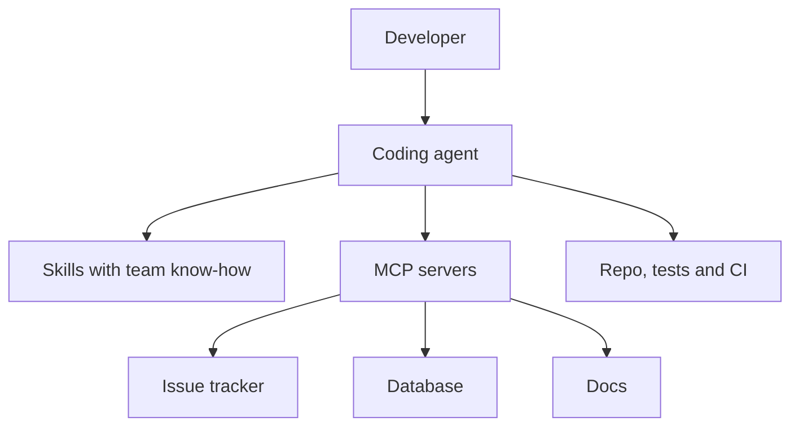

# Company-Wise Questions & What's New

[⬅ Back to index](../README.md)

Covers: how big tech, product companies, Indian companies and startups ask software engineers about AI; AI-allowed coding rounds; the most-asked AI questions for engineers; the trends worth knowing (coding agents, MCP and skills, long context and caching, on-device AI, AI features in apps); and talking about your own AI use.

> These come from commonly reported interview experiences and change often. Use them to prepare for the **style** of questions, not as a guaranteed list.

---

### 1. How do big tech companies ask software engineers about AI?

<details>
<summary>Answer</summary>

**In short:** For regular software engineers, AI usually shows up in four places: behavioral rounds ("How do you use AI tools, and how do you keep quality up?"), system design (an AI feature inside a familiar product, judged on latency, cost, privacy and failure handling), coding rounds (mostly classic, though some companies now allow or provide an AI assistant and watch how you work with it), and platform-specific questions for mobile roles (on-device vs cloud AI, streaming UIs, privacy). Ask your recruiter which formats you'll get.

#### Where AI shows up in the loop

| Round | Typical questions | What they're really checking |
|---|---|---|
| **Behavioral / hiring manager** | "How do you use AI tools in your work?" "Tell me about a time AI-generated code caused a problem." "How do you ensure quality when using AI?" | Judgement and ownership: you use AI productively but stay accountable for what ships |
| **System design** | Design a smart-reply or summarisation feature, an in-app assistant, AI-powered search, a support bot | Normal design skills plus AI-specific concerns: latency, cost per request, privacy, what happens when the model is wrong or down |
| **Coding** | Mostly classic problems; in some AI-allowed rounds you get an assistant | How you prompt, review and test AI output – not whether the AI can solve it |
| **Platform roles (Android/iOS)** | On-device vs cloud, streaming responses in the UI, handling privacy | Platform depth: e.g. Gemini Nano on Android, Apple's Foundation Models framework on iOS (see the Android and iOS repos) |

#### How to do well in each

- **Behavioral:** prepare two or three concrete stories – one where AI sped you up, one where it was wrong and how you caught it, and one about where you chose *not* to use it. Specifics (tool, task, how you verified, outcome) beat general enthusiasm.
- **System design:** treat the model as an unreliable, slow, paid dependency. Talk about streaming, timeouts and fallbacks, keys kept on the server, rate limits, caching, evals and guardrails. Interviewers like candidates who bring up failure modes before being asked.
- **AI-allowed coding:** narrate your process. Clarify the problem yourself, give the assistant a precise request, read every line it produces, run and test it, and fix what's wrong. Blindly pasting output is the fastest way to fail.
- **Platform roles:** know the trade-offs: on-device is private, offline-capable and free per call but limited in model size and device support; cloud is more capable but costs money, needs network and sends data off-device.

#### Pitfalls

- Claiming you "don't really use AI" – many teams now expect fluency; be honest but show informed use.
- Over-claiming ("AI writes all my code") without explaining how you verify it.
- In design rounds, putting the API key in the mobile app.

#### Likely follow-ups

- *What would you never delegate to AI?* Decisions you can't verify, security-sensitive code without careful review, and anything where you'd be unable to spot a mistake.
- *How do you handle the model being unavailable?* Timeouts, retries with backoff, a fallback (smaller model, cached result, or the non-AI flow), and a clear UI state.

</details>

### 2. How do Indian product companies ask engineers about AI?

<details>
<summary>Answer</summary>

**In short:** They usually ask about AI through their own product: how you'd add an AI feature to their app (search, support, catalogue, document handling) and how you use AI coding tools – alongside the normal DSA, design and platform rounds. The AI angle follows the business: e-commerce cares about search and multilingual queries, food and quick commerce about support bots that act through tools, fintech about strict guardrails and compliance, and SaaS startups about building AI features end to end at sensible cost.

#### Typical angles by company type

| Company type | Typical AI angle for engineers |
|---|---|
| **E-commerce (Flipkart, Meesho, Myntra)** | AI search and shopping assistants, review summaries, multilingual/transliterated queries, catalogue tools |
| **Food & quick commerce (Swiggy, Zomato, Zepto)** | Support bots that check orders and start refunds via tools, AI-generated menu/catalogue content |
| **Fintech (PhonePe, Paytm, Razorpay, CRED)** | Support assistants with strict guardrails, document (KYC) extraction, privacy and compliance |
| **SaaS & product startups** | Building AI features end to end, AI usage in the dev workflow, cost control |

Expect "how would you add an AI feature to our app?" design questions and "how do you use AI coding tools?" discussions, alongside the usual rounds.

#### What makes the Indian context different

- **Languages.** Users search and chat in Hindi, other Indian languages, transliterated text ("kurti under 500") and code-mixed Hinglish. Good answers mention per-language evals, multilingual embeddings and the extra token cost of Indic scripts (see [Scenario 10](21-scenario-based.md)).
- **Scale and cost.** Very high request volumes with low revenue per user mean cost per request matters a lot: routing to smaller models, caching, batch jobs for catalogue content, and doing simple cases without an LLM.
- **Devices and networks.** Many users are on mid-range Android phones and patchy networks – streaming, small payloads, graceful offline states and fallbacks matter.
- **Regulation and trust.** Fintech and anything handling personal data must think about data-protection law (such as India's DPDP Act), KYC data, and keeping money-moving actions behind real systems and user confirmation – the model should never decide a refund amount by itself.

#### A typical design question

"Design an AI assistant in our app that helps users with order issues." A strong answer covers:

1. Intent classification and which issues the bot may handle.
2. Tools against real systems (`getOrder`, `initiateRefund`) with authorisation enforced in code.
3. Grounding in policy documents, with citations and escalation to a human agent.
4. Languages, latency (streaming), cost per conversation.
5. Evals from real tickets and monitoring after launch.

#### Pitfalls

- Generic answers that ignore the company's actual product and users.
- Forgetting multilingual and low-end device realities.
- Letting the LLM directly perform financial actions without checks.

#### Likely follow-ups

- *How would you keep costs low at our scale?* Cheap model for most traffic, caching, precomputed content, and LLM calls only where they add clear value.
- *How would you evaluate a Hinglish search feature?* A labelled set of real code-mixed queries with expected results, measured per language.

</details>

### 3. What do startups and AI-native companies ask engineers?

<details>
<summary>Answer</summary>

**In short:** Often a practical build: add an AI feature to a small app or build a mini tool with an LLM API in a few hours, then discuss the trade-offs – prompt design, structured outputs, error handling, cost, and how you tested it. They expect you to use AI coding tools fluently, and they care that you ship quickly *and* verify carefully.

#### What the build usually looks like

Typical tasks (format varies by company):

- Add "summarise this" or "suggest a reply" to a small existing app.
- Build a tiny tool that extracts structured data from text or documents.
- Wire up a simple chat with one or two tools (e.g. look up a record, then answer).

You're usually free to use any AI assistant. The interviewers aren't checking whether you can make something appear – they're checking whether what you built is *sound*.

#### What they look for in the discussion

| Area | Strong answer |
|---|---|
| Prompt design | A clear system prompt, examples where useful, and why you chose them |
| Structured outputs | Schema-based output or tool calls, validated in code – not regex on free text |
| Error handling | Timeouts, retries, invalid output, model refusals, rate limits, empty input |
| Security | API key on the server or in env vars, not in the client; untrusted input handled |
| Cost and latency | Rough cost per request, model choice, streaming where it helps |
| Testing | A handful of test inputs including edge cases, and how you'd turn them into an eval set |
| Next steps | What you'd do with more time: evals, monitoring, caching, guardrails |

A small example of the kind of robustness they like to see (pseudocode-style Python):

```python
def extract_invoice(text: str) -> Invoice | None:
    for attempt in range(2):
        raw = llm.generate(prompt=EXTRACT_PROMPT.format(text=text), response_schema=Invoice)
        try:
            invoice = Invoice.model_validate_json(raw)       # validate, don't trust
            if invoice.total >= 0:
                return invoice
        except ValidationError:
            continue                                          # retry once on bad output
    return None                                               # caller shows manual-entry fallback
```

#### How to approach it

1. Get a simple end-to-end version working early.
2. Then harden: validation, errors, edge cases.
3. Keep a short list of what you tested and what you'd add – and say it out loud.

#### Pitfalls

- Spending the whole session polishing the UI while the AI part is fragile.
- Not being able to explain code the AI wrote for you.
- Ignoring cost – startups notice.

#### Likely follow-ups

- *How would you know if it works well in production?* Log inputs and outputs (with privacy in mind), collect feedback, build an eval set from real cases, and monitor quality and cost.
- *Why this model?* Quality on the task versus cost and latency – and you'd confirm with evals rather than intuition.

</details>

### 4. Which AI questions come up most for software engineers?

<details>
<summary>Answer</summary>

**In short:** The same fifteen or so questions come up again and again: how you use AI and verify it, how LLMs work (tokens, context, temperature, hallucinations), prompting, structured outputs, calling LLM APIs safely, tool use, MCP, RAG, workflows vs agents, AI coding assistants, evals, prompt injection, cost and latency, and designing an AI feature. If you can answer each in two or three confident sentences and go deeper on request, you're well prepared.

#### The list, with where to study each

1. How do you use AI in your work, and how do you verify its output? → [01](01-ai-interviews-overview.md), [03](03-ai-fluency.md)
2. What are tokens, context windows and temperature? Why do outputs vary? → [02](02-how-llms-work.md)
3. Why do LLMs hallucinate, and how do you reduce it? → [02](02-how-llms-work.md), [14](14-guardrails-safety.md)
4. How do you write a good prompt? → [04](04-prompt-engineering.md)
5. How do you get reliable JSON out of a model? → [06](06-structured-outputs.md)
6. How should an app call an LLM safely (keys, streaming, limits)? → [07](07-building-with-llm-apis.md)
7. What is tool use / function calling? → [08](08-tool-use.md)
8. What is MCP? → [09](09-mcp.md)
9. What is RAG, and when would you use it? → [10](10-rag-search.md)
10. What's the difference between a workflow and an agent? → [11](11-agents-workflows.md)
11. How do you use AI coding assistants effectively and safely? → [12](12-ai-coding-assistants.md)
12. How do you test or evaluate an AI feature? → [13](13-evals.md)
13. What is prompt injection, and how do you defend against it? → [14](14-guardrails-safety.md)
14. How do you control the cost and latency of an AI feature? → [15](15-efficiency-cost-latency.md)
15. Design an AI feature for an app. → [20](20-ai-system-design.md)

#### Quick one-line answers to rehearse

| Question | One-liner |
|---|---|
| Tokens / context window | Models read and write in tokens (word pieces); the context window is the maximum tokens per request, input plus output |
| Temperature | Controls randomness in picking the next token; lower is more consistent, higher more varied |
| Hallucination | The model generates plausible text without a source; reduce with grounding, citations, "I don't know" and verification |
| Structured outputs | Use schema-constrained output or tool calls, then validate in code |
| Tool use | The model asks to call a function you defined; your code runs it and returns the result |
| MCP | An open protocol for connecting AI apps to tools and data through standard servers |
| RAG | Retrieve relevant documents at question time and put them in the prompt so answers are current and citable |
| Workflow vs agent | Workflow: your code fixes the steps. Agent: the model decides the next step in a loop |
| Evals | Test sets plus scoring (code checks, LLM judges, humans) run on every change |
| Prompt injection | Instructions hidden in input that hijack the model; limit what tools can do and enforce rules in code |

#### How to use this list

- Practise saying each answer out loud in under 30 seconds, then the 2-minute version.
- For each, have one real example from your own work or a small project.
- Expect follow-ups that push on trade-offs ("when would you *not* use RAG?").

#### Pitfalls

- Memorising definitions without being able to apply them in a design question.
- Going straight to deep internals when the interviewer wanted a practical answer.

</details>

### 5. How should you talk about using AI tools in your own work?

<details>
<summary>Answer</summary>

**In short:** Be concrete and balanced: which tools you use, for which tasks, how you give them context (project instruction files, examples, plans), how you verify results (tests, review, docs), where you deliberately don't use them, and a measurable outcome. Show that AI makes you faster *and* that you stay accountable for quality – the 4D framework (Delegation, Description, Discernment, Diligence) is a good structure. See [AI Fluency](03-ai-fluency.md).

#### Why interviewers ask

Teams now expect engineers to use AI tools, but they've also seen AI-generated bugs, security issues and unreviewable pull requests. The question tests two things at once: are you *effective* with these tools, and do you have the *judgement* to use them responsibly?

#### A structure that works: the 4Ds

| D | What to say | Example |
|---|---|---|
| **Delegation** | What you hand to AI vs keep yourself | "Boilerplate, tests, migrations, exploring unfamiliar code – yes. Security-sensitive logic – I write and review it carefully myself." |
| **Description** | How you give it context | "We keep a project instruction file with architecture and conventions; I ask for a plan before code on anything non-trivial." |
| **Discernment** | How you judge the output | "I read every diff, run the tests, and check unfamiliar APIs against docs – it sometimes invents methods." |
| **Diligence** | Responsibility and ethics | "I don't paste secrets or customer data into tools; I own what I commit, regardless of who wrote it." |

#### Example answer (about 60 seconds)

> "I use a coding agent daily, mainly for three things: writing tests, refactors across many files, and getting up to speed in unfamiliar code. For anything bigger than a small fix I ask it for a plan first, review that, then let it implement in steps. Our repo has an instruction file with our conventions – for example, which dispatcher abstraction to use – and I add to it when the agent repeats a mistake. I review every change like a colleague's PR and run the tests locally. On a recent migration of about 40 screens to a new navigation API, that cut the work from roughly two weeks to four days. Where I don't use it: payment and auth code I write myself and get a second human review on."

Notice the ingredients: specific tools and tasks, context, verification, a boundary, and a number. Use your own real numbers – this one is only an illustration.

#### Pitfalls

- Vague claims ("AI makes me 10x more productive") with no example.
- Sounding dismissive or afraid of the tools – or uncritically enthusiastic.
- Naming confidential company details or code in your story.

#### Likely follow-ups

- *Tell me about a time it got something wrong.* Have a real story: what it got wrong, how you caught it, what you changed in your process.
- *How do you keep your own skills sharp?* Understand everything you ship, do hard parts yourself, and use AI to learn (asking it to explain) rather than just to produce.

</details>

### 6. What are the biggest AI trends software engineers should know about?

<details>
<summary>Answer</summary>

**In short:** Coding agents that work across whole codebases; MCP and skills for connecting AI to tools and team know-how; long context and prompt caching; adaptive thinking and effort controls; AI features inside every app, including agents that act through tools; on-device AI; and evals plus governance becoming standard engineering practice. Know what each is and why it matters to an app engineer, and check recent announcements before interviews because this moves fast.

#### The trends and why they matter to you

- **Coding agents** that read codebases, edit files, run tests and work for long periods in terminals, IDEs and CI. *Why it matters:* the job shifts toward specifying tasks well, giving good context, and reviewing and verifying – interviewers ask how you work with them.
- **MCP** – a standard way to connect AI tools to systems (issue trackers, databases, docs), and **skills** that package team know-how for agents. *Why it matters:* instead of a custom integration per AI tool, you build or reuse an MCP server once; skills let a team share instructions and scripts the agent loads when relevant.
- **Long context and prompt caching** – models handle very large inputs, and caching makes repeated context cheap. *Why it matters:* you can sometimes put a whole document in the prompt instead of building retrieval, and caching makes stable system prompts and documents much cheaper and faster on repeat calls.
- **Adaptive thinking and effort controls** – trading speed and cost against depth per request. *Why it matters:* deep reasoning for hard requests, fast responses for simple ones – a real cost and latency lever.
- **AI features inside every app** – assistants, summarisation, smart search, and agents that take actions through tools. *Why it matters:* "design an AI feature for our app" is now a common system-design question.
- **On-device AI** – small models on phones and laptops for private, offline features. *Why it matters:* for mobile engineers, on-device vs cloud is a core trade-off (privacy, cost, capability, device support).
- **Evaluation and governance** – teams treat evals like tests, and companies adopt AI policies (and regulation such as the EU AI Act). *Why it matters:* shipping AI responsibly means test sets in CI, monitoring, and knowing your company's rules on data and tools.

How several of these fit together in a modern dev setup:



#### How to talk about trends in an interview

Pick two or three you've actually used and give a concrete example, rather than listing everything. "We added an MCP server for our internal docs so the coding agent can look up API conventions" lands better than naming ten buzzwords.

Because this moves fast, check recent announcements from the major AI providers and your target company before interviews.

#### Pitfalls

- Quoting specific model names, prices or context sizes from memory that may be out of date – say "very large" unless you've checked.
- Treating every trend as hype, or every trend as magic; show balanced judgement.

#### Likely follow-ups

- *Long context or RAG?* Long context for a bounded set of documents per request; RAG when the corpus is large, changes often, or needs per-user access control – and cost often decides.
- *What's the difference between MCP and tool use?* Tool use is the model's ability to call functions; MCP is a standard protocol for exposing tools and data to any compatible AI app.

</details>

### 7. How should you prepare for AI questions at a specific company?

<details>
<summary>Answer</summary>

**In short:** Use the company's product and look for its AI features (or obvious places AI could help); read its engineering blog posts about AI; find out which AI tools its engineers use (job descriptions often say); and prepare one design answer for an AI feature in its product plus your personal "how I use AI" story. Ask the recruiter whether AI tools are allowed in the coding rounds.

#### A preparation checklist

| Step | What you get out of it |
|---|---|
| **Use the product** for real, as a customer | Where AI already exists, where it's missing, what users struggle with |
| **Read their engineering blog and talks** | How they think about AI, their stack, problems they've publicly discussed |
| **Read job descriptions** | Which AI tools they use (coding agents, specific providers), what they value |
| **Check recent announcements** | New AI features you can mention and ask about |
| **Ask the recruiter** | Interview formats, whether AI is allowed in coding rounds, any AI-focused round |
| **Prepare one design** | "How I'd add AI feature X to your product", end to end |
| **Prepare your AI story** | Concrete, honest examples of your own AI use (see Q5) |

#### Preparing the design answer

Pick something realistic for their product – for a food delivery app, "a support assistant that resolves late-order complaints"; for a fintech app, "explain this transaction and spot unusual charges". Prepare:

1. The user problem and success metric.
2. The flow: what the model does, which tools it calls, where humans or rules step in.
3. Grounding (RAG over their help content), structured outputs, guardrails.
4. Latency (streaming), cost per request at their scale, privacy and compliance.
5. How you'd evaluate it before launch and monitor it after.
6. Failure states in the UI.

Having thought about *their* product makes design rounds feel like a conversation instead of a generic exercise, and it signals genuine interest.

#### Questions to ask them

- "How does the team use AI coding tools today, and what guidelines do you have?"
- "How do you evaluate AI features before shipping?"
- "What's been hardest about running AI features in production here?"

#### Pitfalls

- Criticising their existing AI feature harshly – frame ideas as improvements.
- Assuming internal details ("you probably use X model") you can't know; say "if I were designing it".
- Skipping the recruiter question and being surprised by an AI-allowed coding round.

</details>

### 8. What should you do in the last week before the interview?

<details>
<summary>Answer</summary>

**In short:** Spend the week moving from knowing to doing: review the most-asked questions, make a few real API calls, use a coding agent on a real task, practise one AI feature design and a few scenarios out loud, polish your "how I use AI" story, and keep the last day light. Hands-on experience gives you the concrete details that make answers convincing.

#### A seven-day plan

| Day | Focus | Output by end of day |
|---|---|---|
| **1–2** | The most-asked list above and the README one-liners | You can answer each in 30 seconds and know where to go deeper |
| **3** | Make a few API calls yourself (chat, tool call, streaming) or build a tiny AI feature | A small working script or app you can describe |
| **4** | Use a coding agent on a real task and note what worked and what didn't | Two or three real observations for your story |
| **5** | One AI feature design out loud, plus scenarios ([topic 21](21-scenario-based.md)) | A design you can present in about 30 minutes |
| **6** | Your "how I use AI" story and behavioral examples | Two to three polished stories with outcomes |
| **7** | Light review and rest | Fresh for the interview |

#### Making each day count

- **Days 1–2:** Don't just read – close the page and answer out loud. Mark the questions you stumble on and revisit them.
- **Day 3:** Even a 30-line script that streams a response and calls one tool gives you real vocabulary: message roles, tool schemas, stop reasons, token usage, errors. Interviewers can tell who has actually built something.
- **Day 4:** Pick a real bug or small feature. Notice where the agent needed more context, what it got wrong, how you verified. These become honest, specific interview examples.
- **Day 5:** Use a fixed structure: requirements → flow diagram → model and prompt → tools and grounding → guardrails → latency and cost → evals and monitoring → failure states. Time yourself.
- **Day 6:** Write each story in situation–action–result form with a number in the result, then say it out loud until it fits in about two minutes.
- **Day 7:** Skim your notes, check any recent announcements from your target company, and rest.

#### Pitfalls

- Trying to learn ML theory or model training in the final week – it's rarely what software engineers are asked.
- Only reading, never practising aloud.
- Cramming new topics the night before instead of sleeping.

</details>

---

[⬅ Previous: Scenario-Based Questions](21-scenario-based.md) · [⬅ Back to index](../README.md)
